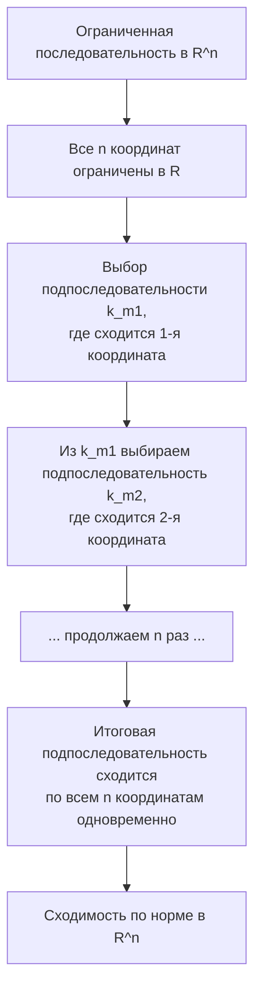

---
tags:
  - матанализ
  - 1_курс
  - подготовка_к_экзамену
тип: конспект
статус: готов
---

# Вопрос №43. Предел последовательности в $\mathbb{R}^n$. Сходимость и покоординатная сходимость.

> [!abstract] Геометрический смысл
> Пространство $\mathbb{R}^n$ представляет собой $n$-мерное евклидово пространство. Сходимость последовательности точек (векторов) означает, что с ростом номера $k$ точки последовательности $x_k$ бесконечно близко «стягиваются» к предельной точке $a$, попадая в любую наперед заданную $\varepsilon$-[[Окрестность|окрестность]] (открытый $n$-мерный шар) этой точки.

Для формализации понятий введем базовую метрику (евклидову [[Норма|норму]]). Пусть $x = (x^{(1)}, x^{(2)}, \dots, x^{(n)}) \in \mathbb{R}^n$. Евклидова норма вектора определяется как:
$$ \|x\| = \sqrt{\sum_{i=1}^{n} (x^{(i)})^2} $$

> [!definition] Предел последовательности в $\mathbb{R}^n$
> Точка $a \in \mathbb{R}^n$ называется пределом последовательности векторов $\{x_k\}_{k=1}^{\infty} \subset \mathbb{R}^n$, если для любого действительного числа $\varepsilon > 0$ существует такой натуральный номер $N \in \mathbb{N}$, что для всех $k > N$ выполняется неравенство:
> $$ \|x_k - a\| < \varepsilon $$
> Обозначение: $\lim_{k \to \infty} x_k = a$ или $x_k \to a$ при $k \to \infty$.

> [!definition] Покоординатная сходимость
> Говорят, что последовательность векторов $x_k = (x_k^{(1)}, \dots, x_k^{(n)})$ сходится к вектору $a = (a^{(1)}, \dots, a^{(n)})$ покоординатно, если для каждого фиксированного индекса $i \in \{1, 2, \dots, n\}$ числовая последовательность $\{x_k^{(i)}\}_{k=1}^{\infty}$ сходится к числу $a^{(i)}$ в $\mathbb{R}$:
> $$ \forall i \in \{1, \dots, n\} \quad \lim_{k \to \infty} x_k^{(i)} = a^{(i)} $$

> [!theorem] Критерий сходимости в $\mathbb{R}^n$ (Эквивалентность сходимости по норме и покоординатной сходимости)
> Последовательность векторов $\{x_k\}$ сходится к вектору $a$ в пространстве $\mathbb{R}^n$ (по норме) тогда и только тогда, когда она сходится к нему покоординатно.

> [!proof]+ Доказательство теоремы
> **Необходимость ($\Rightarrow$):**
> Пусть $x_k \to a$ по норме. Зафиксируем произвольное $\varepsilon > 0$. По определению предела существует $N \in \mathbb{N}$, такое что для всех $k > N$ верно $\|x_k - a\| < \varepsilon$. 
> Рассмотрим $i$-ю координату. Из свойств суммы квадратов неотрицательных чисел имеем:
> $$ (x_k^{(i)} - a^{(i)})^2 \le \sum_{j=1}^{n} (x_k^{(j)} - a^{(j)})^2 = \|x_k - a\|^2 $$
> Извлекая квадратный корень из обеих частей, получаем:
> $$ |x_k^{(i)} - a^{(i)}| \le \|x_k - a\| $$
> Следовательно, для выбранного $\varepsilon > 0$ и найденного $N$, при $k > N$ выполняется:
> $$ |x_k^{(i)} - a^{(i)}| \le \|x_k - a\| < \varepsilon $$
> Это в точности означает, что $\lim_{k \to \infty} x_k^{(i)} = a^{(i)}$ для любого $i \in \{1, \dots, n\}$.
> 
> **Достаточность ($\Leftarrow$):**
> Пусть последовательность сходится покоординатно. Это значит, что для каждого $i \in \{1, \dots, n\}$ выполняется $\lim_{k \to \infty} x_k^{(i)} = a^{(i)}$.
> Зафиксируем $\varepsilon > 0$. Рассмотрим число $\frac{\varepsilon}{\sqrt{n}} > 0$.
> По определению [[Предел функции|предела числовой последовательности]], для каждой координаты $i$ существует свой номер $N_i \in \mathbb{N}$, такой что для всех $k > N_i$ выполняется:
> $$ |x_k^{(i)} - a^{(i)}| < \frac{\varepsilon}{\sqrt{n}} $$
> Выберем общий номер $N = \max \{N_1, N_2, \dots, N_n\}$. Поскольку множество $\{N_i\}$ конечно, максимум существует. 
> Тогда для всех $k > N$ (что влечет $k > N_i$ для всех $i$) неравенство будет выполняться для *каждой* координаты одновременно. Оценим норму разности:
> $$ \|x_k - a\| = \sqrt{\sum_{i=1}^{n} (x_k^{(i)} - a^{(i)})^2} < \sqrt{\sum_{i=1}^{n} \left(\frac{\varepsilon}{\sqrt{n}}\right)^2} = \sqrt{n \cdot \frac{\varepsilon^2}{n}} = \sqrt{\varepsilon^2} = \varepsilon $$
> Таким образом, для любого $\varepsilon > 0$ найден номер $N$, начиная с которого $\|x_k - a\| < \varepsilon$. Сходимость по норме доказана. $\blacksquare$

> [!warning] Важное замечание
> Данная эквивалентность фундаментально опирается на *конечномерность* пространства $\mathbb{R}^n$. В бесконечномерных функциональных пространствах покоординатная (поточечная) сходимость **не влечет** за собой сходимость по норме (равномерную сходимость).

---

# Вопрос №44. Предел и арифметические операции. Предел подпоследовательности векторов.

> [!lemma] Сходимость влечет ограниченность в $\mathbb{R}^n$
> Если последовательность $\{x_k\} \subset \mathbb{R}^n$ сходится, то она ограничена (существует $M > 0$ такое, что $\forall k \in \mathbb{N}: \|x_k\| \le M$).

> [!proof]+ Доказательство леммы
> Пусть $x_k \to a$. Возьмем $\varepsilon = 1$. По определению предела существует $N$, такое что для $k > N$ верно $\|x_k - a\| < 1$. 
> По неравенству треугольника для нормы: $\|x_k\| - \|a\| \le \|x_k - a\| < 1 \implies \|x_k\| < 1 + \|a\|$ для $k > N$.
> Обозначим $M = \max \{\|x_1\|, \|x_2\|, \dots, \|x_N\|, 1 + \|a\|\}$. Максимум конечного числа элементов существует. Тогда для любого $k \in \mathbb{N}$ выполняется $\|x_k\| \le M$. $\blacksquare$

> [!theorem] Арифметические операции с пределами в $\mathbb{R}^n$
> Пусть последовательности $\{x_k\}$ и $\{y_k\}$ в $\mathbb{R}^n$ сходятся: $\lim_{k \to \infty} x_k = a$, $\lim_{k \to \infty} y_k = b$. Пусть также числовая последовательность $\{\lambda_k\} \subset \mathbb{R}$ сходится: $\lim_{k \to \infty} \lambda_k = \lambda$. Тогда:
> 1. $\lim_{k \to \infty} (x_k + y_k) = a + b$ (Предел суммы)
> 2. $\lim_{k \to \infty} (\lambda_k x_k) = \lambda a$ (Умножение на скаляр)
> 3. $\lim_{k \to \infty} (x_k, y_k) = (a, b)$ (Сходимость скалярного произведения)

> [!proof]+ Доказательство арифметических свойств
> **1. Предел суммы:**
> Зафиксируем $\varepsilon > 0$. Существуют $N_1$ и $N_2$, такие что:
> $\forall k > N_1 \implies \|x_k - a\| < \frac{\varepsilon}{2}$
> $\forall k > N_2 \implies \|y_k - b\| < \frac{\varepsilon}{2}$
> Положим $N = \max(N_1, N_2)$. Для всех $k > N$ применим неравенство треугольника:
> $$ \|(x_k + y_k) - (a + b)\| = \|(x_k - a) + (y_k - b)\| \le \|x_k - a\| + \|y_k - b\| < \frac{\varepsilon}{2} + \frac{\varepsilon}{2} = \varepsilon $$
> Сходимость суммы доказана.
> 
> **3. Сходимость скалярного произведения (Прием "добавим и вычтем" $+\pm$):**
> Рассмотрим разность $(x_k, y_k) - (a, b)$. Добавим и вычтем вектор $(a, y_k)$:
> $$ (x_k, y_k) - (a, b) = (x_k, y_k) - (a, y_k) + (a, y_k) - (a, b) = (x_k - a, y_k) + (a, y_k - b) $$
> Применим неравенство треугольника для модуля действительного числа:
> $$ |(x_k, y_k) - (a, b)| \le |(x_k - a, y_k)| + |(a, y_k - b)| $$
> Применим [[Неравенство Коши-Буняковского]]:
> $$ |(x_k, y_k) - (a, b)| \le \|x_k - a\| \cdot \|y_k\| + \|a\| \cdot \|y_k - b\| $$
> Так как $y_k$ сходится, по доказанной лемме она ограничена: существует $M > 0$, что $\|y_k\| \le M$ для всех $k$.
> Зафиксируем $\varepsilon > 0$. Так как $x_k \to a$ и $y_k \to b$, существуют номера $N_1, N_2$, такие что для соответствующих $k$:
> $\|x_k - a\| < \frac{\varepsilon}{2M}$ и $\|y_k - b\| < \frac{\varepsilon}{2(\|a\| + 1)}$ (единица в знаменателе исключает деление на ноль при $a=0$).
> Возьмем $N = \max(N_1, N_2)$. Для $k > N$:
> $$ |(x_k, y_k) - (a, b)| < \frac{\varepsilon}{2M} \cdot M + \|a\| \cdot \frac{\varepsilon}{2(\|a\| + 1)} < \frac{\varepsilon}{2} + \frac{\varepsilon}{2} = \varepsilon $$
> Предел скалярного произведения доказан. Умножение на скаляр (свойство 2) доказывается аналогично приемом $+\pm$. $\blacksquare$

> [!definition] Подпоследовательность
> Пусть дана последовательность $\{x_k\}_{k=1}^{\infty}$. Пусть $\{k_m\}_{m=1}^{\infty}$ — строго возрастающая последовательность натуральных чисел ($k_1 < k_2 < \dots < k_m < \dots$). Тогда последовательность $\{x_{k_m}\}_{m=1}^{\infty}$ называется подпоследовательностью последовательности $\{x_k\}$.
> *Замечание:* По методу математической индукции легко показать, что $k_m \ge m$ для любого $m \in \mathbb{N}$.

> [!theorem] О пределе подпоследовательности
> Если последовательность $\{x_k\} \subset \mathbb{R}^n$ сходится к пределу $a$, то любая её подпоследовательность $\{x_{k_m}\}$ также сходится к $a$.

> [!proof]+ Доказательство
> Зафиксируем $\varepsilon > 0$. Так как $\lim_{k \to \infty} x_k = a$, существует номер $N \in \mathbb{N}$, такой что для всех $k > N$ верно $\|x_k - a\| < \varepsilon$.
> Для подпоследовательности $\{x_{k_m}\}$ выберем номер $M = N$. Тогда для любого $m > M$, в силу строгого возрастания индексов, выполняется $k_m \ge m > M = N$.
> Поскольку $k_m > N$, то к элементу $x_{k_m}$ применимо условие сходимости исходной последовательности:
> $$ \|x_{k_m} - a\| < \varepsilon $$
> По определению это означает, что $\lim_{m \to \infty} x_{k_m} = a$. $\blacksquare$

---

# Вопрос №45. Ограниченность последовательности векторов в $\mathbb{R}^n$. Принцип выбора Больцано-Вейерштрасса.

> [!definition] Ограниченная последовательность
> Последовательность векторов $\{x_k\} \subset \mathbb{R}^n$ называется ограниченной, если существует такое действительное число $M > 0$, что для любого натурального $k$ выполняется неравенство:
> $$ \|x_k\| \le M $$
> *Геометрически:* Все элементы последовательности лежат внутри некоторого $n$-мерного шара радиуса $M$ с центром в начале координат.

> [!lemma] Эквивалентность ограниченности в норме и покоординатной ограниченности
> Последовательность $\{x_k\} \subset \mathbb{R}^n$ ограничена тогда и только тогда, когда для каждого $i \in \{1, \dots, n\}$ числовая последовательность координат $\{x_k^{(i)}\}$ ограничена в $\mathbb{R}$.

> [!proof]+ Доказательство леммы
> **($\Rightarrow$)** Пусть $\|x_k\| \le M$. Как было показано в Вопросе 43, $|x_k^{(i)}| \le \|x_k\|$. Отсюда $|x_k^{(i)}| \le M$ для всех $k$ и $i$. Координаты ограничены.
> **($\Leftarrow$)** Пусть существуют такие $M_i > 0$, что $|x_k^{(i)}| \le M_i$ для всех $k$. Положим $C = \max(M_1, \dots, M_n)$. Тогда $\|x_k\| = \sqrt{\sum (x_k^{(i)})^2} \le \sqrt{\sum C^2} = C\sqrt{n}$. Обозначив $M = C\sqrt{n}$, получаем ограниченность по норме. $\blacksquare$

> [!abstract] Логика принципа Больцано-Вейерштрасса
> Если бесконечное число точек поместить в ограниченный объем (коробку), они неизбежно начнут "кучковаться" (накапливаться) по крайней мере вокруг одной точки. Доказательство строится на последовательном "просеивании" индексов для каждой координаты.

> [!theorem] [[Теорема Больцано-Вейерштрасса]] в $\mathbb{R}^n$
> Из любой ограниченной последовательности векторов в пространстве $\mathbb{R}^n$ можно выделить сходящуюся подпоследовательность.

> [!proof]+ Строгое доказательство (Метод последовательного выделения)
> Пусть дана ограниченная последовательность векторов $x_k = (x_k^{(1)}, x_k^{(2)}, \dots, x_k^{(n)})$. По доказанной лемме, каждая последовательность координат $\{x_k^{(i)}\}_{k=1}^{\infty}$ ограничена в $\mathbb{R}$.
> 
> **Шаг 1:** Рассмотрим первую координату $\{x_k^{(1)}\}$. Она ограничена. По классической теореме Больцано-Вейерштрасса для действительных чисел (1 семестр), из нее можно выделить сходящуюся подпоследовательность.
> Обозначим множество индексов этой подпоследовательности как $\mathbb{N}_1 \subset \mathbb{N}$. Пусть эти индексы образуют возрастающую последовательность $k_{1,1} < k_{1,2} < k_{1,3} < \dots$.
> Для индексов из $\mathbb{N}_1$ последовательность первых координат сходится к некоторому числу $a^{(1)} \in \mathbb{R}$.
> 
> **Шаг 2:** Рассмотрим вторую координату векторов, но *только для индексов из множества* $\mathbb{N}_1$. То есть числовую последовательность $\{x_k^{(2)}\}_{k \in \mathbb{N}_1}$.
> Эта последовательность также ограничена. Снова применим одномерную теорему Больцано-Вейерштрасса. Выделим из $\mathbb{N}_1$ подмножество индексов $\mathbb{N}_2 \subset \mathbb{N}_1$ (образующее последовательность $k_{2,1} < k_{2,2} < \dots$), вдоль которого вторая координата сходится к $a^{(2)} \in \mathbb{R}$.
> *Важно:* Так как $\mathbb{N}_2 \subset \mathbb{N}_1$, то по теореме о пределе подпоследовательности (из Вопроса 44), первая координата по-прежнему сходится к $a^{(1)}$ вдоль индексов из $\mathbb{N}_2$.
> 
> **Шаг $j$ (до $n$):** Продолжая этот процесс по индукции $n$ раз, мы построим цепочку вложенных множеств индексов:
> $$ \mathbb{N} \supset \mathbb{N}_1 \supset \mathbb{N}_2 \supset \dots \supset \mathbb{N}_n $$
> Множество индексов $\mathbb{N}_n$ задает строго возрастающую последовательность натуральных чисел $m_1 < m_2 < m_3 < \dots$
> Вдоль этой итоговой последовательности индексов $\{m_p\}_{p=1}^{\infty}$ *каждая* координата $i \in \{1, \dots, n\}$ образует сходящуюся числовую последовательность:
> $$ \lim_{p \to \infty} x_{m_p}^{(i)} = a^{(i)} $$
> 
> Мы получили подпоследовательность векторов $\{x_{m_p}\}$, которая сходится покоординатно к вектору $a = (a^{(1)}, \dots, a^{(n)})$.
> По критерию сходимости в $\mathbb{R}^n$ (Теорема из Вопроса 43), покоординатная сходимость эквивалентна сходимости по норме. 
> Следовательно, подпоследовательность $\{x_{m_p}\}$ сходится к $a$ в пространстве $\mathbb{R}^n$. Теорема доказана. $\blacksquare$