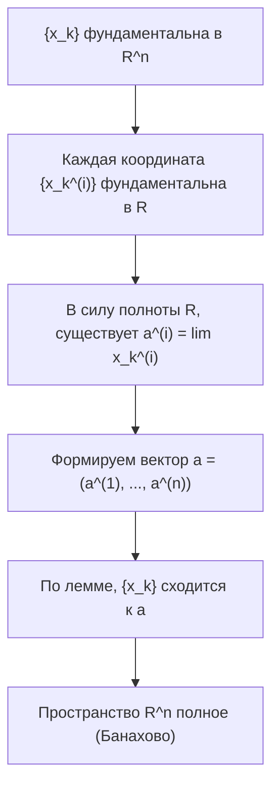

---
tags:
  - матанализ
  - 1_курс
  - подготовка_к_экзамену
тип: конспект
статус: готов
---

Приветствую. Я подготовил для вас исчерпывающий конспект. Математический анализ не терпит легкомыслия, поэтому каждое утверждение ниже строго формализовано, а доказательства проведены от начала и до конца без ссылок на «очевидность». Изучайте вдумчиво. 

Перед началом зафиксируем базовую нотацию для пространства $\mathbb{R}^n$:
Евклидова норма вектора $x = (x^{(1)}, x^{(2)}, \dots, x^{(n)}) \in \mathbb{R}^n$ определяется как $\|x\| = \sqrt{\sum_{i=1}^n (x^{(i)})^2}$. Расстояние между точками — это норма разности $\|x - y\|$.

---

# Вопрос №46. Критерий Больцано-Коши для последовательности векторов

> [!definition] Сходящаяся последовательность векторов
> Последовательность векторов $\{x_k\}_{k=1}^\infty \subset \mathbb{R}^n$ называется **сходящейся** к вектору $a \in \mathbb{R}^n$, если:
> $$ \forall \varepsilon > 0 \quad \exists N \in \mathbb{N} \quad \forall k \ge N \implies \|x_k - a\| < \varepsilon $$
> Обозначение: $\lim_{k \to \infty} x_k = a$.

> [!definition] Фундаментальная последовательность векторов
> Последовательность $\{x_k\}_{k=1}^\infty \subset \mathbb{R}^n$ называется **фундаментальной** (или последовательностью Коши), если:
> $$ \forall \varepsilon > 0 \quad \exists N \in \mathbb{N} \quad \forall k, m \ge N \implies \|x_k - x_m\| < \varepsilon $$

> [!lemma] Лемма о покоординатной сходимости и фундаментальности
> Пусть $x_k = (x_k^{(1)}, \dots, x_k^{(n)})$ — последовательность векторов. 
> 1. Векторная последовательность $\{x_k\}$ сходится к $a = (a^{(1)}, \dots, a^{(n)})$ тогда и только тогда, когда для каждого $i \in \{1, \dots, n\}$ числовая последовательность $\{x_k^{(i)}\}$ сходится к $a^{(i)}$.
> 2. Векторная последовательность $\{x_k\}$ фундаментальна тогда и только тогда, когда для каждого $i \in \{1, \dots, n\}$ числовая последовательность $\{x_k^{(i)}\}$ фундаментальна.

> [!proof]+ Доказательство леммы
> Доказательство опирается на фундаментальное неравенство, связывающее норму вектора и модули его координат:
> $$ |x^{(i)}| = \sqrt{(x^{(i)})^2} \le \sqrt{\sum_{j=1}^n (x^{(j)})^2} = \|x\| \le \sum_{j=1}^n |x^{(j)}| $$
> 
> **Пункт 1 (Сходимость):**
> $(\implies)$ Пусть $x_k \to a$. Зафиксируем $\varepsilon > 0$. Существует $N$, что при $k \ge N$ верно $\|x_k - a\| < \varepsilon$. Тогда для любой координаты $i$:
> $$ |x_k^{(i)} - a^{(i)}| \le \|x_k - a\| < \varepsilon $$
> Значит, $x_k^{(i)} \to a^{(i)}$.
> $(\impliedby)$ Пусть $x_k^{(i)} \to a^{(i)}$ для всех $i=1,\dots,n$. Для заданного $\varepsilon > 0$ найдем для каждой координаты $i$ номер $N_i$, такой что при $k \ge N_i$ выполнено $|x_k^{(i)} - a^{(i)}| < \frac{\varepsilon}{n}$. Положим $N = \max\{N_1, \dots, N_n\}$. Тогда для всех $k \ge N$:
> $$ \|x_k - a\| \le \sum_{i=1}^n |x_k^{(i)} - a^{(i)}| < \sum_{i=1}^n \frac{\varepsilon}{n} = \varepsilon $$
> 
> **Пункт 2 (Фундаментальность):**
> Доказывается абсолютно аналогично, заменой вектора $a$ на вектор $x_m$.

> [!theorem] Критерий Больцано-Коши для векторов
> Последовательность векторов $\{x_k\} \subset \mathbb{R}^n$ сходится тогда и только тогда, когда она является фундаментальной.

> [!proof]+ Доказательство теоремы
> **Необходимость $(\implies)$:** Пусть последовательность $\{x_k\}$ сходится к вектору $a$. Зададим $\varepsilon > 0$. По определению сходимости, существует $N \in \mathbb{N}$, такое что для всех $k \ge N$ выполняется $\|x_k - a\| < \frac{\varepsilon}{2}$. 
> Возьмем любые $k \ge N$ и $m \ge N$. Применим неравенство треугольника для нормы (которое выводится из неравенства Коши-Буняковского):
> $$ \|x_k - x_m\| = \|(x_k - a) + (a - x_m)\| \le \|x_k - a\| + \|x_m - a\| < \frac{\varepsilon}{2} + \frac{\varepsilon}{2} = \varepsilon $$
> Следовательно, последовательность фундаментальна.
> 
> **Достаточность $(\impliedby)$:** Пусть векторная последовательность $\{x_k\}$ фундаментальна. 
> В силу доказанной Леммы, для каждого фиксированного индекса $i \in \{1, \dots, n\}$ числовая последовательность координат $\{x_k^{(i)}\}_{k=1}^\infty$ является фундаментальной. 
> Пространство вещественных чисел $\mathbb{R}$ обладает свойством полноты. Согласно критерию Больцано-Коши для числовых последовательностей, каждая последовательность $\{x_k^{(i)}\}$ сходится к некоторому числу $a^{(i)} \in \mathbb{R}$.
> Сформируем вектор $a = (a^{(1)}, a^{(2)}, \dots, a^{(n)})$. Поскольку каждая координата $x_k^{(i)}$ сходится к $a^{(i)}$, по Лемме векторная последовательность $\{x_k\}$ сходится к вектору $a$. Ч.т.д.

> [!warning] Важное замечание
> Критерий Больцано-Коши опирается на полноту пространства. В пространстве рациональных векторов $\mathbb{Q}^n$ он **не работает**: можно построить фундаментальную последовательность, предел которой лежит в $\mathbb{R}^n \setminus \mathbb{Q}^n$.

---

# Вопрос №47. Предельная и изолированная точки множества. Характеристика предельных точек

Для начала введем понятие окрестности. $\varepsilon$-окрестностью точки $a \in \mathbb{R}^n$ называется открытый шар: $U_\varepsilon(a) = \{x \in \mathbb{R}^n \mid \|x - a\| < \varepsilon\}$. Проколотой окрестностью называется $\mathring{U}_\varepsilon(a) = U_\varepsilon(a) \setminus \{a\}$.

> [!definition] Изолированная точка множества
> Точка $a \in E \subset \mathbb{R}^n$ называется **изолированной точкой** множества $E$, если существует такая окрестность $U_\varepsilon(a)$, которая не содержит точек множества $E$, отличных от $a$:
> $$ \exists \varepsilon > 0 : \mathring{U}_\varepsilon(a) \cap E = \emptyset \quad \text{или} \quad U_\varepsilon(a) \cap E = \{a\} $$

> [!definition] Предельная точка множества
> Точка $a \in \mathbb{R}^n$ называется **[[Предел функции|предельной точкой]]** множества $E \subset \mathbb{R}^n$, если любая ее проколотая окрестность содержит хотя бы одну точку из $E$:
> $$ \forall \varepsilon > 0 \quad \mathring{U}_\varepsilon(a) \cap E \neq \emptyset $$
> Совокупность всех предельных точек множества $E$ называется его производным множеством и обозначается $E'$.

> [!warning] Важное замечание
> Изолированная точка **всегда** принадлежит множеству $E$. Предельная точка **может не принадлежать** множеству $E$ (например, $0$ для множества $E = (0, 1)$).

> [!abstract] Геометрический смысл
> Любая окрестность предельной точки "зацепляет" элементы множества. Окрестность изолированной точки можно "сжать" так, что в ней останется только сама эта точка.

> [!theorem] Эквивалентные определения (Характеристика) предельной точки
> Для множества $E \subset \mathbb{R}^n$ и точки $a \in \mathbb{R}^n$ следующие три утверждения эквивалентны:
> 1. Точка $a$ является предельной точкой множества $E$.
> 2. Любая окрестность $U_\varepsilon(a)$ содержит бесконечно много точек множества $E$.
> 3. Существует последовательность $\{x_k\}_{k=1}^\infty \subset E$, такая что $\forall k \in \mathbb{N} \quad x_k \neq a$, и $\lim_{k \to \infty} x_k = a$.

> [!proof]+ Доказательство теоремы
> Докажем по циклу: $(1) \implies (2) \implies (3) \implies (1)$.
> 
> **Шаг 1: $(1) \implies (2)$**
> Докажем от противного. Пусть $a$ — предельная точка, но существует $\varepsilon_0 > 0$, такая что окрестность $\mathring{U}_{\varepsilon_0}(a)$ содержит лишь конечное число точек множества $E$. Обозначим это конечное множество точек как $\{y_1, y_2, \dots, y_m\}$. 
> Поскольку $y_i \neq a$ для всех $i$, расстояния $\|y_i - a\| > 0$.
> Рассмотрим набор положительных чисел $\{\|y_1 - a\|, \|y_2 - a\|, \dots, \|y_m - a\|\}$. Так как множество конечно, оно достигает своего минимума.
> Положим $r = \min_{1 \le i \le m} \|y_i - a\|$. Очевидно, $r > 0$.
> Рассмотрим новую окрестность $\mathring{U}_{r}(a)$. По построению, для любого $x \in \mathring{U}_{r}(a)$ расстояние $\|x - a\| < r \le \|y_i - a\|$. Значит, ни одна из точек $y_i$ не попадает в $\mathring{U}_{r}(a)$. 
> Следовательно, $\mathring{U}_{r}(a) \cap E = \emptyset$. Это прямо противоречит определению предельной точки (утверждению 1). Противоречие получено, значит точек бесконечно много.
> 
> **Шаг 2: $(2) \implies (3)$**
> По условию (2), в любой окрестности бесконечно много точек из $E$. Построим искомую последовательность конструктивно.
> Возьмем $\varepsilon_1 = 1$. В $\mathring{U}_{1}(a)$ есть точки из $E$; выберем любую и назовем ее $x_1$. 
> Далее для любого $k \ge 2$ положим $\varepsilon_k = \min\left\{\frac{1}{k}, \|x_{k-1} - a\|\right\}$.
> В проколотой окрестности $\mathring{U}_{\varepsilon_k}(a)$ снова бесконечно много точек из $E$. Выберем любую из них и назовем $x_k$.
> По построению, $x_k \neq a$ и $\|x_k - a\| < \frac{1}{k}$. 
> Для любого заданного $\varepsilon > 0$, выбрав $N > \frac{1}{\varepsilon}$ (по аксиоме Архимеда), для всех $k \ge N$ получим $\|x_k - a\| < \frac{1}{k} \le \frac{1}{N} < \varepsilon$. Значит, $\lim_{k \to \infty} x_k = a$.
> 
> **Шаг 3: $(3) \implies (1)$**
> Пусть существует последовательность $\{x_k\} \subset E \setminus \{a\}$, сходящаяся к $a$. 
> Зададим произвольное $\varepsilon > 0$. По определению предела последовательности, существует номер $N$, такой что для всех $k \ge N$ выполняется $\|x_k - a\| < \varepsilon$. 
> Следовательно, точка $x_N$ принадлежит шару $U_\varepsilon(a)$. Так как по условию $x_N \neq a$ и $x_N \in E$, то $x_N \in \mathring{U}_\varepsilon(a) \cap E$. 
> Значит, пересечение $\mathring{U}_\varepsilon(a) \cap E$ не пусто для любого $\varepsilon > 0$. Точка $a$ — предельная. Ч.т.д.

---

# Вопрос №48. Открытые, замкнутые и компактные множества в $\mathbb{R}^n$. Характеристика замкнутых множеств. Операции над открытыми и замкнутыми множествами

Введем классификацию точек относительно множества. Точка $a$ называется **внутренней** для $E$, если $\exists \varepsilon > 0 : U_\varepsilon(a) \subset E$.

> [!definition] Открытые и замкнутые множества
> *   Множество $G \subset \mathbb{R}^n$ называется **открытым**, если все его точки являются внутренними.
> *   Множество $F \subset \mathbb{R}^n$ называется **замкнутым**, если оно содержит все свои предельные точки ($F' \subset F$).

> [!lemma] О связи открытых и замкнутых множеств (через дополнение)
> Множество $F \subset \mathbb{R}^n$ замкнуто тогда и только тогда, когда его дополнение $\complement F = \mathbb{R}^n \setminus F$ открыто.

> [!proof]+ Доказательство леммы
> $(\implies)$ Пусть $F$ замкнуто. Покажем, что любая точка $x \in \complement F$ является внутренней для $\complement F$. 
> Предположим противное: существует $x \in \complement F$, не являющаяся внутренней точкой $\complement F$. Значит, ни одна окрестность $U_\varepsilon(x)$ не лежит целиком в $\complement F$. 
> Это означает, что $\forall \varepsilon > 0 \quad U_\varepsilon(x) \cap F \neq \emptyset$. Поскольку $x \notin F$, то $x$ не совпадает ни с одной точкой из $F$. Значит, $\forall \varepsilon > 0 \quad \mathring{U}_\varepsilon(x) \cap F \neq \emptyset$.
> Следовательно, $x$ — предельная точка множества $F$. Так как $F$ замкнуто, оно должно содержать все свои предельные точки, то есть $x \in F$. Но мы брали $x \in \complement F$. Противоречие. Значит, $\complement F$ открыто.
>
> $(\impliedby)$ Пусть $\complement F$ открыто. Докажем, что $F$ замкнуто. 
> Пусть $x$ — произвольная предельная точка $F$. Если предположить, что $x \notin F$, то $x \in \complement F$. 
> Поскольку $\complement F$ открыто, $x$ является внутренней точкой для $\complement F$, то есть $\exists \varepsilon > 0 : U_\varepsilon(x) \subset \complement F$. 
> Это означает, что $U_\varepsilon(x) \cap F = \emptyset$. Но это противоречит тому, что $x$ — предельная точка $F$ (в любой ее окрестности должны быть точки из $F$). 
> Значит, предположение неверно, и $x \in F$. $F$ содержит все свои предельные точки, следовательно, оно замкнуто. Ч.т.д.

> [!theorem] Характеристика замкнутых множеств
> Для множества $F \subset \mathbb{R}^n$ следующие утверждения эквивалентны:
> 1. $F$ замкнуто (содержит все свои предельные точки).
> 2. Дополнение $\mathbb{R}^n \setminus F$ открыто.
> 3. (Секвенциальный критерий): Если последовательность $\{x_k\}_{k=1}^\infty \subset F$ сходится к $a \in \mathbb{R}^n$, то предел $a \in F$.

*Доказательство эквивалентности (1) и (2) дано в лемме выше. Эквивалентность с (3) напрямую следует из теоремы о характеристике предельных точек (Вопрос 47).*

### Операции над множествами

> [!theorem] Свойства открытых и замкнутых множеств при операциях
> 1. **Для открытых множеств:**
>    - Объединение **любого** (конечного или бесконечного) числа открытых множеств открыто.
>    - Пересечение **конечного** числа открытых множеств открыто.
> 2. **Для замкнутых множеств:**
>    - Пересечение **любого** числа замкнутых множеств замкнуто.
>    - Объединение **конечного** числа замкнутых множеств замкнуто.

> [!proof]+ Строгое доказательство операций
> **Пункт 1.1 (Произвольное объединение открытых):** 
> Пусть $G_\alpha$ — открытые множества, $\alpha \in A$ (индексное множество любой мощности). Обозначим $G = \bigcup_{\alpha \in A} G_\alpha$.
> Возьмем $x \in G$. По определению объединения, $\exists \alpha_0 \in A : x \in G_{\alpha_0}$.
> Так как $G_{\alpha_0}$ открыто, $\exists \varepsilon > 0 : U_\varepsilon(x) \subset G_{\alpha_0}$.
> Поскольку $G_{\alpha_0} \subset G$, получаем $U_\varepsilon(x) \subset G$. Точка $x$ внутренняя, значит $G$ открыто.
> 
> **Пункт 1.2 (Конечное пересечение открытых):**
> Пусть $G_1, G_2$ — открытые множества. Обозначим $G = G_1 \cap G_2$.
> Возьмем $x \in G$. Значит $x \in G_1$ и $x \in G_2$.
> Т.к. $G_1, G_2$ открыты, $\exists r_1 > 0 : U_{r_1}(x) \subset G_1$ и $\exists r_2 > 0 : U_{r_2}(x) \subset G_2$.
> Выберем $r = \min(r_1, r_2)$. Очевидно, $r > 0$.
> Тогда $U_r(x) \subset U_{r_1}(x) \subset G_1$ и $U_r(x) \subset U_{r_2}(x) \subset G_2$. 
> Отсюда $U_r(x) \subset G_1 \cap G_2 = G$. Множество открыто. (По индукции обобщается на любое конечное число).
> 
> **Пункт 2 (Замкнутые множества):**
> Доказывается через Законы де Моргана и доказанную лемму. 
> Пусть $F_\alpha$ — замкнутые множества. Тогда $\complement F_\alpha$ — открытые.
> - Пересечение $\bigcap F_\alpha$: его дополнение $\complement \left( \bigcap F_\alpha \right) = \bigcup (\complement F_\alpha)$. Это произвольное объединение открытых, значит оно открыто. По лемме, $\bigcap F_\alpha$ замкнуто.
> - Конечное объединение $\bigcup_{i=1}^m F_i$: его дополнение $\complement \left( \bigcup_{i=1}^m F_i \right) = \bigcap_{i=1}^m (\complement F_i)$. Это конечное пересечение открытых, значит открыто. По лемме, само объединение замкнуто.

> [!warning] Важное замечание (Контрпримеры)
> Бесконечное пересечение открытых множеств может **не быть** открытым: $\bigcap_{k=1}^\infty \left(-\frac{1}{k}, \frac{1}{k}\right) = \{0\}$ — не открыто.
> Бесконечное объединение замкнутых множеств может **не быть** замкнутым: $\bigcup_{k=3}^\infty \left[\frac{1}{k}, 1-\frac{1}{k}\right] = (0, 1)$ — не замкнуто.

### Компактные множества в $\mathbb{R}^n$

Существует два равносильных (в $\mathbb{R}^n$) подхода к определению компакта: через открытые покрытия (топологическое) и через последовательности (секвенциальное).

> [!definition] Компактное множество (через покрытия)
> Множество $K \subset \mathbb{R}^n$ называется **компактным**, если из любого его покрытия открытыми множествами можно выделить конечное подпокрытие. 
> Формально: если $K \subset \bigcup_{\alpha \in A} G_\alpha$, где $G_\alpha$ открыты, то $\exists \alpha_1, \dots, \alpha_m \in A$, такие что $K \subset \bigcup_{i=1}^m G_{\alpha_i}$.

> [!theorem] Теорема Гейне — Бореля (Характеристика компактов в $\mathbb{R}^n$)
> Множество $K \subset \mathbb{R}^n$ компактно тогда и только тогда, когда оно **ограничено и замкнуто**.
> *(Следствие: Компактность эквивалентна секвенциальной компактности: любая последовательность точек из $K$ содержит подпоследовательность, сходящуюся к точке из $K$ — по [[Теорема Больцано-Вейерштрасса|теореме Больцано-Вейерштрасса]] и замкнутости).*

