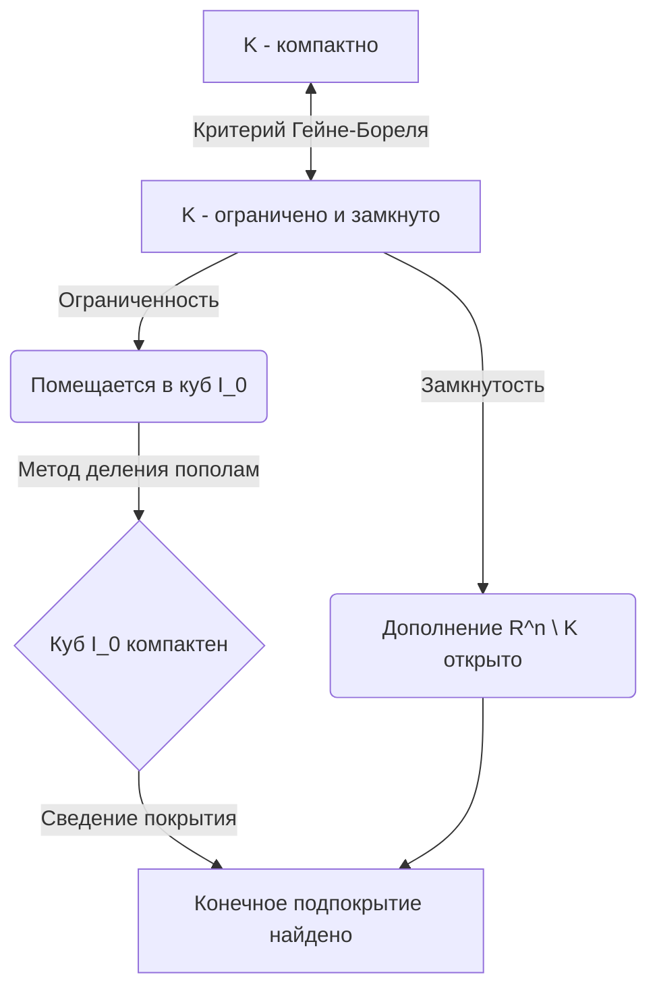

---
tags:
  - матанализ
  - 1_курс
  - подготовка_к_экзамену
тип: конспект
статус: готов
---

# Вопрос №49. Примеры открытых и замкнутых множеств в $\mathbb{R}^n$.

> [!abstract] Геометрический смысл
> Пространство $\mathbb{R}^n$ — это множество упорядоченных наборов из $n$ вещественных чисел $x = (x_1, x_2, \dots, x_n)$ со стандартной евклидовой метрикой:
> $$ \rho(x, y) = \sqrt{\sum_{i=1}^n (x_i - y_i)^2} $$
> Открытое множество геометрически представляет собой область «без краев» (границы), тогда как замкнутое множество содержит всю свою границу.

> [!definition] Основные топологические определения
> 1. **$\varepsilon$-окрестностью** точки $a \in \mathbb{R}^n$ называется множество $B_\varepsilon(a) = \{ x \in \mathbb{R}^n \mid \rho(x, a) < \varepsilon \}$.
> 2. Точка $x \in A$ называется **внутренней точкой** множества $A$, если $\exists \varepsilon > 0 : B_\varepsilon(x) \subset A$.
> 3. Множество $A$ называется **[[Открытое множество|открытым]]**, если каждая его точка является внутренней.
> 4. Точка $x_0 \in \mathbb{R}^n$ называется **[[Предельная точка|предельной точкой]]** множества $A$, если $\forall \varepsilon > 0$ пересечение $(B_\varepsilon(x_0) \setminus \{x_0\}) \cap A \neq \emptyset$.
> 5. Множество $F$ называется **[[Замкнутое множество|замкнутым]]**, если оно содержит все свои предельные точки.

> [!lemma] Примеры открытых множеств
> 6. **Открытый шар** $B_R(a) = \{ x \in \mathbb{R}^n \mid \rho(x, a) < R \}$ является открытым множеством.
> 7. **Открытое полупространство** $H = \{ x \in \mathbb{R}^n \mid x_1 > 0 \}$.
> 8. **Само пространство** $\mathbb{R}^n$ и **пустое множество** $\emptyset$.

> [!proof]+ Доказательство открытости открытого шара
> Пусть $A = B_R(a)$. Возьмем произвольную точку $x \in A$. По определению шара, $\rho(x, a) < R$.
> Определим число $\varepsilon = R - \rho(x, a)$. Заметим, что строго $\varepsilon > 0$.
> Докажем, что $B_\varepsilon(x) \subset A$. 
> Пусть $y \in B_\varepsilon(x)$, тогда $\rho(y, x) < \varepsilon$. 
> По неравенству треугольника для метрики $\rho$:
> $$ \rho(y, a) \le \rho(y, x) + \rho(x, a) < \varepsilon + \rho(x, a) $$
> Подставим определение $\varepsilon$:
> $$ \rho(y, a) < (R - \rho(x, a)) + \rho(x, a) = R $$
> Следовательно, $y \in B_R(a) = A$. Мы показали, что $\forall x \in A \implies \exists \varepsilon > 0 : B_\varepsilon(x) \subset A$. Значит, $A$ — открыто.

> [!lemma] Примеры замкнутых множеств
> 9. **Замкнутый шар** $\bar{B}_R(a) = \{ x \in \mathbb{R}^n \mid \rho(x, a) \le R \}$.
> 10. **Одноточечное множество** $\{ a \}$ для любого $a \in \mathbb{R}^n$.
> 11. **Само пространство** $\mathbb{R}^n$ и **пустое множество** $\emptyset$.

> [!proof]+ Доказательство замкнутости одноточечного множества
> Пусть $F = \{ a \}$. Докажем, что множество предельных точек $F'$ пусто. 
> Предположим от противного, что $\exists x_0 \in \mathbb{R}^n$, являющаяся предельной точкой $\{ a \}$.
> По определению предельной точки, $\forall \varepsilon > 0$ окрестность $B_\varepsilon(x_0)$ содержит бесконечно много точек множества (или хотя бы одну, отличную от $x_0$). 
> Однако в $F$ всего одна точка $a$. Следовательно, чтобы $x_0$ была предельной, необходимо, чтобы при любом $\varepsilon > 0$ выполнялось $a \in B_\varepsilon(x_0)$ и $a \neq x_0$.
> Если $a \neq x_0$, то $\rho(a, x_0) = d > 0$. Возьмем $\varepsilon = \frac{d}{2} > 0$. 
> Тогда $\rho(a, x_0) = d > \varepsilon$, что означает $a \notin B_\varepsilon(x_0)$. Противоречие.
> Значит, множество предельных точек пусто: $F' = \emptyset$. Условие $F' \subset F$ (содержание всех своих предельных точек) выполняется тривиально ($\emptyset \subset \{a\}$). Множество замкнуто.

> [!warning] Важное замечание
> Существуют множества, которые **не являются ни открытыми, ни замкнутыми**. Классический пример в $\mathbb{R}^1$: полуинтервал $[0, 1)$. Он не открыт (точка $0$ не входит с окрестностью) и не замкнут (предельная точка $1$ не принадлежит множеству). Единственные множества в $\mathbb{R}^n$, которые одновременно и открыты, и замкнуты — это $\emptyset$ и $\mathbb{R}^n$ (в силу связности $\mathbb{R}^n$).

---

# Вопрос №50. Замыкание множеств в $\mathbb{R}^n$. Характеристика замыкания множества. Внутренность и граница множеств в $\mathbb{R}^n$.

> [!definition] Замыкание, внутренность, граница
> Пусть $A \subset \mathbb{R}^n$.
> 1. **[[Замыкание]]** множества $A$ (обозначается $[A]$ или $\overline{A}$) — это объединение множества $A$ с множеством всех его предельных точек: $\overline{A} = A \cup A'$.
> 2. **Внутренность** множества $A$ (обозначается $A^\circ$ или $\operatorname{int} A$) — это множество всех внутренних точек $A$.
> 3. Точка $x \in \mathbb{R}^n$ называется **граничной точкой** множества $A$, если $\forall \varepsilon > 0$ в $B_\varepsilon(x)$ содержатся как точки из $A$, так и точки из $\mathbb{R}^n \setminus A$. Множество всех граничных точек называется **границей** и обозначается $\partial A$.

> [!theorem] Характеристика замыкания множества
> Точка $x \in \overline{A}$ тогда и только тогда, когда любая ее $\varepsilon$-окрестность имеет непустое пересечение с $A$:
> $$ x \in \overline{A} \iff \forall \varepsilon > 0 \quad B_\varepsilon(x) \cap A \neq \emptyset $$

> [!proof]+ Доказательство характеристики замыкания
> **Необходимость ($\implies$):** Пусть $x \in \overline{A}$. По определению, $x \in A$ или $x \in A'$.
> * Случай 1: $x \in A$. Тогда $\forall \varepsilon > 0$, очевидно, $x \in B_\varepsilon(x) \cap A$, значит пересечение не пусто.
> * Случай 2: $x \in A'$ ($x$ — предельная точка). По определению предельной точки $\forall \varepsilon > 0$ пересечение $(B_\varepsilon(x) \setminus \{x\}) \cap A \neq \emptyset$. Отсюда следует, что и подавно $B_\varepsilon(x) \cap A \neq \emptyset$.
> 
> **Достаточность ($\impliedby$):** Пусть $\forall \varepsilon > 0$ выполняется $B_\varepsilon(x) \cap A \neq \emptyset$. 
> Нужно доказать, что $x \in \overline{A}$. Предположим, что $x \notin A$. Тогда докажем, что $x \in A'$.
> Так как $x \notin A$, то любая точка $y$, принадлежащая пересечению $B_\varepsilon(x) \cap A$, заведомо не равна $x$ ($y \neq x$).
> Значит, в любой $\varepsilon$-окрестности точки $x$ содержится точка из $A$, отличная от $x$. 
> По определению это означает, что $x$ — предельная точка $A$, то есть $x \in A'$. Следовательно, $x \in A \cup A' = \overline{A}$. Ч.т.д.

> [!theorem] Свойства внутренности и границы
> 1. $A^\circ$ является наибольшим открытым множеством, содержащимся в $A$.
> 2. $\overline{A}$ является наименьшим замкнутым множеством, содержащим $A$.
> 3. $\partial A = \overline{A} \setminus A^\circ = \overline{A} \cap \overline{(\mathbb{R}^n \setminus A)}$. Граница всегда замкнута.

> [!proof]+ Доказательство связи границы, замыкания и внутренности ($\partial A = \overline{A} \setminus A^\circ$)
> Докажем равенство двух множеств через двойное включение.
> 
> **Шаг 1: $\partial A \subset \overline{A} \setminus A^\circ$.**
> Пусть $x \in \partial A$. По определению границы, $\forall \varepsilon > 0$ выполняется:
> 4) $B_\varepsilon(x) \cap A \neq \emptyset$
> 5) $B_\varepsilon(x) \cap (\mathbb{R}^n \setminus A) \neq \emptyset$
> Из (1) по Характеристике замыкания следует, что $x \in \overline{A}$.
> Из (2) следует, что ни при каком $\varepsilon > 0$ окрестность $B_\varepsilon(x)$ не может лежать целиком в $A$. Значит, $x$ не является внутренней точкой, то есть $x \notin A^\circ$.
> Следовательно, $x \in \overline{A} \setminus A^\circ$.
> 
> **Шаг 2: $\overline{A} \setminus A^\circ \subset \partial A$.**
> Пусть $x \in \overline{A} \setminus A^\circ$. 
> Так как $x \in \overline{A}$, то $\forall \varepsilon > 0$ $B_\varepsilon(x) \cap A \neq \emptyset$.
> Так как $x \notin A^\circ$, точка $x$ не является внутренней. Значит, $\forall \varepsilon > 0$ окрестность $B_\varepsilon(x)$ не содержится целиком в $A$. Это эквивалентно тому, что $\forall \varepsilon > 0$ $B_\varepsilon(x) \cap (\mathbb{R}^n \setminus A) \neq \emptyset$.
> Сопоставляя эти два факта, получаем в точности определение граничной точки. Значит, $x \in \partial A$.
> Равенство множеств доказано.

```mermaid
venn
title Структура множества в R^n
"Замыкание (A bar)" : 1
"Множество A" : 2
"Внутренность (A°)" : 3
"Граница (∂A)" : 4
```
*(Схематично: $A^\circ \subset A \subset \overline{A}$, причем $\overline{A}$ является объединением $A^\circ$ и $\partial A$.)*

> [!warning] Важное замечание
> Граница множества может быть "парадоксально" большой. Рассмотрим множество рациональных чисел $\mathbb{Q}$ в $\mathbb{R}^1$. 
> Любая окрестность любой вещественной точки содержит как рациональные, так и иррациональные числа. 
> Поэтому $\mathbb{Q}^\circ = \emptyset$, $\overline{\mathbb{Q}} = \mathbb{R}$, а $\partial \mathbb{Q} = \mathbb{R}$.

---

# Вопрос №51. Открытые и замкнутые подмножества. Покрытие множества и компактность. Критерий компактности в $\mathbb{R}^n$.

> [!definition] Покрытие и Компактность
> 1. Семейство множеств $\{U_\alpha\}_{\alpha \in I}$ называется **[[Открытое покрытие|открытым покрытием]]** множества $K \subset \mathbb{R}^n$, если все $U_\alpha$ открыты и $K \subset \bigcup_{\alpha \in I} U_\alpha$.
> 2. Подмножество $\{U_{\alpha_k}\}_{k=1}^m$ называется **конечным подпокрытием**, если оно состоит из конечного числа элементов и по-прежнему покрывает $K$.
> 3. Множество $K \subset \mathbb{R}^n$ называется **[[Компактное множество|компактным]]**, если из *любого* его открытого покрытия можно выделить конечное подпокрытие (определение Гейне-Бореля-Лебега).

> [!lemma] Лемма о вложенных параллелепипедах в $\mathbb{R}^n$
> Если $I_1 \supset I_2 \supset \dots \supset I_k \supset \dots$ — последовательность вложенных замкнутых $n$-мерных промежутков (параллелепипедов) вида $I_k = [a_1^{(k)}, b_1^{(k)}] \times \dots \times [a_n^{(k)}, b_n^{(k)}]$, причем длина их диагонали стремится к нулю при $k \to \infty$, то существует единственная точка $c \in \mathbb{R}^n$, принадлежащая всем промежуткам: $\bigcap_{k=1}^\infty I_k = \{ c \}$.
> *(Лемма строго доказывается применением [[Теорема Кантора о вложенных отрезках|Теоремы Кантора]] покоординатно и использованием критерия Коши сходимости последовательности).*

> [!theorem] Критерий компактности в $\mathbb{R}^n$ (Теорема Гейне — Бореля)
> Множество $K \subset \mathbb{R}^n$ является компактным тогда и только тогда, когда оно **замкнуто и ограничено**.

> [!proof]+ Доказательство (Необходимость: Компактность $\implies$ Ограниченность и Замкнутость)
> Пусть $K$ — компакт.
> **1. Докажем ограниченность:** 
> Рассмотрим семейство открытых шаров с центром в начале координат $\{ B_m(0) \}_{m=1}^\infty$. Очевидно, что $\mathbb{R}^n = \bigcup_{m=1}^\infty B_m(0)$, поэтому это семейство образует открытое покрытие множества $K$.
> Так как $K$ — компакт, существует конечное подпокрытие $B_{m_1}(0), B_{m_2}(0), \dots, B_{m_s}(0)$. 
> Пусть $M = \max(m_1, \dots, m_s)$. Тогда $K \subset B_M(0)$. Следовательно, $K$ ограничено.
> 
> **2. Докажем замкнутость:**
> Докажем, что дополнение $\mathbb{R}^n \setminus K$ открыто. 
> Пусть $y \notin K$. Для любой точки $x \in K$ выполнено $x \neq y$. Построим непересекающиеся окрестности: пусть $\rho(x, y) = d_x > 0$. Определим $U_x = B_{d_x/2}(x)$ и $V_x = B_{d_x/2}(y)$. Заметим, что $U_x \cap V_x = \emptyset$.
> Семейство $\{ U_x \}_{x \in K}$ является открытым покрытием компакта $K$.
> Выделим конечное подпокрытие: $K \subset U_{x_1} \cup \dots \cup U_{x_p}$.
> Рассмотрим пересечение соответствующих окрестностей точки $y$: $V = V_{x_1} \cap \dots \cap V_{x_p}$. 
> Так как это пересечение конечного числа открытых шаров, $V$ является открытой окрестностью точки $y$.
> При этом $V$ не пересекается ни с одним из $U_{x_i}$, а значит, $V \cap K = \emptyset$. Следовательно, $V \subset \mathbb{R}^n \setminus K$. 
> Мы показали, что любая точка $y \notin K$ входит в дополнение вместе со своей окрестностью. Значит, $\mathbb{R}^n \setminus K$ открыто, а $K$ — замкнуто.

> [!proof]+ Доказательство (Достаточность: Ограниченность и Замкнутость $\implies$ Компактность)
> Пусть $K$ замкнуто и ограничено.
> 
> **Шаг 1: Компактность $n$-мерного промежутка.**
> Так как $K$ ограничено, оно помещается в некоторый замкнутый $n$-мерный промежуток $I_0 = [-L, L]^n$. Докажем сначала, что $I_0$ — компакт.
> Предположим противное: существует открытое покрытие $\{ U_\alpha \}$, из которого нельзя выделить конечное подпокрытие для $I_0$.
> Разделим $I_0$ пополам по каждой координате. Получим $2^n$ замкнутых промежутков. Хотя бы один из них (назовем его $I_1$) нельзя покрыть конечным числом множеств из $\{ U_\alpha \}$ (иначе мы покрыли бы весь $I_0$ конечным числом).
> Повторяя процедуру деления для $I_1$, получим $I_2$, и так далее. 
> Получаем последовательность вложенных промежутков $I_0 \supset I_1 \supset I_2 \supset \dots$, ни один из которых не допускает конечного подпокрытия. 
> Диаметр $k$-го промежутка равен $\operatorname{diam}(I_k) = \frac{\operatorname{diam}(I_0)}{2^k} \xrightarrow{k \to \infty} 0$.
> По Лемме о вложенных параллелепипедах, $\exists! c \in \bigcap_{k=0}^\infty I_k$.
> Так как $c \in I_0$, точка $c$ покрывается некоторым множеством $U_{\alpha_0}$ из нашего покрытия.
> Поскольку $U_{\alpha_0}$ открыто, существует $\varepsilon > 0$ такое, что $B_\varepsilon(c) \subset U_{\alpha_0}$.
> Но так как $\operatorname{diam}(I_k) \to 0$ и $c \in I_k$, найдется номер $N$, при котором $\operatorname{diam}(I_N) < \varepsilon$. Тогда $I_N \subset B_\varepsilon(c) \subset U_{\alpha_0}$.
> Это означает, что $I_N$ покрывается *всего одним* множеством из покрытия. Мы пришли к противоречию с тем, что $I_N$ нельзя покрыть конечным числом множеств. Значит, $I_0$ — компакт.
> 
> **Шаг 2: Компактность $K$.**
> Пусть $K \subset I_0$ — замкнутое подмножество. Рассмотрим произвольное открытое покрытие $\{ U_\alpha \}$ множества $K$.
> Добавим к этому покрытию множество $V = \mathbb{R}^n \setminus K$, которое открыто, так как $K$ замкнуто.
> Теперь семейство $\{ U_\alpha \} \cup \{ V \}$ является открытым покрытием всего промежутка $I_0$.
> Так как $I_0$ компактно, из этого покрытия можно выделить конечное: $U_{\alpha_1}, U_{\alpha_2}, \dots, U_{\alpha_m}$ и, возможно, $V$.
> Поскольку $V$ не содержит ни одной точки из $K$, исходное множество $K$ полностью покрывается набором $U_{\alpha_1}, \dots, U_{\alpha_m}$. 
> Конечное подпокрытие найдено! $K$ — компактно. Ч.т.д.



> [!warning] Важное замечание
> Критерий Гейне-Бореля справедлив **только в конечномерных пространствах** ($\mathbb{R}^n$). В бесконечномерных пространствах (например, в пространстве непрерывных функций $C[a,b]$ со строгой метрикой $\sup$) замкнутый единичный шар является замкнутым и ограниченным, но **не является компактным**.