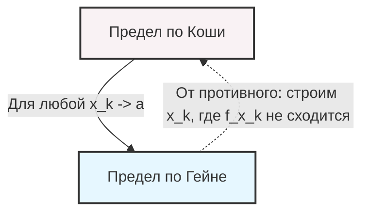

---
tags:
  - матанализ
  - 1_курс
  - подготовка_к_экзамену
тип: конспект
статус: готов
---

# Вопрос №52. Предел отображения нескольких переменных (по Коши и по Гейне). Эквивалентность двух определений предела.

> [!abstract] Вводные замечания
> Пусть дано [[Отображение]] $f: X \to \mathbb{R}^m$, где $X \subset \mathbb{R}^n$. Векторы в $\mathbb{R}^n$ и $\mathbb{R}^m$ будем обозначать как $x = (x_1, \dots, x_n)$ и $y = (y_1, \dots, y_m)$. Расстояние между точками задается стандартной евклидовой нормой: $\|x\| = \sqrt{x_1^2 + \dots + x_n^2}$.
> Пусть точка $a \in \mathbb{R}^n$ является [[Предельная точка|предельной точкой]] множества $X$. Это означает, что в любой ее проколотой окрестности $\mathring{U}_\delta(a) = \{x \in \mathbb{R}^n : 0 < \|x - a\| < \delta\}$ содержатся точки из $X$.

> [!definition] Определение предела по Коши (на языке $\varepsilon - \delta$)
> Вектор $A \in \mathbb{R}^m$ называется пределом отображения $f(x)$ при $x \to a$, если:
> $$\forall \varepsilon > 0 \quad \exists \delta > 0 \quad \forall x \in X \quad \left( 0 < \|x - a\| < \delta \implies \|f(x) - A\| < \varepsilon \right)$$
> Обозначение: $\lim\limits_{x \to a} f(x) = A$.

> [!definition] Определение предела по Гейне (на языке последовательностей)
> Вектор $A \in \mathbb{R}^m$ называется пределом отображения $f(x)$ при $x \to a$, если для любой последовательности $\{x_k\}_{k=1}^\infty \subset X$, удовлетворяющей условиям:
> 1. $\forall k \in \mathbb{N} \quad x_k \neq a$
> 2. $\lim\limits_{k \to \infty} x_k = a$
> 
> Выполняется: $\lim\limits_{k \to \infty} f(x_k) = A$.

> [!theorem] Теорема (Эквивалентность определений Коши и Гейне)
> Вектор $A$ является пределом отображения $f(x)$ при $x \to a$ по Коши тогда и только тогда, когда он является пределом по Гейне.

> [!proof]+ Доказательство
> **Необходимость (Коши $\implies$ Гейне):**
> Пусть $\lim_{x\to a} f(x) = A$ по Коши. Зафиксируем произвольное $\varepsilon > 0$. Согласно определению по Коши, существует $\delta > 0$ такое, что для всех $x \in X$, удовлетворяющих $0 < \|x - a\| < \delta$, верно $\|f(x) - A\| < \varepsilon$.
> 
> Возьмем произвольную последовательность $\{x_k\} \subset X \setminus \{a\}$, сходящуюся к $a$. По определению предела последовательности, для найденного $\delta > 0$ существует номер $N \in \mathbb{N}$ такой, что:
> $$\forall k > N \implies \|x_k - a\| < \delta$$
> Поскольку все $x_k \neq a$, мы имеем $0 < \|x_k - a\| < \delta$. Тогда, согласно выбору $\delta$, для тех же $k > N$ выполняется:
> $$\|f(x_k) - A\| < \varepsilon$$
> Это в точности означает, что последовательность векторов $\{f(x_k)\}$ сходится к $A$. Необходимость доказана.
> 
> **Достаточность (Гейне $\implies$ Коши):**
> Докажем методом от противного. Предположим, что $A$ есть предел по Гейне, но не является пределом по Коши. Построим отрицание определения по Коши:
> $$\exists \varepsilon_0 > 0 \quad \forall \delta > 0 \quad \exists x_\delta \in X \quad \left( 0 < \|x_\delta - a\| < \delta \land \|f(x_\delta) - A\| \ge \varepsilon_0 \right)$$
> Поскольку это верно для любого $\delta > 0$, рассмотрим последовательность $\delta_k = \frac{1}{k}$, где $k \in \mathbb{N}$. Для каждого $k$ выберем соответствующую точку $x_k \in X$:
> $$0 < \|x_k - a\| < \frac{1}{k} \quad \text{и} \quad \|f(x_k) - A\| \ge \varepsilon_0$$
> Из левого неравенства по теореме о двух милиционерах (или из определения предела) следует, что $\lim_{k \to \infty} x_k = a$. При этом все $x_k \neq a$. 
> Таким образом, построена последовательность $\{x_k\}$, удовлетворяющая условиям определения Гейне. Однако $\|f(x_k) - A\| \ge \varepsilon_0 > 0$ для всех $k$, что означает, что последовательность $\{f(x_k)\}$ **не может** сходиться к $A$.
> Мы получили противоречие с тем, что $A$ — предел по Гейне. Достаточность доказана.

---

# Вопрос №53. Единственность предела отображения нескольких переменных. Предел и покоординатный предел.

> [!theorem] Теорема 1 (Единственность предела)
> Если отображение $f: X \to \mathbb{R}^m$ имеет предел при $x \to a$, то этот предел единственен.

> [!proof]+ Доказательство
> Проведем доказательство от противного. Пусть существуют два различных предела $A, B \in \mathbb{R}^m$, причем $A \neq B$. Тогда $\|A - B\| > 0$.
> Выберем $\varepsilon = \frac{\|A - B\|}{2} > 0$. 
> По определению предела (по Коши), для данного $\varepsilon$ существуют $\delta_1 > 0$ и $\delta_2 > 0$ такие, что для всех $x \in X$:
> $$0 < \|x - a\| < \delta_1 \implies \|f(x) - A\| < \varepsilon$$
> $$0 < \|x - a\| < \delta_2 \implies \|f(x) - B\| < \varepsilon$$
> Положим $\delta = \min(\delta_1, \delta_2) > 0$. Так как $a$ — предельная точка, существует $x \in X$ такое, что $0 < \|x - a\| < \delta$. Для этого $x$ выполняются оба неравенства.
> Оценим расстояние между $A$ и $B$, применяя неравенство треугольника (добавляя и вычитая $f(x)$):
> $$\|A - B\| = \|A - f(x) + f(x) - B\| \le \|A - f(x)\| + \|f(x) - B\| < \varepsilon + \varepsilon = 2\varepsilon$$
> Подставляя $\varepsilon = \frac{\|A - B\|}{2}$, получаем:
> $$\|A - B\| < 2 \cdot \frac{\|A - B\|}{2} = \|A - B\|$$
> Получено строгое неравенство $\|A - B\| < \|A - B\|$, что является противоречием. Следовательно, предел единственен.

> [!lemma] Вспомогательное неравенство для координат
> Для любого вектора $y = (y_1, \dots, y_m) \in \mathbb{R}^m$ выполняются неравенства:
> $$\forall i \in \{1,\dots,m\}: \quad |y_i| \le \|y\| \le \sum_{j=1}^m |y_j| \le \sqrt{m} \max_{1 \le j \le m} |y_j|$$

> [!theorem] Теорема 2 (Связь предела с покоординатными пределами)
> Пусть $f(x) = (f_1(x), f_2(x), \dots, f_m(x))$, где $f_i: X \to \mathbb{R}$ — координатные функции. Вектор $A = (A_1, \dots, A_m)$ является пределом $f(x)$ при $x \to a$ тогда и только тогда, когда $\lim_{x\to a} f_i(x) = A_i$ для каждого $i = 1, \dots, m$.

> [!proof]+ Доказательство
> **Необходимость ($\implies$):**
> Дано: $\forall \varepsilon > 0 \exists \delta > 0 \forall x \in \mathring{U}_\delta(a) \cap X \implies \|f(x) - A\| < \varepsilon$.
> Рассмотрим $i$-ю координату. Используя лемму, имеем:
> $$|f_i(x) - A_i| \le \|f(x) - A\| < \varepsilon$$
> Таким образом, для того же $\delta$ выполняется определение предела для функции $f_i(x)$. Следовательно, $\lim_{x\to a} f_i(x) = A_i$.
> 
> **Достаточность ($\impliedby$):**
> Дано: $\forall i \in \{1,\dots,m\}$, $\lim_{x\to a} f_i(x) = A_i$.
> Зафиксируем $\varepsilon > 0$. По определению предела для каждой $f_i(x)$ существует $\delta_i > 0$ такое, что:
> $$\forall x \in \mathring{U}_{\delta_i}(a) \cap X \implies |f_i(x) - A_i| < \frac{\varepsilon}{\sqrt{m}}$$
> Выберем $\delta = \min\{\delta_1, \dots, \delta_m\} > 0$. Тогда для всех $x \in \mathring{U}_\delta(a) \cap X$ выполняются сразу все $m$ неравенств. Оценим норму разности векторов:
> $$\|f(x) - A\| = \sqrt{\sum_{i=1}^m (f_i(x) - A_i)^2} < \sqrt{\sum_{i=1}^m \left(\frac{\varepsilon}{\sqrt{m}}\right)^2} = \sqrt{m \cdot \frac{\varepsilon^2}{m}} = \varepsilon$$
> Следовательно, $\lim_{x\to a} f(x) = A$. Теорема доказана.

> [!warning] Важное замечание: Кратный предел $\neq$ Повторный предел
> Теорема утверждает, что предел вектор-функции равносилен пределам ее скалярных компонент (одновременное стремление переменных). Это **не** имеет отношения к повторным пределам.
> Например, функция $f(x, y) = \frac{xy}{x^2 + y^2}$. 
> Повторные пределы: $\lim_{x\to 0}(\lim_{y\to 0} f(x,y)) = 0$ и $\lim_{y\to 0}(\lim_{x\to 0} f(x,y)) = 0$.
> Однако предел как отображения $\lim_{(x,y) \to (0,0)} f(x,y)$ **не существует** (при $y = kx$ предел зависит от $k$).

---

# Вопрос №54. Предел отображения нескольких переменных и арифметические операции. Предел композиции. Критерий Больцано-Коши для отображений.

### 1. Арифметические операции

> [!theorem] Теорема об арифметических операциях
> Пусть $f, g: X \to \mathbb{R}^m$, и существуют пределы $\lim_{x\to a} f(x) = A$, $\lim_{x\to a} g(x) = B$. Пусть также $\varphi: X \to \mathbb{R}$ — скалярная функция, и $\lim_{x\to a} \varphi(x) = C$. Тогда:
> 1. $\lim_{x\to a} (f(x) \pm g(x)) = A \pm B$
> 2. $\lim_{x\to a} (\varphi(x) f(x)) = CA$ (умножение на скалярную функцию)
> 3. $\lim_{x\to a} \langle f(x), g(x) \rangle = \langle A, B \rangle$ (скалярное произведение)

> [!proof]+ Доказательство (на примере суммы, прием $\varepsilon/2$)
> Зафиксируем $\varepsilon > 0$. 
> Т.к. $\lim_{x\to a} f(x) = A$, существует $\delta_1 > 0$ такое, что $\forall x \in \mathring{U}_{\delta_1}(a) \cap X \implies \|f(x) - A\| < \frac{\varepsilon}{2}$.
> Т.к. $\lim_{x\to a} g(x) = B$, существует $\delta_2 > 0$ такое, что $\forall x \in \mathring{U}_{\delta_2}(a) \cap X \implies \|g(x) - B\| < \frac{\varepsilon}{2}$.
> Положим $\delta = \min(\delta_1, \delta_2) > 0$. Для любого $x \in \mathring{U}_\delta(a) \cap X$ применим неравенство треугольника (добавим и вычтем слагаемые корректно):
> $$\|(f(x) + g(x)) - (A + B)\| = \|(f(x) - A) + (g(x) - B)\| \le \|f(x) - A\| + \|g(x) - B\|$$
> Подставляя оценки:
> $$\|f(x) - A\| + \|g(x) - B\| < \frac{\varepsilon}{2} + \frac{\varepsilon}{2} = \varepsilon$$
> Утверждение для суммы доказано. Остальные свойства элементарно доказываются переходом к покоординатным пределам (опираясь на Теорему 2 из билета №53) и применением свойств пределов для функций одной переменной.

### 2. Предел композиции

> [!theorem] Теорема о пределе сложной функции (композиции)
> Пусть заданы отображения $f: X \to Y$ ($X \subset \mathbb{R}^n, Y \subset \mathbb{R}^m$) и $g: Y \to \mathbb{R}^k$.
> Пусть выполняются условия:
> 1. $\lim_{x\to a} f(x) = b$
> 2. $\lim_{y\to b} g(y) = C$
> 3. Выполнено **хотя бы одно** из условий регулярности:
>    - $\exists \delta_0 > 0 : \forall x \in \mathring{U}_{\delta_0}(a) \cap X \implies f(x) \neq b$ (функция не принимает предельное значение в проколотой окрестности)
>    - Отображение $g$ определено в точке $b$ и $g(b) = C$ (непрерывность внешней функции).
>    
> Тогда $\lim_{x\to a} g(f(x)) = C$.

> [!proof]+ Доказательство (через определение по Гейне)
> Воспользуемся определением по Гейне. Возьмем произвольную последовательность $\{x_p\} \subset X \setminus \{a\}$, такую что $\lim_{p\to\infty} x_p = a$.
> Так как $\lim_{x\to a} f(x) = b$, по определению Гейне для функции $f$, последовательность $y_p = f(x_p)$ сходится к $b$: $\lim_{p\to\infty} y_p = b$.
> 
> Нам нужно показать, что $\lim_{p\to\infty} g(y_p) = C$. Мы могли бы сразу сослаться на предел $g(y)$ при $y\to b$, но определение Гейне для $g$ требует, чтобы $y_p \neq b$. Здесь вступает в силу условие (3).
> - Если выполнено первое условие из (3), то начиная с некоторого номера $P$, все $x_p \in \mathring{U}_{\delta_0}(a)$, следовательно, $y_p = f(x_p) \neq b$. Тогда мы можем применить определение Гейне для $g$, и $g(y_p) \to C$.
> - Если выполнено второе условие ($g(b) = C$), то если для каких-то элементов $y_p = b$, значение $g(y_p) = g(b) = C$, что не нарушает сходимости последовательности к $C$. Для тех подпоследовательностей, где $y_p \neq b$, предел равен $C$ по Гейне для $g$.
> 
> В любом случае $\lim_{p\to\infty} g(f(x_p)) = C$. По эквивалентности Коши и Гейне, теорема доказана.

### 3. Критерий Больцано-Коши

> [!definition] Фундаментальность отображения
> Отображение $f: X \to \mathbb{R}^m$ удовлетворяет условию Коши при $x \to a$, если:
> $$\forall \varepsilon > 0 \quad \exists \delta > 0 \quad \forall x', x'' \in \mathring{U}_\delta(a) \cap X \implies \|f(x') - f(x'')\| < \varepsilon$$

> [!theorem] Критерий Больцано-Коши для отображений
> Отображение $f: X \to \mathbb{R}^m$ имеет конечный предел при $x \to a$ тогда и только тогда, когда оно удовлетворяет условию Коши.

> [!proof]+ Доказательство
> **Необходимость ($\implies$):**
> Пусть $\lim_{x\to a} f(x) = A$. Зафиксируем $\varepsilon > 0$. По определению предела, существует $\delta > 0$ такое, что для любого $x \in \mathring{U}_\delta(a) \cap X$ верно $\|f(x) - A\| < \frac{\varepsilon}{2}$.
> Возьмем любые $x', x'' \in \mathring{U}_\delta(a) \cap X$. Применим прием $+\pm A$ и неравенство треугольника:
> $$\|f(x') - f(x'')\| = \|(f(x') - A) + (A - f(x''))\| \le \|f(x') - A\| + \|f(x'') - A\| < \frac{\varepsilon}{2} + \frac{\varepsilon}{2} = \varepsilon$$
> Необходимость доказана.
> 
> **Достаточность ($\impliedby$):**
> Пусть $f(x)$ удовлетворяет условию Коши. Возьмем любую последовательность $\{x_k\} \subset X \setminus \{a\}$, $x_k \to a$.
> Зафиксируем $\varepsilon > 0$. Найдем $\delta > 0$ из условия Коши для отображения. Так как $x_k \to a$, существует $N \in \mathbb{N}$, что $\forall p, q > N$ элементы $x_p, x_q \in \mathring{U}_\delta(a) \cap X$.
> Тогда из условия Коши следует, что $\|f(x_p) - f(x_q)\| < \varepsilon$. Это означает, что последовательность векторов $\{f(x_k)\}$ является [[Фундаментальная последовательность|фундаментальной]] в $\mathbb{R}^m$.
> Поскольку пространство $\mathbb{R}^m$ полно (по теореме Больцано-Вейерштрасса для каждой координаты), любая фундаментальная последовательность сходится. Пусть $\lim_{k\to\infty} f(x_k) = A$.
> 
> Осталось показать, что $A$ не зависит от выбора последовательности. Возьмем другую последовательность $z_k \to a$. Пусть $f(z_k) \to B$. 
> Смешаем их: $x_1, z_1, x_2, z_2, \dots$ Эта новая последовательность также сходится к $a$. По доказанному выше, последовательность образов фундаментальна и должна сходиться к единому пределу. Следовательно, подпоследовательности $f(x_k)$ и $f(z_k)$ должны сходиться к одному пределу, откуда $A = B$.
> По определению Гейне $\lim_{x\to a} f(x) = A$. Достаточность доказана.