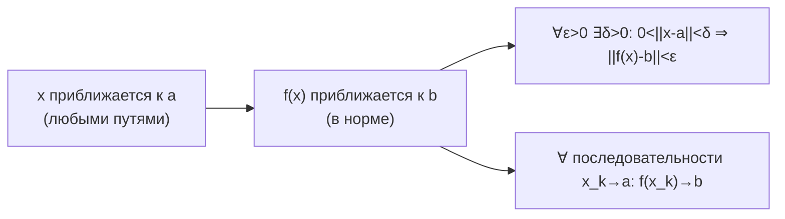
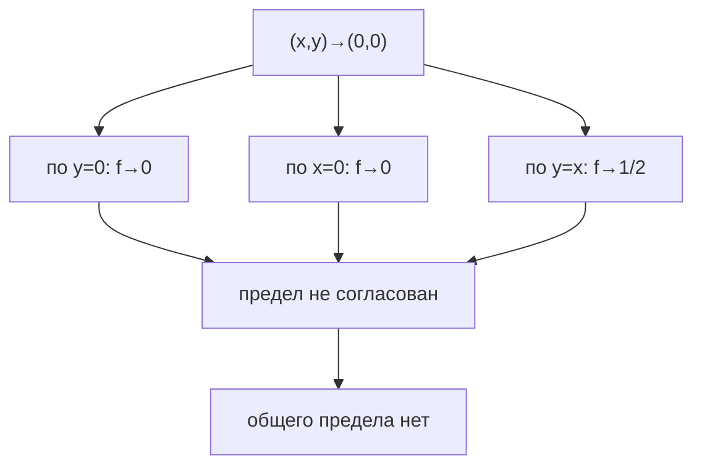

---
tags:
  - матанализ
  - 1_курс
  - подготовка_к_экзамену
тип: конспект
статус: готов
---

# Вопрос №52. Предел отображения нескольких переменных (по Коши и по Гейне). Эквивалентность двух определений предела

> [!definition] Окрестности и проколотые окрестности в $\mathbb{R}^n$
> Пусть $a\in\mathbb{R}^n$, $r>0$. **Открытым шаром** (окрестностью) радиуса $r$ называется
> $$B_r(a)=\{x\in\mathbb{R}^n:\ \|x-a\|<r\}.$$
> **Проколотая окрестность**:
> $$\dot B_r(a)=B_r(a)\setminus\{a\}.$$
> Если $D\subset\mathbb{R}^n$, то $a$ — **предельная точка** множества $D$, если
> $$\forall r>0\ \ (\dot B_r(a)\cap D\neq\varnothing).$$

> [!definition] [[Предел отображения нескольких переменных]] (по Коши, $\varepsilon$–$\delta$)
> Пусть $D\subset\mathbb{R}^n$, $a$ — предельная точка $D$, и задано отображение $f:D\to\mathbb{R}^m$.
> Говорят, что **существует предел** $f(x)$ при $x\to a$ и он равен $b\in\mathbb{R}^m$, и пишут
> $$\lim_{x\to a} f(x)=b,$$
> если
> $$\forall\varepsilon>0\ \exists\delta>0\ \forall x\in D:\ (0<\|x-a\|<\delta)\ \Rightarrow\ \|f(x)-b\|<\varepsilon.$$

> [!definition] [[Предел отображения нескольких переменных]] (по Гейне, через последовательности)
> Пусть $D\subset\mathbb{R}^n$, $a$ — предельная точка $D$, $f:D\to\mathbb{R}^m$.
> Говорят, что
> $$\lim_{x\to a} f(x)=b,$$
> если для **любой** последовательности $\{x_k\}\subset D\setminus\{a\}$ такой, что $x_k\to a$ при $k\to\infty$,
> выполняется
> $$f(x_k)\to b \quad (k\to\infty).$$

> [!abstract] Геометрический / Физический смысл
> Предел $f(x)\to b$ при $x\to a$ означает: при приближении точки $x$ к $a$ **любыми способами** (по любым траекториям/последовательностям) значения $f(x)$ попадают в любой заранее заданный шар $B_\varepsilon(b)$, начиная с некоторой проколотой окрестности точки $a$.

> [!theorem] Эквивалентность определений предела (Коши ⇔ Гейне)
> Пусть $D\subset\mathbb{R}^n$, $a$ — предельная точка $D$, $f:D\to\mathbb{R}^m$, $b\in\mathbb{R}^m$.
> Тогда следующие утверждения эквивалентны:
> 1) $\lim\limits_{x\to a} f(x)=b$ по Коши (в $\varepsilon$–$\delta$ смысле);
> 2) $\lim\limits_{x\to a} f(x)=b$ по Гейне (по последовательностям).

> [!proof]+ Доказательство
> **(1 ⇒ 2).** Предположим, что выполнено определение по Коши. Возьмём произвольную последовательность $\{x_k\}\subset D\setminus\{a\}$, $x_k\to a$.
> 
> Нужно доказать: $f(x_k)\to b$, то есть
> $$\forall\varepsilon>0\ \exists K\ \forall k\ge K:\ \|f(x_k)-b\|<\varepsilon.$$
> 
> Пусть $\varepsilon>0$. По определению Коши существует $\delta>0$ такое, что из $0<\|x-a\|<\delta$ и $x\in D$ следует $\|f(x)-b\|<\varepsilon$.
> 
> Так как $x_k\to a$, то по определению предела последовательности существует $K$ такое, что при $k\ge K$ имеем
> $$\|x_k-a\|<\delta.$$
> При этом $x_k\ne a$, следовательно $0<\|x_k-a\|<\delta$, и значит
> $$\|f(x_k)-b\|<\varepsilon \quad \text{для всех } k\ge K.$$
> Это и означает $f(x_k)\to b$.
> 
> **(2 ⇒ 1).** Предположим, что верно определение по Гейне. Докажем определение по Коши от противного.
> 
> Пусть определение Коши неверно. Тогда существует $\varepsilon_0>0$ такое, что
> $$\forall\delta>0\ \exists x\in D:\ (0<\|x-a\|<\delta)\ \text{и}\ \|f(x)-b\|\ge \varepsilon_0.$$
> 
> Положим $\delta=\frac1k$ для $k\in\mathbb{N}$. Тогда для каждого $k$ найдётся $x_k\in D$ такое, что
> $$0<\|x_k-a\|<\frac1k,\qquad \|f(x_k)-b\|\ge\varepsilon_0.$$
> Из $\|x_k-a\|<\frac1k$ следует $x_k\to a$.
> Но тогда по условию Гейне должно быть $f(x_k)\to b$, то есть $\|f(x_k)-b\|\to 0$, что невозможно при $\|f(x_k)-b\|\ge\varepsilon_0$ для всех $k$.
> Получили противоречие. Следовательно, определение Коши верно.

> [!warning] Важное замечание
> В определении предела существенно, что $a$ является **предельной точкой** множества $D$: иначе можно получить «предел» из пустых условий (если в проколотой окрестности нет точек области определения).

---

# Вопрос №53. Единственность предела отображения нескольких переменных. Предел и покоординатный предел

> [!theorem] Единственность предела отображения
> Пусть $D\subset\mathbb{R}^n$, $a$ — предельная точка $D$, $f:D\to\mathbb{R}^m$.
> Если существуют пределы
> $$\lim_{x\to a} f(x)=b,\qquad \lim_{x\to a} f(x)=c,$$
> то $b=c$.

> [!proof]+ Доказательство
> Предположим, что $b\ne c$. Тогда $\|b-c\|>0$. Возьмём
> $$\varepsilon=\frac{\|b-c\|}{3}>0.$$
> 
> Из условия $\lim_{x\to a} f(x)=b$ следует: существует $\delta_1>0$ такое, что при $x\in D$ и $0<\|x-a\|<\delta_1$ выполняется
> $$\|f(x)-b\|<\varepsilon.$$
> 
> Из условия $\lim_{x\to a} f(x)=c$ следует: существует $\delta_2>0$ такое, что при $x\in D$ и $0<\|x-a\|<\delta_2$ выполняется
> $$\|f(x)-c\|<\varepsilon.$$
> 
> Положим $\delta=\min\{\delta_1,\delta_2\}$. Так как $a$ — предельная точка $D$, существует $x\in D$ такое, что $0<\|x-a\|<\delta$.
> Тогда одновременно
> $$\|f(x)-b\|<\varepsilon,\qquad \|f(x)-c\|<\varepsilon.$$
> По неравенству треугольника:
> $$\|b-c\|=\|b-f(x)+f(x)-c\|\le \|b-f(x)\|+\|f(x)-c\|<\varepsilon+\varepsilon=2\varepsilon.$$
> Но $2\varepsilon=\frac{2}{3}\|b-c\|$, значит
> $$\|b-c\|<\frac{2}{3}\|b-c\|,$$
> что невозможно. Следовательно, $b=c$.

> [!definition] Покоординатная сходимость в $\mathbb{R}^n$ и сходимость в норме
> Пусть $x_k=(x_k^{(1)},\dots,x_k^{(n)})\in\mathbb{R}^n$ и $a=(a^{(1)},\dots,a^{(n)})\in\mathbb{R}^n$.
> Говорят, что $x_k\to a$ **покоординатно**, если для каждого $i=1,\dots,n$ выполняется $x_k^{(i)}\to a^{(i)}$.

> [!lemma] Эквивалентность: $x_k\to a$ в евклидовой норме ⇔ покоординатно
> Для последовательности $\{x_k\}\subset\mathbb{R}^n$ эквивалентны:
> 1) $\|x_k-a\|\to 0$;
> 2) $\forall i\in\{1,\dots,n\}$: $|x_k^{(i)}-a^{(i)}|\to 0$.

> [!proof]+ Доказательство
> **(1 ⇒ 2).** Зафиксируем $i$. Для любого вектора $v\in\mathbb{R}^n$ справедливо
> $$|v_i|\le \|v\|,$$
> поскольку $\|v\|=\sqrt{\sum_{j=1}^n v_j^2}\ge \sqrt{v_i^2}=|v_i|$.
> Применяя это к $v=x_k-a$, получаем
> $$|x_k^{(i)}-a^{(i)}|\le \|x_k-a\| \xrightarrow[k\to\infty]{} 0.$$
> 
> **(2 ⇒ 1).** Пусть $|x_k^{(i)}-a^{(i)}|\to 0$ для всех $i$.
> Тогда
> $$\|x_k-a\|=\sqrt{\sum_{i=1}^n (x_k^{(i)}-a^{(i)})^2}.$$
> Для каждого $k$ имеем оценку
> $$\sum_{i=1}^n (x_k^{(i)}-a^{(i)})^2 \le n\cdot \max_{1\le i\le n}(x_k^{(i)}-a^{(i)})^2.$$
> Следовательно,
> $$\|x_k-a\|\le \sqrt{n}\cdot \max_{1\le i\le n}|x_k^{(i)}-a^{(i)}|.$$
> Правая часть стремится к $0$, так как максимум конечного числа последовательностей, стремящихся к $0$, также стремится к $0$:
> для заданного $\varepsilon>0$ выбираем $K_i$ так, чтобы $|x_k^{(i)}-a^{(i)}|<\varepsilon/\sqrt{n}$ при $k\ge K_i$, затем берём $K=\max_i K_i$.
> Тогда при $k\ge K$ максимум $<\varepsilon/\sqrt{n}$ и $\|x_k-a\|<\varepsilon$.
> Значит, $\|x_k-a\|\to 0$.

> [!definition] Покоординатный предел отображения $f:\mathbb{R}^n\to\mathbb{R}^m$ (по компонентам)
> Пусть $f=(f_1,\dots,f_m)$, где $f_j:D\to\mathbb{R}$.
> Говорят, что существует **покоординатный (покомпонентный) предел** $f$ при $x\to a$, если для каждого $j=1,\dots,m$ существует конечный предел
> $$\lim_{x\to a} f_j(x)=b_j.$$
> Тогда обозначают $b=(b_1,\dots,b_m)$.

> [!theorem] Предел в $\mathbb{R}^m$ ⇔ покомпонентные пределы
> Пусть $f=(f_1,\dots,f_m):D\to\mathbb{R}^m$, $a$ — предельная точка $D$.
> Тогда
> $$\lim_{x\to a} f(x)=b\in\mathbb{R}^m \quad \Longleftrightarrow \quad \forall j:\ \lim_{x\to a} f_j(x)=b_j.$$

> [!proof]+ Доказательство
> **(⇒).** Пусть $\lim_{x\to a} f(x)=b$. Тогда по определению:
> $$\forall\varepsilon>0\ \exists\delta>0:\ 0<\|x-a\|<\delta \Rightarrow \|f(x)-b\|<\varepsilon.$$
> Зафиксируем $j$. Для любого $y\in\mathbb{R}^m$ выполнено $|y_j|\le \|y\|$ (аналогично лемме выше).
> Применим к $y=f(x)-b$: при $0<\|x-a\|<\delta$ получаем
> $$|f_j(x)-b_j|\le \|f(x)-b\|<\varepsilon,$$
> что и означает $\lim_{x\to a} f_j(x)=b_j$.
> 
> **(⇐).** Пусть для всех $j$ выполнено $\lim_{x\to a} f_j(x)=b_j$. Докажем $\lim_{x\to a} f(x)=b$.
> Возьмём $\varepsilon>0$ и положим $\varepsilon_j=\varepsilon/\sqrt{m}$.
> Для каждого $j$ существует $\delta_j>0$ такое, что при $0<\|x-a\|<\delta_j$:
> $$|f_j(x)-b_j|<\varepsilon/\sqrt{m}.$$
> Положим $\delta=\min_{1\le j\le m}\delta_j$. Тогда при $0<\|x-a\|<\delta$ все оценки выполняются одновременно, и
> $$\|f(x)-b\|=\sqrt{\sum_{j=1}^m (f_j(x)-b_j)^2}
> <\sqrt{\sum_{j=1}^m \left(\frac{\varepsilon}{\sqrt{m}}\right)^2}
> =\sqrt{m\cdot \frac{\varepsilon^2}{m}}=\varepsilon.$$
> Это и есть определение $\lim_{x\to a} f(x)=b$.

> [!theorem] Если предел существует, то все «частные» пределы вдоль координатных осей совпадают с ним
> Пусть $f:D\subset\mathbb{R}^n\to\mathbb{R}^m$, $a\in\mathbb{R}^n$ — предельная точка $D$, и $\lim\limits_{x\to a} f(x)=b$.
> Пусть $\gamma:(0,1)\to D$ — любая кривая, для которой $\gamma(t)\to a$ при $t\to 0+$.
> Тогда
> $$\lim_{t\to 0+} f(\gamma(t))=b.$$
> В частности, если существуют точки $a+he_i\in D$ для малых $h\ne 0$, то
> $$\lim_{h\to 0} f(a+he_i)=b \quad \text{для каждого } i.$$

> [!proof]+ Доказательство
> Возьмём $\varepsilon>0$. По определению предела $f(x)\to b$ существует $\delta>0$ такое, что при $x\in D$ и $0<\|x-a\|<\delta$ имеем $\|f(x)-b\|<\varepsilon$.
> Так как $\gamma(t)\to a$, существует $t_0>0$ такое, что при $0<t<t_0$ выполняется $\|\gamma(t)-a\|<\delta$.
> Поскольку $\gamma(t)\in D$, получаем для $0<t<t_0$:
> $$\|f(\gamma(t))-b\|<\varepsilon,$$
> что означает $\lim_{t\to 0+} f(\gamma(t))=b$.

> [!warning] Важное замечание: координатные/частные пределы не гарантируют существования общего предела
> Знание пределов вдоль координатных осей (или даже вдоль нескольких кривых) **не** обеспечивает существование $\lim_{x\to a} f(x)$.

> [!warning] Контрпример (координатные пределы есть, общего предела нет)
> Рассмотрим $f:\mathbb{R}^2\setminus\{(0,0)\}\to\mathbb{R}$:
> $$f(x,y)=\frac{xy}{x^2+y^2}.$$
> Тогда при движении вдоль оси $Ox$ (то есть $y=0$, $x\to 0$):
> $$f(x,0)=0 \ \Rightarrow\ \lim_{x\to 0} f(x,0)=0.$$
> Вдоль оси $Oy$ (то есть $x=0$, $y\to 0$):
> $$f(0,y)=0 \ \Rightarrow\ \lim_{y\to 0} f(0,y)=0.$$
> Однако вдоль прямой $y=x$, $x\ne 0$:
> $$f(x,x)=\frac{x^2}{x^2+x^2}=\frac12 \ \Rightarrow\ \lim_{x\to 0} f(x,x)=\frac12.$$
> Так как получаются разные предельные значения по разным способам приближения к $(0,0)$, общего предела при $(x,y)\to(0,0)$ не существует (по критерию Гейне).

---

# Вопрос №54. Предел отображения нескольких переменных и арифметические операции. Предел композиции. Критерий Больцано–Коши для отображений

> [!theorem] Арифметические операции с пределами (скалярный случай)
> Пусть $D\subset\mathbb{R}^n$, $a$ — предельная точка $D$. Пусть $f,g:D\to\mathbb{R}$ и существуют конечные пределы
> $$\lim_{x\to a} f(x)=A,\qquad \lim_{x\to a} g(x)=B.$$
> Тогда:
> 1) $\lim\limits_{x\to a} (f(x)+g(x))=A+B$;
> 2) $\lim\limits_{x\to a} (f(x)-g(x))=A-B$;
> 3) $\lim\limits_{x\to a} (f(x)\,g(x))=AB$;
> 4) если $B\ne 0$, то существует $\delta_0>0$ такое, что $g(x)\ne 0$ при $0<\|x-a\|<\delta_0$, и
> $$\lim_{x\to a}\frac{f(x)}{g(x)}=\frac{A}{B}.$$

> [!proof]+ Доказательство
> **1) Сумма.** Пусть $\varepsilon>0$. По условию существуют $\delta_1,\delta_2>0$ такие, что при $0<\|x-a\|<\delta_1$ выполняется $|f(x)-A|<\varepsilon/2$, а при $0<\|x-a\|<\delta_2$ выполняется $|g(x)-B|<\varepsilon/2$.
> Положим $\delta=\min\{\delta_1,\delta_2\}$. Тогда при $0<\|x-a\|<\delta$:
> $$|(f(x)+g(x))-(A+B)|\le |f(x)-A|+|g(x)-B|<\varepsilon/2+\varepsilon/2=\varepsilon.$$
> 
> **2) Разность** доказывается аналогично, так как
> $$|(f-g)-(A-B)|=|(f-A)-(g-B)|\le |f-A|+|g-B|.$$
> 
> **3) Произведение.** Зафиксируем $\varepsilon>0$. Сначала получим ограниченность $f$ в некоторой проколотой окрестности $a$.
> Возьмём $\varepsilon_1=1$. Тогда существует $\delta_1>0$ такое, что при $0<\|x-a\|<\delta_1$:
> $$|f(x)-A|<1 \ \Rightarrow\ |f(x)|\le |A|+|f(x)-A|<|A|+1.$$
> Обозначим $M=|A|+1$.
> 
> Далее, выберем $\delta_2>0$ так, чтобы при $0<\|x-a\|<\delta_2$:
> $$|g(x)-B|<\frac{\varepsilon}{2M}.$$
> Также выберем $\delta_3>0$ так, чтобы при $0<\|x-a\|<\delta_3$:
> $$|f(x)-A|<\frac{\varepsilon}{2(|B|+1)}.$$
> Положим $\delta=\min\{\delta_1,\delta_2,\delta_3\}$. Тогда при $0<\|x-a\|<\delta$ имеем $|f(x)|<M$ и
> \[
> \begin{aligned}
> |f(x)g(x)-AB|
> &=|f(x)g(x)-Af(x)+Af(x)-AB|\\
> &\le |f(x)|\,|g(x)-B|+|A|\,|f(x)-A|.
> \end{aligned}
> \]
> Причём $|A|\le |A|+1$, значит
> $$|A|\,|f(x)-A|\le (|A|+1)\,|f(x)-A|<(|B|+1)\cdot \frac{\varepsilon}{2(|B|+1)}=\frac{\varepsilon}{2}$$
> (здесь мы использовали выбор $\delta_3$; если хочется симметрии, можно выбирать $\delta_3$ по $|A|$, а не по $|B|$ — принципиально не меняется).
> А также
> $$|f(x)|\,|g(x)-B|<M\cdot \frac{\varepsilon}{2M}=\frac{\varepsilon}{2}.$$
> Следовательно, $|f(x)g(x)-AB|<\varepsilon$.
> 
> **4) Частное.** Пусть $B\ne 0$.
> Сначала обеспечим отделённость $g(x)$ от нуля. Возьмём $\varepsilon_0=|B|/2$. Тогда существует $\delta_0>0$ такое, что при $0<\|x-a\|<\delta_0$:
> $$|g(x)-B|<\frac{|B|}{2}.$$
> Тогда по обратному неравенству треугольника:
> $$|g(x)|\ge |B|-|g(x)-B|>|B|-\frac{|B|}{2}=\frac{|B|}{2}>0,$$
> значит $g(x)\ne 0$ при $0<\|x-a\|<\delta_0$.
> 
> Теперь оценим разность:
> \[
> \begin{aligned}
> \left|\frac{f(x)}{g(x)}-\frac{A}{B}\right|
> &=\left|\frac{Bf(x)-Ag(x)}{Bg(x)}\right|
> =\frac{|B(f(x)-A)+A(B-g(x))|}{|B|\,|g(x)|}\\
> &\le \frac{|B|\,|f(x)-A|+|A|\,|g(x)-B|}{|B|\,|g(x)|}.
> \end{aligned}
> \]
> При $0<\|x-a\|<\delta_0$ имеем $|g(x)|\ge |B|/2$, поэтому
> $$\left|\frac{f(x)}{g(x)}-\frac{A}{B}\right|
> \le \frac{|B|\,|f(x)-A|+|A|\,|g(x)-B|}{|B|\cdot (|B|/2)}
> =\frac{2}{|B|^2}\Big(|B|\,|f(x)-A|+|A|\,|g(x)-B|\Big).$$
> Выбирая дополнительно $\delta_1,\delta_2$ так, чтобы
> $$|f(x)-A|<\frac{\varepsilon |B|}{4},\qquad |g(x)-B|<\frac{\varepsilon |B|^2}{4|A|+4}$$
> (при $A=0$ вторую оценку можно взять проще, например $|g(x)-B|<\varepsilon |B|/4$),
> и беря $\delta=\min\{\delta_0,\delta_1,\delta_2\}$, получаем при $0<\|x-a\|<\delta$:
> $$\left|\frac{f(x)}{g(x)}-\frac{A}{B}\right|<\varepsilon.$$

> [!theorem] Арифметические операции с пределами (векторный случай)
> Пусть $f,g:D\to\mathbb{R}^m$, $\lim\limits_{x\to a} f(x)=A$, $\lim\limits_{x\to a} g(x)=B$.
> Тогда
> $$\lim_{x\to a} (f(x)+g(x))=A+B,\qquad \lim_{x\to a} (\lambda f(x))=\lambda A\ \ (\lambda\in\mathbb{R}).$$

> [!proof]+ Доказательство
> Пусть $\varepsilon>0$. Выберем $\delta_1$ так, что при $0<\|x-a\|<\delta_1$ имеем $\|f(x)-A\|<\varepsilon/2$, и $\delta_2$ так, что при $0<\|x-a\|<\delta_2$ имеем $\|g(x)-B\|<\varepsilon/2$.
> При $\delta=\min\{\delta_1,\delta_2\}$ получаем:
> $$\|(f(x)+g(x))-(A+B)\|=\|(f(x)-A)+(g(x)-B)\|\le \|f(x)-A\|+\|g(x)-B\|<\varepsilon.$$
> Для $\lambda f$:
> $$\|\lambda f(x)-\lambda A\|=|\lambda|\,\|f(x)-A\|,$$
> и далее применяется определение предела.

> [!theorem] Предел композиции (через непрерывность внешней функции)
> Пусть $D\subset\mathbb{R}^n$, $E\subset\mathbb{R}^m$, $f:D\to E$, $g:E\to\mathbb{R}^k$.
> Пусть $a$ — предельная точка $D$, и
> $$\lim_{x\to a} f(x)=b\in E.$$
> Если $g$ **непрерывна** в точке $b$, то существует предел композиции и
> $$\lim_{x\to a} (g\circ f)(x)=g(b).$$

> [!proof]+ Доказательство
> Нужно доказать: $\forall\varepsilon>0\ \exists\delta>0$ такое, что при $x\in D$ и $0<\|x-a\|<\delta$ выполняется
> $$\|g(f(x))-g(b)\|<\varepsilon.$$
> 
> Так как $g$ непрерывна в $b$, то по определению непрерывности:
> $$\forall\varepsilon>0\ \exists\eta>0\ \forall y\in E:\ \|y-b\|<\eta \Rightarrow \|g(y)-g(b)\|<\varepsilon.$$
> 
> Так как $\lim_{x\to a} f(x)=b$, то по определению предела:
> $$\exists\delta>0\ \forall x\in D:\ 0<\|x-a\|<\delta \Rightarrow \|f(x)-b\|<\eta.$$
> 
> Тогда при $0<\|x-a\|<\delta$ имеем $\|f(x)-b\|<\eta$, следовательно, по выбору $\eta$:
> $$\|g(f(x))-g(b)\|<\varepsilon.$$
> Это и означает $\lim_{x\to a} g(f(x))=g(b)$.

> [!warning] Важное замечание
> В теореме о композиции существенна непрерывность $g$ в точке $b$ (или, более общо, существование предела $g(y)$ при $y\to b$). Без этого утверждение может быть неверным.

> [!definition] [[Критерий Коши]] (Больцано–Коши) существования предела отображения
> Пусть $D\subset\mathbb{R}^n$, $a$ — предельная точка $D$, $f:D\to\mathbb{R}^m$.
> Говорят, что $f$ удовлетворяет **критерию Больцано–Коши** (критерию Коши существования предела) в точке $a$, если
> $$\forall\varepsilon>0\ \exists\delta>0\ \forall x,y\in D:\ \Big(0<\|x-a\|<\delta\ \wedge\ 0<\|y-a\|<\delta\Big)\Rightarrow \|f(x)-f(y)\|<\varepsilon.$$

> [!theorem] Критерий Больцано–Коши для отображений $f:D\to\mathbb{R}^m$
> Пусть $D\subset\mathbb{R}^n$, $a$ — предельная точка $D$, $f:D\to\mathbb{R}^m$.
> Тогда существует конечный предел $\lim\limits_{x\to a} f(x)$ **тогда и только тогда**, когда выполнен критерий Больцано–Коши.

> [!proof]+ Доказательство
> **(⇒).** Пусть $\lim_{x\to a} f(x)=b$. Возьмём $\varepsilon>0$. По определению предела существует $\delta>0$ такое, что при $x\in D$ и $0<\|x-a\|<\delta$:
> $$\|f(x)-b\|<\varepsilon/2.$$
> Тогда для любых $x,y\in D$ с $0<\|x-a\|<\delta$ и $0<\|y-a\|<\delta$:
> $$\|f(x)-f(y)\|=\|f(x)-b+b-f(y)\|\le \|f(x)-b\|+\|f(y)-b\|<\varepsilon/2+\varepsilon/2=\varepsilon.$$
> Критерий Коши выполнен.
> 
> **(⇐).** Пусть выполнен критерий Коши. Докажем существование предела.
> 
> **Шаг 1.** Возьмём произвольную последовательность $\{x_k\}\subset D\setminus\{a\}$, $x_k\to a$. Докажем, что $\{f(x_k)\}$ — фундаментальна (Коши) в $\mathbb{R}^m$.
> 
> Пусть $\varepsilon>0$. По критерию Коши существует $\delta>0$ такое, что для любых $x,y\in D$ при $0<\|x-a\|<\delta$, $0<\|y-a\|<\delta$ выполнено $\|f(x)-f(y)\|<\varepsilon$.
> 
> Так как $x_k\to a$, существует $K$ такое, что при $k\ge K$ имеем $\|x_k-a\|<\delta$ (и при этом $x_k\ne a$, значит $0<\|x_k-a\|<\delta$).
> Тогда для любых $k,\ell\ge K$:
> $$\|f(x_k)-f(x_\ell)\|<\varepsilon.$$
> Значит, $\{f(x_k)\}$ — последовательность Коши в $\mathbb{R}^m$.
> 
> **Шаг 2.** Используем полноту $\mathbb{R}^m$: любая последовательность Коши в $\mathbb{R}^m$ сходится (это следует из полноты $\mathbb{R}$ и покомпонентной сходимости).
> Следовательно, существует $b\in\mathbb{R}^m$ такое, что
> $$f(x_k)\to b.$$
> 
> **Шаг 3.** Покажем, что полученный предел не зависит от выбора последовательности $\{x_k\}\to a$.
> Пусть $\{y_k\}\subset D\setminus\{a\}$, $y_k\to a$, и $f(y_k)\to c$.
> Рассмотрим последовательность, составленную чередованием:
> $$z_1=x_1,\ z_2=y_1,\ z_3=x_2,\ z_4=y_2,\ \dots$$
> Тогда $z_k\to a$. По шагам 1–2 последовательность $f(z_k)$ сходится к некоторому пределу $L$.
> Но подпоследовательность $f(z_{2k-1})=f(x_k)\to b$, следовательно $L=b$.
> Также подпоследовательность $f(z_{2k})=f(y_k)\to c$, следовательно $L=c$.
> По единственности предела последовательности $b=c$.
> 
> **Шаг 4.** Теперь применим определение предела по Гейне: для любой последовательности $x_k\to a$ имеем $f(x_k)\to b$ (по шагам 1–3). Значит, по теореме эквивалентности Коши–Гейне (вопрос №52) существует предел по Коши:
> $$\lim_{x\to a} f(x)=b.$$

> [!abstract] Геометрический / Физический смысл (критерий Коши)
> Критерий Коши говорит: чтобы у $f(x)$ был предел при $x\to a$, необходимо и достаточно, чтобы значения $f(x)$ становились **сколь угодно близкими друг к другу** при взятии аргументов $x$ достаточно близко к $a$ (без указания самого предельного значения заранее).