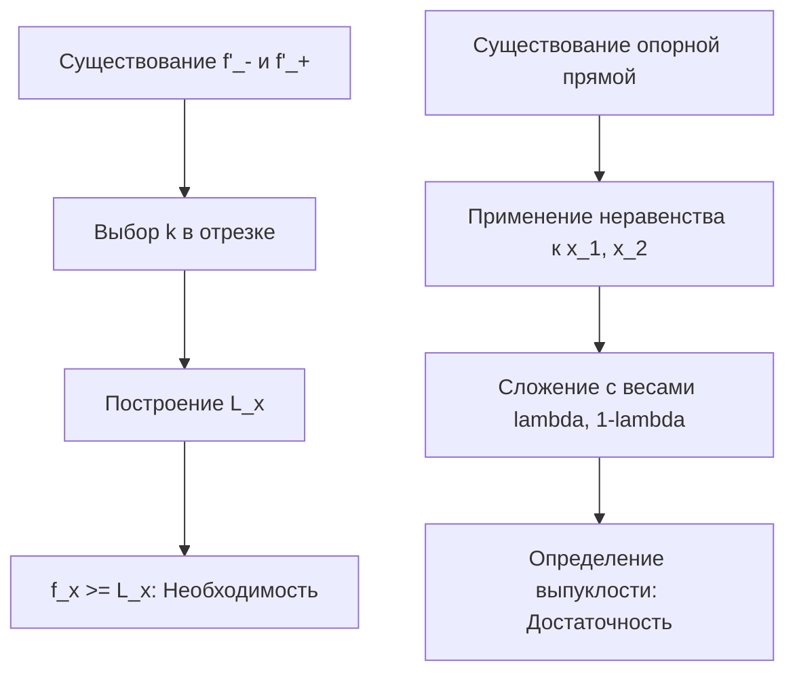
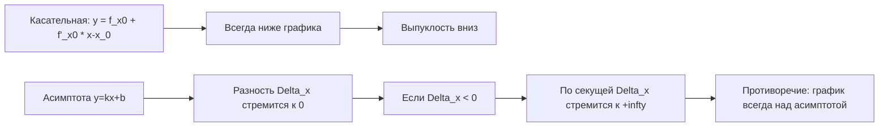

---
tags:
  - матанализ
  - 1_курс
  - подготовка_к_экзамену
тип: конспект
статус: готов
---

# Вопрос №4. Описание опорных прямых выпуклой функции. Характеристика выпуклости с помощью опорных прямых

> [!definition] Опорная прямая
> Пусть задана функция $f: (a, b) \to \mathbb{R}$ и точка $x_0 \in (a, b)$. Прямая, заданная уравнением $y = L(x) = k(x - x_0) + f(x_0)$, где $k \in \mathbb{R}$, называется **опорной прямой** к графику функции $f$ в точке $x_0$, если для всех $x \in (a, b)$ выполняется неравенство:
> $$f(x) \ge L(x) \quad \text{или} \quad f(x) \le L(x)$$
> *Примечание: далее по тексту рассматривается выпуклость вниз, для которой требуется $f(x) \ge L(x)$. Для строгой выпуклости неравенство строгое при $x \ne x_0$.*

> [!lemma] Лемма о монотонности разностного отношения
> Если $f(x)$ — [[Выпуклая функция|выпукла вниз]] на $(a, b)$, то для фиксированного $x_0 \in (a, b)$ функция $\varphi(x) = \frac{f(x) - f(x_0)}{x - x_0}$ не убывает на множествах $(a, x_0)$ и $(x_0, b)$.
> Из этого следует существование конечных односторонних производных в любой внутренней точке $x_0$: 
> $$f'_-(x_0) = \lim_{x \to x_0-0} \varphi(x) \le \lim_{x \to x_0+0} \varphi(x) = f'_+(x_0)$$

> [!theorem] Характеристика выпуклости через опорные прямые
> Функция $f: (a, b) \to \mathbb{R}$ выпукла вниз на интервале $(a, b)$ тогда и только тогда, когда в каждой точке $x_0 \in (a, b)$ к ее графику существует хотя бы одна опорная прямая такая, что график $f$ лежит не ниже этой прямой.

> [!proof]+ Доказательство
> **Необходимость ($\Rightarrow$).**
> Пусть $f$ выпукла на $(a, b)$, $x_0 \in (a, b)$. В силу леммы о монотонности разностного отношения существуют конечные односторонние производные $f'_-(x_0)$ и $f'_+(x_0)$, причем $f'_-(x_0) \le f'_+(x_0)$. 
> Выберем любое число $k \in [f'_-(x_0), f'_+(x_0)]$. Докажем, что прямая $L(x) = f(x_0) + k(x - x_0)$ является опорной.
> 1. Пусть $x > x_0$. В силу неубывания разностного отношения:
> $$\frac{f(x) - f(x_0)}{x - x_0} \ge \lim_{t \to x_0+0} \frac{f(t) - f(x_0)}{t - x_0} = f'_+(x_0) \ge k$$
> Умножая на $(x - x_0) > 0$, получаем $f(x) - f(x_0) \ge k(x - x_0)$, следовательно $f(x) \ge L(x)$.
> 2. Пусть $x < x_0$. Аналогично:
> $$\frac{f(x) - f(x_0)}{x - x_0} \le \lim_{t \to x_0-0} \frac{f(t) - f(x_0)}{t - x_0} = f'_-(x_0) \le k$$
> Умножая на $(x - x_0) < 0$, знак неравенства меняется: $f(x) - f(x_0) \ge k(x - x_0)$, следовательно $f(x) \ge L(x)$.
> Таким образом, $L(x)$ — опорная прямая.
> 
> **Достаточность ($\Leftarrow$).**
> Пусть в каждой точке существует опорная прямая $L(x)$. Возьмем произвольные $x_1, x_2 \in (a, b)$ и $\lambda \in (0, 1)$. Обозначим $x_0 = \lambda x_1 + (1 - \lambda)x_2$. 
> По условию, в точке $x_0$ существует опорная прямая $y = f(x_0) + k(x - x_0)$. Запишем условие опорности для точек $x_1$ и $x_2$:
> $$
> \begin{cases} 
> f(x_1) \ge f(x_0) + k(x_1 - x_0) \\ 
> f(x_2) \ge f(x_0) + k(x_2 - x_0) 
> \end{cases}
> $$
> Умножим первое неравенство на $\lambda > 0$, а второе на $(1 - \lambda) > 0$ и сложим:
> $$\lambda f(x_1) + (1 - \lambda)f(x_2) \ge \lambda f(x_0) + (1 - \lambda)f(x_0) + k(\lambda x_1 + (1 - \lambda)x_2 - x_0)$$
> Так как $\lambda x_1 + (1 - \lambda)x_2 = x_0$, последнее слагаемое равно $k(x_0 - x_0) = 0$. Следовательно:
> $$\lambda f(x_1) + (1 - \lambda)f(x_2) \ge f(x_0)$$
> Что совпадает с определением выпуклой функции. Утверждение доказано.

> [!abstract] Геометрический смысл
> Множество над графиком выпуклой функции (надграфик) является выпуклым множеством. Опорная прямая в контексте одномерного анализа разделяет плоскость так, что весь надграфик лежит в одной полуплоскости.

# Вопрос №5. Критерий выпуклости в терминах касательных и его геометрический смысл. Выпуклость и асимптота

> [!theorem] Критерий выпуклости дифференцируемой функции
> Пусть функция $f: (a, b) \to \mathbb{R}$ [[Дифференцируемость|дифференцируема]] на $(a, b)$. Функция $f$ выпукла вниз на $(a, b)$ тогда и только тогда, когда для любых $x, x_0 \in (a, b)$ выполняется неравенство:
> $$f(x) \ge f(x_0) + f'(x_0)(x - x_0)$$
> Функция строго выпукла, если неравенство строгое при $x \ne x_0$.

> [!proof]+ Доказательство
> **Необходимость ($\Rightarrow$).**
> Если $f$ дифференцируема в точке $x_0$, то левая и правая производные совпадают: $f'_-(x_0) = f'_+(x_0) = f'(x_0)$. Согласно Доказательству из Вопроса №4, опорная прямая строится с угловым коэффициентом $k \in [f'_-(x_0), f'_+(x_0)]$. Поскольку отрезок вырождается в точку, единственно возможный выбор — $k = f'(x_0)$. Подставляя $k$ в уравнение опорной прямой, получаем требуемое неравенство.
> 
> **Достаточность ($\Leftarrow$).**
> Пусть для любых $x, x_0 \in (a, b)$ выполнено $f(x) \ge f(x_0) + f'(x_0)(x - x_0)$. Это в точности означает, что прямая $y = f(x_0) + f'(x_0)(x - x_0)$, являющаяся касательной, служит опорной прямой в каждой точке $x_0$. По Теореме о характеристике через опорные прямые (Вопрос №4), существование опорной прямой в каждой точке влечет выпуклость функции.

> [!abstract] Геометрический смысл
> График дифференцируемой выпуклой вниз функции лежит не ниже любой своей касательной. Касательная является единственной опорной прямой в каждой точке графика.

> [!theorem] Теорема о выпуклой функции и асимптоте
> Пусть функция $f(x)$ выпукла вниз на полуоси $(a, +\infty)$ и имеет при $x \to +\infty$ наклонную асимптоту $y = kx + b$. Тогда для всех $x \in (a, +\infty)$ график функции лежит не ниже асимптоты:
> $$f(x) \ge kx + b$$

> [!proof]+ Доказательство
> Рассмотрим функцию $\Delta(x) = f(x) - (kx + b)$. 
> Так как $f(x)$ выпукла, а линейная функция $-(kx+b)$ выпукла (и вогнута одновременно), их сумма $\Delta(x)$ является выпуклой вниз функцией на $(a, +\infty)$.
> Поскольку прямая является [[Предел функции|асимптотой]], по определению: $\lim_{x \to +\infty} \Delta(x) = 0$.
> Предположим от противного, что существует точка $x_0 \in (a, +\infty)$ такая, что $\Delta(x_0) = -c < 0$ (где $c > 0$).
> Так как $\lim_{x \to +\infty} \Delta(x) = 0$, по определению предела для $\varepsilon = \frac{c}{2}$ найдется точка $x_1 > x_0$ такая, что $|\Delta(x_1)| < \frac{c}{2}$, следовательно, $\Delta(x_1) > -\frac{c}{2}$.
> Проведем секущую через точки $(x_0, \Delta(x_0))$ и $(x_1, \Delta(x_1))$. Ее угловой коэффициент:
> $$m = \frac{\Delta(x_1) - \Delta(x_0)}{x_1 - x_0} > \frac{-\frac{c}{2} - (-c)}{x_1 - x_0} = \frac{c}{2(x_1 - x_0)} > 0$$
> Для выпуклой функции $\Delta(x)$ при $x > x_1$ график лежит не ниже секущей:
> $$\Delta(x) \ge \Delta(x_1) + m(x - x_1)$$
> Так как $m > 0$, при $x \to +\infty$ правая часть стремится к $+\infty$. Переходя к пределу в неравенстве, получаем $\lim_{x \to +\infty} \Delta(x) = +\infty$, что противоречит условию $\lim_{x \to +\infty} \Delta(x) = 0$.
> Полученное противоречие доказывает, что $\Delta(x) \ge 0$ для всех $x \in (a, +\infty)$.

# Вопрос №6. Критерии выпуклости в терминах первой и второй производных

> [!theorem] Критерий в терминах первой производной
> Пусть $f(x)$ дифференцируема на интервале $(a, b)$. Функция $f(x)$ выпукла вниз на $(a, b)$ тогда и только тогда, когда ее производная $f'(x)$ монотонно не убывает на $(a, b)$. Для строгой выпуклости необходимо и достаточно строгого возрастания $f'(x)$.

> [!proof]+ Доказательство (для первой производной)
> **Необходимость ($\Rightarrow$).**
> Пусть $f(x)$ выпукла. Возьмем $x_1, x_2 \in (a, b)$ так, что $x_1 < x_2$. По критерию через касательные (Вопрос №5) запишем два неравенства:
> $$
> \begin{cases} 
> f(x_2) \ge f(x_1) + f'(x_1)(x_2 - x_1) \\ 
> f(x_1) \ge f(x_2) + f'(x_2)(x_1 - x_2) 
> \end{cases}
> $$
> Сложим эти неравенства:
> $$f(x_2) + f(x_1) \ge f(x_1) + f(x_2) + f'(x_1)(x_2 - x_1) - f'(x_2)(x_2 - x_1)$$
> Вычитая $f(x_1) + f(x_2)$ и вынося $(x_2 - x_1)$, получаем:
> $$0 \ge (f'(x_1) - f'(x_2))(x_2 - x_1)$$
> Так как $x_2 > x_1$, то $(x_2 - x_1) > 0$. Следовательно, $f'(x_1) - f'(x_2) \le 0 \Rightarrow f'(x_1) \le f'(x_2)$. Функция $f'(x)$ не убывает.
> 
> **Достаточность ($\Leftarrow$).**
> Пусть $f'(x)$ не убывает. Зафиксируем $x_0 \in (a, b)$ и возьмем произвольное $x \in (a, b)$. По [[Теорема Лагранжа|теореме Лагранжа]] о конечных приращениях существует $c$ между $x_0$ и $x$, такое что:
> $$f(x) - f(x_0) = f'(c)(x - x_0)$$
> 1. Если $x > x_0$, то $x_0 < c < x$. В силу неубывания производной $f'(c) \ge f'(x_0)$. Умножая на $(x - x_0) > 0$, получаем $f'(c)(x - x_0) \ge f'(x_0)(x - x_0)$.
> 2. Если $x < x_0$, то $x < c < x_0$. В силу неубывания $f'(c) \le f'(x_0)$. Умножая на $(x - x_0) < 0$, знак меняется: $f'(c)(x - x_0) \ge f'(x_0)(x - x_0)$.
> В обоих случаях $f(x) - f(x_0) \ge f'(x_0)(x - x_0)$, что по критерию касательных означает выпуклость $f(x)$.

> [!theorem] Условия выпуклости в терминах второй производной (Теорема 3.8.5)
> Пусть $f: (a, b) \to \mathbb{R}$, $f$ непрерывна на $(a, b)$ и дважды дифференцируема на $(a, b)$. $f$ выпукла на $(a, b)$ тогда и только тогда, когда $f''(x) \ge 0$ при всех $x \in (a, b)$.
> Если $f''(x) > 0$ при всех $x \in (a, b)$, то $f$ строго выпукла на $(a, b)$.

> [!proof]+ Доказательство (для второй производной)
> **Необходимость ($\Rightarrow$).**
> Пусть $f$ выпукла. По критерию первой производной, $f'(x)$ не убывает на $(a, b)$.
> По определению второй производной:
> $$f''(x) = \lim_{\Delta x \to 0} \frac{f'(x + \Delta x) - f'(x)}{\Delta x}$$
> Так как $f'(x)$ не убывает, при $\Delta x > 0$ имеем $f'(x + \Delta x) \ge f'(x)$, следовательно дробь неотрицательна. При $\Delta x < 0$ имеем $f'(x + \Delta x) \le f'(x)$, и дробь (как отношение двух отрицательных чисел) также неотрицательна. 
> Переход к пределу сохраняет нестрогое неравенство, поэтому $f''(x) \ge 0$.
> 
> **Достаточность ($\Leftarrow$).**
> Пусть $f''(x) \ge 0$ на $(a, b)$. Применим теорему Лагранжа к функции $f'(x)$ на отрезке $[x_1, x_2]$, где $x_1 < x_2$:
> $$f'(x_2) - f'(x_1) = f''(c)(x_2 - x_1), \quad c \in (x_1, x_2)$$
> Так как $f''(c) \ge 0$ и $(x_2 - x_1) > 0$, получаем $f'(x_2) - f'(x_1) \ge 0$, то есть $f'(x)$ не убывает. По критерию первой производной это означает выпуклость $f(x)$.
> Если $f''(x) > 0$, то $f''(c) > 0$, следовательно $f'(x_2) > f'(x_1)$ (строгое возрастание первой производной), откуда следует строгая выпуклость.

### Точки перегиба
> [!definition] Точка перегиба (Определение 3.8.3)
> Пусть $f: (A, B) \to \mathbb{R}$, $a \in (A, B)$. Предположим, что:
> 1. $\exists \delta > 0$ такое, что $(a - \delta, a + \delta) \subset (A, B)$ и $f$ имеет разный характер выпуклости на $(a - \delta, a]$ и $[a, a + \delta)$ (на одном выпукла, на другом вогнута);
> 2. $f$ непрерывна в точке $a$;
> 3. Существует $f'(a) \in \mathbb{R}$.
> Тогда точка $a$ называется **точкой перегиба** функции $f$.

> [!theorem] Необходимое условие перегиба (Теорема 3.8.6)
> Пусть $f: (A, B) \to \mathbb{R}$, $a \in (A, B)$. Предположим, что $f$ дважды дифференцируема в точке $a$. Если $a$ является точкой перегиба $f$, то $f''(a) = 0$.

> [!proof]+ Доказательство (Теорема 3.8.6)
> Предположим от противного: пусть $a$ — точка перегиба, но $f''(a) \ne 0$.
> Разложим функцию по [[Формула Тейлора|формуле Тейлора]] с остаточным членом в форме Пеано в точке $a$:
> $$f(x) - f(a) - f'(a)(x - a) = \frac{f''(a)}{2}(x - a)^2 + o((x - a)^2) \quad \text{при } x \to a$$
> Левая часть $g(x) = f(x) - (f(a) + f'(a)(x - a))$ представляет собой отклонение графика от касательной.
> Перепишем правую часть:
> $$g(x) = (x - a)^2 \left( \frac{f''(a)}{2} + \alpha(x) \right), \quad \text{где } \lim_{x \to a} \alpha(x) = 0$$
> В силу свойств предела, в некоторой выколотой $\delta$-окрестности точки $a$ знак скобки полностью определяется знаком $f''(a) \ne 0$. Поскольку $(x - a)^2 > 0$, знак $g(x)$ постоянен как слева, так и справа от $a$. 
> Это означает, что график локально лежит строго по одну сторону от касательной. Следовательно, в окрестности $a$ функция сохраняет характер строгой выпуклости (вниз при $f''(a) > 0$ или вверх при $f''(a) < 0$), что противоречит определению точки перегиба. Противоречие доказывает, что $f''(a) = 0$.

> [!warning] Замечание
> Теорема 3.8.6 не дает достаточного условия. Пример: $f(x) = x^4$. Функция строго выпукла на $\mathbb{R}$, $f''(x) = 12x^2$, $f''(0) = 0$, но точка $x = 0$ не является точкой перегиба, так как смены выпуклости не происходит.

> [!theorem] Достаточное условие перегиба (Теорема 3.8.7)
> Пусть $f: (A, B) \to \mathbb{R}$, $a \in (A, B)$, $f$ непрерывна в точке $a$ и имеет в ней производную из $\mathbb{R}$. Пусть существует такое $\delta > 0$, что $f$ дважды дифференцируема на $(a - \delta, a) \cup (a, a + \delta)$ и выполнено одно из условий:
> 4. $f''(x) > 0$ на $(a - \delta, a)$ и $f''(x) < 0$ на $(a, a + \delta)$;
> 5. $f''(x) < 0$ на $(a - \delta, a)$ и $f''(x) > 0$ на $(a, a + \delta)$.
> Тогда $a$ — точка перегиба $f$.

> [!proof]+ Доказательство (Теорема 3.8.7)
> Рассмотрим случай 1 (смена знака с $+$ на $-$).
> По критерию выпуклости через вторую производную:
> На интервале $(a - \delta, a)$ выполнено $f''(x) > 0$, значит $f(x)$ выпукла вниз.
> На интервале $(a, a + \delta)$ выполнено $f''(x) < 0$, значит $f(x)$ выпукла вверх (вогнута).
> Так как $f$ непрерывна в точке $a$, она выпукла вниз на полуинтервале $(a - \delta, a]$ и выпукла вверх на $[a, a + \delta)$. 
> В точке $a$ существует конечная производная $f'(a)$ (по условию).
> Все три требования из Определения 3.8.3 выполнены. Точка $a$ является точкой перегиба. Случай 2 доказывается симметрично.