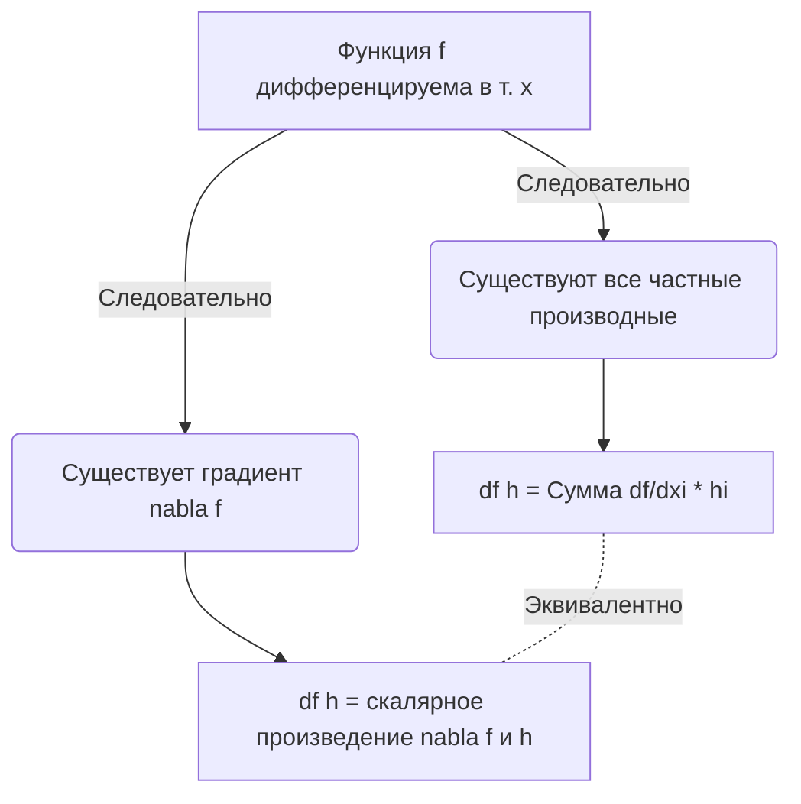

---
tags:
  - матанализ
  - 1_курс
  - подготовка_к_экзамену
тип: конспект
статус: готов
---

Добро пожаловать на экзамен. Математический анализ не терпит расплывчатых формулировок и интуитивных «очевидностей». Любое утверждение должно строго базироваться на аксиоматике действительных чисел и определениях через предельные переходы. Ниже представлен исчерпывающий конспект, удовлетворяющий самым строгим академическим стандартам кафедры.

# Вопрос №58. Равномерная непрерывность и теорема Кантора.

> [!definition] Равномерная непрерывность функции
> Пусть задано множество $E \subset \mathbb{R}$. Функция $f: E \to \mathbb{R}$ называется **равномерно непрерывной** на множестве $E$, если:
> $$\forall \varepsilon > 0 \quad \exists \delta > 0 \quad \forall x_1, x_2 \in E \quad (|x_1 - x_2| < \delta \implies |f(x_1) - f(x_2)| < \varepsilon)$$

> [!warning] Важное замечание (Отличие от локальной непрерывности)
> Принципиальное отличие от обычной [[Непрерывность функции|непрерывности]] заключается в порядке кванторов. При локальной непрерывности $\delta$ зависит и от $\varepsilon$, и от точки $x_0$. При равномерной непрерывности $\delta$ зависит **только** от $\varepsilon$ и обслуживает сразу всё множество $E$.
> **Контрпример:** Функция $f(x) = \frac{1}{x}$ непрерывна на интервале $(0, 1)$, но не является равномерно непрерывной на нём. При приближении к нулю производная неограниченно растет, и для фиксированного $\varepsilon$ невозможно подобрать единое $\delta$ для всего интервала.

> [!abstract] Геометрический смысл
> Равномерную непрерывность можно интерпретировать как «скольжение прямоугольника». Если функция равномерно непрерывна, то для любого заданного по высоте прямоугольника (высоты $2\varepsilon$) можно подобрать такую его ширину ($2\delta$), что при любом перемещении центра прямоугольника вдоль графика функции, график не будет пересекать верхнюю и нижнюю грани этого прямоугольника (будет выходить только через боковые).

> [!theorem] Теорема Кантора
> Если функция $f(x)$ непрерывна на отрезке $[a, b]$, то она равномерно непрерывна на этом отрезке.

> [!proof]+ Доказательство (Теорема Кантора)
> Проведем доказательство от противного. 
> Пусть функция $f(x)$ непрерывна на отрезке $[a, b]$, но **не является** равномерно непрерывной на нём. 
> Построим отрицание определения равномерной непрерывности:
> $$\exists \varepsilon_0 > 0 \quad \forall \delta > 0 \quad \exists x_\delta, y_\delta \in [a, b] \quad (|x_\delta - y_\delta| < \delta \land |f(x_\delta) - f(y_\delta)| \ge \varepsilon_0)$$
> 
> Поскольку это утверждение справедливо для любого $\delta > 0$, мы можем выбрать счетную последовательность значений $\delta_n = \frac{1}{n}$, где $n \in \mathbb{N}$.
> Для каждого $n$ найдутся точки $x_n, y_n \in [a, b]$ такие, что:
> $$|x_n - y_n| < \frac{1}{n} \qquad \text{и} \qquad |f(x_n) - f(y_n)| \ge \varepsilon_0 \quad (1)$$
> 
> Рассмотрим последовательность $\{x_n\}$. Так как все $x_n \in [a, b]$, эта последовательность ограничена. По [[Теорема Больцано-Вейерштрасса|теореме Больцано-Вейерштрасса]], из всякой ограниченной последовательности можно выделить сходящуюся подпоследовательность. 
> Пусть $\{x_{n_k}\}$ — такая подпоследовательность, и $\lim_{k \to \infty} x_{n_k} = c$. 
> Поскольку отрезок $[a, b]$ — замкнутое множество, предельная точка принадлежит ему: $c \in [a, b]$.
> 
> Теперь рассмотрим соответствующую подпоследовательность $\{y_{n_k}\}$. Оценим расстояние от $y_{n_k}$ до точки $c$, используя неравенство треугольника:
> $$|y_{n_k} - c| = |y_{n_k} - x_{n_k} + x_{n_k} - c| \le |y_{n_k} - x_{n_k}| + |x_{n_k} - c|$$
> Так как $|x_{n_k} - y_{n_k}| < \frac{1}{n_k}$ и $n_k \ge k \to \infty$, то первое слагаемое стремится к нулю. Второе слагаемое стремится к нулю в силу того, что $x_{n_k} \to c$.
> Переходя к пределу при $k \to \infty$, получаем, что $\lim_{k \to \infty} y_{n_k} = c$.
> 
> По условию теоремы функция $f(x)$ непрерывна на отрезке $[a, b]$, а значит, непрерывна и в точке $c$. По определению непрерывности по Гейне:
> $$\lim_{k \to \infty} f(x_{n_k}) = f(c) \qquad \text{и} \qquad \lim_{k \to \infty} f(y_{n_k}) = f(c)$$
> 
> Тогда, используя неравенство треугольника, оценим разность значений функции:
> $$|f(x_{n_k}) - f(y_{n_k})| = |f(x_{n_k}) - f(c) + f(c) - f(y_{n_k})| \le |f(x_{n_k}) - f(c)| + |f(c) - f(y_{n_k})|$$
> 
> Так как $f(x_{n_k}) \to f(c)$ и $f(y_{n_k}) \to f(c)$ при $k \to \infty$, для заданного $\varepsilon_0 > 0$ найдется такой номер $K \in \mathbb{N}$, что для всех $k > K$ будет выполняться:
> $$|f(x_{n_k}) - f(c)| < \frac{\varepsilon_0}{2} \qquad \text{и} \qquad |f(y_{n_k}) - f(c)| < \frac{\varepsilon_0}{2}$$
> 
> Подставляя это в предыдущее неравенство для $k > K$, получаем:
> $$|f(x_{n_k}) - f(y_{n_k})| < \frac{\varepsilon_0}{2} + \frac{\varepsilon_0}{2} = \varepsilon_0$$
> 
> Однако, согласно построению последовательностей (см. условие $(1)$), для всех номеров должно выполняться $|f(x_{n_k}) - f(y_{n_k})| \ge \varepsilon_0$.
> Мы получили строгое противоречие ($\varepsilon_0 < \varepsilon_0$). Следовательно, наше изначальное предположение было неверным, и функция $f(x)$ равномерно непрерывна на отрезке $[a, b]$. Ч.т.д.

---

# Вопрос №59. Символы Ландау. Дифференцируемость отображения в точке. Производная по вектору и ее вычисление. Единственность дифференциала.

> [!definition] Символы Ландау ($O$ большое и $o$ малое)
> Пусть заданы функции $f(x)$ и $g(x)$ в проколотой окрестности точки $x_0$ (где $x_0$ может быть и символом $\infty$).
> 1. Функция $f(x) = O(g(x))$ при $x \to x_0$, если существует такая константа $C > 0$ и окрестность $U(x_0)$, что для всех $x \in U(x_0) \setminus \{x_0\}$ выполняется:
> $$|f(x)| \le C|g(x)|$$
> 2. Функция $f(x) = o(g(x))$ при $x \to x_0$, если для любого $\varepsilon > 0$ существует окрестность $U_\varepsilon(x_0)$, что для всех $x \in U_\varepsilon(x_0) \setminus \{x_0\}$ выполняется:
> $$|f(x)| \le \varepsilon|g(x)|$$
> (Если $g(x) \neq 0$, это эквивалентно тому, что $\lim_{x \to x_0} \frac{f(x)}{g(x)} = 0$).

> [!definition] Дифференцируемость отображения в точке
> Пусть задано отображение $f: U \to \mathbb{R}^m$, где $U \subset \mathbb{R}^n$ — открытое множество. Отображение $f$ называется **дифференцируемым** в точке $x_0 \in U$, если приращение функции $\Delta f(x_0, h) = f(x_0 + h) - f(x_0)$ можно представить в виде:
> $$f(x_0 + h) - f(x_0) = L(h) + o(\|h\|) \quad \text{при} \quad h \to 0$$
> где $L: \mathbb{R}^n \to \mathbb{R}^m$ — линейный оператор (не зависящий от $h$, но зависящий от $x_0$), а $\|h\|$ — евклидова норма вектора $h \in \mathbb{R}^n$.
> Линейный оператор $L$ называется **дифференциалом** отображения $f$ в точке $x_0$ и обозначается $df(x_0)$.

> [!definition] Производная по вектору
> Пусть $f: U \to \mathbb{R}^m$ ($U \subset \mathbb{R}^n$ открыто), $x_0 \in U$, и $v \in \mathbb{R}^n$ — произвольный ненулевой вектор. **Производной отображения $f$ в точке $x_0$ по вектору $v$** называется [[Предел функции|предел]]:
> $$\frac{\partial f}{\partial v}(x_0) = \lim_{t \to 0} \frac{f(x_0 + t v) - f(x_0)}{t}$$
> (при условии, что этот предел существует).

> [!theorem] Единственность дифференциала
> Если отображение $f$ дифференцируемо в точке $x_0$, то его дифференциал $df(x_0)$ определяется единственным образом.

> [!proof]+ Доказательство (Единственность дифференциала)
> Докажем от противного. Пусть отображение $f$ имеет в точке $x_0$ два различных дифференциала, соответствующих линейным операторам $L_1$ и $L_2$.
> По определению дифференцируемости, для любого вектора приращения $h$ мы имеем два представления:
> $$f(x_0 + h) - f(x_0) = L_1(h) + \alpha_1(h)\|h\|$$
> $$f(x_0 + h) - f(x_0) = L_2(h) + \alpha_2(h)\|h\|$$
> где вектор-функции $\alpha_1(h)$ и $\alpha_2(h)$ стремятся к нулевому вектору при $h \to 0$.
> 
> Приравняем правые части:
> $$L_1(h) + \alpha_1(h)\|h\| = L_2(h) + \alpha_2(h)\|h\|$$
> В силу линейности операторов, перенесем их в левую часть:
> $$(L_1 - L_2)(h) = (\alpha_2(h) - \alpha_1(h))\|h\|$$
> 
> Зафиксируем произвольный ненулевой вектор $v \in \mathbb{R}^n$. Рассмотрим приращение вида $h = tv$, где $t \in \mathbb{R}, t \neq 0$. Подставим $h$ в полученное равенство. Используя свойство линейности оператора $(L_1 - L_2)(tv) = t(L_1 - L_2)(v)$:
> $$t(L_1 - L_2)(v) = (\alpha_2(tv) - \alpha_1(tv)) \|tv\|$$
> 
> Разделим обе части на $t \neq 0$. Учитывая, что $\|tv\| = |t| \cdot \|v\|$, получаем:
> $$(L_1 - L_2)(v) = (\alpha_2(tv) - \alpha_1(tv)) \frac{|t|}{t} \|v\|$$
> 
> Заметим, что $\frac{|t|}{t} = \text{sgn}(t)$, что по модулю равно $1$. Устремим $t \to 0$. 
> Так как $\lim_{h \to 0} \alpha_1(h) = 0$ и $\lim_{h \to 0} \alpha_2(h) = 0$, то при $t \to 0$ вектор $h = tv \to 0$, и следовательно правая часть равенства стремится к нулевому вектору:
> $$\lim_{t \to 0} \left[ (\alpha_2(tv) - \alpha_1(tv)) \text{sgn}(t) \|v\| \right] = 0$$
> 
> Поскольку левая часть $(L_1 - L_2)(v)$ вообще не зависит от $t$ (это константный вектор для фиксированного $v$), мы получаем:
> $$(L_1 - L_2)(v) = 0 \implies L_1(v) = L_2(v)$$
> 
> Так как вектор $v$ был выбран произвольно, операторы $L_1$ и $L_2$ совпадают на всем пространстве $\mathbb{R}^n$. Дифференциал единственен. Ч.т.д.

> [!theorem] Вычисление производной по вектору для дифференцируемого отображения
> Если отображение $f$ дифференцируемо в точке $x_0$, то для любого вектора $v$ существует производная по этому вектору, и она равна значению дифференциала на этом векторе:
> $$\frac{\partial f}{\partial v}(x_0) = df(x_0)(v)$$

> [!proof]+ Доказательство
> По определению дифференцируемости положим $h = tv$:
> $$f(x_0 + tv) - f(x_0) = df(x_0)(tv) + o(\|tv\|)$$
> В силу линейности дифференциала $df(x_0)(tv) = t \cdot df(x_0)(v)$.
> Разделим всё выражение на $t$:
> $$\frac{f(x_0 + tv) - f(x_0)}{t} = df(x_0)(v) + \frac{o(|t| \|v\|)}{t}$$
> Перейдём к пределу при $t \to 0$. Слагаемое $\frac{o(|t|)}{t} \to 0$ по определению $o$-малого. Таким образом, предел слева существует и в точности равен $df(x_0)(v)$. Ч.т.д.

---

# Вопрос №60. Частные производные. Выражение дифференциала и производной по вектору дифференцируемого отображения через его частные производные. Матрица Якоби и градиент.

> [!definition] Частная производная
> Пусть задана скалярная функция $f: U \to \mathbb{R}$, где $U \subset \mathbb{R}^n$ — открытое множество. Обозначим координаты точки $x = (x_1, x_2, \dots, x_n)$.
> **Частной производной** функции $f$ в точке $x^0$ по переменной $x_i$ называется предел:
> $$\frac{\partial f}{\partial x_i}(x^0) = \lim_{\Delta x_i \to 0} \frac{f(x_1^0, \dots, x_i^0 + \Delta x_i, \dots, x_n^0) - f(x_1^0, \dots, x_n^0)}{\Delta x_i}$$
> Для вектор-функции $f: \mathbb{R}^n \to \mathbb{R}^m$ частные производные берутся покоординатно для каждой компоненты $f_j$.

> [!warning] Важное замечание (Существование частных производных не влечет дифференцируемость)
> Классический контрпример: функция $f(x, y) = \frac{xy}{x^2+y^2}$ при $(x, y) \neq (0,0)$ и $f(0,0) = 0$. Частные производные в точке $(0,0)$ равны нулю (существуют). Однако функция не только не дифференцируема, она даже не является непрерывной в нуле (пределы по разным прямым $y=kx$ различны). Для дифференцируемости требуется непрерывность самих частных производных (достаточное условие).

> [!theorem] Выражение дифференциала через частные производные
> Если функция $f: \mathbb{R}^n \to \mathbb{R}$ дифференцируема в точке $x$, то в этой точке существуют все частные производные первого порядка, и дифференциал функции на векторе $h = (h_1, h_2, \dots, h_n)^T$ имеет вид:
> $$df(x)(h) = \sum_{i=1}^{n} \frac{\partial f}{\partial x_i}(x) h_i$$

> [!proof]+ Доказательство
> Пусть функция $f$ дифференцируема в точке $x$. Из предыдущего вопроса мы знаем, что производная по вектору $v$ существует и равна $df(x)(v)$.
> Выберем в качестве вектора $v$ базисный вектор $e_i = (0, \dots, 1, \dots, 0)^T$ (единица на $i$-м месте). 
> По определению производной по вектору:
> $$\frac{\partial f}{\partial e_i}(x) = \lim_{t \to 0} \frac{f(x + te_i) - f(x)}{t}$$
> Заметим, что это в точности совпадает с определением частной производной $\frac{\partial f}{\partial x_i}(x)$. Следовательно, частные производные существуют, и выполняется равенство:
> $$df(x)(e_i) = \frac{\partial f}{\partial x_i}(x)$$
> Теперь рассмотрим произвольный вектор приращения $h = \sum_{i=1}^n h_i e_i$.
> В силу линейности дифференциала как оператора:
> $$df(x)(h) = df(x)\left( \sum_{i=1}^n h_i e_i \right) = \sum_{i=1}^n h_i \cdot df(x)(e_i) = \sum_{i=1}^n \frac{\partial f}{\partial x_i}(x) h_i$$
> Ч.т.д.

> [!definition] Матрица Якоби
> Для вектор-функции $f: \mathbb{R}^n \to \mathbb{R}^m$, заданной в виде $m$ координатных функций $f_1, \dots, f_m$ от $n$ переменных $x_1, \dots, x_n$, **матрицей Якоби** (матрицей дифференциала) в точке $x$ называется матрица размера $m \times n$, составленная из всех частных производных:
> $$J_f(x) = \begin{pmatrix} 
> \frac{\partial f_1}{\partial x_1} & \frac{\partial f_1}{\partial x_2} & \dots & \frac{\partial f_1}{\partial x_n} \\ 
> \frac{\partial f_2}{\partial x_1} & \frac{\partial f_2}{\partial x_2} & \dots & \frac{\partial f_2}{\partial x_n} \\ 
> \vdots & \vdots & \ddots & \vdots \\ 
> \frac{\partial f_m}{\partial x_1} & \frac{\partial f_m}{\partial x_2} & \dots & \frac{\partial f_m}{\partial x_n}
> \end{pmatrix}$$
> В матричном виде действие дифференциала на вектор $h$ записывается как умножение матрицы Якоби на столбец $h$: $\quad df(x)h = J_f(x) \cdot h$.

> [!definition] Градиент
> Для скалярной функции $f: \mathbb{R}^n \to \mathbb{R}$ дифференциал является линейным функционалом $df(x): \mathbb{R}^n \to \mathbb{R}$. По теореме Рисса о представлении линейного функционала, в евклидовом пространстве существует единственный вектор, скалярное умножение на который задает этот функционал.
> Этот вектор называется **градиентом** функции $f$ в точке $x$ и обозначается $\nabla f(x)$ или $\text{grad} \, f(x)$:
> $$\nabla f(x) = \left( \frac{\partial f}{\partial x_1}(x), \frac{\partial f}{\partial x_2}(x), \dots, \frac{\partial f}{\partial x_n}(x) \right)^T$$
> Выражение дифференциала и производной по вектору через градиент принимает вид (где $\langle \cdot, \cdot \rangle$ — скалярное произведение):
> $$df(x)(h) = \langle \nabla f(x), h \rangle \qquad \text{и} \qquad \frac{\partial f}{\partial v}(x) = \langle \nabla f(x), v \rangle$$

> [!abstract] Физический и геометрический смысл градиента
> Поскольку $\frac{\partial f}{\partial v} = \langle \nabla f, v \rangle = \|\nabla f\| \cdot \|v\| \cdot \cos \theta$ (где $\theta$ — угол между направлением $v$ и градиентом), производная по направлению достигает максимума, когда $\cos \theta = 1$, то есть когда направление вектора $v$ совпадает с направлением градиента.
> **Вывод:** Градиент всегда указывает направление наискорейшего возрастания функции в данной точке, а его норма равна скорости этого возрастания. Кроме того, градиент ортогонален линиям (поверхностям) уровня функции.

