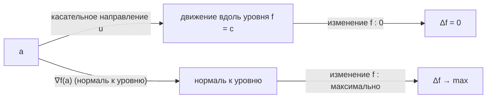

---
tags:
  - матанализ
  - 1_курс
  - подготовка_к_экзамену
тип: конспект
статус: готов
---

# Вопрос №61. Дифференцируемость координатных функций. Описание матрицы Якоби

> [!definition] [[Дифференцируемость]] отображения $f: \mathbb{R}^n \to \mathbb{R}^m$ в точке
> Пусть $a \in \mathbb{R}^n$. Отображение $f: \mathbb{R}^n \to \mathbb{R}^m$ **дифференцируемо** в точке $a$, если существует линейное отображение $A: \mathbb{R}^n \to \mathbb{R}^m$ такое, что при $h \to 0$ выполняется
> $$
> f(a + h) = f(a) + Ah + r(h), \qquad \frac{\|r(h)\|}{\|h\|} \to 0.
> $$
> Линейное отображение $A$ называется **[[Дифференциал|дифференциалом]]** $f$ в точке $a$ и обозначается $df(a)$.

> [!definition] Координатные (компонентные) функции
> Пусть $f = (f_1, \dots, f_m): \mathbb{R}^n \to \mathbb{R}^m$, где $f_i: \mathbb{R}^n \to \mathbb{R}$ — скалярные функции. Тогда $f_i$ называются **координатными функциями** отображения $f$.

> [!theorem] Дифференцируемость координатных функций и покоординатное описание дифференциала
> Если $f: \mathbb{R}^n \to \mathbb{R}^m$ дифференцируемо в $a$, то каждая координатная функция $f_i$ дифференцируема в $a$, причём
> $$
> df(a)h = \bigl(df_1(a)h, \dots, df_m(a)h\bigr).
> $$
> Кроме того, если $df(a)$ представлен матрицей $J_f(a) \in \mathbb{R}^{m \times n}$ в стандартных базисах, то
> $$
> J_f(a) = \begin{pmatrix}
> \frac{\partial f_1}{\partial x_1}(a) & \cdots & \frac{\partial f_1}{\partial x_n}(a) \\
> \vdots & \ddots & \vdots \\
> \frac{\partial f_m}{\partial x_1}(a) & \cdots & \frac{\partial f_m}{\partial x_n}(a)
> \end{pmatrix},
> $$
> то есть $j$-й столбец — это $df(a)e_j$, а $(i, j)$-й элемент равен $\dfrac{\partial f_i}{\partial x_j}(a)$.

> [!proof]+ Доказательство
> Пусть $f$ дифференцируемо в $a$. Тогда существует линейное $A: \mathbb{R}^n \to \mathbb{R}^m$ и остаток $r(h)$, что
> $$
> f(a + h) = f(a) + Ah + r(h), \qquad \frac{\|r(h)\|}{\|h\|} \to 0 \quad (h \to 0).
> $$
> Обозначим $Ah = (A_1h, \dots, A_mh)$, где $A_i: \mathbb{R}^n \to \mathbb{R}$ — $i$-я координатная форма линейного отображения $A$, а также $r(h) = (r_1(h), \dots, r_m(h))$.
>
> Тогда для каждого $i \in \{1, \dots, m\}$, переходя к $i$-й координате в равенстве, получаем:
> $$
> f_i(a + h) = f_i(a) + A_ih + r_i(h).
> $$
> Оценим остаток: из неравенства $|r_i(h)| \le \|r(h)\|$ следует
> $$
> \frac{|r_i(h)|}{\|h\|} \le \frac{\|r(h)\|}{\|h\|} \to 0 \quad (h \to 0).
> $$
> Значит, $f_i$ дифференцируема в $a$ и $df_i(a)h = A_ih$.
>
> Теперь покажем связь с частными производными. Пусть $e_j$ — $j$-й базисный вектор в $\mathbb{R}^n$, $t \in \mathbb{R}$, $t \to 0$. Подставим $h = te_j$:
> $$
> f_i(a + te_j) = f_i(a) + A_i(te_j) + r_i(te_j) = f_i(a) + t\,A_i(e_j) + r_i(te_j).
> $$
> Тогда
> $$
> \frac{f_i(a + te_j) - f_i(a)}{t} = A_i(e_j) + \frac{r_i(te_j)}{t}.
> $$
> Так как $\|te_j\| = |t|$ и $\dfrac{|r_i(te_j)|}{\|te_j\|} \to 0$, имеем
> $$
> \left|\frac{r_i(te_j)}{t}\right| = \frac{|r_i(te_j)|}{|t|} = \frac{|r_i(te_j)|}{\|te_j\|} \to 0.
> $$
> Следовательно, предел существует и равен
> $$
> \frac{\partial f_i}{\partial x_j}(a) = \lim_{t \to 0} \frac{f_i(a + te_j) - f_i(a)}{t} = A_i(e_j).
> $$
> Если $A$ записать матрицей $J_f(a)$, то по определению матричного представления линейного отображения столбец $j$ равен $Ae_j$, а его $i$-я координата равна $A_i(e_j) = \dfrac{\partial f_i}{\partial x_j}(a)$. Значит, матрица $A$ совпадает с указанной матрицей Якоби. ∎

> [!definition] [[Матрица Якоби]] (якобиан)
> Если $f: \mathbb{R}^n \to \mathbb{R}^m$ дифференцируемо в $a$, то матрица линейного отображения $df(a)$ в стандартных базисах называется **матрицей Якоби** и обозначается $J_f(a)$.

> [!warning] Важное замечание (частные производные $\not\Rightarrow$ дифференцируемость)
> Существование всех частных производных $\dfrac{\partial f_i}{\partial x_j}(a)$ само по себе **не гарантирует** дифференцируемость $f$ в $a$: нужно линейное приближение с остатком $o(\|h\|)$.
>
> На экзамене обязательно различать:
> - «существуют частные производные»;
> - «существует дифференциал (то есть $f$ дифференцируема)».

# Вопрос №62. Геометрические свойства градиента. Экстремальное свойство градиента

> [!definition] [[Градиент]] скалярной функции
> Пусть $f: \mathbb{R}^n \to \mathbb{R}$ дифференцируема в точке $a$. Тогда существует линейная форма $df(a): \mathbb{R}^n \to \mathbb{R}$. **Градиентом** $f$ в точке $a$ называется вектор $\nabla f(a) \in \mathbb{R}^n$, единственный такой, что для любого $h \in \mathbb{R}^n$
> $$
> df(a)h = \langle \nabla f(a), h \rangle.
> $$
> В координатах:
> $$
> \nabla f(a) = \left(\frac{\partial f}{\partial x_1}(a), \dots, \frac{\partial f}{\partial x_n}(a)\right).
> $$

> [!definition] [[Производная по направлению]] (через дифференциал)
> Пусть $f: \mathbb{R}^n \to \mathbb{R}$ дифференцируема в $a$, $u \in \mathbb{R}^n$. **Производная по направлению $u$** определяется как
> $$
> D_u f(a) := df(a)u.
> $$
> Если дополнительно $\|u\| = 1$, то $D_u f(a)$ интерпретируется как «скорость изменения $f$ в направлении единичного вектора $u$».

> [!theorem] Связь градиента и производной по направлению
> Если $f$ дифференцируема в $a$, то для любого $u \in \mathbb{R}^n$ выполняется
> $$
> D_u f(a) = \langle \nabla f(a), u \rangle.
> $$

> [!proof]+ Доказательство
> По определению градиента $\nabla f(a)$ — это вектор, представляющий линейную форму $df(a)$ скалярным произведением:
> $$
> df(a)h = \langle \nabla f(a), h \rangle \quad \text{для всех } h.
> $$
> Подставляя $h = u$, получаем
> $$
> D_u f(a) = df(a)u = \langle \nabla f(a), u \rangle.
> $$
> Других предположений не требуется. ∎

> [!theorem] Экстремальное свойство [[Градиент|градиента]] (наибольший рост)
> Пусть $f: \mathbb{R}^n \to \mathbb{R}$ дифференцируема в $a$ и $\nabla f(a) \ne 0$. Тогда среди всех единичных векторов $u$ величина $D_u f(a)$:
>
> 1) достигает максимума и минимума;
> 2) причём
>    $$
>    \max_{\|u\| = 1} D_u f(a) = \|\nabla f(a)\|, \qquad \min_{\|u\| = 1} D_u f(a) = -\|\nabla f(a)\|;
>    $$
> 3) максимум достигается при $u = \dfrac{\nabla f(a)}{\|\nabla f(a)\|}$, минимум — при $u = -\dfrac{\nabla f(a)}{\|\nabla f(a)\|}$.

> [!proof]+ Доказательство
> Возьмём произвольный $u$ с $\|u\| = 1$. По предыдущей теореме
> $$
> D_u f(a) = \langle \nabla f(a), u \rangle.
> $$
> По неравенству Коши—Буняковского:
> $$
> \langle \nabla f(a), u \rangle \le \|\nabla f(a)\| \, \|u\| = \|\nabla f(a)\|.
> $$
> Следовательно, для всех $\|u\| = 1$ верно $D_u f(a) \le \|\nabla f(a)\|$, то есть
> $$
> \max_{\|u\| = 1} D_u f(a) \le \|\nabla f(a)\|.
> $$
> Покажем, что значение $\|\nabla f(a)\|$ достижимо. Положим
> $$
> u_0 := \frac{\nabla f(a)}{\|\nabla f(a)\|}.
> $$
> Тогда $\|u_0\| = 1$ и
> $$
> D_{u_0} f(a) = \left\langle \nabla f(a), \frac{\nabla f(a)}{\|\nabla f(a)\|} \right\rangle = \frac{\langle \nabla f(a), \nabla f(a) \rangle}{\|\nabla f(a)\|} = \frac{\|\nabla f(a)\|^2}{\|\nabla f(a)\|} = \|\nabla f(a)\|.
> $$
> Значит,
> $$
> \max_{\|u\| = 1} D_u f(a) = \|\nabla f(a)\|.
> $$
> Для минимума применим ту же оценку к $-u$:
> $$
> D_u f(a) = \langle \nabla f(a), u \rangle \ge -\|\nabla f(a)\|,
> $$
> и равенство достигается при $u = -u_0$. ∎

> [!theorem] Градиент ортогонален уровню функции (в $\mathbb{R}^2$ и $\mathbb{R}^3$)
> Пусть $f: \mathbb{R}^n \to \mathbb{R}$ дифференцируема в $a$ и рассмотрим множество уровня
> $$
> S = \{x \in \mathbb{R}^n: \ f(x) = f(a)\}.
> $$
> Если существует дифференцируемая кривая $\gamma: (-t_0, t_0) \to \mathbb{R}^n$ такая, что $\gamma(0) = a$ и $\gamma(t) \in S$ при всех $t$, то
> $$
> \langle \nabla f(a), \gamma'(0) \rangle = 0.
> $$
> То есть градиент ортогонален любому касательному вектору к уровню в точке $a$.

> [!proof]+ Доказательство
> Рассмотрим композицию $\varphi(t) := f(\gamma(t))$. Так как $\gamma(t) \in S$, имеем $\varphi(t) = f(a)$ для всех $t$ из области определения, то есть $\varphi$ — константа. Тогда по определению производной функции одной переменной
> $$
> \varphi'(0) = 0.
> $$
> С другой стороны, по правилу дифференцирования композиции (см. Вопрос №63) и определению градиента:
> $$
> \varphi'(0) = df(a) \, \gamma'(0) = \langle \nabla f(a), \gamma'(0) \rangle.
> $$
> Следовательно,
> $$
> \langle \nabla f(a), \gamma'(0) \rangle = 0.
> $$
> ∎

> [!abstract] Геометрический / Физический смысл
> - $\nabla f(a)$ указывает направление **наиболее быстрого возрастания** $f$ в точке $a$, а $\|\nabla f(a)\|$ — величина этого максимального «наклона».
> - На линии/поверхности уровня $f(x) = c$ функция не меняется, поэтому допустимые «касательные» направления дают нулевую производную по направлению; значит, $\nabla f(a)$ перпендикулярен уровню.

> [!warning] Важное замечание (случай $\nabla f(a) = 0$)
> Если $\nabla f(a) = 0$, то для любого $u$ имеем $D_u f(a) = \langle 0, u \rangle = 0$. Это означает **отсутствие линейного роста** во всех направлениях, но **не гарантирует** ни максимума, ни минимума функции в точке $a$ (нужны дополнительные исследования, например, высшие производные).

# Вопрос №63. Дифференцирование композиции. Частные производные композиции

> [!definition] Композиция отображений
> Пусть $g: \mathbb{R}^n \to \mathbb{R}^m$ и $f: \mathbb{R}^m \to \mathbb{R}^k$. Композицией называется отображение
> $$
> (f \circ g)(x) := f(g(x)).
> $$

> [!theorem] [[Правило цепочки]] (дифференциал композиции)
> Пусть $g: \mathbb{R}^n \to \mathbb{R}^m$ дифференцируема в $a$, а $f: \mathbb{R}^m \to \mathbb{R}^k$ дифференцируема в точке $b = g(a)$. Тогда композиция $F = f \circ g$ дифференцируема в $a$, и её дифференциал равен композиции дифференциалов:
> $$
> dF(a) = df(b) \circ dg(a).
> $$
> В матричной форме (в стандартных базисах):
> $$
> J_{f \circ g}(a) = J_f(g(a)) \, J_g(a).
> $$

> [!proof]+ Доказательство
> Обозначим $b = g(a)$. Так как $g$ дифференцируема в $a$, существует линейное отображение $B: \mathbb{R}^n \to \mathbb{R}^m$ и остаток $\rho(h)$ такие, что
> $$
> g(a + h) = g(a) + Bh + \rho(h), \qquad \frac{\|\rho(h)\|}{\|h\|} \to 0 \quad (h \to 0).
> $$
> Так как $f$ дифференцируема в $b$, существует линейное $A: \mathbb{R}^m \to \mathbb{R}^k$ и остаток $\eta(u)$ такие, что при $u \to 0$:
> $$
> f(b + u) = f(b) + Au + \eta(u), \qquad \frac{\|\eta(u)\|}{\|u\|} \to 0 \quad (u \to 0).
> $$
> Рассмотрим $F(a + h) = f(g(a + h))$. Подставим разложение для $g$:
> $$
> F(a + h) = f\bigl(b + (Bh + \rho(h))\bigr).
> $$
> Положим $u(h) := Bh + \rho(h)$. Тогда $u(h) \to 0$ при $h \to 0$ (поскольку $\|Bh\| \le \|B\| \|h\|$ и $\rho(h) = o(\|h\|)$). Применим дифференцируемость $f$ в $b$:
> $$
> F(a + h) = f(b) + A(Bh + \rho(h)) + \eta(Bh + \rho(h)).
> $$
> Перегруппируем:
> $$
> F(a + h) = F(a) + (A \circ B)h + \underbrace{A\rho(h) + \eta(Bh + \rho(h))}_{=: R(h)}.
> $$
> Осталось проверить, что $R(h) = o(\|h\|)$.
>
> 1) Для первого слагаемого: так как $A$ линейно и непрерывно, существует константа $C_A > 0$, что $\|Av\| \le C_A \|v\|$ для всех $v$. Тогда
>    $$
>    \frac{\|A\rho(h)\|}{\|h\|} \le C_A \, \frac{\|\rho(h)\|}{\|h\|} \to 0.
>    $$
>
> 2) Для второго слагаемого используем определение $\eta(u) = o(\|u\|)$: существует функция $\alpha(u)$ такая, что
>    $$
>    \eta(u) = \alpha(u) \, \|u\|, \qquad \alpha(u) \to 0 \ (u \to 0).
>    $$
>    Тогда
>    $$
>    \frac{\|\eta(u(h))\|}{\|h\|} = \frac{|\alpha(u(h))| \, \|u(h)\|}{\|h\|}.
>    $$
>    Оценим $\|u(h)\|$:
>    $$
>    \|u(h)\| = \|Bh + \rho(h)\| \le \|Bh\| + \|\rho(h)\| \le \|B\| \, \|h\| + \|\rho(h)\|.
>    $$
>    Делим на $\|h\|$ (при $h \ne 0$):
>    $$
>    \frac{\|u(h)\|}{\|h\|} \le \|B\| + \frac{\|\rho(h)\|}{\|h\|}.
>    $$
>    Правая часть стремится к $\|B\|$, значит существует число $M > 0$ и окрестность нуля по $h$, где
>    $$
>    \frac{\|u(h)\|}{\|h\|} \le M.
>    $$
>    Кроме того, $\alpha(u(h)) \to 0$, так как $u(h) \to 0$. Следовательно,
>    $$
>    \frac{\|\eta(u(h))\|}{\|h\|} = |\alpha(u(h))| \cdot \frac{\|u(h)\|}{\|h\|} \le |\alpha(u(h))| \cdot M \to 0.
>    $$
>
> Итак,
> $$
> \frac{\|R(h)\|}{\|h\|} \le \frac{\|A\rho(h)\|}{\|h\|} + \frac{\|\eta(u(h))\|}{\|h\|} \to 0,
> $$
> то есть $R(h) = o(\|h\|)$. Это и означает дифференцируемость $F$ в $a$ с дифференциалом $dF(a) = A \circ B = df(b) \circ dg(a)$.
>
> Матричная формула $J_{f \circ g}(a) = J_f(b) J_g(a)$ следует из того, что матрица композиции линейных отображений равна произведению соответствующих матриц в согласованных базисах. ∎

> [!theorem] Частные производные композиции (покоординатная формула правила цепочки)
> Пусть $g = (g_1, \dots, g_m): \mathbb{R}^n \to \mathbb{R}^m$ дифференцируема в $a$, $f = (f_1, \dots, f_k): \mathbb{R}^m \to \mathbb{R}^k$ дифференцируема в $b = g(a)$. Тогда для $F = f \circ g$ и любых $i \in \{1, \dots, k\}$, $j \in \{1, \dots, n\}$:
> $$
> \frac{\partial F_i}{\partial x_j}(a) = \sum_{\ell=1}^m \frac{\partial f_i}{\partial y_\ell}(b) \, \frac{\partial g_\ell}{\partial x_j}(a),
> $$
> где $y_1, \dots, y_m$ — координаты в $\mathbb{R}^m$.

> [!proof]+ Доказательство
> Из матричной формулы
> $$
> J_{f \circ g}(a) = J_f(b) \, J_g(a)
> $$
> следует равенство элементов матриц: элемент $(i, j)$ произведения равен
> $$
> (J_f(b) \, J_g(a))_{ij} = \sum_{\ell=1}^m (J_f(b))_{i\ell} \, (J_g(a))_{\ell j}.
> $$
> По определению матриц Якоби
> $$
> (J_f(b))_{i\ell} = \frac{\partial f_i}{\partial y_\ell}(b), \qquad (J_g(a))_{\ell j} = \frac{\partial g_\ell}{\partial x_j}(a), \qquad (J_{f \circ g}(a))_{ij} = \frac{\partial F_i}{\partial x_j}(a).
> $$
> Подстановка даёт требуемую формулу. ∎

> [!abstract] Геометрический / Физический смысл
> Композиция $f \circ g$ описывает «двухэтапное преобразование»:
> $$
> x \xmapsto{\,g\,} y = g(x) \xmapsto{\,f\,} z = f(y).
> $$
> Линеаризация (первый порядок малости) тоже проходит в два этапа:
> $$
> \Delta y \approx dg(a) \, \Delta x, \qquad \Delta z \approx df(g(a)) \, \Delta y, \qquad \Rightarrow \quad \Delta z \approx df(g(a)) \, dg(a) \, \Delta x.
> $$

> [!warning] Важное замечание (недостаточность одних частных производных)
> Формула правила цепочки гарантирована при **дифференцируемости** $g$ в $a$ и $f$ в $g(a)$. Если у функций лишь существуют частные производные, но нет дифференцируемости (нет оценки остатка $o(\|h\|)$), то правило цепочки в таком виде применять нельзя.

## Основные исправления:

1. **Пробелы вокруг `:` в определениях функций** — `$f:\mathbb{R}^n\to\mathbb{R}^m$` → `$f: \mathbb{R}^n \to \mathbb{R}^m$`
2. **Пробелы вокруг `\to`** — добавлены везде
3. **Пробелы вокруг `\in`** — добавлены везде
4. **Пробелы вокруг `=`** — добавлены где необходимо
5. **Пробелы в кортежах** — `$(f_1,\dots,f_m)$` → `$(f_1, \dots, f_m)$`
6. **Пробелы вокруг операторов** — добавлены для улучшения читаемости
7. **Пробелы в тексте** — исправлены для единообразия
