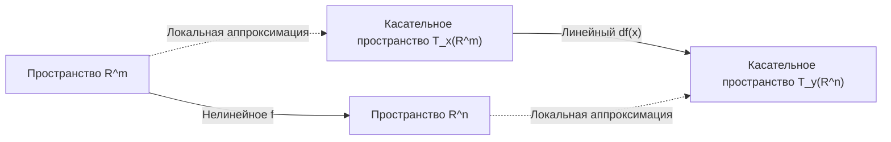

---
tags:
  - матанализ
  - 1_курс
  - подготовка_к_экзамену
тип: конспект
статус: готов
---

# Вопрос №64. Дифференцирование и арифметические операции. Дифференцирование обратного отображения.

> [!abstract] Вводные замечания экзаменатора
> В данном билете мы рассматриваем отображения конечномерных евклидовых пространств $f: U \to \mathbb{R}^n$, где $U$ — открытое множество в $\mathbb{R}^m$. Под дифференцируемостью понимается дифференцируемость по Фреше, а под дифференциалом $df(x)$ — [[Линейный оператор]] из $\mathcal{L}(\mathbb{R}^m, \mathbb{R}^n)$. 

> [!theorem] Теорема (Арифметические свойства дифференцируемых отображений)
> Пусть заданы отображения $f, g: U \to \mathbb{R}^n$, дифференцируемые в точке $x_0 \in U$. Пусть также задана скалярная функция $\varphi: U \to \mathbb{R}$, дифференцируемая в $x_0$. Тогда:
> 1. **Линейность:** Отображение $(\alpha f + \beta g)$ дифференцируемо в $x_0$ для любых $\alpha, \beta \in \mathbb{R}$, и:
>    $$ d(\alpha f + \beta g)(x_0) = \alpha df(x_0) + \beta dg(x_0) $$
> 2. **Скалярное произведение:** Функция $\langle f, g \rangle: U \to \mathbb{R}$ дифференцируема в $x_0$, и:
>    $$ d\langle f, g \rangle(x_0)h = \langle df(x_0)h, g(x_0) \rangle + \langle f(x_0), dg(x_0)h \rangle \quad \forall h \in \mathbb{R}^m $$
> 3. **Умножение на скалярную функцию:** Отображение $(\varphi f): U \to \mathbb{R}^n$ дифференцируемо в $x_0$, и:
>    $$ d(\varphi f)(x_0)h = (d\varphi(x_0)h)f(x_0) + \varphi(x_0)(df(x_0)h) \quad \forall h \in \mathbb{R}^m $$

> [!proof]+ Доказательство (для умножения на скалярную функцию)
> Зафиксируем приращение независимой переменной $h \in \mathbb{R}^m$ такое, что $x_0 + h \in U$. 
> По условию дифференцируемости функций $\varphi$ и $f$ в точке $x_0$ имеем представления:
> $$ \varphi(x_0 + h) = \varphi(x_0) + d\varphi(x_0)h + \alpha(h)\lVert h \rVert $$
> $$ f(x_0 + h) = f(x_0) + df(x_0)h + \beta(h)\lVert h \rVert $$
> где скалярная функция $\alpha(h) \to 0$ и вектор-функция $\beta(h) \to \mathbf{0}$ при $h \to \mathbf{0}$.
> 
> Вычислим полное приращение произведения $\Delta(\varphi f)$:
> $$ \Delta(\varphi f) = \varphi(x_0 + h)f(x_0 + h) - \varphi(x_0)f(x_0) = $$
> Подставляя разложения, получаем:
> $$ = \Big( \varphi(x_0) + d\varphi(x_0)h + \alpha(h)\lVert h \rVert \Big) \Big( f(x_0) + df(x_0)h + \beta(h)\lVert h \rVert \Big) - \varphi(x_0)f(x_0) $$
> Раскрываем скобки и группируем слагаемые. Линейная по $h$ часть:
> $$ L(h) = (d\varphi(x_0)h)f(x_0) + \varphi(x_0)(df(x_0)h) $$
> Остаток $R(h)$ включает все остальные члены:
> $$ R(h) = (d\varphi(x_0)h)(df(x_0)h) + \alpha(h)\lVert h \rVert f(x_0) + \dots + \alpha(h)\lVert h \rVert \beta(h)\lVert h \rVert $$
> Нам необходимо строго доказать, что $R(h) = o(\lVert h \rVert)$ при $h \to \mathbf{0}$. Оценим норму остатка:
> $$ \frac{\lVert R(h) \rVert}{\lVert h \rVert} \le \frac{\lvert d\varphi(x_0)h \rvert \cdot \lVert df(x_0)h \rVert}{\lVert h \rVert} + \lvert \alpha(h) \rvert \lVert f(x_0) \rVert + \dots $$
> Поскольку линейные операторы в конечномерном пространстве ограничены, существуют константы $C_1, C_2 > 0$, такие что $\lvert d\varphi(x_0)h \rvert \le C_1 \lVert h \rVert$ и $\lVert df(x_0)h \rVert \le C_2 \lVert h \rVert$.
> Следовательно, первое слагаемое оценивается как:
> $$ \frac{C_1 \lVert h \rVert \cdot C_2 \lVert h \rVert}{\lVert h \rVert} = C_1 C_2 \lVert h \rVert \xrightarrow{h \to \mathbf{0}} 0 $$
> Аналогично, поскольку $\alpha(h) \to 0$ и $\beta(h) \to \mathbf{0}$, все слагаемые в $\frac{\lVert R(h) \rVert}{\lVert h \rVert}$ стремятся к нулю.
> В силу единственности дифференциала, доказано, что $d(\varphi f) = L$. $\blacksquare$

> [!theorem] Теорема (О дифференцировании обратного отображения)
> Пусть $U, V$ — открытые множества в $\mathbb{R}^n$. Пусть отображение $f: U \to V$ биективно, дифференцируемо в точке $x_0 \in U$, и его дифференциал $A = df(x_0)$ является обратимым линейным оператором (т.е. определитель [[Матрица Якоби]] $\det J_f(x_0) \neq 0$). 
> Если обратное отображение $g = f^{-1}: V \to U$ [[Непрерывность функции|непрерывно]] в точке $y_0 = f(x_0)$, то $g$ дифференцируемо в $y_0$, и его дифференциал равен:
> $$ dg(y_0) = [df(x_0)]^{-1} = A^{-1} $$

> [!proof]+ Доказательство
> Зададим приращение $\Delta y \in \mathbb{R}^n$ так, чтобы $y_0 + \Delta y \in V$. Поскольку $g$ биективно, этому приращению однозначно соответствует $\Delta x = g(y_0 + \Delta y) - g(y_0)$. 
> В силу непрерывности $g$ в точке $y_0$, из $\Delta y \to \mathbf{0}$ строго следует, что $\Delta x \to \mathbf{0}$.
> 
> Запишем условие дифференцируемости $f$ в точке $x_0$:
> $$ \Delta y = f(x_0 + \Delta x) - f(x_0) = A\Delta x + \omega(\Delta x)\lVert \Delta x \rVert $$
> где $\omega(\Delta x) \to \mathbf{0}$ при $\Delta x \to \mathbf{0}$.
> 
> Применим к обеим частям равенства линейный оператор $A^{-1}$ (он существует по условию):
> $$ A^{-1}\Delta y = \Delta x + A^{-1}\omega(\Delta x)\lVert \Delta x \rVert $$
> Выразим $\Delta x$ (которое равно $g(y_0 + \Delta y) - g(y_0)$):
> $$ \Delta x = A^{-1}\Delta y - A^{-1}\omega(\Delta x)\lVert \Delta x \rVert \quad \text{(*)} $$
> Нам требуется доказать, что второе слагаемое в правой части является $o(\lVert \Delta y \rVert)$.
> 
> **Шаг 1: Оценка $\lVert \Delta x \rVert$ через $\lVert \Delta y \rVert$.**
> Из равенства $\Delta y = A\Delta x + \omega(\Delta x)\lVert \Delta x \rVert$ имеем $A\Delta x = \Delta y - \omega(\Delta x)\lVert \Delta x \rVert$.
> Применяем норму и неравенство треугольника:
> $$ \lVert A\Delta x \rVert \le \lVert \Delta y \rVert + \lVert \omega(\Delta x) \rVert \lVert \Delta x \rVert $$
> Для обратимого оператора $A$ существует константа $m > 0$ такая, что $\lVert A\Delta x \rVert \ge m \lVert \Delta x \rVert$ (где $m = \frac{1}{\lVert A^{-1} \rVert}$).
> Тогда:
> $$ m \lVert \Delta x \rVert \le \lVert \Delta y \rVert + \lVert \omega(\Delta x) \rVert \lVert \Delta x \rVert $$
> Поскольку $\omega(\Delta x) \to \mathbf{0}$, найдется такая $\delta$-окрестность нуля, что для всех $\lVert \Delta x \rVert < \delta$ выполняется $\lVert \omega(\Delta x) \rVert \le \frac{m}{2}$. 
> Для таких $\Delta x$ получаем:
> $$ m \lVert \Delta x \rVert \le \lVert \Delta y \rVert + \frac{m}{2} \lVert \Delta x \rVert \implies \frac{m}{2} \lVert \Delta x \rVert \le \lVert \Delta y \rVert \implies \lVert \Delta x \rVert \le \frac{2}{m} \lVert \Delta y \rVert $$
> 
> **Шаг 2: Оценка остаточного члена.**
> Обозначим остаток из формулы (*) как $R(\Delta y) = -A^{-1}\omega(\Delta x)\lVert \Delta x \rVert$. Оценим его норму с учетом полученного неравенства для $\lVert \Delta x \rVert$:
> $$ \lVert R(\Delta y) \rVert \le \lVert A^{-1} \rVert \cdot \lVert \omega(\Delta x) \rVert \cdot \lVert \Delta x \rVert \le \lVert A^{-1} \rVert \cdot \lVert \omega(\Delta x) \rVert \cdot \frac{2}{m} \lVert \Delta y \rVert $$
> Разделим на $\lVert \Delta y \rVert$:
> $$ \frac{\lVert R(\Delta y) \rVert}{\lVert \Delta y \rVert} \le \lVert A^{-1} \rVert \frac{2}{m} \lVert \omega(\Delta x) \rVert $$
> При $\Delta y \to \mathbf{0}$ мы установили, что $\Delta x \to \mathbf{0}$, а значит $\lVert \omega(\Delta x) \rVert \to 0$. 
> Следовательно, $\frac{\lVert R(\Delta y) \rVert}{\lVert \Delta y \rVert} \to 0$, то есть $R(\Delta y) = o(\lVert \Delta y \rVert)$.
> Окончательно получаем $g(y_0 + \Delta y) - g(y_0) = A^{-1}\Delta y + o(\lVert \Delta y \rVert)$, что по определению доказывает дифференцируемость $g$ и тот факт, что $dg(y_0) = A^{-1}$. $\blacksquare$

> [!warning] Важное замечание
> Условие непрерывности обратного отображения $g$ в точке $y_0$ в формулировке теоремы принципиально. Без него из существования $f^{-1}$ и обратимости $df(x_0)$ дифференцируемость обратного отображения вывести нельзя. Однако, в классической "Теореме об обратной функции" это условие часто опускают, так как предварительно доказывают локальную непрерывную обратимость отображения класса $C^1$ (по принципу сжимающих отображений).

---

# Вопрос №65. Дифференцируемость и непрерывная дифференцируемость отображения.

> [!definition] Определение 1: Дифференцируемость отображения (по Фреше)
> Пусть $U \subset \mathbb{R}^m$ — открытое множество. Отображение $f: U \to \mathbb{R}^n$ называется **дифференцируемым в точке** $x_0 \in U$, если существует линейный оператор $A: \mathbb{R}^m \to \mathbb{R}^n$ (называемый [[Дифференциал Фреше]]) такой, что полное приращение отображения в точке $x_0$ представимо в виде:
> $$ f(x_0 + \Delta x) - f(x_0) = A\Delta x + o(\lVert \Delta x \rVert) \quad \text{при } \Delta x \to \mathbf{0} $$
> где запись $o(\lVert \Delta x \rVert)$ означает вектор-функцию $\alpha(\Delta x)$, такую что $\lim_{\Delta x \to \mathbf{0}} \frac{\lVert \alpha(\Delta x) \rVert}{\lVert \Delta x \rVert} = 0$.
> Линейный оператор $A$ обозначается как $df(x_0)$ или $f'(x_0)$.

> [!lemma] Лемма (Матричное представление дифференциала)
> Если отображение $f = (f_1, f_2, \dots, f_n)^T$ дифференцируемо в точке $x_0$, то все его координатные функции $f_i$ имеют в этой точке частные производные по всем переменным $x_j$, а матрица линейного оператора $A$ в стандартных базисах пространств $\mathbb{R}^m$ и $\mathbb{R}^n$ совпадает с **Матрицей Якоби**:
> $$ J_f(x_0) = \begin{pmatrix} 
> \frac{\partial f_1}{\partial x_1}(x_0) & \cdots & \frac{\partial f_1}{\partial x_m}(x_0) \\ 
> \vdots & \ddots & \vdots \\ 
> \frac{\partial f_n}{\partial x_1}(x_0) & \cdots & \frac{\partial f_n}{\partial x_m}(x_0) 
> \end{pmatrix} $$

> [!abstract] Геометрический смысл дифференцируемости
> Дифференцируемость означает, что в малой окрестности точки $x_0$ нелинейное отображение $f$ может быть с высокой точностью (с ошибкой высшего порядка малости) заменено аффинным отображением $L(x) = f(x_0) + A(x - x_0)$. Геометрически это означает существование невертикальной касательной гиперплоскости к графику функции.

> [!definition] Определение 2: Непрерывная дифференцируемость (Класс $C^1$)
> Отображение $f: U \to \mathbb{R}^n$ называется **непрерывно дифференцируемым** на множестве $U$ (обозначается $f \in C^1(U, \mathbb{R}^n)$), если:
> 1. Оно дифференцируемо в каждой точке $x \in U$.
> 2. Отображение $x \mapsto f'(x)$, действующее из $U \subset \mathbb{R}^m$ в пространство линейных операторов $\mathcal{L}(\mathbb{R}^m, \mathbb{R}^n)$ (снабженное операторной [[Норма|нормой]]), является непрерывным.
> 
> *Эквивалентное определение:* Отображение $f \in C^1(U, \mathbb{R}^n)$ тогда и только тогда, когда все его частные производные $\frac{\partial f_i}{\partial x_j}$ существуют и непрерывны на $U$.

---

# Вопрос №66. Теорема о связи непрерывной дифференцируемости с дифференцируемостью и непрерывностью.

> [!abstract] Логика взаимосвязей
> На экзамене крайне важно не путать импликации. Логическая цепочка строга:
> $C^1$ (Непрерывная дифференцируемость) $\implies$ Дифференцируемость $\implies$ Непрерывность.
> Обратные утверждения в общем случае **неверны**.

### 1. Связь дифференцируемости и непрерывности

> [!theorem] Теорема 1 (Дифференцируемость влечет непрерывность)
> Если отображение $f: U \to \mathbb{R}^n$ дифференцируемо в точке $x_0 \in U$, то оно [[Непрерывность функции|непрерывно]] в этой точке.

> [!proof]+ Доказательство
> По определению дифференцируемости имеем:
> $$ f(x_0 + \Delta x) - f(x_0) = A\Delta x + \alpha(\Delta x)\lVert \Delta x \rVert $$
> где $\lim_{\Delta x \to \mathbf{0}} \alpha(\Delta x) = \mathbf{0}$.
> Перейдем к пределу при $\Delta x \to \mathbf{0}$. 
> Поскольку $A$ — линейный оператор в конечномерном пространстве, он ограничен, следовательно $\exists C > 0: \lVert A\Delta x \rVert \le C \lVert \Delta x \rVert$.
> Отсюда $\lim_{\Delta x \to \mathbf{0}} A\Delta x = \mathbf{0}$.
> Также очевидно, что $\lim_{\Delta x \to \mathbf{0}} \alpha(\Delta x)\lVert \Delta x \rVert = \mathbf{0} \cdot 0 = \mathbf{0}$.
> В итоге:
> $$ \lim_{\Delta x \to \mathbf{0}} (f(x_0 + \Delta x) - f(x_0)) = \mathbf{0} \implies \lim_{x \to x_0} f(x) = f(x_0) $$
> Что доказывает непрерывность $f$ в точке $x_0$ по определению. $\blacksquare$

### 2. Связь существования частных производных и дифференцируемости

> [!warning] Важное замечание (Контрпример)
> Из самого факта *существования* всех частных производных в точке $x_0$ **не следует** дифференцируемость и даже непрерывность функции в этой точке! 
> Классический контрпример: функция $f(x, y) = \frac{xy}{x^2 + y^2}$ (и $f(0,0)=0$). Частные производные в нуле существуют ($\frac{\partial f}{\partial x}(0,0) = 0$, $\frac{\partial f}{\partial y}(0,0) = 0$), но функция разрывна в нуле (предел по прямой $y=x$ равен $1/2$), а значит, по Теореме 1, не дифференцируема.
> Для дифференцируемости необходимо наложить условие **непрерывности** частных производных.

> [!theorem] Теорема 2 (Достаточное условие дифференцируемости / Связь $C^1$ и дифференцируемости)
> Если в некоторой окрестности $B_\delta(x_0)$ точки $x_0 = (x_1^0, \dots, x_m^0)$ существуют все частные производные $\frac{\partial f_i}{\partial x_j}$, и они непрерывны в самой точке $x_0$, то отображение $f$ дифференцируемо в точке $x_0$.

> [!proof]+ Доказательство (на примере скалярной функции $f: \mathbb{R}^2 \to \mathbb{R}$)
> Для простоты и наглядности приведем строгое доказательство для функции двух переменных $f(x,y)$. Для вектор-функции $m$ переменных доказательство проводится аналогично по каждой координате с использованием ступенчатой ломаной.
> 
> Дано: $\frac{\partial f}{\partial x}$ и $\frac{\partial f}{\partial y}$ существуют в $B_\delta(x_0, y_0)$ и непрерывны в $(x_0, y_0)$.
> Зададим приращения $\Delta x$ и $\Delta y$ так, чтобы точка $(x_0+\Delta x, y_0+\Delta y) \in B_\delta(x_0, y_0)$.
> 
> Запишем полное приращение функции, разбив его на два шага (по координатным осям):
> $$ \Delta f = f(x_0+\Delta x, y_0+\Delta y) - f(x_0, y_0) = $$
> $$ = \Big[ f(x_0+\Delta x, y_0+\Delta y) - f(x_0, y_0+\Delta y) \Big] + \Big[ f(x_0, y_0+\Delta y) - f(x_0, y_0) \Big] $$
> 
> К каждой квадратной скобке мы можем применить одномерную [[Теорема Лагранжа]] о среднем значении (поскольку функция имеет производные по соответствующим переменным, она непрерывна на соответствующих отрезках интегрирования):
> Для первой скобки (меняется только $x$): существует $\xi \in (x_0, x_0+\Delta x)$ такое, что
> $$ f(x_0+\Delta x, y_0+\Delta y) - f(x_0, y_0+\Delta y) = \frac{\partial f}{\partial x}(\xi, y_0+\Delta y)\Delta x $$
> Для второй скобки (меняется только $y$): существует $\eta \in (y_0, y_0+\Delta y)$ такое, что
> $$ f(x_0, y_0+\Delta y) - f(x_0, y_0) = \frac{\partial f}{\partial y}(x_0, \eta)\Delta y $$
> 
> Теперь добавим и вычтем значения частных производных в точке $(x_0, y_0)$ (прием $+\pm$):
> $$ \Delta f = \left[ \frac{\partial f}{\partial x}(x_0, y_0) \Delta x + \frac{\partial f}{\partial y}(x_0, y_0) \Delta y \right] + $$
> $$ + \left( \frac{\partial f}{\partial x}(\xi, y_0+\Delta y) - \frac{\partial f}{\partial x}(x_0, y_0) \right)\Delta x + \left( \frac{\partial f}{\partial y}(x_0, \eta) - \frac{\partial f}{\partial y}(x_0, y_0) \right)\Delta y $$
> 
> Первая квадратная скобка — это кандидат на дифференциал $df(x_0, y_0)$. Назовем остальную часть $R(\Delta x, \Delta y)$ и докажем, что это $o(\rho)$, где $\rho = \sqrt{\Delta x^2 + \Delta y^2}$.
> 

