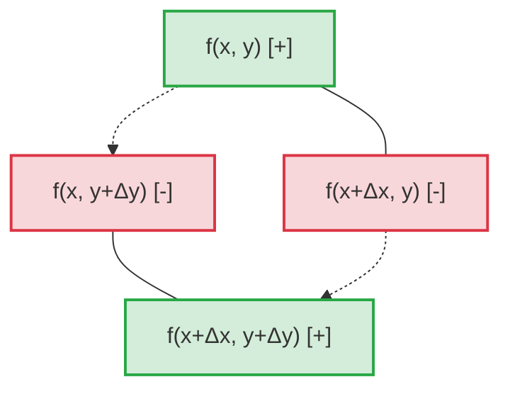

---
tags:
  - матанализ
  - 1_курс
  - подготовка_к_экзамену
тип: конспект
статус: готов
---

> [!abstract] Предисловие экзаменатора
> Данный конспект содержит исчерпывающее, строгое изложение теории дифференциального исчисления функций нескольких переменных. Я требую абсолютной ясности в понимании предельных переходов, строгой опоры на [[Теорема Лагранжа о конечных приращениях|теорему Лагранжа]] и безошибочного владения техникой прибавления и вычитания вспомогательных слагаемых. Любые ссылки на "очевидность" на экзамене будут караться снижением оценки.

# Вопрос №67. Частные производные высших порядков. Многократная дифференцируемость. Связь между условиями дифференцируемости частных производных различных порядков.

> [!definition] Частные производные высших порядков
> Пусть функция $f: U \to \mathbb{R}$, где $U \subset \mathbb{R}^n$ — открытое множество, имеет в $U$ частную производную по переменной $x_i$, то есть задана функция $\frac{\partial f}{\partial x_i}: U \to \mathbb{R}$. 
> Если эта функция сама имеет частную производную по переменной $x_j$ в точке $M_0 \in U$, то эта производная называется **частной производной второго порядка** функции $f$ в точке $M_0$ и обозначается:
> $$ \frac{\partial^2 f}{\partial x_j \partial x_i}(M_0) = \frac{\partial}{\partial x_j} \left( \frac{\partial f}{\partial x_i} \right) (M_0) $$
> Производные порядка $k$ определяются индуктивно: $\frac{\partial^k f}{\partial x_{i_k} \dots \partial x_{i_1}} = \frac{\partial}{\partial x_{i_k}} \left( \frac{\partial^{k-1} f}{\partial x_{i_{k-1}} \dots \partial x_{i_1}} \right)$. 
> Если $i \neq j$, производная называется **смешанной**.

> [!definition] Многократная дифференцируемость в точке
> Функция $f(x)$ называется **дважды дифференцируемой** в точке $M_0$, если она дифференцируема в некоторой окрестности этой точки, а её первый [[Дифференциал]] $df(x; dx) = \sum_{i=1}^n \frac{\partial f}{\partial x_i}(x) dx_i$ (рассматриваемый как функция от $x$ при фиксированных приращениях $dx_i$) дифференцируем в точке $M_0$.
> Индуктивно: функция $k$ раз дифференцируема в точке $M_0$, если она $(k-1)$ раз дифференцируема в окрестности $M_0$, и её дифференциал $(k-1)$-го порядка дифференцируем в точке $M_0$.

> [!theorem] Теорема Юнга (Связь дифференцируемости и равенства смешанных производных)
> Пусть функция $f(x, y)$ определена в окрестности $U(M_0)$ точки $M_0(x_0, y_0)$. Если обе первые частные производные $\frac{\partial f}{\partial x}$ и $\frac{\partial f}{\partial y}$ существуют в $U(M_0)$ и **дифференцируемы** в самой точке $M_0$, то в этой точке существуют смешанные производные второго порядка, и они равны:
> $$ \frac{\partial^2 f}{\partial x \partial y}(M_0) = \frac{\partial^2 f}{\partial y \partial x}(M_0) $$

> [!theorem] Теорема Шварца (Связь непрерывности и равенства смешанных производных)
> Пусть функция $f(x, y)$ определена в окрестности $U(M_0)$ точки $M_0(x_0, y_0)$. Если в $U(M_0)$ существуют смешанные производные $\frac{\partial^2 f}{\partial x \partial y}$ и $\frac{\partial^2 f}{\partial y \partial x}$, и они **непрерывны** в точке $M_0$, то они равны в этой точке.
> *(Строгое доказательство этой теоремы будет дано в Вопросе №69 на базе леммы о двойном приращении).*

> [!warning] Важное замечание (Контрпример)
> Если отказаться от условий непрерывности или дифференцируемости первых производных в точке, смешанные производные могут не совпадать. 
> Классический контрпример:
> $$ f(x,y) = \begin{cases} xy \frac{x^2 - y^2}{x^2 + y^2}, & x^2+y^2 > 0 \\ 0, & x=y=0 \end{cases} $$
> Прямым вычислением по определению (через [[Предел функции]]) можно показать, что $f_{xy}(0,0) = -1$, а $f_{yx}(0,0) = 1$. Равенства нет, так как вторые производные разрывны в нуле.

---

# Вопрос №68. Многократная непрерывная дифференцируемость.

> [!definition] Класс гладкости $C^k(U)$ (Многократная непрерывная дифференцируемость)
> Функция $f: U \to \mathbb{R}$ (где $U$ — открытое множество в $\mathbb{R}^n$) принадлежит классу $C^k(U)$, если в области $U$ существуют все её частные производные до порядка $k$ включительно, и все они являются [[Непрерывность|непрерывными функциями]] в каждой точке множества $U$. 
> Кратко: $f \in C^k(U)$ $\iff$ функция $k$ раз непрерывно дифференцируема. Класс $C^\infty(U)$ обозначает бесконечно дифференцируемые функции.

> [!theorem] Достаточное условие $k$-кратной дифференцируемости
> Если $f \in C^k(U)$, то функция $f$ является $k$ раз дифференцируемой в каждой точке множества $U$.

> [!proof]+ Доказательство (для $k=1$, базовый случай, обобщаемый по индукции)
> Докажем, что из существования и непрерывности частных производных первого порядка следует дифференцируемость функции. Для наглядности проведем строгое доказательство для функции двух переменных $f(x,y)$.
> 
> Пусть точка $M_0(x_0, y_0) \in U$. Зададим приращения $\Delta x$ и $\Delta y$ так, чтобы точка $M(x_0+\Delta x, y_0+\Delta y)$ также лежала в $U$ (это возможно, так как $U$ — открытое множество).
> Рассмотрим полное приращение функции:
> $$ \Delta f = f(x_0+\Delta x, y_0+\Delta y) - f(x_0, y_0) $$
> Применим строгий аналитический прием "плюс-минус", добавив и вычтя значение в промежуточной точке $f(x_0, y_0+\Delta y)$:
> $$ \Delta f = [f(x_0+\Delta x, y_0+\Delta y) - f(x_0, y_0+\Delta y)] + [f(x_0, y_0+\Delta y) - f(x_0, y_0)] $$
> Каждая квадратная скобка представляет собой приращение функции только по одной переменной. Поскольку $f$ имеет частные производные в $U$, мы можем применить к каждой скобке одномерную [[Теорема Лагранжа о конечных приращениях|теорему Лагранжа]]:
> Для первой скобки (по $x$): существует $\theta_1 \in (0, 1)$ такая, что:
> $$ f(x_0+\Delta x, y_0+\Delta y) - f(x_0, y_0+\Delta y) = f'_x(x_0 + \theta_1 \Delta x, y_0 + \Delta y) \cdot \Delta x $$
> Для второй скобки (по $y$): существует $\theta_2 \in (0, 1)$ такая, что:
> $$ f(x_0, y_0+\Delta y) - f(x_0, y_0) = f'_y(x_0, y_0 + \theta_2 \Delta y) \cdot \Delta y $$
> Подставляем в выражение для полного приращения:
> $$ \Delta f = f'_x(x_0 + \theta_1 \Delta x, y_0 + \Delta y) \Delta x + f'_y(x_0, y_0 + \theta_2 \Delta y) \Delta y $$
> В силу условия теоремы, производные $f'_x$ и $f'_y$ непрерывны в точке $M_0(x_0, y_0)$. По определению непрерывности, при $\Delta x \to 0$ и $\Delta y \to 0$ (что означает $\rho = \sqrt{\Delta x^2 + \Delta y^2} \to 0$):
> $$ f'_x(x_0 + \theta_1 \Delta x, y_0 + \Delta y) = f'_x(x_0, y_0) + \alpha(\Delta x, \Delta y) $$
> $$ f'_y(x_0, y_0 + \theta_2 \Delta y) = f'_y(x_0, y_0) + \beta(\Delta x, \Delta y) $$
> где $\alpha \to 0$ и $\beta \to 0$ при $\rho \to 0$.
> Подставляем эти разложения в $\Delta f$:
> $$ \Delta f = (f'_x(x_0, y_0) + \alpha) \Delta x + (f'_y(x_0, y_0) + \beta) \Delta y \\ \qquad = f'_x(x_0, y_0)\Delta x + f'_y(x_0, y_0)\Delta y + (\alpha \Delta x + \beta \Delta y) $$
> Осталось строго доказать, что остаток есть $o(\rho)$. Оценим его модуль:
> $$ \frac{|\alpha \Delta x + \beta \Delta y|}{\rho} \le |\alpha| \frac{|\Delta x|}{\rho} + |\beta| \frac{|\Delta y|}{\rho} \le |\alpha| \cdot 1 + |\beta| \cdot 1 \to 0 \text{ при } \rho \to 0 $$
> Таким образом, $\Delta f = df(M_0) + o(\rho)$, что по определению означает дифференцируемость функции $f$ в точке $M_0$. 
> Для произвольного $k$ теорема доказывается индуктивно, применяя этот же аппарат к дифференциалам $(k-1)$-го порядка. $\blacksquare$

---

# Вопрос №69. Лемма о двойном приращении функции нескольких переменных в точке.

> [!abstract] Геометрический смысл двойного приращения
> Двойное (или смешанное) приращение строится на вершинах прямоугольника со сторонами $\Delta x$ и $\Delta y$. Это дискретный аналог смешанной производной.
> 

> [!definition] Двойное приращение
> Пусть функция $f(x,y)$ задана в окрестности точки $(x,y)$. **Двойным (смешанным) приращением** функции $f$ по переменным $x$ и $y$ называется выражение:
> $$ \Delta_{xy}^2 f = f(x+\Delta x, y+\Delta y) - f(x+\Delta x, y) - f(x, y+\Delta y) + f(x, y) $$

> [!lemma] Лемма о двойном приращении
> Пусть функция $f(x,y)$ определена в прямоугольнике $Q = [x, x+\Delta x] \times [y, y+\Delta y]$. Если внутри прямоугольника существуют частные производные $f_x'$ и смешанная производная $f_{xy}''$, то существуют числа $\theta_1, \theta_2 \in (0, 1)$ такие, что:
> $$ \Delta_{xy}^2 f = f_{xy}''(x + \theta_1 \Delta x, y + \theta_2 \Delta y) \cdot \Delta x \cdot \Delta y $$

> [!proof]+ Строгое доказательство леммы
> Введем вспомогательную функцию одной переменной $t$:
> $$ \varphi(t) = f(t, y+\Delta y) - f(t, y), \quad t \in [x, x+\Delta x] $$
> Заметим, что двойное приращение можно выразить через функцию $\varphi$:
> $$ \varphi(x+\Delta x) - \varphi(x) = [f(x+\Delta x, y+\Delta y) - f(x+\Delta x, y)] - [f(x, y+\Delta y) - f(x, y)] = \Delta_{xy}^2 f $$
> Функция $\varphi(t)$ дифференцируема на $(x, x+\Delta x)$, так как по условию существует $f_x'$. Вычислим её производную:
> $$ \varphi'(t) = f_x'(t, y+\Delta y) - f_x'(t, y) $$
> Применим к $\varphi(t)$ на отрезке $[x, x+\Delta x]$ [[Теорема Лагранжа о конечных приращениях|теорему Лагранжа]]. Существует точка $c_1 = x + \theta_1 \Delta x$ (где $\theta_1 \in (0,1)$), такая что:
> $$ \varphi(x+\Delta x) - \varphi(x) = \varphi'(c_1) \cdot \Delta x $$
> Подставим выражение для $\varphi'(c_1)$:
> $$ \Delta_{xy}^2 f = \left[ f_x'(x + \theta_1 \Delta x, y+\Delta y) - f_x'(x + \theta_1 \Delta x, y) \right] \cdot \Delta x $$
> Теперь рассмотрим квадратную скобку. Зафиксируем первую координату $\xi = x + \theta_1 \Delta x$ и введем новую вспомогательную функцию:
> $$ \psi(s) = f_x'(\xi, s), \quad s \in [y, y+\Delta y] $$
> Тогда квадратная скобка равна $\psi(y+\Delta y) - \psi(y)$.
> По условию существует смешанная производная $f_{xy}''$, что означает дифференцируемость функции $f_x'$ по переменной $y$. Следовательно, $\psi(s)$ дифференцируема, и $\psi'(s) = f_{xy}''(\xi, s)$.
> Применим теорему Лагранжа к $\psi(s)$ на отрезке $[y, y+\Delta y]$. Существует точка $c_2 = y + \theta_2 \Delta y$ (где $\theta_2 \in (0,1)$), такая что:
> $$ \psi(y+\Delta y) - \psi(y) = \psi'(c_2) \cdot \Delta y = f_{xy}''(x + \theta_1 \Delta x, y + \theta_2 \Delta y) \cdot \Delta y $$
> Подставляя это в формулу для $\Delta_{xy}^2 f$, получаем итоговое соотношение:
> $$ \Delta_{xy}^2 f = f_{xy}''(x + \theta_1 \Delta x, y + \theta_2 \Delta y) \cdot \Delta x \cdot \Delta y $$
> Лемма полностью доказана. $\blacksquare$

> [!theorem] Применение: Строгое доказательство Теоремы Шварца (из Вопроса №67)
> С помощью доказанной леммы мы обязаны строго обосновать теорему Шварца.
> Пусть $f_{xy}''$ и $f_{yx}''$ существуют в окрестности $M_0(x_0, y_0)$ и непрерывны в ней.
> 1. Вычислим $\Delta_{xy}^2 f$ двумя способами. Первый способ (сначала по $x$, затем по $y$) мы проделали в лемме:
> $$ \frac{\Delta_{xy}^2 f}{\Delta x \Delta y} = f_{xy}''(x_0 + \theta_1 \Delta x, y_0 + \theta_2 \Delta y) $$
> 2. В силу симметрии двойного приращения, мы можем ввести функцию $\chi(s) = f(x_0+\Delta x, s) - f(x_0, s)$ и провести аналогичные рассуждения, дифференцируя сначала по $y$, а затем по $x$. Получим:
> $$ \frac{\Delta_{xy}^2 f}{\Delta x \Delta y} = f_{yx}''(x_0 + \tilde{\theta}_1 \Delta x, y_0 + \tilde{\theta}_2 \Delta y) $$
> где $\tilde{\theta}_1, \tilde{\theta}_2 \in (0,1)$.
> 3. Приравняем правые части:
> $$ f_{xy}''(x_0 + \theta_1 \Delta x, y_0 + \theta_2 \Delta y) = f_{yx}''(x_0 + \tilde{\theta}_1 \Delta x, y_0 + \tilde{\theta}_2 \Delta y) $$
> 4. Осуществим предельный переход при $\Delta x \to 0$ и $\Delta y \to 0$. Так как производные $f_{xy}''$ и $f_{yx}''$ **непрерывны** в точке $(x_0, y_0)$, пределы обеих частей совпадают со значениями функций в этой точке:
> $$ \lim_{\Delta x, \Delta y \to 0} f_{xy}''(x_0 + \theta_1 \Delta x, y_0 + \theta_2 \Delta y) = f_{xy}''(x_0, y_0) $$
> $$ \lim_{\Delta x, \Delta y \to 0} f_{yx}''(x_0 + \tilde{\theta}_1 \Delta x, y_0 + \tilde{\theta}_2 \Delta y) = f_{yx}''(x_0, y_0) $$
> Отсюда с неотвратимостью следует, что $f_{xy}''(x_0, y_0) = f_{yx}''(x_0, y_0)$. Теорема доказана. $\blacksquare$

