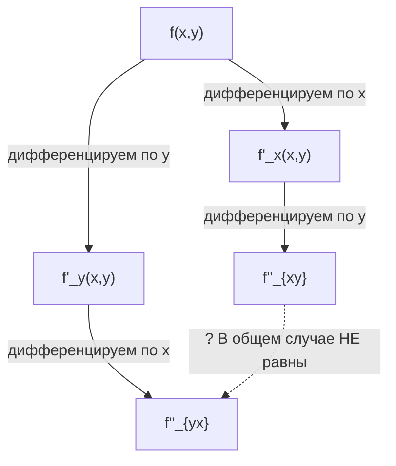
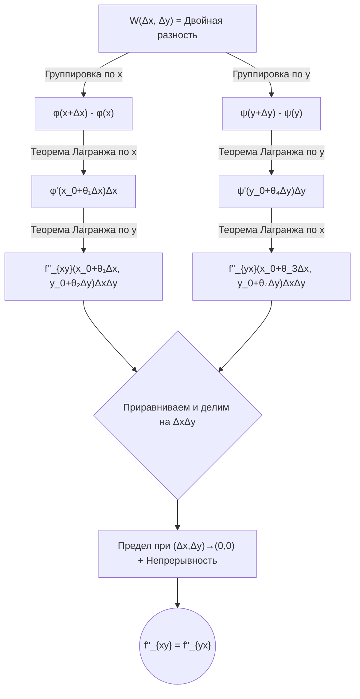
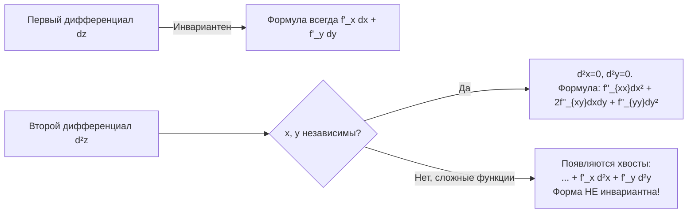

---
tags:
  - матанализ
  - 1_курс
  - подготовка_к_экзамену
тип: конспект
статус: готов
---

> [!abstract] От экзаменатора
> Представленный ниже материал требует абсолютного понимания. На экзамене я не потерплю размахивания руками, ссылок на «очевидность» или подмены строгих предельных переходов геометрической интуицией. Каждое применение [[Теорема Лагранжа о конечных приращениях|теоремы Лагранжа]] или свойства [[Непрерывность|непрерывности]] должно быть обосновано. Учите определения наизусть, понимайте структуру доказательств.

# Вопрос № 70. Симметрия смешанных производных функции двух переменных

> [!definition] Частные производные высших порядков
> Пусть функция $f(x,y)$ имеет в некоторой окрестности $U(M_0)$ точки $M_0(x_0, y_0)$ [[Частная производная|частные производные]] первого порядка $f'_x(x,y)$ и $f'_y(x,y)$. 
> Если эти производные сами имеют частные производные в точке $M_0$, то они называются **частными производными второго порядка** функции $f(x,y)$ в точке $M_0$.

Обозначения для чистых производных:
$$ f''_{xx} = \frac{\partial^2 f}{\partial x^2} = \frac{\partial}{\partial x} \left( \frac{\partial f}{\partial x} \right), \qquad f''_{yy} = \frac{\partial^2 f}{\partial y^2} = \frac{\partial}{\partial y} \left( \frac{\partial f}{\partial y} \right) $$

> [!definition] Смешанные частные производные
> Производные, взятые по различным переменным, называются **смешанными**.
> $$ f''_{xy} = \frac{\partial^2 f}{\partial x \partial y} = \frac{\partial}{\partial y} \left( \frac{\partial f}{\partial x} \right) \quad \text{и} \quad f''_{yx} = \frac{\partial^2 f}{\partial y \partial x} = \frac{\partial}{\partial x} \left( \frac{\partial f}{\partial y} \right) $$

**Постановка проблемы:** Всегда ли результат дифференцирования не зависит от порядка взятия производных? Иными словами, всегда ли $f''_{xy}(x_0, y_0) = f''_{yx}(x_0, y_0)$? Ответ: **нет**.

> [!warning] Важное замечание (Контрпример Пеано)
> Равенство смешанных производных НЕ является тождественным. Оно требует дополнительных условий (обычно — непрерывности). Если смешанные производные разрывны в точке, они могут не совпадать.
> 
> Рассмотрим функцию:
> $$ f(x,y) = \begin{cases} xy \frac{x^2 - y^2}{x^2 + y^2}, & x^2 + y^2 > 0 \\ 0, & x=y=0 \end{cases} $$
> Найдем смешанные производные в точке $(0,0)$ по определению через [[Предел функции|предел]]:
> 1. При $y \neq 0$: $\quad f'_x(0,y) = \lim_{x \to 0} \frac{f(x,y) - f(0,y)}{x} = \lim_{x \to 0} \left( y \frac{x^2 - y^2}{x^2 + y^2} \right) = -y$.
> 2. Отсюда $f''_{xy}(0,0) = \lim_{y \to 0} \frac{f'_x(0,y) - f'_x(0,0)}{y} = \lim_{y \to 0} \frac{-y - 0}{y} = -1$.
> 3. При $x \neq 0$: $\quad f'_y(x,0) = \lim_{y \to 0} \frac{f(x,y) - f(x,0)}{y} = \lim_{y \to 0} \left( x \frac{x^2 - y^2}{x^2 + y^2} \right) = x$.
> 4. Отсюда $f''_{yx}(0,0) = \lim_{x \to 0} \frac{f'_y(x,0) - f'_y(0,0)}{x} = \lim_{x \to 0} \frac{x - 0}{x} = 1$.
> 
> **Вывод:** $f''_{xy}(0,0) = -1 \neq 1 = f''_{yx}(0,0)$. 

---

# Вопрос № 71. Условия равенства смешанных производных функции двух переменных

Для того чтобы смешанные производные были равны, на функцию необходимо наложить дополнительные ограничения. Классическим достаточным условием в рамках курса математического анализа является теорема Шварца.

> [!theorem] Теорема Шварца о равенстве смешанных производных
> Пусть функция $f(x,y)$ определена в некоторой окрестности $U(M_0)$ точки $M_0(x_0, y_0)$. Если в этой окрестности:
> 1. Существуют частные производные $f'_x, f'_y, f''_{xy}, f''_{yx}$.
> 2. Смешанные производные $f''_{xy}$ и $f''_{yx}$ **непрерывны** в самой точке $M_0(x_0, y_0)$.
> 
> Тогда в точке $M_0$ выполняется равенство:
> $$ f''_{xy}(x_0, y_0) = f''_{yx}(x_0, y_0) $$

> [!lemma] Вспомогательная конструкция: Двойная разность
> Для доказательства введем функцию двойного приращения (двойную разность) по прямоугольнику со сторонами $\Delta x$ и $\Delta y$:
> $$ W(\Delta x, \Delta y) = f(x_0 + \Delta x, y_0 + \Delta y) - f(x_0 + \Delta x, y_0) - f(x_0, y_0 + \Delta y) + f(x_0, y_0) $$
> Мы вычислим эту разность двумя разными способами, сводя её к производным $f''_{xy}$ и $f''_{yx}$ соответственно.

> [!proof]+ Доказательство теоремы Шварца
> Зафиксируем приращения $\Delta x \neq 0$ и $\Delta y \neq 0$ так, чтобы прямоугольник с вершинами $(x_0, y_0)$, $(x_0+\Delta x, y_0)$, $(x_0, y_0+\Delta y)$, $(x_0+\Delta x, y_0+\Delta y)$ целиком лежал в окрестности $U(M_0)$.
> 
> **Шаг 1. Сведение $W$ к $f''_{xy}$**
> Введем вспомогательную функцию одной переменной $x$:
> $$ \varphi(x) = f(x, y_0 + \Delta y) - f(x, y_0) $$
> Тогда двойную разность можно переписать как приращение функции $\varphi$:
> $$ W(\Delta x, \Delta y) = \varphi(x_0 + \Delta x) - \varphi(x_0) $$
> Так как $f'_x$ существует в $U(M_0)$, функция $\varphi(x)$ дифференцируема на отрезке $[x_0, x_0+\Delta x]$ (или $[x_0+\Delta x, x_0]$ при $\Delta x < 0$). Применим к ней [[Теорема Лагранжа о конечных приращениях|теорему Лагранжа]]:
> $$ W(\Delta x, \Delta y) = \varphi'(x_0 + \theta_1 \Delta x) \cdot \Delta x, \quad \text{где } \theta_1 \in (0,1) $$
> Вычислим производную $\varphi'$:
> $$ \varphi'(x) = f'_x(x, y_0 + \Delta y) - f'_x(x, y_0) $$
> Подставим точку $x_0 + \theta_1 \Delta x$:
> $$ W(\Delta x, \Delta y) = \left[ f'_x(x_0 + \theta_1 \Delta x, y_0 + \Delta y) - f'_x(x_0 + \theta_1 \Delta x, y_0) \right] \Delta x $$
> Выражение в квадратных скобках — это приращение функции $f'_x(x,y)$ по переменной $y$ на отрезке $[y_0, y_0+\Delta y]$ при фиксированном $x = x_0 + \theta_1 \Delta x$. Так как $f''_{xy}$ существует, мы можем повторно применить теорему Лагранжа уже по переменной $y$:
> $$ W(\Delta x, \Delta y) = f''_{xy}(x_0 + \theta_1 \Delta x, y_0 + \theta_2 \Delta y) \cdot \Delta y \cdot \Delta x, \quad \text{где } \theta_2 \in (0,1) $$
> 
> **Шаг 2. Сведение $W$ к $f''_{yx}$**
> Теперь введем другую вспомогательную функцию переменной $y$:
> $$ \psi(y) = f(x_0 + \Delta x, y) - f(x_0, y) $$
> Аналогично, $W(\Delta x, \Delta y) = \psi(y_0 + \Delta y) - \psi(y_0)$.
> Применяя теорему Лагранжа сначала к $\psi$ на отрезке $[y_0, y_0+\Delta y]$, а затем к $f'_y$ на отрезке $[x_0, x_0+\Delta x]$, получим:
> $$ W(\Delta x, \Delta y) = f''_{yx}(x_0 + \theta_3 \Delta x, y_0 + \theta_4 \Delta y) \cdot \Delta x \cdot \Delta y, \quad \text{где } \theta_3, \theta_4 \in (0,1) $$
> 
> **Шаг 3. Предельный переход**
> Приравняем два полученных выражения для $W(\Delta x, \Delta y)$ и сократим на $(\Delta x \cdot \Delta y \neq 0)$:
> $$ f''_{xy}(x_0 + \theta_1 \Delta x, y_0 + \theta_2 \Delta y) = f''_{yx}(x_0 + \theta_3 \Delta x, y_0 + \theta_4 \Delta y) $$
> Теперь устремим $(\Delta x, \Delta y) \to (0,0)$. 
> Точки $(x_0 + \theta_1 \Delta x, y_0 + \theta_2 \Delta y)$ и $(x_0 + \theta_3 \Delta x, y_0 + \theta_4 \Delta y)$ стремятся к точке $(x_0, y_0)$.
> В силу условия **непрерывности** обеих смешанных производных в точке $M_0(x_0, y_0)$, пределы левой и правой частей совпадают со значениями функций в этой точке:
> $$ \lim_{(\Delta x, \Delta y) \to (0,0)} f''_{xy}(...) = f''_{xy}(x_0, y_0) $$
> $$ \lim_{(\Delta x, \Delta y) \to (0,0)} f''_{yx}(...) = f''_{yx}(x_0, y_0) $$
> Следовательно:
> $$ f''_{xy}(x_0, y_0) = f''_{yx}(x_0, y_0) $$
> Что и требовалось доказать. $\blacksquare$

> [!theorem] Теорема Юнга (Ослабленные условия)
> *Историческая справка для отличников:* Существует более сильное утверждение (теорема Юнга), требующее лишь дифференцируемости первых производных $f'_x$ и $f'_y$ в самой точке $(x_0, y_0)$, не требуя существования вторых производных в целой окрестности. Но в стандартном курсе на экзамене спрашивается и доказывается именно теорема Шварца.

---

# Вопрос № 72. Дифференциалы высших порядков

> [!definition] Дифференциал первого порядка
> Пусть функция $z = f(x,y)$ [[Дифференцируемость|дифференцируема]] в точке $(x,y)$. Её первым дифференциалом называется главная линейная часть приращения:
> $$ dz = df(x,y) = f'_x(x,y) dx + f'_y(x,y) dy $$
> где $dx = \Delta x$ и $dy = \Delta y$ — приращения **независимых** переменных, которые мы считаем произвольными константами, не зависящими от $x$ и $y$.

> [!definition] Дифференциал второго порядка
> Дифференциалом второго порядка $d^2z$ функции $z=f(x,y)$ называется дифференциал от её первого дифференциала при условии, что приращения независимых переменных $dx$ и $dy$ остаются постоянными при повторном дифференцировании:
> $$ d^2z = d(dz) $$

Выведем формулу для $d^2z$. Так как $dz = f'_x dx + f'_y dy$, а $dx, dy = const$:
$$ d^2z = d(f'_x dx + f'_y dy) = d(f'_x) dx + d(f'_y) dy $$
Раскроем дифференциалы от производных:
$$ d(f'_x) = (f'_x)'_x dx + (f'_x)'_y dy = f''_{xx} dx + f''_{xy} dy $$
$$ d(f'_y) = (f'_y)'_x dx + (f'_y)'_y dy = f''_{yx} dx + f''_{yy} dy $$
Подставляя обратно и предполагая выполнение условий теоремы Шварца ($f''_{xy} = f''_{yx}$):
$$ d^2z = (f''_{xx} dx + f''_{xy} dy) dx + (f''_{xy} dx + f''_{yy} dy) dy $$
$$ d^2z = f''_{xx} dx^2 + 2f''_{xy} dx dy + f''_{yy} dy^2 $$

> [!abstract] Операторная форма записи
> Для запоминания дифференциалов $n$-го порядка вводится символический оператор:
> $$ d^n z = \left( dx \frac{\partial}{\partial x} + dy \frac{\partial}{\partial y} \right)^n f(x,y) $$
> Он раскрывается по формуле бинома Ньютона. Возведение в степень символа $\partial$ означает порядок производной, а возведение в степень $dx, dy$ — алгебраическую степень дифференциала независимой переменной.

### Отсутствие инвариантности формы дифференциалов высших порядков

> [!warning] КРИТИЧЕСКИ ВАЖНОЕ ЗАМЕЧАНИЕ НА ЭКЗАМЕНЕ
> Первый дифференциал $df = f'_x dx + f'_y dy$ обладает свойством **инвариантности формы**: формула выглядит одинаково независимо от того, являются ли $x,y$ независимыми переменными или функциями от других переменных $u, v$.
> 
> **Дифференциалы высших порядков ($d^2z, d^3z, \dots$) СВОЙСТВОМ ИНВАРИАНТНОСТИ ФОРМЫ НЕ ОБЛАДАЮТ!**

> [!proof]+ Строгое доказательство отсутствия инвариантности
> Пусть $z = f(x,y)$, но теперь $x = x(u,v)$ и $y = y(u,v)$ — функции независимых переменных $u, v$, имеющие непрерывные вторые частные производные.
> Первый дифференциал:
> $$ dz = f'_x dx + f'_y dy $$
> Здесь $dx$ и $dy$ уже **не являются константами**, так как это дифференциалы функций $x(u,v)$ и $y(u,v)$, зависящие от $u, v, du, dv$.
> 
> Найдем $d^2z = d(dz)$:
> По правилу дифференцирования суммы и произведения (учитывая, что теперь $d(dx) = d^2x \neq 0$ и $d(dy) = d^2y \neq 0$):
> $$ d^2z = d(f'_x dx) + d(f'_y dy) = \left( d(f'_x) \cdot dx + f'_x \cdot d(dx) \right) + \left( d(f'_y) \cdot dy + f'_y \cdot d(dy) \right) $$
> Так как $d(f'_x) = f''_{xx} dx + f''_{xy} dy$ и $d(f'_y) = f''_{xy} dx + f''_{yy} dy$, подставим:
> $$ d^2z = \underbrace{f''_{xx} dx^2 + 2f''_{xy} dx dy + f''_{yy} dy^2}_{\text{классическая часть}} + \underbrace{f'_x d^2x + f'_y d^2y}_{\text{добавочные члены}} $$
> 
> **Вывод:** Наличие слагаемых $f'_x d^2x + f'_y d^2y$ строго доказывает, что форма второго дифференциала изменилась. Если бы $x, y$ были независимыми, то $d^2x = 0$ и $d^2y = 0$, и добавочные члены исчезли бы.

