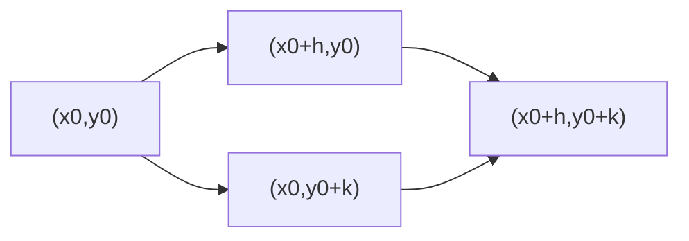

---
tags:
  - матанализ
  - 1_курс
  - подготовка_к_экзамену
тип: конспект
статус: готов
---

# Вопрос №70. Симметрия смешанных производных функции двух переменных

> [!definition] [[Смешанная производная]] второго порядка
> Пусть $f:D\subset\mathbb{R}^2\to\mathbb{R}$, $(x_0,y_0)\in D$, и существует частная производная $f_x$ в некоторой окрестности точки $(x_0,y_0)$ (в смысле существования в каждой точке этой окрестности).  
> Тогда **смешанной производной** $f_{xy}(x_0,y_0)$ называется производная функции $f_x$ по $y$ в точке $(x_0,y_0)$:
> $$
> f_{xy}(x_0,y_0)=\lim_{k\to 0}\frac{f_x(x_0,y_0+k)-f_x(x_0,y_0)}{k},
> $$
> если предел существует (конечен). Аналогично определяется $f_{yx}(x_0,y_0)$.

> [!definition] Симметрия смешанных производных (равенство смешанных производных)
> Говорят, что в точке $(x_0,y_0)$ имеет место **симметрия смешанных производных**, если существуют $f_{xy}(x_0,y_0)$ и $f_{yx}(x_0,y_0)$ и выполняется равенство
> $$
> f_{xy}(x_0,y_0)=f_{yx}(x_0,y_0).
> $$

> [!theorem] [[Теорема Клеро — Шварца]] (симметрия смешанных производных при непрерывности)
> Пусть $f$ определена в некоторой окрестности точки $(x_0,y_0)$.  
> Предположим, что в этой окрестности существуют смешанные производные $f_{xy}$ и $f_{yx}$ и, кроме того, хотя бы одна из них непрерывна в точке $(x_0,y_0)$, а другая существует в некоторой окрестности (стандартная достаточность: обе смешанные производные существуют в окрестности и непрерывны в точке). Тогда
> $$
> f_{xy}(x_0,y_0)=f_{yx}(x_0,y_0).
> $$

> [!lemma] Прямоугольная смешанная разность
> Для $h\neq 0$, $k\neq 0$ рассмотрим величину
> $$
> \Delta(h,k)=f(x_0+h,y_0+k)-f(x_0+h,y_0)-f(x_0,y_0+k)+f(x_0,y_0).
> $$
> Она равна приращению $f$ по вершинам прямоугольника и является дискретным аналогом смешанной производной.

> [!abstract] Геометрический / Физический смысл
> Величина $\Delta(h,k)$ измеряет «неаддитивность» приращений при последовательном изменении $x$ и $y$:  
> сначала изменить $x$, потом $y$ **или** сначала $y$, потом $x$.  
> Симметрия $f_{xy}=f_{yx}$ означает, что в пределе при $h,k\to 0$ эффект «порядка малых изменений» исчезает.

> [!proof]+ Доказательство теоремы Клеро — Шварца (через теорему Лагранжа о среднем для функций одной переменной)
> Зафиксируем малые $h\neq 0$, $k\neq 0$ так, чтобы все рассматриваемые точки лежали в области определения $f$.
> 
> **Шаг 1.** Представим $\Delta(h,k)$ как разность значений некоторой функции одной переменной и применим [[Теорема Лагранжа о среднем]].
> 
> Рассмотрим функцию одной переменной
> $$
> \varphi(x)=f(x,y_0+k)-f(x,y_0),
> $$
> определённую на отрезке с концами $x_0$ и $x_0+h$ (ориентация не важна).
> 
> Предположим, что $f_x$ существует на соответствующем промежутке по $x$ при фиксированных $y_0$ и $y_0+k$; тогда $\varphi$ дифференцируема и
> $$
> \varphi'(x)=f_x(x,y_0+k)-f_x(x,y_0).
> $$
> По теореме Лагранжа о среднем существует $\xi=\xi(h,k)$ между $x_0$ и $x_0+h$ такая, что
> $$
> \varphi(x_0+h)-\varphi(x_0)=\varphi'(\xi)\,h.
> $$
> Левая часть равна
> $$
> \varphi(x_0+h)-\varphi(x_0)=\big(f(x_0+h,y_0+k)-f(x_0+h,y_0)\big)-\big(f(x_0,y_0+k)-f(x_0,y_0)\big)=\Delta(h,k).
> $$
> Следовательно,
> $$
> \Delta(h,k)=\big(f_x(\xi,y_0+k)-f_x(\xi,y_0)\big)\,h.
> $$
> 
> **Шаг 2.** Применим теорему Лагранжа к разности по $y$.
> 
> Рассмотрим (при фиксированном $\xi$) функцию одной переменной
> $$
> \psi(y)=f_x(\xi,y).
> $$
> Предположим, что $f_{xy}$ существует на промежутке между $y_0$ и $y_0+k$; тогда $\psi$ дифференцируема и $\psi'(y)=f_{xy}(\xi,y)$.
> По теореме Лагранжа существует $\eta=\eta(h,k)$ между $y_0$ и $y_0+k$ такая, что
> $$
> f_x(\xi,y_0+k)-f_x(\xi,y_0)=f_{xy}(\xi,\eta)\,k.
> $$
> Подставляя, получаем
> $$
> \Delta(h,k)=h\cdot \big(f_{xy}(\xi,\eta)\,k\big)=hk\,f_{xy}(\xi,\eta).
> $$
> Значит,
> $$
> \frac{\Delta(h,k)}{hk}=f_{xy}(\xi,\eta). \qquad (1)
> $$
> 
> **Шаг 3.** Аналогично выразим $\Delta(h,k)$ через $f_{yx}$, поменяв порядок применения теоремы Лагранжа.
> 
> Рассмотрим функцию
> $$
> \widetilde\varphi(y)=f(x_0+h,y)-f(x_0,y).
> $$
> Тогда
> $$
> \widetilde\varphi(y_0+k)-\widetilde\varphi(y_0)=\Delta(h,k).
> $$
> Если $f_y$ существует на нужном промежутке, то $\widetilde\varphi$ дифференцируема и $\widetilde\varphi'(y)=f_y(x_0+h,y)-f_y(x_0,y)$.
> По теореме Лагранжа существует $\eta'=\eta'(h,k)$ между $y_0$ и $y_0+k$:
> $$
> \Delta(h,k)=k\big(f_y(x_0+h,\eta')-f_y(x_0,\eta')\big).
> $$
> Теперь применим теорему Лагранжа по $x$ к функции $x\mapsto f_y(x,\eta')$ (при условии существования $f_{yx}$ на промежутке между $x_0$ и $x_0+h$). Получим, что существует $\xi'=\xi'(h,k)$ между $x_0$ и $x_0+h$ такое, что
> $$
> f_y(x_0+h,\eta')-f_y(x_0,\eta')=f_{yx}(\xi',\eta')\,h.
> $$
> Следовательно,
> $$
> \frac{\Delta(h,k)}{hk}=f_{yx}(\xi',\eta'). \qquad (2)
> $$
> 
> **Шаг 4.** Переход к пределу при $(h,k)\to(0,0)$.
> 
> Из построения: $\xi$ лежит между $x_0$ и $x_0+h$, а $\eta$ — между $y_0$ и $y_0+k$. Поэтому при $(h,k)\to(0,0)$ выполняется
> $$
> \xi\to x_0,\qquad \eta\to y_0,
> $$
> и аналогично $\xi'\to x_0$, $\eta'\to y_0$.
> 
> Пусть, например, $f_{xy}$ непрерывна в $(x_0,y_0)$, а $f_{yx}$ существует в некоторой окрестности точки. Тогда по определению непрерывности:
> для любого $\varepsilon>0$ существует $\delta>0$ такое, что если
> $$
> \sqrt{(x-x_0)^2+(y-y_0)^2}<\delta,
> $$
> то
> $$
> |f_{xy}(x,y)-f_{xy}(x_0,y_0)|<\varepsilon.
> $$
> При достаточно малых $h,k$ точки $(\xi,\eta)$ попадают в такую $\delta$-окрестность, значит
> $$
> \left|\frac{\Delta(h,k)}{hk}-f_{xy}(x_0,y_0)\right|
> =|f_{xy}(\xi,\eta)-f_{xy}(x_0,y_0)|<\varepsilon,
> $$
> то есть
> $$
> \lim_{(h,k)\to(0,0)}\frac{\Delta(h,k)}{hk}=f_{xy}(x_0,y_0). \qquad (3)
> $$
> Аналогично, если дополнительно $f_{yx}$ непрерывна в $(x_0,y_0)$ (или если доказать существование того же предела другим способом), то из (2) получаем
> $$
> \lim_{(h,k)\to(0,0)}\frac{\Delta(h,k)}{hk}=f_{yx}(x_0,y_0). \qquad (4)
> $$
> Предел не может одновременно равняться двум различным числам, следовательно из (3)–(4)
> $$
> f_{xy}(x_0,y_0)=f_{yx}(x_0,y_0).
> $$
> Теорема доказана.

> [!warning] Важное замечание (почему нужны условия)
> Сам факт существования $f_{xy}(x_0,y_0)$ и $f_{yx}(x_0,y_0)$ **не гарантирует** их равенства, если нет условий регулярности (например, непрерывности смешанных производных в точке/окрестности). Контрпример приведён в следующем вопросе.

---

# Вопрос №71. Условия равенства смешанных производных функции двух переменных

> [!definition] [[Непрерывность]] в точке (в терминах $\varepsilon$–$\delta$)
> Функция $g:D\subset\mathbb{R}^2\to\mathbb{R}$ непрерывна в точке $(x_0,y_0)\in D$, если
> $$
> \forall \varepsilon>0\ \exists \delta>0:\ \sqrt{(x-x_0)^2+(y-y_0)^2}<\delta \Rightarrow |g(x,y)-g(x_0,y_0)|<\varepsilon.
> $$

> [!theorem] Достаточное условие 1 (класс $C^2$ в окрестности)
> Пусть $f$ определена в некоторой окрестности точки $(x_0,y_0)$ и существуют вторые частные производные
> $$
> f_{xx},\ f_{xy},\ f_{yx},\ f_{yy}
> $$
> в этой окрестности. Если $f_{xy}$ и $f_{yx}$ непрерывны в точке $(x_0,y_0)$ (в частности, если все вторые частные производные непрерывны в окрестности), то
> $$
> f_{xy}(x_0,y_0)=f_{yx}(x_0,y_0).
> $$

> [!theorem] Достаточное условие 2 (непрерывность одной смешанной производной + существование другой в окрестности)
> Пусть $f$ определена в окрестности $(x_0,y_0)$, существуют $f_x$ и $f_y$ в этой окрестности.  
> Пусть также $f_{xy}$ существует в окрестности и непрерывна в точке $(x_0,y_0)$, а $f_{yx}$ существует в окрестности (не обязательно непрерывна). Тогда
> $$
> f_{xy}(x_0,y_0)=f_{yx}(x_0,y_0).
> $$
> (Аналогично при перестановке ролей $f_{xy}$ и $f_{yx}$.)

> [!proof]+ Доказательство достаточного условия 2
> Повторим конструкцию из доказательства теоремы Клеро — Шварца.
> 
> Для малых $h,k\neq 0$ рассмотрим
> $$
> \Delta(h,k)=f(x_0+h,y_0+k)-f(x_0+h,y_0)-f(x_0,y_0+k)+f(x_0,y_0).
> $$
> 
> Как в предыдущем вопросе, двукратное применение [[Теорема Лагранжа о среднем]] даёт существование $\xi,\eta$ таких, что
> $$
> \frac{\Delta(h,k)}{hk}=f_{xy}(\xi,\eta),
> $$
> где $\xi$ лежит между $x_0$ и $x_0+h$, а $\eta$ — между $y_0$ и $y_0+k$.
> 
> Так как $f_{xy}$ непрерывна в $(x_0,y_0)$, то (строго по определению непрерывности) при $(h,k)\to(0,0)$ имеем
> $$
> f_{xy}(\xi,\eta)\to f_{xy}(x_0,y_0),
> $$
> то есть существует предел
> $$
> L:=\lim_{(h,k)\to(0,0)}\frac{\Delta(h,k)}{hk}=f_{xy}(x_0,y_0). \qquad (1)
> $$
> 
> С другой стороны, аналогичное рассуждение «в обратном порядке» (в котором требуется существование $f_{yx}$ в окрестности) даёт представление
> $$
> \frac{\Delta(h,k)}{hk}=f_{yx}(\xi',\eta')
> $$
> для некоторых $\xi',\eta'$ между соответствующими концами отрезков, зависящих от $h,k$.
> 
> Тогда из (1) следует, что у отношения $\Delta(h,k)/(hk)$ существует предел $L$. Но по определению $f_{yx}(x_0,y_0)$ как предела соответствующих разностных отношений (можно вывести через те же $\Delta(h,k)$), значение $f_{yx}(x_0,y_0)$ обязано совпадать с этим единственным возможным пределом $L$. Следовательно,
> $$
> f_{yx}(x_0,y_0)=L=f_{xy}(x_0,y_0).
> $$
> Доказательство завершено.

> [!warning] Контрпример: смешанные производные существуют, но не равны
> Определим $f:\mathbb{R}^2\to\mathbb{R}$:
> $$
> f(x,y)=
> \begin{cases}
> \dfrac{xy(x^2-y^2)}{x^2+y^2}, & (x,y)\neq (0,0),\\[6pt]
> 0, & (x,y)=(0,0).
> \end{cases}
> $$
> Тогда в точке $(0,0)$ существуют смешанные производные, но
> $$
> f_{xy}(0,0)=1,\qquad f_{yx}(0,0)=-1.
> $$
> Ключевая причина: вторые производные не являются непрерывными в окрестности (в точке происходит «разрыв регулярности»).
> 
> > [!proof]+ Проверка значений $f_{xy}(0,0)$ и $f_{yx}(0,0)$
> > Сначала найдём $f_x(0,y)$ для $y\neq 0$:
> > $$
> > f_x(0,y)=\lim_{h\to 0}\frac{f(h,y)-f(0,y)}{h}=\lim_{h\to 0}\frac{f(h,y)}{h}.
> > $$
> > Для $y\neq 0$ и $h\neq 0$:
> > $$
> > f(h,y)=\frac{hy(h^2-y^2)}{h^2+y^2}\quad\Rightarrow\quad \frac{f(h,y)}{h}=\frac{y(h^2-y^2)}{h^2+y^2}.
> > $$
> > Переходя к пределу при $h\to 0$:
> > $$
> > f_x(0,y)=\frac{y(0-y^2)}{0+y^2}=-y.
> > $$
> > Также
> > $$
> > f_x(0,0)=\lim_{h\to 0}\frac{f(h,0)-f(0,0)}{h}=\lim_{h\to 0}\frac{0}{h}=0.
> > $$
> > Тогда
> > $$
> > f_{xy}(0,0)=\lim_{k\to 0}\frac{f_x(0,k)-f_x(0,0)}{k}=\lim_{k\to 0}\frac{-k-0}{k}=-1.
> > $$
> > Аналогично найдём $f_y(x,0)$ для $x\neq 0$:
> > $$
> > f_y(x,0)=\lim_{t\to 0}\frac{f(x,t)-f(x,0)}{t}=\lim_{t\to 0}\frac{f(x,t)}{t}.
> > $$
> > При $x\neq 0$:
> > $$
> > f(x,t)=\frac{xt(x^2-t^2)}{x^2+t^2}\quad\Rightarrow\quad \frac{f(x,t)}{t}=\frac{x(x^2-t^2)}{x^2+t^2}\xrightarrow[t\to 0]{} \frac{x\cdot x^2}{x^2}=x.
> > $$
> > То есть $f_y(x,0)=x$ при $x\neq 0$, и $f_y(0,0)=0$.
> > Тогда
> > $$
> > f_{yx}(0,0)=\lim_{h\to 0}\frac{f_y(h,0)-f_y(0,0)}{h}=\lim_{h\to 0}\frac{h-0}{h}=1.
> > $$
> > Получили $f_{xy}(0,0)=-1$, $f_{yx}(0,0)=1$, то есть равенство смешанных производных нарушается.

> [!warning] Методологическое замечание
> На экзамене важно различать:
> 1) **утверждение** $f_{xy}=f_{yx}$ (это не всегда правда),  
> 2) **условия**, при которых оно верно (непрерывность/гладкость в окрестности).

---

# Вопрос №72. Дифференциалы высших порядков

> [!definition] [[Дифференциал]] первого порядка (полный дифференциал) для $f:\mathbb{R}^n\to\mathbb{R}$
> Пусть $f$ задана в окрестности точки $a=(a_1,\dots,a_n)$ и имеет в точке $a$ линейную часть приращения:
> существует линейная форма $L(h)$ такая, что при $h\to 0$
> $$
> f(a+h)-f(a)=L(h)+o(\|h\|).
> $$
> Тогда $f$ **дифференцируема** в $a$, а $L$ называется **дифференциалом** в точке $a$ и обозначается $df(a)$.
> При наличии частных производных и дифференцируемости:
> $$
> df(a)=\sum_{i=1}^n f_{x_i}(a)\,dx_i,
> $$
> где $dx_i$ — независимые приращения координат.

> [!definition] Дифференциалы высших порядков (итерация оператора $d$)
> Пусть $f$ определена в окрестности точки и обладает достаточной гладкостью (существуют соответствующие частные производные).  
> Определим дифференциалы высших порядков рекуррентно:
> $$
> d^1 f := df,\qquad d^{m}f:=d(d^{m-1}f),\quad m\ge 2,
> $$
> где при вычислении $d(\cdot)$ величины $dx_i$ рассматриваются как формальные независимые константы (их дифференциал равен нулю: $d(dx_i)=0$).

> [!theorem] Формула для второго дифференциала ($n$ переменных)
> Пусть $f$ имеет в окрестности точки $a$ все вторые частные производные $f_{x_i x_j}$, и эти производные непрерывны в точке $a$ (достаточно для корректной симметрии смешанных производных). Тогда
> $$
> d^2 f(a)=\sum_{i=1}^n\sum_{j=1}^n f_{x_i x_j}(a)\,dx_i\,dx_j.
> $$
> В случае $n=2$:
> $$
> d^2 f(a)=f_{xx}(a)\,dx^2+2f_{xy}(a)\,dx\,dy+f_{yy}(a)\,dy^2,
> $$
> где коэффициент $2$ возникает из равенства $f_{xy}(a)=f_{yx}(a)$.

> [!proof]+ Доказательство формулы для $d^2 f$
> Рассмотрим $f:\mathbb{R}^n\to\mathbb{R}$ и точку $a$.
> 
> Из формулы для первого дифференциала:
> $$
> df(a)=\sum_{i=1}^n f_{x_i}(a)\,dx_i.
> $$
> Возьмём дифференциал от обеих частей. Используем линейность оператора $d$:
> $$
> d\big(df(a)\big)=d\left(\sum_{i=1}^n f_{x_i}(a)\,dx_i\right)=\sum_{i=1}^n d\big(f_{x_i}(a)\,dx_i\big).
> $$
> По правилу дифференцирования произведения (здесь $dx_i$ — «константы» относительно $d$, то есть $d(dx_i)=0$):
> $$
> d\big(f_{x_i}(a)\,dx_i\big)=d\big(f_{x_i}(a)\big)\,dx_i+f_{x_i}(a)\,d(dx_i)=d\big(f_{x_i}(a)\big)\,dx_i.
> $$
> Так как $f_{x_i}$ дифференцируема (существуют все $f_{x_i x_j}$ и они непрерывны в точке $a$, что является стандартным достаточным условием дифференцируемости $f_{x_i}$), то
> $$
> d\big(f_{x_i}(a)\big)=\sum_{j=1}^n f_{x_i x_j}(a)\,dx_j.
> $$
> Подставляя:
> $$
> d^2 f(a)=d(df(a))=\sum_{i=1}^n\left(\sum_{j=1}^n f_{x_i x_j}(a)\,dx_j\right)dx_i
> =\sum_{i=1}^n\sum_{j=1}^n f_{x_i x_j}(a)\,dx_j\,dx_i.
> $$
> Перестановка $dx_j\,dx_i$ на $dx_i\,dx_j$ является формальной (произведение симметрично), а равенства коэффициентов при $dx_i dx_j$ и $dx_j dx_i$ обеспечиваются равенством смешанных производных $f_{x_i x_j}(a)=f_{x_j x_i}(a)$, которое следует из [[Теорема Клеро — Шварца]] при данных условиях.
> Доказательство завершено.

> [!theorem] Формула для дифференциала порядка $m$ (через мультииндексы)
> Пусть $f$ имеет непрерывные частные производные порядка $m$ в некоторой окрестности точки $a\in\mathbb{R}^n$ (то есть $f\in C^m$ в окрестности $a$). Тогда дифференциал порядка $m$ существует и имеет вид
> $$
> d^m f(a)=\sum_{|\alpha|=m}\frac{m!}{\alpha!}\,\partial^\alpha f(a)\,dx^\alpha,
> $$
> где:
> - $\alpha=(\alpha_1,\dots,\alpha_n)$ — мультииндекс, $|\alpha|=\alpha_1+\dots+\alpha_n$,
> - $\alpha!=\alpha_1!\cdots \alpha_n!$,
> - $\partial^\alpha f=\frac{\partial^{|\alpha|}f}{\partial x_1^{\alpha_1}\cdots \partial x_n^{\alpha_n}}$,
> - $dx^\alpha = (dx_1)^{\alpha_1}\cdots (dx_n)^{\alpha_n}$.

> [!abstract] Геометрический / Физический смысл (связь с формулой Тейлора)
> Для $f:\mathbb{R}^n\to\mathbb{R}$ при достаточной гладкости справедлива аппроксимация приращения:
> $$
> f(a+h)-f(a)=df(a)[h]+\frac12\,d^2f(a)[h]+\cdots+\frac{1}{m!}\,d^m f(a)[h]+o(\|h\|^m),
> $$
> где $df(a)[h]$ — линейная часть (касательная гиперплоскость), а $\frac12 d^2 f(a)[h]$ — квадратичная поправка (кривизна; матрица Гессе).  
> Именно поэтому $d^2 f$ играет ключевую роль в исследовании экстремумов (в 1 курсе обычно формулируется через знакоопределённость квадратичной формы).

> [!warning] Важное замечание: когда «$d^2 f = d(df)$» может быть некорректным
> Если у $f$ нет достаточной гладкости (например, вторые частные производные существуют лишь частично или смешанные производные не совпадают), то формальная запись
> $$
> d^2 f = d(df)
> $$
> может приводить к неоднозначности коэффициентов при $dx\,dy$ (поскольку при вычислении могут возникать $f_{xy}$ и $f_{yx}$, которые вообще говоря могут различаться).  
> Поэтому для корректной теории дифференциалов высших порядков в стандартном курсе требуют условия типа $f\in C^m$ в окрестности точки.

> [!lemma] Частный случай: одна переменная
> Если $f:\mathbb{R}\to\mathbb{R}$ $m$ раз дифференцируема в точке $x$, то
> $$
> d^m f(x)=f^{(m)}(x)\,(dx)^m.
> $$

> [!proof]+ Доказательство леммы (индукция по $m$)
> База $m=1$: $df(x)=f'(x)\,dx$ — это стандартная формула дифференциала.
> 
> Переход: пусть $d^m f(x)=f^{(m)}(x)\,(dx)^m$. Тогда
> $$
> d^{m+1}f(x)=d(d^m f(x))=d\big(f^{(m)}(x)\,(dx)^m\big).
> $$
> Поскольку $d\big((dx)^m\big)=0$ (формально $dx$ — константа относительно $d$), имеем
> $$
> d^{m+1}f(x)=d\big(f^{(m)}(x)\big)\,(dx)^m=f^{(m+1)}(x)\,dx\,(dx)^m=f^{(m+1)}(x)\,(dx)^{m+1}.
> $$
> Индукция завершена.

---