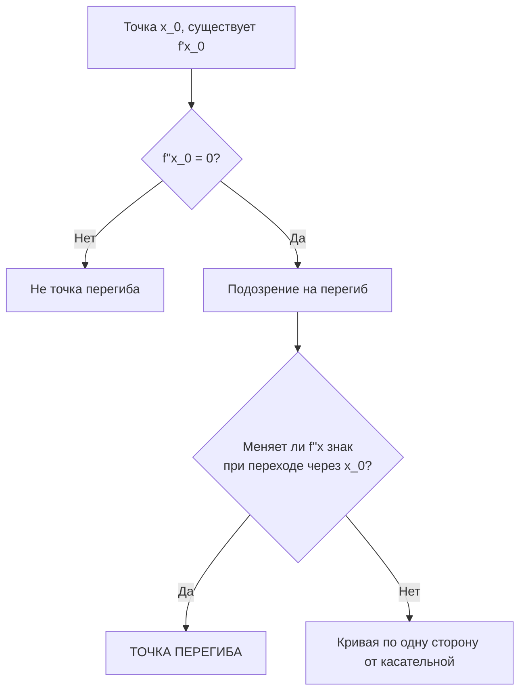

---
tags:
  - матанализ
  - 1_курс
  - подготовка_к_экзамену
тип: конспект
статус: готов
---

# Вопрос №7. Точка перегиба. Необходимое и достаточное условия перегиба.

> [!abstract] Геометрический смысл
> Интуитивно, точка перегиба — это точка на графике функции, в которой происходит смена направления [[Выпуклость функции|выпуклости]] (со строгой выпуклости вниз на строгую выпуклость вверх, или наоборот). Геометрически это означает, что график функции **пересекает** свою касательную в этой точке, переходя с одной её стороны на другую.

> [!definition] Точка перегиба
> Пусть функция $f(x)$ дифференцируема в точке $x_0$. Прямая $y_{k}(x) = f(x_0) + f'(x_0)(x - x_0)$ является касательной к графику $f(x)$ в точке $x_0$. 
> Точка $x_0$ называется **точкой перегиба** функции $f(x)$, если существует такая проколотая окрестность $\mathring{U}_\delta(x_0)$, что разность $\Delta(x) = f(x) - y_{k}(x)$ имеет разные знаки при $x \in (x_0 - \delta, x_0)$ и при $x \in (x_0, x_0 + \delta)$.

### Необходимое условие перегиба

> [!theorem] Необходимое условие точки перегиба
> Если $x_0$ — точка перегиба функции $f(x)$, и в этой точке существует конечная вторая [[Производная|производная]] $f''(x_0)$, то $f''(x_0) = 0$.

> [!proof]+ Доказательство (от противного)
> Предположим, что $x_0$ — точка перегиба, но $f''(x_0) \neq 0$. Без ограничения общности пусть $f''(x_0) > 0$.
> Запишем [[Формула Тейлора|формулу Тейлора]] для функции $f(x)$ в окрестности $x_0$ с остаточным членом в форме Пеано:
> $$ f(x) = f(x_0) + f'(x_0)(x - x_0) + \frac{f''(x_0)}{2}(x - x_0)^2 + o((x - x_0)^2), \quad x \to x_0 $$
> Перенесем линейную часть (уравнение касательной) влево:
> $$ \Delta(x) = f(x) - y_{k}(x) = \frac{f''(x_0)}{2}(x - x_0)^2 + o((x - x_0)^2) $$
> Вынесем $(x - x_0)^2$ за скобки (для $x \neq x_0$):
> $$ \Delta(x) = (x - x_0)^2 \left[ \frac{f''(x_0)}{2} + \frac{o((x - x_0)^2)}{(x - x_0)^2} \right] $$
> По определению $o$-малого, предел второго слагаемого в скобках при $x \to x_0$ равен нулю. Так как $\frac{f''(x_0)}{2} > 0$, по теореме о сохранении знака предела существует проколотая $\delta$-окрестность $\mathring{U}_\delta(x_0)$, в которой выражение в квадратных скобках строго больше нуля.
> Поскольку $(x - x_0)^2 > 0$ для всех $x \neq x_0$, получаем, что $\Delta(x) > 0$ для всех $x \in \mathring{U}_\delta(x_0)$.
> Это означает, что график функции лежит строго выше касательной по обе стороны от точки касания. Смены знака $\Delta(x)$ не происходит, следовательно, $x_0$ не является точкой перегиба. Противоречие.
> Если $f''(x_0) < 0$, аналогичные рассуждения показывают, что $\Delta(x) < 0$ в $\mathring{U}_\delta(x_0)$. 
> Таким образом, необходимо, чтобы $f''(x_0) = 0$. $\blacksquare$

### Достаточные условия перегиба

> [!theorem] Первое достаточное условие (по смене знака $f''$)
> Пусть функция $f(x)$ дифференцируема в окрестности $U_\delta(x_0)$ и дважды дифференцируема в проколотой окрестности $\mathring{U}_\delta(x_0)$. Если вторая производная $f''(x)$ меняет знак при переходе через точку $x_0$, то $x_0$ — точка перегиба.

> [!proof]+ Доказательство
> Рассмотрим разность между функцией и касательной: $\Delta(x) = f(x) - f(x_0) - f'(x_0)(x - x_0)$.
> Запишем формулу Тейлора с остаточным членом в форме Лагранжа для $x \in \mathring{U}_\delta(x_0)$:
> $$ f(x) = f(x_0) + f'(x_0)(x - x_0) + \frac{f''(\xi)}{2}(x - x_0)^2 $$
> где $\xi$ лежит строго между $x_0$ и $x$.
> Тогда $\Delta(x) = \frac{f''(\xi)}{2}(x - x_0)^2$.
> Поскольку $(x - x_0)^2 > 0$ при $x \neq x_0$, знак $\Delta(x)$ полностью совпадает со знаком $f''(\xi)$.
> 1. Если $f''(x)$ меняет знак с минуса на плюс:
>    - При $x < x_0$ имеем $\xi \in (x, x_0)$, поэтому $f''(\xi) < 0 \implies \Delta(x) < 0$.
>    - При $x > x_0$ имеем $\xi \in (x_0, x)$, поэтому $f''(\xi) > 0 \implies \Delta(x) > 0$.
>    Знак $\Delta(x)$ меняется, $x_0$ — точка перегиба.
> 2. Аналогично доказывается случай смены знака с плюса на минус. $\blacksquare$

> [!theorem] Второе достаточное условие (по высшим производным)
> Пусть функция $f(x)$ имеет в точке $x_0$ производные до $n$-го порядка включительно ($n \ge 3$), причём:
> $$ f''(x_0) = f'''(x_0) = \dots = f^{(n-1)}(x_0) = 0, \quad f^{(n)}(x_0) \neq 0 $$
> Тогда если $n$ — **нечётное** число, то $x_0$ является точкой перегиба. (Если $n$ чётное, то $x_0$ — точка локального экстремума разности $\Delta(x)$, и перегиба нет).

> [!proof]+ Доказательство
> Запишем формулу Тейлора с остатком в форме Пеано, учитывая обнуление производных со 2-й по $(n-1)$-ю:
> $$ f(x) = f(x_0) + f'(x_0)(x - x_0) + \frac{f^{(n)}(x_0)}{n!}(x - x_0)^n + o((x - x_0)^n) $$
> Вычислим отклонение от касательной:
> $$ \Delta(x) = f(x) - y_{k}(x) = (x - x_0)^n \left[ \frac{f^{(n)}(x_0)}{n!} + \frac{o((x - x_0)^n)}{(x - x_0)^n} \right] $$
> Аналогично доказательству необходимого условия, существует проколотая окрестность $\mathring{U}_\delta(x_0)$, где скобка сохраняет знак, совпадающий со знаком $f^{(n)}(x_0)$.
> Если $n$ — нечётное, то множитель $(x - x_0)^n$ меняет знак при переходе через $x_0$. Следовательно, $\Delta(x)$ также меняет знак. Значит, $x_0$ — точка перегиба. $\blacksquare$

---

# Вопрос №8. Первообразная. Описание первообразных функции на промежутке.

> [!abstract] Физический смысл
> Если производная — это скорость изменения величины (например, скорость движения точки), то поиск первообразной — это обратная задача: восстановление закона движения (координаты) по известной скорости.

> [!definition] Первообразная
> Функция $F(x)$ называется **[[Первообразная|первообразной]]** для функции $f(x)$ на [[Промежуток|промежутке]] $I$ (интервале, отрезке или полуинтервале), если $F(x)$ дифференцируема для любого $x \in I$ и выполняется тождество:
> $$ \forall x \in I: \quad F'(x) = f(x) $$
> *(Для концов отрезка понимаются односторонние производные).*

> [!warning] Важное замечание о промежутке
> Определение первообразной жёстко привязано к **связному промежутку**. Если область определения функции состоит из нескольких непересекающихся интервалов, первообразные на каждом из них независимы. 

### Описание множества первообразных

> [!theorem] Основная теорема о структуре множества первообразных
> Если $F_1(x)$ и $F_2(x)$ — две любые первообразные одной и той же функции $f(x)$ на промежутке $I$, то они отличаются друг от друга на константу. То есть существует такое вещественное число $C \in \mathbb{R}$, что:
> $$ \forall x \in I: \quad F_1(x) - F_2(x) = C $$

> [!proof]+ Доказательство
> Введем вспомогательную функцию $\Phi(x) = F_1(x) - F_2(x)$, определенную на промежутке $I$.
> Так как $F_1$ и $F_2$ дифференцируемы на $I$, то $\Phi(x)$ также дифференцируема на $I$.
> Найдем её производную:
> $$ \forall x \in I: \quad \Phi'(x) = (F_1(x) - F_2(x))' = F_1'(x) - F_2'(x) = f(x) - f(x) = 0 $$
> Зафиксируем произвольную точку $x_0 \in I$. Возьмем любую другую точку $x \in I$ (для определенности пусть $x > x_0$). 
> Поскольку $I$ — промежуток, весь отрезок $[x_0, x]$ целиком принадлежит $I$.
> Функция $\Phi(t)$ непрерывна на отрезке $[x_0, x]$ (так как дифференцируема) и дифференцируема на интервале $(x_0, x)$. 
> Следовательно, к ней применима [[Теорема Лагранжа|теорема Лагранжа о конечных приращениях]]: существует точка $\xi \in (x_0, x)$, такая что
> $$ \Phi(x) - \Phi(x_0) = \Phi'(\xi)(x - x_0) $$
> Но мы доказали, что $\Phi'(t) = 0$ для всех $t \in I$, значит $\Phi'(\xi) = 0$. Отсюда:
> $$ \Phi(x) - \Phi(x_0) = 0 \cdot (x - x_0) = 0 \implies \Phi(x) = \Phi(x_0) $$
> Поскольку $x$ выбрано произвольно, функция $\Phi(x)$ принимает одно и то же значение во всех точках промежутка $I$. Обозначим это значение как $C = \Phi(x_0)$.
> Тогда $\forall x \in I: F_1(x) - F_2(x) = C$. $\blacksquare$

> [!lemma] Следствие
> Если $F(x)$ — какая-либо первообразная функции $f(x)$ на промежутке $I$, то множество **всех** первообразных функции $f(x)$ на $I$ задается семейством функций $\{ F(x) + C \mid C \in \mathbb{R} \}$.

> [!warning] Контрпример для несвязного множества
> Рассмотрим функцию $f(x) = \frac{1}{x}$ на множестве $\mathbb{R} \setminus \{0\}$.
> Функция $F_1(x) = \ln|x|$ является её первообразной.
> Функция $F_2(x) = \begin{cases} \ln x + 5, & x > 0 \\ \ln(-x) - 3, & x < 0 \end{cases}$ также является её первообразной!
> Разность $F_2(x) - F_1(x)$ равна $5$ при $x>0$ и $-3$ при $x<0$, то есть **не является глобальной константой**. Именно поэтому в теореме критически важно требование, чтобы $I$ был единым промежутком.

---

# Вопрос №9. Неопределенный интеграл функции на промежутке. Операции над неопределенными интегралами.

> [!definition] Неопределенный интеграл
> **Неопределенным интегралом** функции $f(x)$ на промежутке $I$ называется совокупность (множество) всех её первообразных на этом промежутке. Обозначается символом $\int f(x) dx$.
> Если $F(x)$ — одна из первообразных, то:
> $$ \int f(x) dx = F(x) + C $$
> где под $C$ понимается произвольная вещественная постоянная.

### Базовые свойства (Связь с производной)

1. Производная от неопределенного интеграла равна подынтегральной функции:
   $$ \left( \int f(x) dx \right)' = (F(x) + C)' = F'(x) = f(x) $$
2. Дифференциал от неопределенного интеграла равен подынтегральному выражению:
   $$ d \left( \int f(x) dx \right) = f(x) dx $$
3. Неопределенный интеграл от дифференциала функции равен самой функции с точностью до константы:
   $$ \int dF(x) = \int F'(x) dx = F(x) + C $$

### Операции над неопределенными интегралами

> [!theorem] Линейность неопределенного интеграла
> Пусть функции $f(x)$ и $g(x)$ имеют первообразные на промежутке $I$, а $\alpha, \beta \in \mathbb{R}$ — константы, причем $|\alpha| + |\beta| \neq 0$. Тогда функция $\alpha f(x) + \beta g(x)$ также имеет первообразную на $I$, и справедливо равенство (как равенство множеств функций):
> $$ \int (\alpha f(x) + \beta g(x)) dx = \alpha \int f(x) dx + \beta \int g(x) dx $$

> [!proof]+ Доказательство
> Пусть $F(x)$ — первообразная для $f(x)$, а $G(x)$ — первообразная для $g(x)$. 
> Правая часть равенства представляет собой множество функций вида $\alpha(F(x) + C_1) + \beta(G(x) + C_2) = \alpha F(x) + \beta G(x) + (\alpha C_1 + \beta C_2)$.
> Поскольку $C_1, C_2$ — независимые произвольные константы, а хотя бы одно из чисел $\alpha, \beta$ не равно нулю, выражение $\alpha C_1 + \beta C_2$ пробегает всё множество $\mathbb{R}$. Обозначим его просто $C$.
> Проверим, является ли $\Phi(x) = \alpha F(x) + \beta G(x)$ первообразной для $\alpha f(x) + \beta g(x)$. Продифференцируем:
> $$ \Phi'(x) = (\alpha F(x) + \beta G(x))' = \alpha F'(x) + \beta G'(x) = \alpha f(x) + \beta g(x) $$
> Равенство выполняется для всех $x \in I$. Следовательно, $\Phi(x)$ — первообразная для подынтегральной функции слева.
> Таким образом, оба множества имеют вид $\alpha F(x) + \beta G(x) + C$, что доказывает их тождество. $\blacksquare$

> [!theorem] Замена переменной (интегрирование подстановкой)
> Пусть функция $f(x)$ имеет первообразную $F(x)$ на промежутке $X$. Пусть функция $x = \varphi(t)$ определена и дифференцируема на промежутке $T$, причем $\varphi(T) \subseteq X$. Тогда на промежутке $T$ функция $f(\varphi(t)) \cdot \varphi'(t)$ имеет первообразную, и справедливо равенство:
> $$ \int f(x) dx \bigg|_{x = \varphi(t)} = \int f(\varphi(t)) \varphi'(t) dt $$

> [!proof]+ Доказательство
> По условию $F'(x) = f(x)$ для $x \in X$.
> Рассмотрим сложную функцию $\Phi(t) = F(\varphi(t))$ на промежутке $T$.
> По теореме о производной сложной функции, $\Phi(t)$ дифференцируема на $T$, и:
> $$ \Phi'(t) = \frac{d}{dt} \left[ F(\varphi(t)) \right] = F'(\varphi(t)) \cdot \varphi'(t) = f(\varphi(t)) \cdot \varphi'(t) $$
> Это означает, что $F(\varphi(t))$ является первообразной для функции $f(\varphi(t)) \varphi'(t)$.
> Тогда $\int f(\varphi(t)) \varphi'(t) dt = F(\varphi(t)) + C$.
> С другой стороны, подстановка $x = \varphi(t)$ в левую часть дает:
> $$ \left( \int f(x) dx \right) \bigg|_{x = \varphi(t)} = (F(x) + C) \big|_{x = \varphi(t)} = F(\varphi(t)) + C $$
> Множества совпадают. $\blacksquare$

> [!theorem] Интегрирование по частям
> Пусть функции $u(x)$ и $v(x)$ дифференцируемы на промежутке $I$, и функция $u'(x)v(x)$ имеет первообразную на $I$. Тогда функция $u(x)v'(x)$ также имеет первообразную на $I$, и справедливо равенство:
> $$ \int u(x)v'(x) dx = u(x)v(x) - \int v(x)u'(x) dx $$
> Или в дифференциальной форме: $\int u \, dv = uv - \int v \, du$.

> [!proof]+ Доказательство
> По правилу дифференцирования произведения (Лейбница):
> $$ (u(x)v(x))' = u'(x)v(x) + u(x)v'(x) \implies u(x)v'(x) = (u(x)v(x))' - v(x)u'(x) $$
> Функция $(u(x)v(x))'$ имеет очевидную первообразную $u(x)v(x)$.
> Функция $v(x)u'(x)$ имеет первообразную по условию теоремы.
> В силу линейности неопределенного интеграла, разность правой части также имеет первообразную, и мы можем проинтегрировать обе части:
> $$ \int u(x)v'(x) dx = \int (u(x)v(x))' dx - \int v(x)u'(x) dx $$
> $$ \int u(x)v'(x) dx = u(x)v(x) - \int v(x)u'(x) dx $$
> (Константа интегрирования из $\int (uv)' dx$ поглощается множеством первообразных второго интеграла). Теорема доказана. $\blacksquare$

