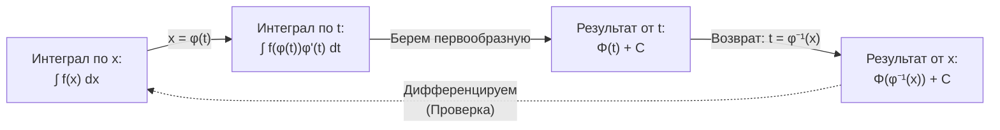

---
tags:
  - матанализ
  - 1_курс
  - подготовка_к_экзамену
тип: конспект
статус: готов
---

Приветствую. Я ожидаю от вас безупречного владения математическим аппаратом. Математический анализ не терпит приближенности в формулировках. Любое «очевидно» на моем экзамене заканчивается пересдачей. Ниже представлен строгий, исчерпывающий конспект по запрошенным билетам. Учите определения наизусть и вникайте в каждое логическое следствие.

---

# Вопрос №10. Необходимое и достаточное условия существования первообразных

> [!definition] Первообразная и неопределенный интеграл
> Пусть задана функция $f: (a, b) \to \mathbb{R}$. Функция $F: (a, b) \to \mathbb{R}$ называется **[[Первообразная|первообразной]]** для функции $f$ на интервале $(a, b)$, если $F$ дифференцируема на $(a, b)$ и для любого $x \in (a, b)$ выполняется равенство:
> $$F'(x) = f(x)$$
> Совокупность всех первообразных функции $f$ на $(a, b)$ называется **[[Неопределенный интеграл|неопределенным интегралом]]** и обозначается $\int f(x) dx$. Если $F(x)$ — одна из первообразных, то $\int f(x) dx = F(x) + C$, где $C \in \mathbb{R}$ — произвольная постоянная.

> [!theorem] Достаточное условие существования первообразной (Теорема Коши)
> Если функция $f(x)$ непрерывна на отрезке $[a, b]$, то у нее существует первообразная на этом отрезке. В качестве одной из первообразных выступает [[Интеграл с переменным верхним пределом]]:
> $$\Phi(x) = \int_{a}^{x} f(t) dt$$

> [!proof]+ Доказательство достаточного условия
> Пусть $f \in C[a,b]$. Рассмотрим функцию $\Phi(x) = \int_{a}^{x} f(t) dt$ для $x \in [a, b]$. Докажем, что $\Phi'(x) = f(x)$.
> Зафиксируем произвольную точку $x \in [a, b]$. Дадим аргументу $x$ приращение $\Delta x \neq 0$ такое, что $x + \Delta x \in [a, b]$.
> Рассмотрим приращение функции $\Phi$:
> $$\Delta \Phi = \Phi(x + \Delta x) - \Phi(x) = \int_{a}^{x + \Delta x} f(t) dt - \int_{a}^{x} f(t) dt = \int_{x}^{x + \Delta x} f(t) dt$$
> Оценим разность между разностным отношением и предполагаемой производной $f(x)$:
> $$\left| \frac{\Delta \Phi}{\Delta x} - f(x) \right| = \left| \frac{1}{\Delta x} \int_{x}^{x + \Delta x} f(t) dt - f(x) \right|$$
> Поскольку $f(x)$ можно внести под интеграл по переменной $t$ (так как $f(x)$ не зависит от $t$):
> $$f(x) = \frac{1}{\Delta x} \int_{x}^{x + \Delta x} f(x) dt$$
> Подставляем это в модуль:
> $$\left| \frac{\Delta \Phi}{\Delta x} - f(x) \right| = \left| \frac{1}{\Delta x} \int_{x}^{x + \Delta x} (f(t) - f(x)) dt \right| \leq \frac{1}{|\Delta x|} \left| \int_{x}^{x + \Delta x} |f(t) - f(x)| dt \right|$$
> В силу условия, функция $f$ обладает свойством [[Непрерывность|непрерывности]] в точке $x$. По определению (на языке $\varepsilon - \delta$):
> $$\forall \varepsilon > 0 \quad \exists \delta > 0 \quad \forall t \in [a, b]: \quad |t - x| < \delta \implies |f(t) - f(x)| < \varepsilon$$
> Пусть $|\Delta x| < \delta$. Тогда для любого $t$, лежащего между $x$ и $x + \Delta x$, выполняется неравенство $|t - x| \leq |\Delta x| < \delta$, а значит, $|f(t) - f(x)| < \varepsilon$.
> Возвращаясь к оценке интеграла:
> $$\frac{1}{|\Delta x|} \left| \int_{x}^{x + \Delta x} |f(t) - f(x)| dt \right| < \frac{1}{|\Delta x|} \left| \int_{x}^{x + \Delta x} \varepsilon \, dt \right| = \frac{1}{|\Delta x|} \cdot \varepsilon \cdot |\Delta x| = \varepsilon$$
> Таким образом, мы строго показали, что:
> $$\lim_{\Delta x \to 0} \frac{\Phi(x + \Delta x) - \Phi(x)}{\Delta x} = f(x)$$
> Следовательно, $\Phi'(x) = f(x)$, и первообразная существует. $\blacksquare$

> [!theorem] Необходимое условие существования первообразной (Теорема Дарбу)
> Если функция $f(x)$ имеет первообразную $F(x)$ на интервале $(a, b)$, то функция $f(x)$ принимает все промежуточные значения между любыми двумя своими значениями. (Свойство Дарбу для [[Производная|производной]]).

> [!proof]+ Доказательство необходимого условия
> Пусть $F'(x) = f(x)$ на $(a, b)$. Выберем две произвольные точки $x_1, x_2 \in (a, b)$, пусть $x_1 < x_2$.
> Пусть $f(x_1) = A$, $f(x_2) = B$, и для определенности $A < B$.
> Возьмем произвольное число $C$ такое, что $A < C < B$. Нам необходимо доказать, что $\exists \xi \in (x_1, x_2)$ такое, что $f(\xi) = C$.
> Введем вспомогательную функцию:
> $$g(x) = F(x) - Cx$$
> Эта функция дифференцируема на $[x_1, x_2]$, так как $F(x)$ дифференцируема. Найдем ее производную:
> $$g'(x) = F'(x) - C = f(x) - C$$
> Вычислим значения производной на концах отрезка $[x_1, x_2]$:
> $$g'(x_1) = f(x_1) - C = A - C < 0$$
> $$g'(x_2) = f(x_2) - C = B - C > 0$$
> Так как $g(x)$ дифференцируема на $[x_1, x_2]$, она непрерывна на нем. По второй [[Теорема Вейерштрасса|теореме Вейерштрасса]], непрерывная на отрезке функция достигает на нем своего точного минимума. Пусть минимум достигается в точке $\xi \in [x_1, x_2]$.
> Поскольку $g'(x_1) < 0$, функция $g(x)$ строго убывает в правой полуокрестности $x_1$. Значит, минимум не может достигаться в $x_1$.
> Поскольку $g'(x_2) > 0$, функция $g(x)$ строго возрастает в левой полуокрестности $x_2$. Значит, минимум не может достигаться в $x_2$.
> Следовательно, точка минимума лежит строго внутри интервала: $\xi \in (x_1, x_2)$.
> По [[Теорема Ферма|теореме Ферма]], если функция достигает локального экстремума во внутренней точке и дифференцируема в ней, то ее производная равна нулю.
> $$g'(\xi) = 0 \implies f(\xi) - C = 0 \implies f(\xi) = C$$
> Мы доказали, что производная принимает любое промежуточное значение. $\blacksquare$

> [!warning] Важное замечание (Контрпримеры)
> Из Теоремы Дарбу тривиально следует, что функция, имеющая точки разрыва первого рода (скачки), **не может иметь первообразной**.
> Классический пример: функция $\text{sgn}(x)$ (сигнум) на отрезке $[-1, 1]$. Она принимает значения $-1$ и $1$, но не принимает значение $0$ нигде, кроме точки разрыва, что нарушает свойство Дарбу на интервалах, содержащих ноль. Интеграл Римана от нее существует, но первообразной в строгом смысле (функции, дифференцируемой *всюду* на интервале) не существует.

> [!abstract] Логическая структура условий
```mermaid
graph TD
    A[Функция f] -->|Непрерывна| B(Первообразная точно существует)
    B --> C(Теорема Коши: Ф-я - интеграл с перем. верх. пределом)
    A -->|Имеет разрыв 1 рода| D(Первообразная ТОЧНО НЕ существует)
    D --> E(Теорема Дарбу: Производная не имеет скачков)
    A -->|Имеет разрыв 2 рода| F(Первообразная МОЖЕТ существовать)
    F -.-> G(Пример: f=2x*sin(1/x)-cos(1/x) имеет перв. F=x^2*sin(1/x))
```

---

# Вопрос №11. Линейность неопределенного интеграла

> [!definition] Смысл равенства в неопределенных интегралах
> Напоминаю: неопределенный интеграл — это не функция, а **множество функций**.
> Когда мы пишем $\int f(x) dx = \int g(x) dx$, мы подразумеваем равенство множеств. То есть, любая функция из левого множества содержится в правом, и наоборот. Аналитически это означает, что первообразные отличаются на некоторую константу.

> [!theorem] Линейность неопределенного интеграла
> Пусть функции $f(x)$ и $g(x)$ имеют первообразные на интервале $(a, b)$, а $\alpha, \beta \in \mathbb{R}$ — произвольные константы, причем $\alpha^2 + \beta^2 \neq 0$. Тогда функция $\alpha f(x) + \beta g(x)$ также имеет первообразную на $(a, b)$, и справедливо равенство:
> $$\int (\alpha f(x) + \beta g(x)) dx = \alpha \int f(x) dx + \beta \int g(x) dx$$

> [!proof]+ Доказательство
> Доказательство сводится к проверке определения первообразной для левой и правой частей с учетом свойств линейности производной.
> Пусть $F(x)$ — какая-либо первообразная для $f(x)$, а $G(x)$ — первообразная для $g(x)$. По определению:
> $$F'(x) = f(x), \quad G'(x) = g(x)$$
> Рассмотрим множество функций, стоящее в правой части равенства. Это множество имеет вид:
> $$\alpha (F(x) + C_1) + \beta (G(x) + C_2) = \alpha F(x) + \beta G(x) + (\alpha C_1 + \beta C_2)$$
> где $C_1, C_2$ — произвольные действительные числа. Так как хотя бы одно из чисел $\alpha$ или $\beta$ не равно нулю, выражение $\alpha C_1 + \beta C_2$ при переборе всех возможных $C_1, C_2 \in \mathbb{R}$ пробегает все множество действительных чисел $\mathbb{R}$. Обозначим эту новую константу как $C$.
> Таким образом, правая часть представляет собой множество функций вида:
> $$\{\alpha F(x) + \beta G(x) + C \mid C \in \mathbb{R}\}$$
> Теперь докажем, что любая функция из этого множества является первообразной для подынтегральной функции из левой части $\alpha f(x) + \beta g(x)$. Возьмем производную от базового элемента множества:
> $$(\alpha F(x) + \beta G(x))' = \alpha F'(x) + \beta G'(x) = \alpha f(x) + \beta g(x)$$
> (В переходе использована доказанная ранее теорема о линейности [[Производная|производной]]).
> Так как производная от функции $\alpha F(x) + \beta G(x)$ равна подынтегральной функции левой части, по определению неопределенного интеграла:
> $$\int (\alpha f(x) + \beta g(x)) dx = \alpha F(x) + \beta G(x) + C$$
> Мы получили в точности то же самое множество функций, что и в правой части. Равенство множеств доказано. $\blacksquare$

> [!warning] Важное замечание о константах
> Грубейшая ошибка студентов — формальное вычитание интегралов. Например:
> $\int f(x)dx - \int f(x)dx = 0$.
> Это **ЛОЖНО**. Разность двух множеств первообразных $\{F(x) + C_1\}$ и $\{F(x) + C_2\}$ дает множество констант $\{C_1 - C_2\}$, то есть просто константу $C$. Правильный ответ: $\int f(x)dx - \int f(x)dx = C$. Линейность работает корректно только если мы помним, что оперируем классами эквивалентности функций, отличающихся на константу.

---

# Вопрос №12. Замена переменной в неопределенном интеграле

Метод замены переменной базируется на правиле дифференцирования сложной функции (цепном правиле). Формально различают подведение под знак дифференциала (прямая замена) и классическую замену переменной (обратная замена).

> [!lemma] Подведение под знак дифференциала (1-я форма замены)
> Пусть функция $f(t)$ имеет первообразную $F(t)$ на интервале $T$, а функция $t = \varphi(x)$ дифференцируема на интервале $X$ и $\varphi(X) \subseteq T$. Тогда на интервале $X$ функция $f(\varphi(x))\varphi'(x)$ имеет первообразную $F(\varphi(x))$, то есть:
> $$\int f(\varphi(x)) \varphi'(x) dx = F(\varphi(x)) + C$$

> [!proof]+ Доказательство леммы
> По условию, $F'(t) = f(t)$ для всех $t \in T$.
> Рассмотрим сложную функцию $\Phi(x) = F(\varphi(x))$. Поскольку $F$ дифференцируема на $T$, а $\varphi$ дифференцируема на $X$, по теореме о производной сложной функции $\Phi(x)$ дифференцируема на $X$, и ее производная равна:
> $$\Phi'(x) = [F(\varphi(x))]' = F'(\varphi(x)) \cdot \varphi'(x)$$
> Так как $F'(\varphi(x)) = f(\varphi(x))$, получаем:
> $$\Phi'(x) = f(\varphi(x)) \cdot \varphi'(x)$$
> По определению неопределенного интеграла, это означает, что:
> $$\int f(\varphi(x)) \varphi'(x) dx = \Phi(x) + C = F(\varphi(x)) + C$$
> Что и требовалось доказать. $\blacksquare$

> [!theorem] Замена переменной (2-я форма)
> Пусть функция $f(x)$ задана на интервале $X$. Пусть функция $x = \varphi(t)$ удовлетворяет следующим условиям:
> 1. $\varphi(t)$ непрерывно дифференцируема на интервале $T$.
> 2. $\varphi(t)$ строго монотонна на $T$ (что обеспечивает существование обратной функции $t = \varphi^{-1}(x)$).
> 3. Область значений $\varphi(T) = X$.
> 
> Если функция $f(\varphi(t))\varphi'(t)$ имеет первообразную $\Phi(t)$ на интервале $T$, то функция $f(x)$ имеет первообразную на интервале $X$, и справедливо равенство:
> $$\int f(x) dx = \left. \int f(\varphi(t)) \varphi'(t) dt \right|_{t = \varphi^{-1}(x)}$$

> [!proof]+ Доказательство теоремы
> Пусть $\Phi(t)$ является первообразной для $f(\varphi(t))\varphi'(t)$ на интервале $T$. Это означает, что:
> $$\Phi'(t) = f(\varphi(t))\varphi'(t) \quad \forall t \in T$$
> Нам нужно доказать, что после обратной подстановки функция $F(x) = \Phi(\varphi^{-1}(x))$ будет первообразной для $f(x)$ на множестве $X$.
> Так как $\varphi(t)$ строго монотонна и непрерывно дифференцируема, существует обратная функция $t = \varphi^{-1}(x)$.
> Проверим, что производная функции $F(x)$ равна $f(x)$. По правилу дифференцирования сложной функции:
> $$F'(x) = [\Phi(\varphi^{-1}(x))]' = \Phi'(t) \cdot (\varphi^{-1}(x))'_{x} \quad \text{где } t = \varphi^{-1}(x)$$
> Подставим $\Phi'(t)$:
> $$F'(x) = f(\varphi(t)) \cdot \varphi'(t) \cdot (\varphi^{-1}(x))'_{x}$$
> По теореме о производной обратной функции: $(\varphi^{-1}(x))'_{x} = \frac{1}{\varphi'(t)}$ (при условии, что $\varphi'(t) \neq 0$).
> Если $\varphi(t)$ строго монотонна и непрерывно дифференцируема, мы не теряем общности, считая $\varphi'(t) \neq 0$ (иначе применяем более тонкие разбиения).
> Тогда:
> $$F'(x) = f(\varphi(t)) \cdot \varphi'(t) \cdot \frac{1}{\varphi'(t)} = f(\varphi(t)) = f(x)$$
> Так как $F'(x) = f(x)$, $F(x)$ является первообразной для $f(x)$.
> Следовательно, $\int f(x) dx = F(x) + C = \Phi(\varphi^{-1}(x)) + C$, что в точности совпадает с утверждением теоремы. $\blacksquare$

> [!warning] Важное замечание (Условие монотонности)
> Требование строгой монотонности функции $\varphi(t)$ **критически важно** для 2-й формы замены. Если функция не является биекцией, обратная функция $\varphi^{-1}(x)$ не будет однозначной. 
> *Контрпример студенческой ошибки:* Вычисление интеграла $\int \sqrt{1-x^2} dx$ заменой $x = \sin t$. Если не ограничить $t \in [-\pi/2, \pi/2]$ (где синус строго монотонен), возвращение к переменной $x$ через $t = \arcsin x$ будет математически неправомерным, так как вы потеряете ветви функции.

> [!abstract] Схема работы замены переменной

