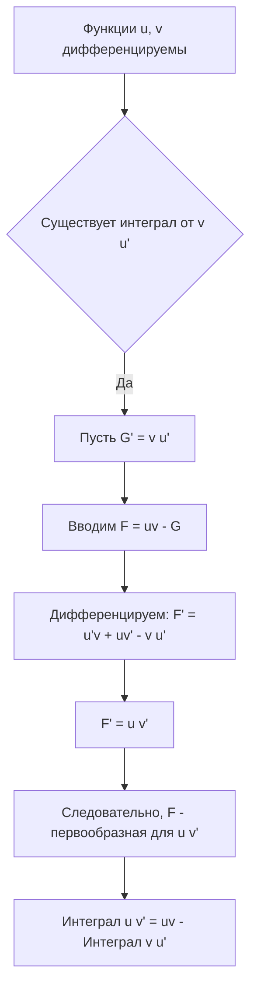
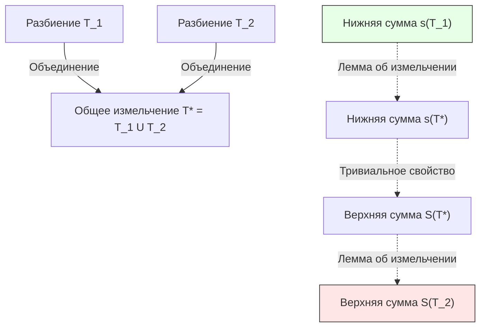

---
tags:
  - матанализ
  - 1_курс
  - подготовка_к_экзамену
тип: конспект
статус: готов
---

# Вопрос №13. Интегрирование по частям в неопределенном интеграле

> [!abstract] Физический / Геометрический смысл
> Операция интегрирования по частям является обратной к правилу Лейбница дифференцирования произведения двух функций: $(uv)' = u'v + uv'$. В контексте неопределенного интеграла этот метод позволяет свести вычисление интеграла от произведения двух функций к вычислению, как правило, более простого интеграла путем "переброски" производной с одного множителя на другой.

> [!definition] Определение неопределенного интеграла (напоминание)
> [[Неопределенный интеграл]] от функции $f(x)$ на промежутке $X$ — это совокупность всех её [[Первообразная|первообразных]] на этом промежутке. Обозначается:
> $$ \int f(x) dx = F(x) + C $$
> где $F'(x) = f(x)$ для всех $x \in X$, а $C \in \mathbb{R}$ — произвольная константа. Равенство неопределенных интегралов понимается как равенство множеств функций.

> [!theorem] Теорема (Об интегрировании по частям)
> Пусть функции $u(x)$ и $v(x)$ [[Дифференцируемость|дифференцируемы]] на промежутке $X$, и на этом промежутке существует неопределенный интеграл $\int v(x) u'(x) dx$. Тогда на промежутке $X$ существует и неопределенный интеграл $\int u(x) v'(x) dx$, причем справедливо равенство:
> $$ \int u(x) v'(x) dx = u(x) v(x) - \int v(x) u'(x) dx $$
> В дифференциальной форме формула имеет вид:
> $$ \int u \, dv = u v - \int v \, du $$

> [!proof]+ Доказательство
> 1. По условию, интеграл $\int v(x) u'(x) dx$ существует. Пусть функция $G(x)$ является одной из первообразных для функции $v(x) u'(x)$ на промежутке $X$. Это означает, что для любого $x \in X$ выполняется:
> $$ G'(x) = v(x) u'(x) $$
> 2. Рассмотрим функцию $F(x) = u(x) v(x) - G(x)$. Поскольку $u(x)$ и $v(x)$ дифференцируемы по условию, а $G(x)$ дифференцируема как первообразная, функция $F(x)$ также дифференцируема на $X$.
> 3. Найдем производную функции $F(x)$, строго применяя правило дифференцирования суммы и произведения:
> $$ F'(x) = \left( u(x) v(x) - G(x) \right)' = u'(x) v(x) + u(x) v'(x) - G'(x) $$
> 4. Подставим $G'(x) = v(x) u'(x)$ в полученное выражение:
> $$ F'(x) = u'(x) v(x) + u(x) v'(x) - v(x) u'(x) $$
> 5. Заметим, что $u'(x) v(x)$ и $v(x) u'(x)$ взаимно уничтожаются (в силу коммутативности умножения действительных чисел):
> $$ F'(x) = u(x) v'(x) $$
> 6. Следовательно, по определению первообразной, функция $F(x) = u(x) v(x) - G(x)$ является первообразной для функции $u(x) v'(x)$ на промежутке $X$.
> 7. Переходя к неопределенным интегралам как к множествам первообразных, запишем:
> $$ \int u(x) v'(x) dx = F(x) + C = u(x) v(x) - G(x) + C $$
> 8. С другой стороны, множество $-\int v(x) u'(x) dx$ представляет собой множество функций вида $-G(x) + C_1$. Поскольку $C$ и $C_1$ пробегают всё множество $\mathbb{R}$, множества $\{ -G(x) + C \}$ и $\{ -G(x) + C_1 \}$ совпадают.
> 9. Окончательно получаем строгое равенство множеств:
> $$ \int u(x) v'(x) dx = u(x) v(x) - \int v(x) u'(x) dx $$
> Теорема доказана.

> [!warning] Важное замечание
> Равенство в теореме понимается с точностью до произвольной постоянной. Запись $\int v(x) u'(x) dx$ уже содержит константу интегрирования, поэтому прибавлять еще одну константу $+C$ к правой части формулы не требуется.

---

# Вопрос №14. Интегрирование рациональных функций

> [!definition] Рациональная функция (дробь)
> Функция вида $R(x) = \frac{P(x)}{Q(x)}$, где $P(x)$ и $Q(x)$ — алгебраические [[Многочлен|многочлены]] с действительными коэффициентами:
> $$ P(x) = a_n x^n + \dots + a_1 x + a_0, \quad Q(x) = b_m x^m + \dots + b_1 x + b_0 $$
> Дробь называется **правильной**, если степень числителя строго меньше степени знаменателя ($n < m$).

> [!lemma] Лемма о выделении целой части
> Любую неправильную рациональную дробь ($n \ge m$) можно единственным образом представить в виде суммы многочлена (целой части) и правильной рациональной дроби путем деления числителя на знаменатель "уголком":
> $$ \frac{P(x)}{Q(x)} = M(x) + \frac{r(x)}{Q(x)}, \quad \text{где } \deg r < \deg Q $$

> [!theorem] Теорема (Основная теорема алгебры и разложение знаменателя)
> Всякий многочлен $Q(x)$ с действительными коэффициентами может быть единственным образом (с точностью до порядка сомножителей) разложен на линейные и квадратичные неразложимые (не имеющие действительных корней) множители:
> $$ Q(x) = b_m (x - a_1)^{k_1} \dots (x - a_r)^{k_r} (x^2 + p_1 x + q_1)^{s_1} \dots (x^2 + p_l x + q_l)^{s_l} $$
> где $p_i^2 - 4q_i < 0$ (дискриминант отрицателен), а $k_i, s_i \in \mathbb{N}$.

> [!theorem] Теорема о разложении на простейшие дроби
> Любая правильная рациональная дробь $\frac{P(x)}{Q(x)}$ может быть представлена, и притом единственным образом, в виде суммы конечного числа [[Простейшие дроби|простейших дробей]] над полем $\mathbb{R}$.
> Каждому множителю $(x-a)^k$ знаменателя соответствует сумма $k$ дробей:
> $$ \frac{A_1}{x-a} + \frac{A_2}{(x-a)^2} + \dots + \frac{A_k}{(x-a)^k} $$
> Каждому множителю $(x^2+px+q)^s$ соответствует сумма $s$ дробей:
> $$ \frac{M_1 x + N_1}{x^2+px+q} + \frac{M_2 x + N_2}{(x^2+px+q)^2} + \dots + \frac{M_s x + N_s}{(x^2+px+q)^s} $$
> где $A_i, M_i, N_i$ — некоторые действительные числа (неопределенные коэффициенты).

### Алгоритм и строгое вычисление интегралов от простейших дробей

Интегрирование рациональной функции сводится к интегрированию многочлена и простейших дробей четырех типов.

> [!proof]+ Интегрирование простейших дробей (Строгий вывод)
> **Тип I.** $\int \frac{A}{x-a} dx$.
> Применим замену переменной $t = x-a, dt = dx$:
> $$ \int \frac{A}{x-a} dx = A \int \frac{dt}{t} = A \ln|t| + C = A \ln|x-a| + C $$
> 
> **Тип II.** $\int \frac{A}{(x-a)^k} dx, \quad k \ge 2, k \in \mathbb{N}$.
> Замена $t = x-a, dt = dx$:
> $$ \int A t^{-k} dt = A \frac{t^{-k+1}}{-k+1} + C = \frac{A}{(1-k)(x-a)^{k-1}} + C $$
> 
> **Тип III.** $\int \frac{Mx+N}{x^2+px+q} dx$, при условии $p^2 - 4q < 0$.
> 1. Выделим полный квадрат в знаменателе:
> $$ x^2+px+q = x^2 + 2\frac{p}{2}x + \frac{p^2}{4} - \frac{p^2}{4} + q = \left(x + \frac{p}{2}\right)^2 + \left(q - \frac{p^2}{4}\right) $$
> 2. По условию $q - p^2/4 > 0$. Обозначим $a^2 = q - p^2/4, a > 0$.
> 3. Сделаем замену $t = x + p/2 \implies x = t - p/2, dx = dt$. Тогда знаменатель равен $t^2+a^2$.
> 4. Числитель преобразуется: $Mx+N = M(t - p/2) + N = Mt + (N - Mp/2)$.
> 5. Разобьем интеграл на два:
> $$ \int \frac{Mt + (N - Mp/2)}{t^2+a^2} dt = M \int \frac{t \, dt}{t^2+a^2} + \left(N - \frac{Mp}{2}\right) \int \frac{dt}{t^2+a^2} $$
> 6. Первый интеграл (внесение под дифференциал):
> $$ \int \frac{t \, dt}{t^2+a^2} = \frac{1}{2} \int \frac{d(t^2+a^2)}{t^2+a^2} = \frac{1}{2} \ln(t^2+a^2) $$
> 7. Второй интеграл (табличный арктангенс):
> $$ \int \frac{dt}{t^2+a^2} = \frac{1}{a} \arctan\frac{t}{a} $$
> 8. Возврат к $x$ дает итоговую (исчерпывающую) формулу.
> 
> **Тип IV.** $I_k = \int \frac{Mx+N}{(x^2+px+q)^k} dx, \quad k \ge 2$.
> После выделения полного квадрата и замены $t = x+p/2$, как в Типе III, задача сводится к двум интегралам. Первый $\int \frac{t \, dt}{(t^2+a^2)^k}$ берется подведением под дифференциал:
> $$ \frac{1}{2} \int (t^2+a^2)^{-k} d(t^2+a^2) = \frac{1}{2(1-k)(t^2+a^2)^{k-1}} + C $$
> Второй интеграл обозначим $J_k = \int \frac{dt}{(t^2+a^2)^k}$. Для него строго выведем рекуррентную формулу.
> Интегрируем $J_k$ по частям. Пусть $u = (t^2+a^2)^{-k}, dv = dt$.
> Тогда $du = -k(t^2+a^2)^{-k-1} \cdot 2t \, dt$, а $v = t$.
> $$ J_k = \frac{t}{(t^2+a^2)^k} - \int t \left( -2kt(t^2+a^2)^{-k-1} \right) dt = \frac{t}{(t^2+a^2)^k} + 2k \int \frac{t^2}{(t^2+a^2)^{k+1}} dt $$
> Применим прием $+\pm$ (добавим и вычтем $a^2$ в числителе):
> $$ t^2 = (t^2+a^2) - a^2 $$
> $$ \int \frac{t^2}{(t^2+a^2)^{k+1}} dt = \int \frac{t^2+a^2}{(t^2+a^2)^{k+1}} dt - \int \frac{a^2}{(t^2+a^2)^{k+1}} dt = J_k - a^2 J_{k+1} $$
> Подставляем обратно:
> $$ J_k = \frac{t}{(t^2+a^2)^k} + 2k (J_k - a^2 J_{k+1}) $$
> Выражаем $J_{k+1}$:
> $$ 2k a^2 J_{k+1} = \frac{t}{(t^2+a^2)^k} + (2k-1) J_k \implies J_{k+1} = \frac{t}{2k a^2 (t^2+a^2)^k} + \frac{2k-1}{2k a^2} J_k $$
> Формула позволяет понизить степень $k$ до 1, где интеграл $J_1$ сводится к арктангенсу.

> [!warning] Важное замечание
> Метод неопределенных коэффициентов работает *только* для правильных дробей. Попытка применить его к неправильной дроби без предварительного выделения целой части (деления многочленов) приведет к логическому противоречию и неверному ответу.

---

# Вопрос №15. Суммы Римана. Интеграл Римана. Суммы Дарбу и их свойства

> [!definition] Разбиение отрезка и выборка
> Пусть задан отрезок $[a,b]$. **Разбиением** $T$ отрезка $[a,b]$ называется конечное множество точек $x_i$ таких, что:
> $$ a = x_0 < x_1 < x_2 < \dots < x_{n-1} < x_n = b $$
> **Диаметром разбиения** (шагом разбиения) $d(T)$ называется длина наибольшего частичного отрезка: $d(T) = \max_{1 \le i \le n} \Delta x_i$, где $\Delta x_i = x_i - x_{i-1}$.
> **Выборкой** (оснащением) $\xi$ называется набор точек $\xi = \{\xi_1, \dots, \xi_n\}$, таких что $\xi_i \in [x_{i-1}, x_i]$ для всех $i=1,\dots,n$.

> [!definition] Сумма Римана и Интеграл Римана
> Пусть функция $f(x)$ определена на $[a,b]$. **Суммой Римана** (интегральной суммой) для функции $f(x)$, разбиения $T$ и выборки $\xi$ называется число:
> $$ \sigma(T, \xi) = \sum_{i=1}^n f(\xi_i) \Delta x_i $$
> Функция $f(x)$ называется **интегрируемой по Риману** на отрезке $[a,b]$, если существует конечное число $I \in \mathbb{R}$ такое, что:
> $$ \forall \varepsilon > 0 \quad \exists \delta > 0 \quad \forall T \text{ с } d(T) < \delta, \quad \forall \xi: \quad |\sigma(T, \xi) - I| < \varepsilon $$
> Число $I$ называется [[Интеграл Римана|определенным интегралом Римана]] и обозначается $\int_a^b f(x) dx$.

### Суммы Дарбу и их свойства

Пусть функция $f(x)$ ограничена на $[a,b]$. По аксиоме полноты действительных чисел, на каждом отрезке $[x_{i-1}, x_i]$ существуют точные грани:
$$ m_i = \inf_{[x_{i-1}, x_i]} f(x), \qquad M_i = \sup_{[x_{i-1}, x_i]} f(x) $$

> [!definition] Суммы Дарбу
> **Нижней суммой Дарбу** $s(T)$ и **верхней суммой Дарбу** $S(T)$ для разбиения $T$ называются соответственно:
> $$ s(T) = \sum_{i=1}^n m_i \Delta x_i, \qquad S(T) = \sum_{i=1}^n M_i \Delta x_i $$

> [!abstract] Геометрический смысл сумм Дарбу
> Геометрически нижняя сумма Дарбу — это площадь ступенчатой фигуры, составленной из прямоугольников, вписанных под график функции $f(x)$. Верхняя сумма Дарбу — площадь ступенчатой фигуры, описанной вокруг графика. Сумма Римана всегда "зажата" между ними.

> [!theorem] Свойства сумм Дарбу
> **Свойство 1 (Ограничение сумм Римана).** Для любого разбиения $T$ и любой выборки $\xi$:
> $$ s(T) \le \sigma(T, \xi) \le S(T) $$
> *(Доказательство тривиально следует из определения супремума и инфимума: $m_i \le f(\xi_i) \le M_i$, умножаем на $\Delta x_i > 0$ и суммируем).*
>
> **Свойство 2 (Точная грань сумм Римана).**
> При фиксированном разбиении $T$:
> $$ s(T) = \inf_{\xi} \sigma(T, \xi), \qquad S(T) = \sup_{\xi} \sigma(T, \xi) $$
>
> **Свойство 3 (Лемма об измельчении разбиения).**
> Пусть разбиение $T'$ получено из $T$ добавлением новых точек (то есть $T \subset T'$). Тогда нижние суммы не убывают, а верхние не возрастают:
> $$ s(T) \le s(T') \quad \text{и} \quad S(T') \le S(T) $$
>
> **Свойство 4 (Сравнение сумм любых разбиений).**
> Для любых двух разбиений $T_1$ и $T_2$ отрезка $[a,b]$ любая нижняя сумма не превосходит любой верхней суммы:
> $$ s(T_1) \le S(T_2) $$

> [!proof]+ Доказательство Свойства 3 (Лемма об измельчении) и Свойства 4
> **Доказательство Свойства 3:**
> 1. Докажем для случая добавления одной новой точки $x^*$. Пусть $x^* \in (x_{k-1}, x_k)$. Разбиение $T' = T \cup \{x^*\}$.
> 2. Рассмотрим, как изменится верхняя сумма Дарбу. Разность $S(T) - S(T')$ зависит только от отрезка $[x_{k-1}, x_k]$, так как на остальных отрезках разбиения совпадают.
> 3. В $S(T)$ вклад этого отрезка равен $M_k \cdot (x_k - x_{k-1})$, где $M_k = \sup_{[x_{k-1}, x_k]} f(x)$.
> 4. В $S(T')$ этот отрезок разбился на два. Вклад равен $M_k^{(1)} (x^* - x_{k-1}) + M_k^{(2)} (x_k - x^*)$, где
> $$ M_k^{(1)} = \sup_{[x_{k-1}, x^*]} f(x), \quad M_k^{(2)} = \sup_{[x^*, x_k]} f(x) $$
> 5. Так как $[x_{k-1}, x^*] \subset [x_{k-1}, x_k]$, то супремум на подмножестве не превышает супремума на всём множестве: $M_k^{(1)} \le M_k$. Аналогично, $M_k^{(2)} \le M_k$.
> 6. Оценим сумму в $S(T')$:
> $$ M_k^{(1)} (x^* - x_{k-1}) + M_k^{(2)} (x_k - x^*) \le M_k (x^* - x_{k-1}) + M_k (x_k - x^*) = M_k (x_k - x_{k-1}) $$
> 7. Следовательно, вклад новых отрезков меньше либо равен вкладу старого, откуда $S(T') \le S(T)$.
> 8. Аналогично рассуждая для точных нижних граней (инфимум на подмножестве не меньше инфимума на всем множестве: $m_k^{(1)} \ge m_k$), строго получаем $s(T') \ge s(T)$.
> 9. По методу математической индукции утверждение переносится на добавление любого конечного числа точек.
> 
> **Доказательство Свойства 4:**
> 10. Пусть $T_1$ и $T_2$ — произвольные разбиения.
> 11. Рассмотрим их объединение $T^* = T_1 \cup T_2$. Это новое разбиение является измельчением как для $T_1$, так и для $T_2$.
> 12. По доказанному Свойству 3 (лемма об измельчении), имеем:
> $$ s(T_1) \le s(T^*) \quad \text{и} \quad S(T^*) \le S(T_2) $$
> 13. С другой стороны, для одного и того же разбиения $T^*$ очевидно, что нижняя сумма не превосходит верхней (т.к. $m_i \le M_i \implies s(T^*) \le S(T^*)$).
> 14. Выстраиваем строгую цепочку неравенств:
> $$ s(T_1) \le s(T^*) \le S(T^*) \le S(T_2) $$
> Транзитивность отношения порядка завершает доказательство: $s(T_1) \le S(T_2)$.

> [!warning] Важное замечание
> Понятие сумм Дарбу неразрывно связано с **ограниченностью** функции. Если функция $f(x)$ неограничена на $[a,b]$, то хотя бы на одном отрезке разбиения точная верхняя (или нижняя) грань не существует (равна $+\infty$ или $-\infty$), и суммы Дарбу теряют классический числовой смысл. Именно поэтому [[Теорема Вейерштрасса]] об ограниченности интегрируемой по Риману функции является принципиальным фундаментом для построения интеграла Римана.

