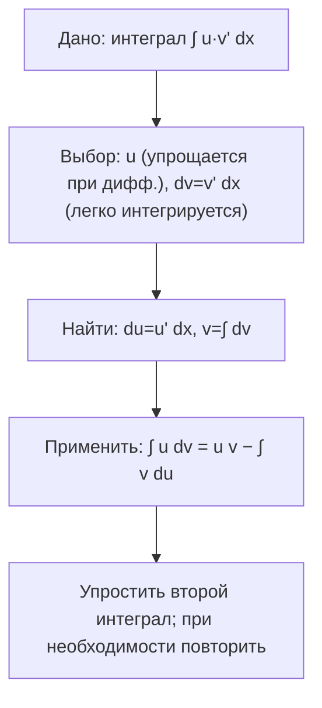
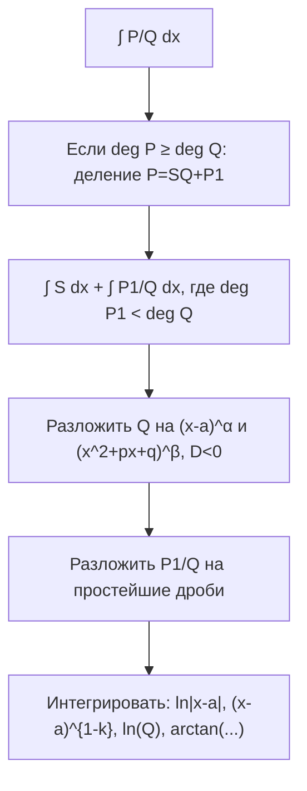
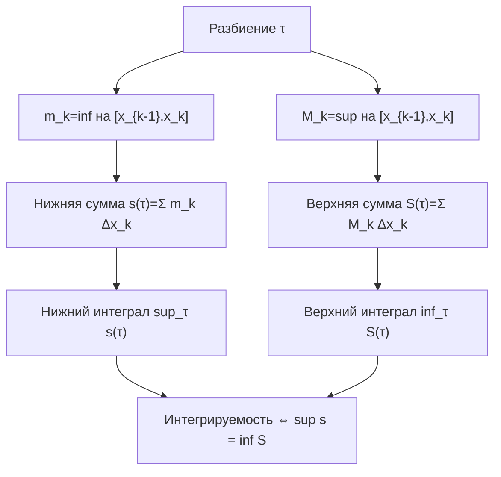

---
tags:
  - матанализ
  - 1_курс
  - подготовка_к_экзамену
тип: конспект
статус: готов
---

# Вопрос №13. Интегрирование по частям в неопределенном интеграле

> [!definition] [[Неопределённый интеграл]] как множество первообразных
> Пусть $f$ определена на промежутке $I\subset\mathbb{R}$. Функция $F$ называется **первообразной** функции $f$ на $I$, если $F$ дифференцируема на $I$ и $F'(x)=f(x)$ для всех $x\in I$.  
> **Неопределённым интегралом** называется множество всех первообразных:
> $$\int f(x)\,dx=\{F(x)+C \mid F'(x)=f(x),\; C\in\mathbb{R}\}.$$

> [!theorem] Формула интегрирования по частям (неопределённый интеграл)
> Пусть функции $u$ и $v$ дифференцируемы на промежутке $I$, а произведение $u(x)v'(x)$ имеет первообразную на $I$ (в частности, когда интегралы рассматриваются формально в рамках таблицы первообразных). Тогда верна формула
> $$\int u(x)\,v'(x)\,dx = u(x)\,v(x)-\int u'(x)\,v(x)\,dx.$$

> [!proof]+ Доказательство
> Рассмотрим функцию $W(x)=u(x)v(x)$. Так как $u$ и $v$ дифференцируемы, то по правилу дифференцирования произведения имеем для всех $x\in I$:
> $$W'(x)=(u(x)v(x))' = u'(x)v(x)+u(x)v'(x).$$
> Перепишем равенство, выделив слагаемое $u(x)v'(x)$:
> $$u(x)v'(x)=W'(x)-u'(x)v(x).$$
> Возьмём неопределённый интеграл обеих частей (то есть рассмотрим первообразные). Если $H$ — первообразная $u(x)v'(x)$, то можно выбрать первообразные так, чтобы выполнялось:
> $$\int u(x)v'(x)\,dx=\int \bigl(W'(x)-u'(x)v(x)\bigr)\,dx.$$
> По определению первообразной имеем $\int W'(x)\,dx=W(x)+C_1=u(x)v(x)+C_1$. Тогда
> $$\int u(x)v'(x)\,dx = u(x)v(x)+C_1-\int u'(x)v(x)\,dx.$$
> Переобозначая константу $C_1$ как произвольную константу $C$ (поскольку в неопределённом интеграле константа поглощается множеством первообразных), получаем:
> $$\int u(x)v'(x)\,dx = u(x)v(x)-\int u'(x)v(x)\,dx.$$
> Что и требовалось.

> [!abstract] Геометрический / Физический смысл
> Интегрирование по частям — «обратная операция» к правилу произведения:
> $$ (uv)' = u'v + uv'. $$
> Смысл приёма: в интеграле $\int u\,dv$ можно «перенести» производную с $v$ на $u$ ценой появления члена $uv$:
> $$\int u\,dv = uv - \int v\,du.$$
> Типичная стратегия: выбрать $u$ так, чтобы $u'$ был проще, а $dv$ так, чтобы $\int dv$ вычислялся таблично.

> [!warning] Важное замечание (о корректности)
> Формула по частям в неопределённом виде корректна как утверждение о первообразных: нужно, чтобы соответствующие выражения имели смысл на одном и том же промежутке $I$ и существовали первообразные.  
> На практике это означает: при вычислении следует фиксировать промежуток, где функции определены и дифференцируемы, иначе одна и та же «формула» может давать разные ветви (например, при логарифмах и арктангенсах).

> [!definition] Стандартная запись $\int u\,dv$
> Запись
> $$\int u\,dv := \int u(x)\,v'(x)\,dx,\quad v=\int v'(x)\,dx$$
> служит сокращением, где $dv=v'(x)\,dx$, $du=u'(x)\,dx$. Тогда формула по частям записывается:
> $$\int u\,dv = uv-\int v\,du.$$

> [!abstract] Типовые шаблоны применения (без «скачков» логики)
> 1) $\int x e^x\,dx$: берут $u=x$ (тогда $u'=1$), $dv=e^x dx$ (тогда $v=e^x$).  
> 2) $\int \ln x\,dx$ на $(0,\infty)$: берут $u=\ln x$, $dv=dx$ (тогда $v=x$), получают
> $$\int \ln x\,dx = x\ln x-\int x\cdot \frac1x\,dx=x\ln x-\int 1\,dx=x\ln x-x+C.$$
> Здесь промежуток $(0,\infty)$ фиксирует область определения $\ln x$.

---

# Вопрос №14. Интегрирование рациональных функций

> [!definition] [[Рациональная функция]]
> Функция $R(x)$ называется **рациональной**, если
> $$R(x)=\frac{P(x)}{Q(x)},$$
> где $P,Q$ — многочлены, $Q\not\equiv 0$. Область определения: $\{x\in\mathbb{R}\mid Q(x)\neq 0\}$.

> [!theorem] Сведение интеграла рациональной функции к интегралам простейших дробей
> Пусть $R(x)=\dfrac{P(x)}{Q(x)}$ — рациональная функция. Тогда интеграл $\int R(x)\,dx$ на каждом промежутке, не содержащем корней $Q$, вычисляется по схеме:
> 1) (Деление) представление
> $$\frac{P(x)}{Q(x)}=S(x)+\frac{P_1(x)}{Q(x)},\qquad \deg P_1<\deg Q,$$
> где $S$ — многочлен;
> 2) (Разложение на простейшие дроби) если разложить $Q$ над $\mathbb{R}$:
> $$Q(x)=\prod_{i=1}^m (x-a_i)^{\alpha_i}\cdot \prod_{j=1}^n (x^2+p_j x+q_j)^{\beta_j},$$
> где $x^2+p_jx+q_j$ — неприводимые над $\mathbb{R}$ квадратичные множители (то есть $p_j^2-4q_j<0$),
> то существует разложение
> $$\frac{P_1(x)}{Q(x)}=
> \sum_{i=1}^m\sum_{k=1}^{\alpha_i}\frac{A_{ik}}{(x-a_i)^k}
> +\sum_{j=1}^n\sum_{k=1}^{\beta_j}\frac{B_{jk}x+C_{jk}}{(x^2+p_jx+q_j)^k},$$
> где $A_{ik},B_{jk},C_{jk}\in\mathbb{R}$.
> Следовательно, $\int R(x)\,dx$ сводится к интегралам вида
> $$\int S(x)\,dx,\quad \int\frac{dx}{(x-a)^k},\quad \int \frac{Bx+C}{(x^2+px+q)^k}\,dx.$$

> [!proof]+ Доказательство (схема с обоснованием ключевых шагов)
> **Шаг 1 (деление многочленов).**  
> По алгоритму деления многочленов существуют единственные многочлены $S(x)$ и $P_1(x)$ такие, что
> $$P(x)=S(x)Q(x)+P_1(x),\qquad \deg P_1<\deg Q.$$
> Делим на $Q(x)$ (на области, где $Q(x)\neq 0$), получаем:
> $$\frac{P(x)}{Q(x)}=S(x)+\frac{P_1(x)}{Q(x)}.$$
> Тогда
> $$\int \frac{P}{Q}\,dx=\int S(x)\,dx+\int\frac{P_1}{Q}\,dx.$$
>
> **Шаг 2 (факторизация знаменателя над $\mathbb{R}$).**  
> Любой вещественный многочлен раскладывается в произведение линейных и неприводимых квадратичных множителей с кратностями:
> $$Q(x)=c\prod (x-a_i)^{\alpha_i}\prod (x^2+p_jx+q_j)^{\beta_j},\quad c\neq 0,$$
> причём для неприводимых квадратов дискриминант отрицателен: $p_j^2-4q_j<0$.
>
> **Шаг 3 (существование разложения на простейшие дроби).**  
> Рассмотрим функцию $\dfrac{P_1(x)}{Q(x)}$ при $\deg P_1<\deg Q$. Требуется подобрать коэффициенты $A_{ik},B_{jk},C_{jk}$ так, чтобы выполнялось тождество многочленов после приведения к общему знаменателю $Q(x)$.  
> Умножим предполагаемое разложение на $Q(x)$. Левая часть даст $P_1(x)$, правая — некоторый многочлен, линейно зависящий от неизвестных коэффициентов. Поскольку степень результирующего многочлена ограничена $\deg Q-1$, приравнивание коэффициентов при степенях $x^0,x^1,\dots,x^{\deg Q-1}$ приводит к конечной системе линейных уравнений относительно этих коэффициентов. Она совместна (существование следует из стандартной теории разложения рациональных функций; конструктивно коэффициенты находятся методом неопределённых коэффициентов).  
> Следовательно, разложение существует и сводит интеграл к сумме интегралов простейших дробей.

> [!warning] Важное замечание (о промежутках и логарифмах)
> При интегрировании простейших дробей возникают выражения $\ln|x-a|$ и $\arctan(\cdot)$.  
> Корректно фиксировать промежуток, не пересекающий точки $x=a$ (полюса), чтобы первообразная была определена как функция на промежутке. Запись с $|x-a|$ стандартно объединяет случаи $x>a$ и $x<a$, но на каждом конкретном промежутке знак фиксирован.

> [!definition] Простейшие дроби: линейные множители
> Для $a\in\mathbb{R}$ и $k\in\mathbb{N}$ дроби
> $$\frac{1}{(x-a)^k}$$
> называются простейшими (для линейного множителя). Для разложения по кратному корню используются суммы по $k=1,\dots,\alpha$.

> [!theorem] Интегралы простейших дробей для линейного множителя
> Для $k=1$:
> $$\int \frac{dx}{x-a}=\ln|x-a|+C.$$
> Для $k\ge 2$:
> $$\int \frac{dx}{(x-a)^k}=\frac{(x-a)^{1-k}}{1-k}+C=-\frac{1}{(k-1)(x-a)^{k-1}}+C.$$

> [!proof]+ Доказательство
> Для $k=1$ рассмотрим $F(x)=\ln|x-a|$ на любом промежутке, не содержащем $a$. Тогда $|x-a|=\pm(x-a)$ с фиксированным знаком на таком промежутке, и производная вычисляется как
> $$F'(x)=\frac{1}{x-a}.$$
> Значит, $F$ — первообразная.
>
> Для $k\ge2$ положим
> $$F(x)=\frac{(x-a)^{1-k}}{1-k}.$$
> Тогда $F$ дифференцируема при $x\neq a$, и
> $$F'(x)=\frac{1}{1-k}\cdot(1-k)(x-a)^{-k}=\frac{1}{(x-a)^k}.$$
> Следовательно, формула верна.

> [!definition] Простейшие дроби: неприводимый квадратичный множитель
> Пусть $x^2+px+q$ — квадратный трёхчлен с $p^2-4q<0$ (нет вещественных корней). Тогда простейшие дроби имеют вид
> $$\frac{Bx+C}{(x^2+px+q)^k},\quad k\in\mathbb{N},\; B,C\in\mathbb{R}.$$

> [!lemma] Приведение квадрата (выделение полного квадрата)
> Для любых $p,q\in\mathbb{R}$ справедливо тождество
> $$x^2+px+q=\left(x+\frac{p}{2}\right)^2+\left(q-\frac{p^2}{4}\right).$$
> При условии $p^2-4q<0$ имеем $q-\frac{p^2}{4}>0$.

> [!proof]+ Доказательство
> Раскроем квадрат:
> $$\left(x+\frac{p}{2}\right)^2=x^2+px+\frac{p^2}{4}.$$
> Тогда
> $$x^2+px+q=\left(x+\frac{p}{2}\right)^2+\left(q-\frac{p^2}{4}\right).$$
> Неравенство $p^2-4q<0$ эквивалентно $4q-p^2>0$, то есть $q-\frac{p^2}{4}>0$.

> [!theorem] Интегрирование дроби $\dfrac{Bx+C}{x^2+px+q}$ при $p^2-4q<0$
> Пусть $p^2-4q<0$. Тогда
> $$\int \frac{Bx+C}{x^2+px+q}\,dx
> =\frac{B}{2}\ln(x^2+px+q)+\frac{2C-Bp}{\sqrt{4q-p^2}}\arctan\!\left(\frac{2x+p}{\sqrt{4q-p^2}}\right)+C_0.$$

> [!proof]+ Доказательство
> Обозначим $Q(x)=x^2+px+q$. Тогда $Q'(x)=2x+p$. Представим числитель как линейную комбинацию $Q'(x)$ и константы:
> $$Bx+C=\frac{B}{2}(2x+p)+\left(C-\frac{Bp}{2}\right)=\frac{B}{2}Q'(x)+\left(C-\frac{Bp}{2}\right).$$
> Тогда
> $$\int \frac{Bx+C}{Q(x)}\,dx
> =\frac{B}{2}\int \frac{Q'(x)}{Q(x)}\,dx+\left(C-\frac{Bp}{2}\right)\int\frac{dx}{Q(x)}.$$
> Первый интеграл:
> $$\int \frac{Q'}{Q}\,dx=\ln|Q(x)|+C_1.$$
> На любом промежутке $Q(x)>0$ (что верно при $p^2-4q<0$ для всех $x$), поэтому $\ln|Q|=\ln Q$.
>
> Для второго интеграла применим лемму о выделении полного квадрата:
> $$Q(x)=\left(x+\frac{p}{2}\right)^2+\left(q-\frac{p^2}{4}\right).$$
> Обозначим $\alpha^2=q-\frac{p^2}{4}=\frac{4q-p^2}{4}$, тогда $\alpha>0$ и
> $$Q(x)=\left(x+\frac{p}{2}\right)^2+\alpha^2.$$
> Подстановка $t=\dfrac{x+\frac{p}{2}}{\alpha}$ даёт $dx=\alpha\,dt$, и
> $$\int\frac{dx}{Q(x)}=\int \frac{\alpha\,dt}{\alpha^2(t^2+1)}=\frac{1}{\alpha}\arctan t + C_2.$$
> Возвращаясь к $x$ и подставляя $\alpha=\frac{\sqrt{4q-p^2}}{2}$, получаем:
> $$\int\frac{dx}{Q(x)}=\frac{2}{\sqrt{4q-p^2}}\arctan\!\left(\frac{2x+p}{\sqrt{4q-p^2}}\right)+C_2.$$
> Собирая всё вместе:
> $$\int \frac{Bx+C}{Q(x)}dx=\frac{B}{2}\ln Q(x)+\left(C-\frac{Bp}{2}\right)\frac{2}{\sqrt{4q-p^2}}\arctan\!\left(\frac{2x+p}{\sqrt{4q-p^2}}\right)+C_0,$$
> что эквивалентно заявленной формуле, поскольку
> $$\left(C-\frac{Bp}{2}\right)\cdot 2 = 2C-Bp.$$

> [!abstract] Геометрический / Физический смысл (почему появляются $\ln$ и $\arctan$)
> - Линейный множитель $(x-a)$ даёт первообразную $\ln|x-a|$ из-за производной логарифма: $(\ln|x-a|)'=\frac1{x-a}$.  
> - Квадрат без вещественных корней задаёт «сумму квадратов» после выделения полного квадрата, что приводит к стандартному интегралу
> $$\int \frac{dt}{1+t^2}=\arctan t + C.$$

---

# Вопрос №15. Суммы Римана. Интеграл Римана. Суммы Дарбу и их свойства

> [!definition] [[Разбиение]] отрезка и его мелкость
> Пусть $[a,b]\subset\mathbb{R}$, $a<b$. **Разбиением** (partition) называется конечный набор точек
> $$\tau:\ a=x_0<x_1<\dots<x_n=b.$$
> Обозначим $\Delta x_k=x_k-x_{k-1}$ и **мелкость разбиения**
> $$|\tau|=\max_{1\le k\le n}\Delta x_k.$$
> Разбиение $\tau'$ называется **уточнением** $\tau$ (пишут $\tau'\succeq\tau$), если множество точек $\tau$ содержится в $\tau'$.

> [!definition] Отмеченное разбиение и [[Суммы Римана]]
> **Отмеченным разбиением** называется пара $(\tau,\xi)$, где $\tau:\ a=x_0<\dots<x_n=b$ — разбиение, а $\xi=(\xi_1,\dots,\xi_n)$ — набор точек, таких что
> $$\xi_k\in[x_{k-1},x_k]\quad (k=1,\dots,n).$$
> Пусть $f$ ограничена на $[a,b]$. **Суммой Римана** называется
> $$\sigma(f;\tau,\xi)=\sum_{k=1}^n f(\xi_k)\,\Delta x_k.$$

> [!definition] [[Интеграл Римана]] (через суммы Римана, $\varepsilon$-определение)
> Ограниченная функция $f:[a,b]\to\mathbb{R}$ называется **интегрируемой по Риману** на $[a,b]$, если существует число $I\in\mathbb{R}$ такое, что
> $$\forall \varepsilon>0\ \exists \delta>0\ \forall(\tau,\xi):\ |\tau|<\delta \ \Rightarrow\ |\sigma(f;\tau,\xi)-I|<\varepsilon.$$
> Тогда $I$ обозначается
> $$I=\int_a^b f(x)\,dx.$$

> [!abstract] Геометрический / Физический смысл
> Сумма Римана — площадь «ступенчатой аппроксимации» графика $y=f(x)$ прямоугольниками ширины $\Delta x_k$ и высоты $f(\xi_k)$.  
> Интегрируемость по Риману означает: при достаточно мелком разбиении результат почти не зависит от выбора точек $\xi_k$ и стабилизируется к единственному числу.

> [!definition] [[Суммы Дарбу]]: нижняя и верхняя суммы
> Пусть $f$ ограничена на $[a,b]$, $(\tau: a=x_0<\dots<x_n=b)$ — разбиение. Для каждого отрезка $[x_{k-1},x_k]$ положим
> $$m_k=\inf_{x\in[x_{k-1},x_k]} f(x),\qquad M_k=\sup_{x\in[x_{k-1},x_k]} f(x).$$
> Тогда **нижняя сумма Дарбу** и **верхняя сумма Дарбу**:
> $$s(f;\tau)=\sum_{k=1}^n m_k\,\Delta x_k,\qquad S(f;\tau)=\sum_{k=1}^n M_k\,\Delta x_k.$$

> [!definition] Нижний и верхний интегралы Дарбу
> **Нижний интеграл Дарбу** и **верхний интеграл Дарбу** определяются как
> $$\underline{\int_a^b} f = \sup_{\tau} s(f;\tau),\qquad \overline{\int_a^b} f = \inf_{\tau} S(f;\tau),$$
> где супремум и инфимум берутся по всем разбиениям $\tau$ отрезка $[a,b]$. (Используются понятия [[Супремум]] и [[Инфимум]].)

> [!lemma] Связь сумм Римана и сумм Дарбу
> Для любого ограниченного $f$, любого разбиения $\tau$ и любой разметки $\xi$ (то есть $\xi_k\in[x_{k-1},x_k]$) выполнено
> $$s(f;\tau)\le \sigma(f;\tau,\xi)\le S(f;\tau).$$

> [!proof]+ Доказательство
> Зафиксируем $k\in\{1,\dots,n\}$. По определению $m_k=\inf_{x\in[x_{k-1},x_k]}f(x)$ означает:
> $$m_k\le f(x)\quad \text{для всех }x\in[x_{k-1},x_k].$$
> В частности, для $x=\xi_k$ имеем $m_k\le f(\xi_k)$. Аналогично из $M_k=\sup f$ следует $f(\xi_k)\le M_k$.  
> Умножая неравенства на $\Delta x_k>0$, получаем:
> $$m_k\Delta x_k\le f(\xi_k)\Delta x_k\le M_k\Delta x_k.$$
> Складывая по $k=1,\dots,n$, приходим к
> $$\sum_{k=1}^n m_k\Delta x_k\le \sum_{k=1}^n f(\xi_k)\Delta x_k\le \sum_{k=1}^n M_k\Delta x_k,$$
> то есть $s(f;\tau)\le \sigma(f;\tau,\xi)\le S(f;\tau)$.

> [!lemma] Монотонность сумм Дарбу при уточнении разбиения
> Если $\tau'\succeq\tau$ (то есть $\tau'$ — уточнение $\tau$), то
> $$s(f;\tau)\le s(f;\tau'),\qquad S(f;\tau')\le S(f;\tau).$$

> [!proof]+ Доказательство
> Достаточно рассмотреть случай, когда $\tau'$ получено добавлением одной точки $c\in(x_{j-1},x_j)$ в разбиение $\tau$. Тогда один отрезок $[x_{j-1},x_j]$ заменяется двумя: $[x_{j-1},c]$ и $[c,x_j]$; остальные интервалы не меняются.
>
> Обозначим
> $$m=\inf_{[x_{j-1},x_j]} f,\quad m_1=\inf_{[x_{j-1},c]} f,\quad m_2=\inf_{[c,x_j]} f.$$
> Так как $[x_{j-1},c]\subset[x_{j-1},x_j]$, то по свойству инфимума по меньшему множеству:
> $$m\le m_1.$$
> Аналогично $m\le m_2$. Тогда, учитывая $\Delta x_j=(c-x_{j-1})+(x_j-c)$,
> $$m\Delta x_j
> =m\bigl((c-x_{j-1})+(x_j-c)\bigr)
> \le m_1(c-x_{j-1})+m_2(x_j-c).$$
> Прибавляя одинаковые (неизменившиеся) слагаемые по другим индексам, получаем $s(f;\tau)\le s(f;\tau')$.
>
> Для верхних сумм аналогично: обозначим
> $$M=\sup_{[x_{j-1},x_j]} f,\quad M_1=\sup_{[x_{j-1},c]} f,\quad M_2=\sup_{[c,x_j]} f.$$
> Тогда из включений множеств следует $M_1\le M$ и $M_2\le M$, откуда
> $$M_1(c-x_{j-1})+M_2(x_j-c)\le M\Delta x_j.$$
> Значит, $S(f;\tau')\le S(f;\tau)$.

> [!theorem] Критерий интегрируемости Римана через суммы Дарбу
> Для ограниченной функции $f:[a,b]\to\mathbb{R}$ эквивалентны утверждения:
> 1) $f$ интегрируема по Риману на $[a,b]$;
> 2) верхний и нижний интегралы Дарбу совпадают:
> $$\underline{\int_a^b} f=\overline{\int_a^b} f;$$
> 3) выполняется критерий $\varepsilon$-разбиения:
> $$\forall\varepsilon>0\ \exists\tau:\ S(f;\tau)-s(f;\tau)<\varepsilon.$$
> При выполнении этих условий общее значение равно интегралу Римана:
> $$\int_a^b f=\underline{\int_a^b} f=\overline{\int_a^b} f.$$

> [!proof]+ Доказательство
> **(1) $\Rightarrow$ (3).**  
> Пусть $f$ интегрируема по Риману и
> $$I=\int_a^b f(x)\,dx.$$
> Возьмём произвольное $\varepsilon>0$. По определению интеграла Римана существует $\delta>0$ такое, что для любого отмеченного разбиения $(\tau,\xi)$ с $|\tau|<\delta$ верно:
> $$|\sigma(f;\tau,\xi)-I|<\frac{\varepsilon}{2}.$$
> Зафиксируем разбиение $\tau$ с $|\tau|<\delta$. Для каждого $k$ по определению супремума $M_k$ существует точка $\xi_k^+\in[x_{k-1},x_k]$, удовлетворяющая
> $$M_k-\frac{\varepsilon}{2(b-a)}< f(\xi_k^+)\le M_k.$$
> Аналогично по определению инфимума $m_k$ существует $\xi_k^-\in[x_{k-1},x_k]$ такая, что
> $$m_k\le f(\xi_k^-)< m_k+\frac{\varepsilon}{2(b-a)}.$$
> Рассмотрим две суммы Римана:
> $$\sigma^+=\sum_{k=1}^n f(\xi_k^+)\Delta x_k,\qquad \sigma^-=\sum_{k=1}^n f(\xi_k^-)\Delta x_k.$$
> Тогда из построения:
> $$0\le S(f;\tau)-\sigma^+=\sum_{k=1}^n (M_k-f(\xi_k^+))\Delta x_k
> <\sum_{k=1}^n \frac{\varepsilon}{2(b-a)}\Delta x_k=\frac{\varepsilon}{2(b-a)}(b-a)=\frac{\varepsilon}{2},$$
> и
> $$0\le \sigma^--s(f;\tau)=\sum_{k=1}^n (f(\xi_k^-)-m_k)\Delta x_k
> <\sum_{k=1}^n \frac{\varepsilon}{2(b-a)}\Delta x_k=\frac{\varepsilon}{2}.$$
> Поскольку $|\tau|<\delta$, по определению интеграла:
> $$|\sigma^+-I|<\frac{\varepsilon}{2},\qquad |\sigma^--I|<\frac{\varepsilon}{2}.$$
> Используем оценку разности через добавление и вычитание $I$:
> $$S(f;\tau)-s(f;\tau)=\bigl(S(f;\tau)-\sigma^+\bigr)+\bigl(\sigma^+-I\bigr)+\bigl(I-\sigma^-\bigr)+\bigl(\sigma^--s(f;\tau)\bigr).$$
> Оценивая каждый член по модулю и учитывая первые две оценки (неотрицательность крайних разностей) получаем:
> $$S(f;\tau)-s(f;\tau)
> \le \frac{\varepsilon}{2}+\frac{\varepsilon}{2}+\frac{\varepsilon}{2}+\frac{\varepsilon}{2}=2\varepsilon.$$
> Заменяя в начале $\varepsilon$ на $\varepsilon/2$, получаем требуемое:
> $$\exists\tau:\ S(f;\tau)-s(f;\tau)<\varepsilon.$$
>
> **(3) $\Rightarrow$ (2).**  
> По определению
> $$\underline{\int_a^b} f=\sup_{\tau} s(f;\tau),\qquad \overline{\int_a^b} f=\inf_{\tau} S(f;\tau).$$
> Для любого разбиения $\tau$ верно $s(f;\tau)\le S(f;\tau)$, значит
> $$\underline{\int_a^b} f\le \overline{\int_a^b} f.$$
> Пусть выполнено (3). Тогда для любого $\varepsilon>0$ найдётся $\tau_\varepsilon$ с
> $$S(f;\tau_\varepsilon)-s(f;\tau_\varepsilon)<\varepsilon.$$
> По свойствам супремума и инфимума:
> $$s(f;\tau_\varepsilon)\le \underline{\int_a^b} f \quad\text{необязательно верно; верно } s(f;\tau_\varepsilon)\le \sup_\tau s(f;\tau)=\underline{\int_a^b} f,$$
> и
> $$\overline{\int_a^b} f=\inf_\tau S(f;\tau)\le S(f;\tau_\varepsilon).$$
> Тогда
> $$0\le \overline{\int_a^b} f-\underline{\int_a^b} f
> \le S(f;\tau_\varepsilon)-s(f;\tau_\varepsilon)<\varepsilon.$$
> Поскольку $\varepsilon>0$ произвольно, получаем
> $$\overline{\int_a^b} f-\underline{\int_a^b} f=0,$$
> то есть (2).
>
> **(2) $\Rightarrow$ (1).**  
> Пусть
> $$J:=\underline{\int_a^b} f=\overline{\int_a^b} f.$$
> Возьмём $\varepsilon>0$. По определению инфимума существует разбиение $\tau_1$, такое что
> $$S(f;\tau_1)<J+\frac{\varepsilon}{2}.$$
> По определению супремума существует разбиение $\tau_2$, такое что
> $$s(f;\tau_2)>J-\frac{\varepsilon}{2}.$$
> Рассмотрим общее уточнение $\tau=\tau_1\cup\tau_2$. По лемме о монотонности при уточнении:
> $$S(f;\tau)\le S(f;\tau_1)<J+\frac{\varepsilon}{2},\qquad s(f;\tau)\ge s(f;\tau_2)>J-\frac{\varepsilon}{2}.$$
> Следовательно,
> $$S(f;\tau)-s(f;\tau)<\varepsilon.$$
> Теперь для любого отмеченного разбиения $(\tau,\xi)$ по лемме связи:
> $$s(f;\tau)\le \sigma(f;\tau,\xi)\le S(f;\tau).$$
> Вычтем $J$:
> $$s(f;\tau)-J\le \sigma(f;\tau,\xi)-J\le S(f;\tau)-J.$$
> При этом
> $$s(f;\tau)-J>-\frac{\varepsilon}{2},\qquad S(f;\tau)-J<\frac{\varepsilon}{2}.$$
> Значит,
> $$|\sigma(f;\tau,\xi)-J|<\frac{\varepsilon}{2}<\varepsilon.$$
> То есть найдётся разбиение $\tau$ (а значит, можно взять $\delta=|\tau|$ и требовать $|\tau'|<\delta$ через уточнения), обеспечивающее малость отклонения сумм Римана от $J$, что и даёт интегрируемость по Риману с интегралом $I=J$.

> [!theorem] Основные свойства интеграла Римана (для интегрируемых функций)
> Пусть $f,g$ интегрируемы по Риману на $[a,b]$, $\alpha,\beta\in\mathbb{R}$. Тогда:
> 4) **Линейность:** $\int_a^b (\alpha f+\beta g)\,dx=\alpha\int_a^b f\,dx+\beta\int_a^b g\,dx$.
> 5) **Монотонность:** если $f(x)\le g(x)$ для всех $x\in[a,b]$, то $\int_a^b f\,dx\le\int_a^b g\,dx$.
> 6) **Оценка:** если $m\le f(x)\le M$ на $[a,b]$, то $m(b-a)\le\int_a^b f\,dx\le M(b-a)$.
> 7) **Аддитивность по промежутку:** для $c\in[a,b]$ имеем
> $$\int_a^b f\,dx=\int_a^c f\,dx+\int_c^b f\,dx.$$

> [!proof]+ Доказательство (идея через суммы Римана, без пропусков ключевых неравенств)
> Все пункты доказываются из определения через суммы Римана и линейности конечной суммы.
>
> 8) Для любого $(\tau,\xi)$:
> $$\sigma(\alpha f+\beta g;\tau,\xi)=\sum(\alpha f(\xi_k)+\beta g(\xi_k))\Delta x_k
> =\alpha\sigma(f;\tau,\xi)+\beta\sigma(g;\tau,\xi).$$
> Переход к пределу по определению интеграла Римана сохраняет равенство.
>
> 9) Если $f(\xi_k)\le g(\xi_k)$ для всех $k$, то
> $$\sigma(f;\tau,\xi)\le \sigma(g;\tau,\xi).$$
> Переходя к пределу в смысле $\varepsilon$-определения интеграла, получаем неравенство для интегралов.
>
> 10) Из $m\le f(\xi_k)\le M$ следует
> $$m\Delta x_k\le f(\xi_k)\Delta x_k\le M\Delta x_k.$$
> Складывая:
> $$m(b-a)\le \sigma(f;\tau,\xi)\le M(b-a),$$
> а затем переходя к пределу, получаем оценку для интеграла.
>
> 11) Разбиение $[a,b]$ можно выбрать так, чтобы $c$ было точкой разбиения. Тогда сумма Римана на $[a,b]$ распадается на суммы на $[a,c]$ и $[c,b]$. Предел при измельчении разбиения сохраняет равенство.

> [!warning] Важное замечание (когда Риман не работает)
> Риманова интегрируемость требует ограниченности на $[a,b]$. Если $f$ не ограничена, то нужен аппарат **несобственных интегралов** (отдельная тема).  
> Также существуют ограниченные функции, неинтегрируемые по Риману (классический пример: функция Дирихле $f=\mathbf{1}_{\mathbb{Q}}$), поскольку для любого разбиения на каждом отрезке одновременно $\inf=0$ и $\sup=1$, и потому $S(f;\tau)-s(f;\tau)=b-a\neq 0$.

