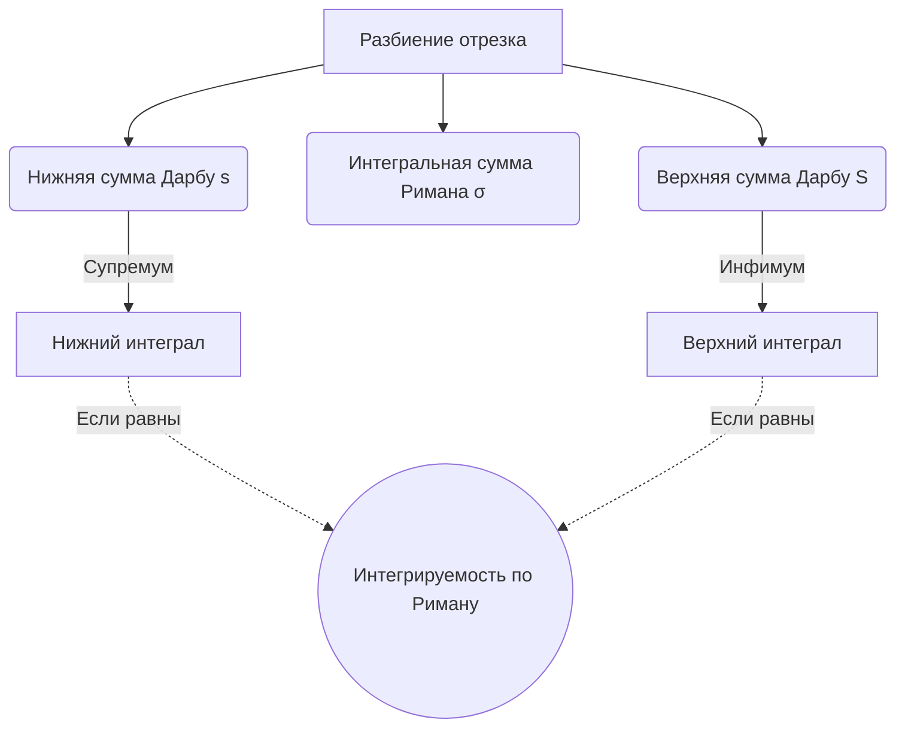

---
tags:
  - матанализ
  - 1_курс
  - подготовка_к_экзамену
тип: конспект
статус: готов
---

# Вопрос №16. Ограниченность интегрируемой функции. Верхний и нижний интегралы Дарбу. Критерий интегрируемости функции. Колебание функции и интегрируемость.

> [!abstract] Геометрический смысл
> Суммы Дарбу представляют собой площади вписанных (нижняя сумма) и описанных (верхняя сумма) многоступенчатых фигур. Интегрируемость означает, что при измельчении разбиения зазор между площадью описанной и вписанной фигур стремится к нулю, «зажимая» истинную площадь криволинейной трапеции.

> [!definition] Основные определения
> Пусть функция $f(x)$ определена на отрезке $[a, b]$.
> 1. **[[Разбиение]]** $\tau$: множество точек $a = x_0 < x_1 < \dots < x_n = b$.
> 2. **Шаг разбиения** $\lambda(\tau) = \max_{1 \le i \le n} \Delta x_i$, где $\Delta x_i = x_i - x_{i-1}$.
> 3. **Выборка** $\xi$: набор точек $\xi_i \in [x_{i-1}, x_i]$ для $i = 1, \dots, n$.
> 4. **[[Интегральная сумма Римана]]**: $\sigma(f, \tau, \xi) = \sum_{i=1}^n f(\xi_i) \Delta x_i$.
> 5. Число $I$ называется **[[Интеграл Римана|интегралом Римана]]** от функции $f$ на $[a,b]$ (обозначается $f \in R[a,b]$), если:
> $$\forall \varepsilon > 0 \quad \exists \delta > 0 \quad \forall \tau: \lambda(\tau) < \delta \quad \forall \xi \implies |\sigma(f, \tau, \xi) - I| < \varepsilon$$

> [!theorem] Необходимое условие интегрируемости (Теорема об ограниченности)
> Если функция $f(x)$ интегрируема по Риману на отрезке $[a, b]$, то она ограничена на этом отрезке.

> [!proof]+ Доказательство теоремы об ограниченности
> Проведем доказательство от противного. Предположим, что $f \in R[a,b]$, но $f(x)$ неограничена на $[a, b]$.
> Так как $f \in R[a,b]$, существует интеграл $I$. По определению предела интегральной суммы, для $\varepsilon = 1$ найдется такое $\delta > 0$, что для любого разбиения $\tau$ с $\lambda(\tau) < \delta$ и любого выбора точек $\xi_i$ выполняется:
> $$|\sigma(f, \tau, \xi) - I| < 1 \implies |\sigma(f, \tau, \xi)| < |I| + 1$$
> Зафиксируем некоторое разбиение $\tau$, удовлетворяющее условию $\lambda(\tau) < \delta$. 
> Поскольку $f(x)$ неограничена на всем $[a, b]$, она будет неограничена по крайней мере на одном из частичных отрезков разбиения, назовем его $[x_{k-1}, x_k]$.
> Зафиксируем точки $\xi_i$ на всех отрезках, кроме $k$-го. Сумма слагаемых на этих отрезках есть фиксированное число $C$:
> $$C = \sum_{i \neq k} f(\xi_i) \Delta x_i$$
> Тогда интегральную сумму можно записать как:
> $$\sigma(f, \tau, \xi) = C + f(\xi_k) \Delta x_k$$
> Так как $f(x)$ неограничена на $[x_{k-1}, x_k]$, мы можем выбрать точку $\xi_k \in [x_{k-1}, x_k]$ так, чтобы выполнялось неравенство:
> $$|f(\xi_k)| > \frac{|C| + |I| + 1}{\Delta x_k}$$
> Оценим модуль интегральной суммы, используя неравенство треугольника ($|A + B| \ge |B| - |A|$):
> $$|\sigma(f, \tau, \xi)| = |C + f(\xi_k) \Delta x_k| \ge |f(\xi_k) \Delta x_k| - |C| > (|C| + |I| + 1) - |C| = |I| + 1$$
> Мы получили $|\sigma(f, \tau, \xi)| > |I| + 1$, что противоречит условию $|\sigma(f, \tau, \xi)| < |I| + 1$. 
> Полученное противоречие строго доказывает, что интегрируемая функция обязана быть ограниченной.

> [!warning] Важное замечание
> Ограниченность — необходимое, но **не достаточное** условие. Контрпримером является функция Дирихле $D(x)$ на $[0,1]$. Она ограничена ($0 \le D(x) \le 1$), но не интегрируема по Риману.

> [!definition] Суммы и интегралы Дарбу
> Пусть функция $f(x)$ ограничена на $[a, b]$. Для заданного разбиения $\tau$ введем точные грани на частичных отрезках:
> $$m_i = \inf_{x \in [x_{i-1}, x_i]} f(x), \qquad M_i = \sup_{x \in [x_{i-1}, x_i]} f(x)$$
> **Нижняя сумма Дарбу**: $s(f, \tau) = \sum_{i=1}^n m_i \Delta x_i$.
> **Верхняя сумма Дарбу**: $S(f, \tau) = \sum_{i=1}^n M_i \Delta x_i$.
> 
> **[[Нижний интеграл Дарбу]]**: $\underline{I} = \sup_{\tau} s(f, \tau)$.
> **[[Верхний интеграл Дарбу]]**: $\overline{I} = \inf_{\tau} S(f, \tau)$.

> [!lemma] Свойства сумм Дарбу
> 6. Для любой выборки $\xi$: $s(f, \tau) \le \sigma(f, \tau, \xi) \le S(f, \tau)$.
> 7. При добавлении новых точек в разбиение $\tau$ (переход к измельчению $\tau'$), нижняя сумма не убывает, а верхняя не возрастает: $s(f, \tau) \le s(f, \tau')$ и $S(f, \tau) \ge S(f, \tau')$.
> 8. Для любых двух разбиений $\tau_1, \tau_2$: $s(f, \tau_1) \le S(f, \tau_2)$.
> 9. Всегда $\underline{I} \le \overline{I}$.

> [!theorem] Критерий интегрируемости Дарбу (через суммы Дарбу)
> Ограниченная на $[a, b]$ функция $f(x)$ интегрируема по Риману $\iff$ $\forall \varepsilon > 0$ существует разбиение $\tau$, такое что $S(f, \tau) - s(f, \tau) < \varepsilon$.

> [!proof]+ Доказательство критерия Дарбу
> **Необходимость ($\Rightarrow$):**
> Дано: $f \in R[a,b]$, следовательно, $\lim_{\lambda(\tau)\to 0} \sigma = I$.
> Зафиксируем $\varepsilon > 0$. Существует $\delta > 0$, что для любого $\tau$ с $\lambda(\tau) < \delta$ и любых выборок $\xi', \xi''$ выполняется:
> $$I - \frac{\varepsilon}{3} < \sigma(f, \tau, \xi') < I + \frac{\varepsilon}{3} \quad \text{и} \quad I - \frac{\varepsilon}{3} < \sigma(f, \tau, \xi'') < I + \frac{\varepsilon}{3}$$
> Отсюда следует, что $|\sigma(f, \tau, \xi'') - \sigma(f, \tau, \xi')| < \frac{2\varepsilon}{3}$.
> Зафиксируем разбиение $\tau$. Из свойств супремума и инфимума, мы можем выбрать такие точки $\xi''_i$ и $\xi'_i$ на каждом отрезке, что $f(\xi''_i)$ будет сколь угодно близко к $M_i$, а $f(\xi'_i)$ — к $m_i$. Следовательно, можно выбрать выборки так, чтобы:
> $$S(f, \tau) - \sigma(f, \tau, \xi'') < \frac{\varepsilon}{6} \quad \text{и} \quad \sigma(f, \tau, \xi') - s(f, \tau) < \frac{\varepsilon}{6}$$
> Сложим эти неравенства и тождества:
> $$S(f, \tau) - s(f, \tau) = (S - \sigma'') + (\sigma'' - \sigma') + (\sigma' - s) < \frac{\varepsilon}{6} + \frac{2\varepsilon}{3} + \frac{\varepsilon}{6} = \varepsilon$$
> Необходимость доказана.
> 
> **Достаточность ($\Leftarrow$):**
> Дано: $\forall \varepsilon > 0 \exists \tau: S(f, \tau) - s(f, \tau) < \varepsilon$.
> Из определения интегралов Дарбу имеем: $s(f, \tau) \le \underline{I} \le \overline{I} \le S(f, \tau)$.
> Вычтем нижнюю границу из верхней:
> $$0 \le \overline{I} - \underline{I} \le S(f, \tau) - s(f, \tau) < \varepsilon$$
> Поскольку это верно для любого $\varepsilon > 0$, то $\overline{I} = \underline{I} = I$.
> Для любой интегральной суммы на этом разбиении: $s(f, \tau) \le \sigma(f, \tau, \xi) \le S(f, \tau)$, а также $s(f, \tau) \le I \le S(f, \tau)$.
> Следовательно, $|\sigma(f, \tau, \xi) - I| \le S(f, \tau) - s(f, \tau) < \varepsilon$. (Здесь строго показано сходимость по разбиениям, по теореме Дарбу это эквивалентно сходимости при $\lambda(\tau) \to 0$).

> [!definition] Колебание функции
> **[[Колебание функции]]** $\omega_i$ на отрезке $[x_{i-1}, x_i]$ определяется как разность точных граней:
> $$\omega_i = M_i - m_i = \sup_{x', x'' \in [x_{i-1}, x_i]} |f(x') - f(x'')|$$

> [!theorem] Критерий интегрируемости (через колебания)
> Ограниченная функция $f \in R[a,b] \iff \forall \varepsilon > 0 \quad \exists \tau: \quad \sum_{i=1}^n \omega_i \Delta x_i < \varepsilon$.

*(Доказательство тривиально следует из критерия Дарбу, так как $S(f, \tau) - s(f, \tau) = \sum M_i \Delta x_i - \sum m_i \Delta x_i = \sum (M_i - m_i)\Delta x_i = \sum \omega_i \Delta x_i$.)*

---

# Вопрос №17. Интегрируемость непрерывных и монотонных функций.

> [!abstract] Физический смысл
> Непрерывная функция не имеет разрывов, поэтому при уменьшении шага разбиения её значения на каждом микроотрезке меняются бесконечно мало. Монотонная функция может иметь счетное число разрывов, но её «рост» или «падение» строго ограничено концами отрезка, поэтому суммарная площадь над этими разрывами стремится к нулю.

> [!theorem] Интегрируемость непрерывной функции
> Если функция $f(x)$ непрерывна на отрезке $[a, b]$ ($f \in C[a,b]$), то она интегрируема по Риману на этом отрезке ($f \in R[a,b]$).

> [!proof]+ Доказательство для непрерывной функции
> По второй теореме Вейерштрасса, непрерывная на отрезке функция ограничена. Следовательно, мы можем применять аппарат сумм Дарбу.
> По [[Теорема Кантора|теореме Кантора]], функция, непрерывная на отрезке $[a, b]$, **равномерно непрерывна** на нем.
> Это означает, что:
> $$\forall \varepsilon > 0 \quad \exists \delta > 0 \quad \forall x', x'' \in [a, b]: |x' - x''| < \delta \implies |f(x') - f(x'')| < \frac{\varepsilon}{b - a}$$
> Зададим произвольное $\varepsilon > 0$. Найдем соответствующее $\delta > 0$ из условия равномерной непрерывности.
> Построим любое разбиение $\tau$, для которого шаг $\lambda(\tau) < \delta$.
> Рассмотрим колебание функции $\omega_i = M_i - m_i$ на каждом частичном отрезке $[x_{i-1}, x_i]$. По первой теореме Вейерштрасса, непрерывная функция достигает своих точных граней на отрезке, то есть существуют точки $u_i, v_i \in [x_{i-1}, x_i]$, такие что $f(u_i) = M_i$ и $f(v_i) = m_i$.
> Поскольку точки лежат в одном частичном отрезке, расстояние между ними $|u_i - v_i| \le \Delta x_i \le \lambda(\tau) < \delta$.
> В силу равномерной непрерывности получаем:
> $$\omega_i = f(u_i) - f(v_i) < \frac{\varepsilon}{b - a}$$
> Составим разность верхней и нижней сумм Дарбу (сумму колебаний):
> $$S(f, \tau) - s(f, \tau) = \sum_{i=1}^n \omega_i \Delta x_i < \sum_{i=1}^n \frac{\varepsilon}{b - a} \Delta x_i = \frac{\varepsilon}{b - a} \sum_{i=1}^n \Delta x_i = \frac{\varepsilon}{b - a} (b - a) = \varepsilon$$
> По критерию Дарбу (через колебания), функция $f(x)$ интегрируема по Риману.

> [!theorem] Интегрируемость монотонной функции
> Если функция $f(x)$ монотонна на отрезке $[a, b]$, то она интегрируема по Риману на этом отрезке ($f \in R[a,b]$).

> [!proof]+ Доказательство для монотонной функции
> Для определенности будем считать, что $f(x)$ монотонно не убывает на $[a, b]$ (случай невозрастания доказывается аналогично).
> Функция ограничена своими значениями на концах отрезка: $f(a) \le f(x) \le f(b)$.
> Если $f(a) = f(b)$, то функция константа и её интегрируемость тривиальна. Пусть $f(b) > f(a)$.
> Зададим произвольное $\varepsilon > 0$.
> Выберем разбиение $\tau$ отрезка $[a, b]$ на $n$ равных частей. Тогда длина каждого частичного отрезка равна:
> $$\Delta x_i = \lambda(\tau) = \frac{b - a}{n}$$
> Выберем $n$ настолько большим, чтобы выполнялось условие:
> $$\frac{b - a}{n} < \frac{\varepsilon}{f(b) - f(a)}$$
> Так как функция монотонно не убывает, точная нижняя грань на отрезке $[x_{i-1}, x_i]$ достигается на левом конце, а точная верхняя — на правом:
> $$m_i = f(x_{i-1}), \qquad M_i = f(x_i)$$
> Тогда колебание на $i$-м отрезке равно:
> $$\omega_i = f(x_i) - f(x_{i-1})$$
> Составим сумму Дарбу через колебания:
> $$S(f, \tau) - s(f, \tau) = \sum_{i=1}^n \omega_i \Delta x_i = \sum_{i=1}^n (f(x_i) - f(x_{i-1})) \frac{b-a}{n}$$
> Вынесем общий множитель за знак суммы. Оставшаяся сумма является "телескопической":
> $$\sum_{i=1}^n (f(x_i) - f(x_{i-1})) = (f(x_1) - f(x_0)) + (f(x_2) - f(x_1)) + \dots + (f(x_n) - f(x_{n-1})) = f(x_n) - f(x_0)$$
> Учитывая, что $x_n = b$ и $x_0 = a$, получаем:
> $$S(f, \tau) - s(f, \tau) = \frac{b-a}{n} (f(b) - f(a)) < \frac{\varepsilon}{f(b) - f(a)} (f(b) - f(a)) = \varepsilon$$
> По критерию интегрируемости Дарбу, функция $f(x)$ интегрируема по Риману.

---

# Вопрос №18. Интегрируемость функции, измененной на конечном множестве. Интегрируемость функции и её сужения.

> [!abstract] Геометрический смысл
> Изменение функции в конечном числе точек меняет ординаты лишь конечного числа "ступенек" в суммах Дарбу. При устремлении шага разбиения к нулю, ширина этих измененных ступенек стремится к нулю, а поскольку функция ограничена, площадь этих ступенек также исчезает. Сужение отрезка интегрирования просто отсекает часть площади, сохраняя хорошие свойства функции на оставшемся куске.

> [!theorem] Об изменении функции на конечном множестве
> Пусть функция $f(x)$ интегрируема на $[a, b]$. Если функция $g(x)$ отличается от $f(x)$ лишь в конечном числе точек отрезка $[a, b]$, то $g(x)$ также интегрируема на $[a, b]$, причем:
> $$\int_a^b f(x) dx = \int_a^b g(x) dx$$

> [!proof]+ Доказательство
> Достаточно доказать теорему для случая, когда $g(x)$ отличается от $f(x)$ **ровно в одной точке** $c \in [a, b]$. Случай конечного числа точек $k$ доказывается последовательным применением этого утверждения (математической индукцией).
> 
> Пусть $g(x) = f(x)$ для всех $x \neq c$, и $g(c) \neq f(c)$.
> Так как $f \in R[a,b]$, она ограничена: $\exists M_f > 0: |f(x)| \le M_f$.
> Новая функция $g(x)$ также ограничена, так как она отличается только одним значением. Положим $M = \max(M_f, |g(c)|)$. Тогда $|g(x)| \le M$ на всем $[a, b]$.
> 
> Зададим произвольное $\varepsilon > 0$.
> Так как $f \in R[a,b]$, по критерию Дарбу существует разбиение $\tau_f$, для которого $\sum \omega_i(f) \Delta x_i < \frac{\varepsilon}{2}$.
> Добавим в разбиение точки, чтобы локализовать точку $c$ в очень малом отрезке. Создадим новое разбиение $\tau$, которое является измельчением $\tau_f$, такое, что точка $c$ содержится не более чем в двух смежных частичных отрезках (если $c$ совпала с узлом разбиения), суммарная длина которых строго меньше $\frac{\varepsilon}{8M}$. При измельчении сумма Дарбу для $f$ только уменьшится: $\sum \omega_i(f) \Delta x_i < \frac{\varepsilon}{2}$.
> 
> Сравним колебания функций $f$ и $g$ на отрезках нового разбиения $\tau$:
> 1. На отрезках, не содержащих точку $c$, функции тождественно равны: $\omega_i(g) = \omega_i(f)$.
> 2. На отрезках, содержащих точку $c$ (их максимум два, обозначим их индексы как множество $K$), колебание $g$ ограничено сверху величиной $2M$ (так как $M_i \le M, m_i \ge -M \implies M_i - m_i \le 2M$).
> 
> Оценим сумму колебаний для функции $g$:
> $$S(g, \tau) - s(g, \tau) = \sum_{i \notin K} \omega_i(g) \Delta x_i + \sum_{i \in K} \omega_i(g) \Delta x_i$$
> Первая сумма меньше $\frac{\varepsilon}{2}$, так как она является частью суммы колебаний для $f$.
> Вторую сумму оценим сверху:
> $$\sum_{i \in K} \omega_i(g) \Delta x_i \le 2M \sum_{i \in K} \Delta x_i < 2M \cdot \frac{\varepsilon}{8M} = \frac{\varepsilon}{4}$$
> (Даже если таких отрезков два, их суммарная длина по построению была ограничена).
> Итого:
> $$S(g, \tau) - s(g, \tau) < \frac{\varepsilon}{2} + \frac{\varepsilon}{4} < \varepsilon$$
> По критерию Дарбу, $g \in R[a,b]$.
> 
> Равенство интегралов следует из оценки интегральной суммы. Для любого $\varepsilon>0$ разность интегральных сумм $\sigma(f) - \sigma(g)$ на разбиениях с шагом $\lambda(\tau) < \delta$ оценивается как $|f(c) - g(c)| \cdot 2\lambda(\tau)$. Устремляя шаг к нулю, пределы сумм совпадут.

> [!theorem] Интегрируемость сужения функции (аддитивность интеграла)
> Если функция $f \in R[a,b]$, то для любого отрезка $[c, d] \subset [a, b]$ функция $f$ интегрируема на $[c, d]$ ($f \in R[c,d]$).

> [!proof]+ Доказательство интегрируемости сужения
> Пусть $f \in R[a,b]$. Зададим $\varepsilon > 0$.
> По критерию Дарбу существует разбиение $\tau$ отрезка $[a, b]$, такое что:
> $$S(f, \tau) - s(f, \tau) = \sum_{i=1}^n \omega_i \Delta x_i < \varepsilon$$
> Построим новое разбиение $\tau'$, добавив в $\tau$ точки $c$ и $d$ (если их там не было). По свойству измельчения разбиения, разность сумм Дарбу не увеличится:
> $$S(f, \tau') - s(f, \tau') \le S(f, \tau) - s(f, \tau) < \varepsilon$$
> Отрезок $[c, d]$ теперь составлен из некоторого подмножества частичных отрезков разбиения $\tau'$ (пусть индексы этих отрезков от $k$ до $m$).
> Все слагаемые в сумме $S(f, \tau') - s(f, \tau') = \sum \omega_i \Delta x_i$ неотрицательны, так как $\omega_i \ge 0$ и $\Delta x_i > 0$.
> Следовательно, сумма части слагаемых не превосходит общей суммы:
> $$S_{[c,d]}(f) - s_{[c,d]}(f) = \sum_{i=k}^m \omega_i \Delta x_i \le \sum_{\text{все } i} \omega_i \Delta x_i < \varepsilon$$
> Мы показали, что для любого $\varepsilon > 0$ можно найти разбиение отрезка $[c, d]$ (состоящее из элементов $\tau'$), для которого разность верхней и нижней сумм Дарбу меньше $\varepsilon$.
> По критерию Дарбу, $f \in R[c,d]$.

> [!warning] Обратное утверждение
> Обратное утверждение справедливо в следующей формулировке: если отрезок $[a, b]$ разбит на конечное число подотрезков, и на каждом из них функция интегрируема, то она интегрируема и на всем $[a, b]$. Доказывается сложением соответствующих неравенств $S_k - s_k < \frac{\varepsilon}{N}$, где $N$ — число подотрезков.

