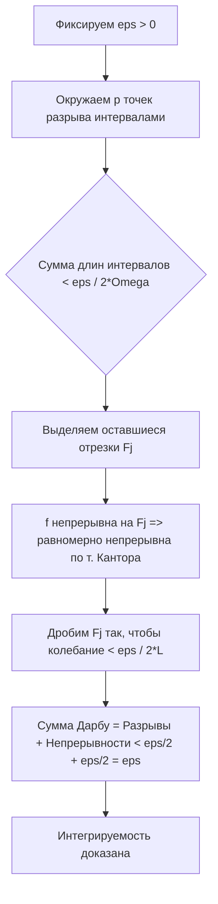

---
tags:
  - матанализ
  - 1_курс
  - подготовка_к_экзамену
тип: конспект
статус: готов
---

Приветствую. Я ожидаю от вас безупречного владения математическим аппаратом. Математический анализ не терпит размахивания руками и апелляций к интуиции там, где требуется строгий язык $\varepsilon-\delta$. Ниже представлен исчерпывающий конспект по трем важнейшим вопросам теории [[Интеграл Римана|интеграла Римана]]. Читайте вдумчиво, каждое слово здесь имеет вес.

---

# Вопрос №19. Интегрируемость кусочно-непрерывных функций.

> [!definition] Кусочно-непрерывная функция
> Функция $f: [a, b] \to \mathbb{R}$ называется **кусочно-непрерывной** на отрезке $[a, b]$, если она ограничена на этом отрезке и имеет не более чем конечное число точек разрыва.

> [!warning] Важное замечание
> Требование ограниченности функции является абсолютно необходимым. Функция $f(x) = \frac{1}{x}$ при $x \in (0, 1]$ и $f(0) = 0$ имеет всего одну точку разрыва, однако она не ограничена и, следовательно, не интегрируема по Риману в собственном смысле. 

> [!theorem] Теорема об интегрируемости кусочно-непрерывной функции
> Если функция $f(x)$ ограничена на отрезке $[a, b]$ и непрерывна на нем всюду, за исключением конечного числа точек, то она интегрируема по Риману на $[a, b]$, то есть $f \in \mathcal{R}[a, b]$.

> [!proof]+ Доказательство
> Пусть функция $f(x)$ определена и ограничена на отрезке $[a, b]$. Следовательно, существуют точные грани:
> $$ M = \sup_{x \in [a, b]} f(x), \quad m = \inf_{x \in [a, b]} f(x) $$
> Обозначим $\Omega = M - m$ — колебание функции $f$ на всем отрезке $[a, b]$. Если $\Omega = 0$, то функция постоянна и интегрируема. Пусть $\Omega > 0$.
> 
> Пусть $x_1, x_2, \dots, x_p$ — точки разрыва функции $f$ на $[a, b]$.
> Зафиксируем произвольное $\varepsilon > 0$. Наша цель — использовать [[Критерий Дарбу]] интегрируемости, то есть построить такое разбиение $T$ отрезка $[a, b]$, для которого разность верхней и нижней сумм Дарбу удовлетворяет неравенству:
> $$ S(T) - s(T) = \sum_{i=1}^n \omega_i \Delta x_i < \varepsilon $$
> где $\omega_i = M_i - m_i$ — колебание функции на частичном отрезке $[x_{i-1}, x_i]$.
> 
> **Шаг 1: Изоляция точек разрыва.**
> Окружим каждую точку разрыва $x_k$ интервалом $(\alpha_k, \beta_k)$ так, чтобы сумма длин всех этих интервалов была строго меньше $\frac{\varepsilon}{2\Omega}$:
> $$ \sum_{k=1}^p (\beta_k - \alpha_k) < \frac{\varepsilon}{2\Omega} $$
> 
> **Шаг 2: Анализ непрерывных участков.**
> После удаления интервалов $(\alpha_k, \beta_k)$ из отрезка $[a, b]$ останется конечное объединение непересекающихся замкнутых отрезков, которые мы обозначим как $F_1, F_2, \dots, F_q$ (их не более чем $p+1$).
> На каждом из отрезков $F_j$ функция $f(x)$ не имеет точек разрыва, то есть строго непрерывна. 
> Согласно [[Теорема Кантора|теореме Кантора]], функция, непрерывная на компакте (замкнутом отрезке), равномерно непрерывна на нем. Следовательно, для выбранного $\varepsilon > 0$ существует такое $\delta > 0$, что для любых $x', x'' \in F_j$, удовлетворяющих условию $|x' - x''| < \delta$, выполняется:
> $$ |f(x') - f(x'')| < \frac{\varepsilon}{2(b-a)} $$
> 
> **Шаг 3: Построение итогового разбиения.**
> Построим разбиение $T$ отрезка $[a,b]$ так, чтобы границы интервалов $\alpha_k, \beta_k$ вошли в число точек разбиения. Оставшиеся отрезки $F_j$ разобьем на частичные отрезки с длиной, строго меньшей найденного $\delta$.
> Теперь разобьем сумму разностей сумм Дарбу на две группы:
> $$ S(T) - s(T) = \sum_{T} \omega_i \Delta x_i = \Sigma_1 + \Sigma_2 $$
> где $\Sigma_1$ — сумма по отрезкам, покрывающим точки разрыва (их объединение лежит внутри $\cup (\alpha_k, \beta_k)$), а $\Sigma_2$ — сумма по отрезкам, составляющим непрерывные части $F_j$.
> 
> **Шаг 4: Оценка сумм.**
> Для $\Sigma_1$: на любом частичном отрезке колебание $\omega_i \le \Omega$. Следовательно:
> $$ \Sigma_1 = \sum_{\text{разрывы}} \omega_i \Delta x_i \le \Omega \sum_{\text{разрывы}} \Delta x_i < \Omega \cdot \frac{\varepsilon}{2\Omega} = \frac{\varepsilon}{2} $$
> Для $\Sigma_2$: длина каждого частичного отрезка меньше $\delta$, поэтому в силу равномерной непрерывности $\omega_i < \frac{\varepsilon}{2(b-a)}$. Следовательно:
> $$ \Sigma_2 = \sum_{\text{непрерыв}} \omega_i \Delta x_i < \frac{\varepsilon}{2(b-a)} \sum_{\text{непрерыв}} \Delta x_i \le \frac{\varepsilon}{2(b-a)} (b-a) = \frac{\varepsilon}{2} $$
> 
> **Итог:**
> $$ S(T) - s(T) = \Sigma_1 + \Sigma_2 < \frac{\varepsilon}{2} + \frac{\varepsilon}{2} = \varepsilon $$
> В силу произвольности $\varepsilon > 0$, по критерию Дарбу $f(x)$ интегрируема по Риману на $[a, b]$. $\blacksquare$

---

# Вопрос №20. Критерий Лебега интегрируемости функции по Риману. Арифметические действия над интегрируемыми функциями.

Для формулировки этого фундаментального критерия необходимо ввести понятие множества меры нуль по Лебегу (в рамках вещественной прямой $\mathbb{R}$).

> [!definition] Множество меры нуль
> Множество $E \subset \mathbb{R}$ имеет **меру нуль по Лебегу** (обозначается $\mu(E) = 0$), если для любого $\varepsilon > 0$ существует конечная или счетная система интервалов $\{(a_k, b_k)\}_{k=1}^\infty$, покрывающая множество $E$ (то есть $E \subset \bigcup_{k} (a_k, b_k)$), сумма длин которых удовлетворяет неравенству:
> $$ \sum_{k} (b_k - a_k) < \varepsilon $$

> [!lemma] Колебание функции в точке
> Пусть $f$ определена на $[a,b]$. **Колебанием функции в точке** $x \in [a,b]$ называется величина:
> $$ \omega_f(x) = \lim_{\delta \to +0} \sup_{x', x'' \in (x-\delta, x+\delta)\cap[a,b]} |f(x') - f(x'')| $$
> Функция непрерывна в точке $x$ тогда и только тогда, когда $\omega_f(x) = 0$. Множество точек разрыва можно представить как $D = \{x \in [a,b] \mid \omega_f(x) > 0\}$.

> [!theorem] Критерий Лебега
> Функция $f: [a,b] \to \mathbb{R}$ интегрируема по Риману на $[a,b]$ тогда и только тогда, когда она ограничена на $[a,b]$, а множество всех её точек разрыва имеет меру нуль по Лебегу.

> [!proof]+ Схема строгого доказательства (для экзаменатора)
> Обозначим $D_\sigma = \{x \in [a,b] \mid \omega_f(x) \ge \sigma\}$. Можно строго доказать, что $D_\sigma$ — замкнутое множество.
> 
> **Достаточность ($\Leftarrow$):** Пусть $f$ ограничена ($|f(x)| \le M$) и $\mu(D) = 0$. Зададим $\varepsilon > 0$. Выберем $\sigma = \frac{\varepsilon}{2(b-a)}$. 
> Так как $D_\sigma \subset D$, то $\mu(D_\sigma) = 0$. Поскольку $D_\sigma$ ограничено и замкнуто, оно является компактом. По [[Теорема Гейне-Бореля|лемме Гейне-Бореля]] из счетного покрытия $D_\sigma$ интервалами суммы длин $< \frac{\varepsilon}{4M}$ можно выделить конечное подпокрытие.
> Объединение этих конечных интервалов назовем $G$. Сумма длин $G < \frac{\varepsilon}{4M}$. Множество $K = [a,b] \setminus G$ есть компакт, и $\forall x \in K: \omega_f(x) < \sigma$. Для каждой точки из $K$ существует окрестность, где колебание $< \sigma$. Из этих окрестностей выделим конечное покрытие компакта $K$.
> Строим разбиение $T$, границы которого подчинены этим покрытиям. Тогда сумма Дарбу распадается на две: над $G$ (где колебание $\le 2M$, а длина $< \frac{\varepsilon}{4M}$) и над $K$ (где колебание $< \sigma = \frac{\varepsilon}{2(b-a)}$, длина $\le b-a$). 
> $$ S - s \le 2M \cdot \frac{\varepsilon}{4M} + \frac{\varepsilon}{2(b-a)} \cdot (b-a) = \frac{\varepsilon}{2} + \frac{\varepsilon}{2} = \varepsilon. $$
> По критерию Дарбу $f \in \mathcal{R}[a,b]$.
> 
> **Необходимость ($\Rightarrow$):** Если $f \in \mathcal{R}[a,b]$, то для любого $\varepsilon > 0$ и любого $\sigma > 0$ можно найти разбиение, где $\sum \omega_i \Delta x_i < \sigma \cdot \varepsilon$. Все интервалы разбиения, пересекающиеся с $D_\sigma$, обязаны иметь $\omega_i \ge \sigma$. Тогда их суммарная длина $\sum \Delta x_i \le \frac{1}{\sigma} \sum \omega_i \Delta x_i < \varepsilon$. Значит, $\mu(D_\sigma) = 0$. 
> Так как $D = \bigcup_{n=1}^\infty D_{1/n}$, а счетное объединение множеств меры нуль есть множество меры нуль, то $\mu(D) = 0$. Ограниченность $f$ следует из самого определения интегрируемости (чтобы суммы Дарбу были конечны). $\blacksquare$

### Арифметические действия над интегрируемыми функциями

> [!theorem] Теорема об арифметических операциях
> Пусть $f, g \in \mathcal{R}[a,b]$, $\alpha, \beta \in \mathbb{R}$. Тогда:
> 1. $\alpha f + \beta g \in \mathcal{R}[a,b]$ (линейность).
> 2. $f \cdot g \in \mathcal{R}[a,b]$ (произведение).
> 3. Если существует число $c > 0$ такое, что $|g(x)| \ge c$ для всех $x \in [a,b]$, то $\frac{f}{g} \in \mathcal{R}[a,b]$.

> [!proof]+ Строгое доказательство (для произведения, метод Дарбу)
> Покажем, что произведение интегрируемых функций интегрируемо, не прибегая к критерию Лебега, используя исключительно суммы Дарбу и прием $+\pm$.
> Так как $f, g \in \mathcal{R}[a,b]$, то они ограничены: $\exists M_f, M_g > 0$, такие что $|f(x)| \le M_f, |g(x)| \le M_g$.
> Рассмотрим колебание произведения $f \cdot g$ на произвольном отрезке разбиения $[x_{i-1}, x_i]$. Пусть $x', x''$ — любые две точки из этого отрезка.
> Рассмотрим модуль разности, добавив и вычтя слагаемое $f(x')g(x'')$:
> $$ |f(x')g(x') - f(x'')g(x'')| = |f(x')g(x') - f(x')g(x'') + f(x')g(x'') - f(x'')g(x'')| $$
> По неравенству треугольника:
> $$ \le |f(x')| \cdot |g(x') - g(x'')| + |g(x'')| \cdot |f(x') - f(x'')| $$
> Заменяя значения функций их супремумами на всем отрезке, получим оценку сверху:
> $$ \le M_f \cdot \omega_g^i + M_g \cdot \omega_f^i $$
> Переходя к супремуму по всем $x', x'' \in [x_{i-1}, x_i]$, получаем связь колебаний:
> $$ \omega_{fg}^i \le M_f \omega_g^i + M_g \omega_f^i $$
> Умножим это неравенство на $\Delta x_i$ и просуммируем по $i$ от $1$ до $n$:
> $$ \sum_{i=1}^n \omega_{fg}^i \Delta x_i \le M_f \sum_{i=1}^n \omega_g^i \Delta x_i + M_g \sum_{i=1}^n \omega_f^i \Delta x_i $$
> Зададим $\varepsilon > 0$. В силу интегрируемости $f$ и $g$, по критерию Дарбу существуют такие разбиения $T_1$ и $T_2$, что суммы Дарбу разностей строго меньше $\frac{\varepsilon}{2M_g}$ и $\frac{\varepsilon}{2M_f}$ соответственно. Возьмем разбиение $T = T_1 \cup T_2$ (объединение точек). При измельчении разбиения разность сумм Дарбу не увеличивается, поэтому для $T$:
> $$ \sum \omega_{fg}^i \Delta x_i < M_f \frac{\varepsilon}{2M_f} + M_g \frac{\varepsilon}{2M_g} = \varepsilon $$
> По критерию Дарбу $f \cdot g \in \mathcal{R}[a,b]$. $\blacksquare$

---

# Вопрос №21. Свойства интеграла Римана.

Свойства интеграла Римана органично вытекают из свойств предела интегральных сумм. Здесь мы рассмотрим базовые свойства интеграла по фиксированному отрезку.

> [!abstract] Линейность и Аддитивность
> **1. Линейность.** Если $f, g \in \mathcal{R}[a,b]$ и $\alpha, \beta \in \mathbb{R}$, то
> $$ \int_a^b (\alpha f(x) + \beta g(x)) dx = \alpha \int_a^b f(x) dx + \beta \int_a^b g(x) dx $$
> *Доказательство* опирается на линейность интегральных сумм Римана $\sigma(T, \xi)$ и свойства предела.
> 
> **2. Аддитивность по отрезку.** Для любых $a < c < b$, функция $f \in \mathcal{R}[a,b] \iff f \in \mathcal{R}[a,c] \land f \in \mathcal{R}[c,b]$. При этом:
> $$ \int_a^b f(x) dx = \int_a^c f(x) dx + \int_c^b f(x) dx $$
> *Доказательство* строится на фиксации точки $c$ как обязательной точки разбиения при оценке сумм Дарбу.

> [!theorem] Свойства, связанные с неравенствами
> **3. Сохранение знака.** Если $f \in \mathcal{R}[a,b]$ и $f(x) \ge 0$ $\forall x \in [a,b]$, то $\int_a^b f(x) dx \ge 0$.
> **4. Интегрирование неравенств.** Если $f, g \in \mathcal{R}[a,b]$ и $f(x) \ge g(x)$ $\forall x \in [a,b]$, то
> $$ \int_a^b f(x) dx \ge \int_a^b g(x) dx $$
> *(Следует из свойства 3 для функции $h(x) = f(x) - g(x)$).*

> [!theorem] Интегрируемость модуля
> Если $f \in \mathcal{R}[a,b]$, то $|f| \in \mathcal{R}[a,b]$, причем справедливо неравенство:
> $$ \left| \int_a^b f(x) dx \right| \le \int_a^b |f(x)| dx $$

> [!proof]+ Доказательство интегрируемости модуля
> Для любых двух чисел $x', x''$ справедливо обратное неравенство треугольника:
> $$ ||f(x')| - |f(x'')|| \le |f(x') - f(x'')| $$
> Отсюда следует, что колебание функции $|f|$ на любом отрезке не превосходит колебания функции $f$:
> $$ \omega_{|f|}^i \le \omega_f^i $$
> Умножая на $\Delta x_i$ и суммируя, получаем, что разность верхней и нижней сумм Дарбу для $|f|$ меньше или равна таковой для $f$. Так как $f \in \mathcal{R}$, по критерию Дарбу $|f| \in \mathcal{R}$.
> Само неравенство интегралов выводится из двойного неравенства:
> $$ -|f(x)| \le f(x) \le |f(x)| $$
> Применяя свойство интегрирования неравенств (Свойство 4), получаем требуемое. $\blacksquare$

> [!theorem] Первая теорема о среднем (обобщенная)
> Пусть $f, g \in \mathcal{R}[a,b]$, причем $m \le f(x) \le M$ для всех $x \in [a,b]$, а функция $g(x)$ знакопостоянна на $[a,b]$ (для определенности $g(x) \ge 0$). Тогда существует такое число $\mu \in [m, M]$, что:
> $$ \int_a^b f(x)g(x) dx = \mu \int_a^b g(x) dx $$
> Если, кроме того, $f \in C[a,b]$, то существует точка $\xi \in [a,b]$ такая, что:
> $$ \int_a^b f(x)g(x) dx = f(\xi) \int_a^b g(x) dx $$

> [!proof]+ Доказательство первой теоремы о среднем
> Так как $m \le f(x) \le M$ и $g(x) \ge 0$ на всем отрезке, умножим неравенство на $g(x)$:
> $$ m \cdot g(x) \le f(x)g(x) \le M \cdot g(x) $$
> В силу интегрируемости $f$ и $g$, произведение $f \cdot g \in \mathcal{R}[a,b]$. Применим свойство интегрирования неравенств:
> $$ m \int_a^b g(x) dx \le \int_a^b f(x)g(x) dx \le M \int_a^b g(x) dx $$
> Если $\int_a^b g(x) dx = 0$, то $\int f(x)g(x) dx = 0$, и равенство выполняется при любом $\mu \in [m, M]$.
> Если $\int_a^b g(x) dx > 0$, разделим все части неравенства на этот интеграл:
> $$ m \le \frac{\int_a^b f(x)g(x) dx}{\int_a^b g(x) dx} \le M $$
> Обозначим эту дробь за $\mu$. Очевидно, что $\mu \in [m, M]$.
> 
> Если функция $f$ строго непрерывна на отрезке $[a, b]$, то по [[Теорема Больцано-Коши|второй теореме Больцано-Коши о промежуточном значении]], она принимает все значения между своим минимумом и максимумом. Так как $\mu$ лежит в этих пределах, существует хотя бы одна точка $\xi \in [a,b]$, для которой $f(\xi) = \mu$. Подставляя это в формулу, получаем искомое утверждение. $\blacksquare$

