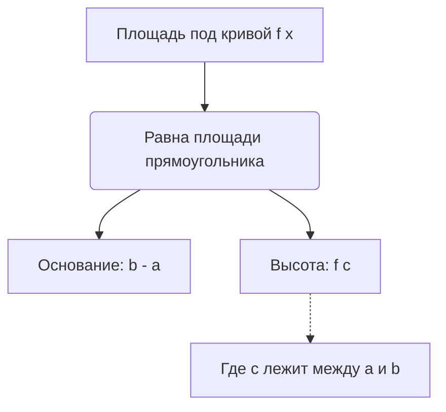

---
tags:
  - матанализ
  - 1_курс
  - подготовка_к_экзамену
тип: конспект
статус: готов
---

# Вопрос №20. Критерий Лебега интегрируемости функции по Риману. Арифметические действия над интегрируемыми функциями.

> [!definition] Множество лебеговой меры нуль
> Множество $E \subset \mathbb{R}$ имеет меру нуль по Лебегу (пишут $\mu(E) = 0$), если для любого заданного $\varepsilon > 0$ существует конечная или счетная система интервалов $\{(a_i, b_i)\}_{i=1}^{\infty}$, такая что:
> 1. $E \subset \bigcup_{i=1}^{\infty} (a_i, b_i)$ (интервалы покрывают множество);
> 2. $\sum_{i=1}^{\infty} (b_i - a_i) < \varepsilon$ (сумма длин интервалов строго меньше $\varepsilon$).

> [!definition] Колебание функции в точке
> Пусть функция $f(x)$ определена в некоторой окрестности точки $x_0$. Колебанием функции $f$ в точке $x_0$ называется величина:
> $$ \omega(f, x_0) = \lim_{\delta \to 0+0} \left( \sup_{x \in U_\delta(x_0)} f(x) - \inf_{x \in U_\delta(x_0)} f(x) \right) $$
> Функция непрерывна в точке $x_0$ тогда и только тогда, когда $\omega(f, x_0) = 0$.

> [!theorem] Критерий Лебега интегрируемости по Риману
> Для того чтобы ограниченная на отрезке $[a,b]$ функция $f(x)$ была интегрируема по Риману ($f \in \mathcal{R}[a,b]$), необходимо и достаточно, чтобы множество точек её разрыва на этом отрезке имело лебегову меру нуль.

> [!lemma] Вспомогательная лемма о компактности (Лемма о покрытии)
> Пусть $E_c = \{x \in [a,b] \mid \omega(f, x) \ge c > 0\}$. Если $f$ ограничена, то $E_c$ — замкнутое множество. Будучи подмножеством отрезка $[a,b]$, оно является компактом.

> [!proof]+ Доказательство критерия Лебега
> **Достаточность:** Пусть $f$ ограничена ($|f(x)| \le M$) и множество её точек разрыва $D$ имеет меру нуль. 
> Зафиксируем $\varepsilon > 0$. Рассмотрим множество $E_{\varepsilon_1} = \{x \in [a,b] \mid \omega(f, x) \ge \frac{\varepsilon}{2(b-a)}\}$. 
> Так как $E_{\varepsilon_1} \subset D$, то $\mu(E_{\varepsilon_1}) = 0$. По лемме, $E_{\varepsilon_1}$ замкнуто и ограничено, значит, компактно. 
> По определению меры нуль, покроем $E_{\varepsilon_1}$ конечной системой интервалов с суммой длин $< \frac{\varepsilon}{4M}$. 
> Оставшаяся часть отрезка $K = [a,b] \setminus \cup (a_i, b_i)$ является компактом, на котором $\forall x: \omega(f, x) < \frac{\varepsilon}{2(b-a)}$.
> Для каждой точки из $K$ найдется окрестность, где колебание $< \frac{\varepsilon}{2(b-a)}$. Выделим из этих окрестностей конечное подпокрытие (по [[Теорема Гейне-Бореля]]).
> Построим разбиение $T$ отрезка $[a,b]$, границы которого согласованы с этими интервалами. 
> Разделим отрезки разбиения $\Delta x_k$ на два класса:
> $\Sigma'$ — отрезки, пересекающиеся с $E_{\varepsilon_1}$. Их суммарная длина $< \frac{\varepsilon}{4M}$. Колебание на них оценивается как $\omega_k \le 2M$.
> $\Sigma''$ — остальные отрезки. На них $\omega_k < \frac{\varepsilon}{2(b-a)}$.
> Вычислим разность верхней и нижней [[Суммы Дарбу]]:
> $$ \Omega(T) = \sum_{k} \omega_k \Delta x_k = \sum_{\Sigma'} \omega_k \Delta x_k + \sum_{\Sigma''} \omega_k \Delta x_k $$
> $$ \Omega(T) < 2M \cdot \frac{\varepsilon}{4M} + \frac{\varepsilon}{2(b-a)} \cdot (b-a) = \frac{\varepsilon}{2} + \frac{\varepsilon}{2} = \varepsilon $$
> По критерию Дарбу, функция интегрируема.
> 
> **Необходимость:** Пусть $f \in \mathcal{R}[a,b]$. По критерию Дарбу, $\forall \varepsilon > 0$ $\exists$ разбиение $T$, такое что $\sum \omega_k \Delta x_k < \varepsilon$.
> Пусть $D_c = \{x \in [a,b] \mid \omega(f,x) \ge c\}$. Если точка $x \in D_c$ лежит строго внутри отрезка разбиения $\Delta x_k$, то $\omega_k \ge c$.
> Сумма длин таких отрезков: $\sum' \Delta x_k \le \frac{1}{c} \sum' \omega_k \Delta x_k < \frac{\varepsilon}{c}$.
> Точки множества $D_c$, попавшие на границы разбиений, образуют конечное множество (мера нуль). Значит, $D_c$ покрывается интервалами со сколь угодно малой суммой длин. Следовательно, $\mu(D_c) = 0$.
> Множество всех точек разрыва $D = \bigcup_{n=1}^\infty D_{1/n}$. Объединение счетного числа множеств меры нуль имеет меру нуль. Ч.т.д.

> [!theorem] Арифметические свойства интегрируемых функций
> Пусть $f, g \in \mathcal{R}[a,b]$ и $\alpha, \beta \in \mathbb{R}$. Тогда:
> 1. $(\alpha f + \beta g) \in \mathcal{R}[a,b]$ (Линейность множества интегрируемых функций);
> 2. $(f \cdot g) \in \mathcal{R}[a,b]$ (Интегрируемость произведения).

> [!proof]+ Доказательство (через критерий Лебега)
> 1. Если $f, g \in \mathcal{R}[a,b]$, то они ограничены. Линейная комбинация ограниченных функций ограничена. Пусть $D_f$ и $D_g$ — множества точек разрыва функций $f$ и $g$. По критерию Лебега $\mu(D_f) = 0$ и $\mu(D_g) = 0$.
> Множество точек разрыва суммы $D_{f+g} \subset D_f \cup D_g$.
> Так как объединение двух множеств меры нуль имеет меру нуль, $\mu(D_{f+g}) = 0$. По критерию Лебега $(\alpha f + \beta g) \in \mathcal{R}[a,b]$.
> 2. Аналогично, произведение ограниченных функций ограничено. Точки разрыва произведения могут возникать только в точках разрыва сомножителей: $D_{f \cdot g} \subset D_f \cup D_g$.
> Следовательно, $\mu(D_{f \cdot g}) = 0$, и $(f \cdot g) \in \mathcal{R}[a,b]$.

> [!warning] Важное замечание (Частное)
> Функция $\frac{f(x)}{g(x)}$ интегрируема по Риману при условии $f, g \in \mathcal{R}[a,b]$ **только если** существует константа $c > 0$, такая что $|g(x)| \ge c > 0$ $\forall x \in [a,b]$. Иначе функция может оказаться неограниченной.

---

# Вопрос №21. Свойства интеграла Римана.

> [!abstract] Геометрический смысл
> Интеграл Римана $\int_a^b f(x)dx$ представляет собой ориентированную [[Площадь]] (в смысле меры Жордана) подграфика функции. Свойства ниже формализуют интуитивные понятия: площади можно складывать, растягивать, и большая фигура имеет большую площадь.

> [!theorem] Основные свойства определенного интеграла
> Пусть $f, g \in \mathcal{R}[a,b]$. Тогда справедливы следующие свойства:
> 1. **Линейность:** $\int_a^b (\alpha f(x) + \beta g(x))dx = \alpha \int_a^b f(x)dx + \beta \int_a^b g(x)dx$.
> 2. **Аддитивность по отрезку:** Для любой точки $c \in (a,b)$, $f \in \mathcal{R}[a,b] \iff f \in \mathcal{R}[a,c] \land f \in \mathcal{R}[c,b]$. При этом:
>    $$ \int_a^b f(x)dx = \int_a^c f(x)dx + \int_c^b f(x)dx $$
> 3. **Монотонность (интегрирование неравенств):** Если $f(x) \le g(x)$ $\forall x \in [a,b]$, то $\int_a^b f(x)dx \le \int_a^b g(x)dx$.
> 4. **Оценка модуля:** Если $f \in \mathcal{R}[a,b]$, то $|f| \in \mathcal{R}[a,b]$, причем:
>    $$ \left| \int_a^b f(x)dx \right| \le \int_a^b |f(x)|dx $$

> [!proof]+ Доказательство свойств
> **1. Линейность.**
> Для любого разбиения $T$ и выбора промежуточных точек $\xi_i$ составим [[Интегральная сумма|интегральную сумму Римана]]:
> $$ \sigma(T, \alpha f + \beta g) = \sum_{i=1}^n (\alpha f(\xi_i) + \beta g(\xi_i))\Delta x_i = \alpha \sum_{i=1}^n f(\xi_i)\Delta x_i + \beta \sum_{i=1}^n g(\xi_i)\Delta x_i $$
> Переходя к пределу при мелкости разбиения $\lambda(T) \to 0$ (пределы сумм существуют в силу интегрируемости $f$ и $g$), получаем требуемое равенство.
> 
> **2. Аддитивность.**
> *Достаточность ($\Rightarrow$)*: Если $f \in \mathcal{R}[a,b]$, то по критерию Дарбу $\forall \varepsilon > 0$ $\exists$ разбиение $T$, где $\Omega(T) < \varepsilon$. Добавив точку $c$ в $T$ (если её там не было), мы получим новое разбиение $T'$, для которого $\Omega(T') \le \Omega(T) < \varepsilon$. Разбиение $T'$ распадается на $T_1$ для $[a,c]$ и $T_2$ для $[c,b]$. Так как сумма неотрицательных слагаемых меньше $\varepsilon$, то $\Omega(T_1) < \varepsilon$ и $\Omega(T_2) < \varepsilon$, значит $f$ интегрируема на частях.
> Равенство интегралов вытекает из свойства интегральных сумм: для разбиения, содержащего точку $c$, $\sigma_{[a,b]} = \sigma_{[a,c]} + \sigma_{[c,b]}$. Переход к пределу при $\lambda \to 0$ дает равенство.
> 
> **3. Монотонность.**
> Рассмотрим функцию $h(x) = g(x) - f(x) \ge 0$. Её интегральная сумма $\sigma(h, T) = \sum h(\xi_i)\Delta x_i \ge 0$ (так как $\Delta x_i > 0$ и $h \ge 0$). Переходя к пределу, $\int_a^b h(x)dx \ge 0$. В силу линейности: $\int g - \int f \ge 0 \implies \int f \le \int g$.
> 
> **4. Оценка модуля.**
> Заметим, что $-|f(x)| \le f(x) \le |f(x)|$ для всех $x$. Так как функция $z \mapsto |z|$ непрерывна, композиция $|f(x)|$ интегрируема по Лебегу (или из оценки колебаний $\omega(|f|) \le \omega(f)$). 
> Применяя свойство монотонности к неравенству:
> $$ -\int_a^b |f(x)|dx \le \int_a^b f(x)dx \le \int_a^b |f(x)|dx $$
> Это эквивалентно $\left| \int_a^b f(x)dx \right| \le \int_a^b |f(x)|dx$.

> [!warning] Важное замечание (Контрпример)
> Интегрируемость $|f(x)|$ **не влечет** интегрируемость $f(x)$. 
> Пусть $f(x) = 1$, если $x \in \mathbb{Q}$, и $f(x) = -1$, если $x \in \mathbb{R} \setminus \mathbb{Q}$ (модификация функции Дирихле).
> Тогда $|f(x)| \equiv 1 \in \mathcal{R}[a,b]$. Однако $f(x)$ разрывна всюду, её верхняя сумма Дарбу равна $(b-a)$, а нижняя $-(b-a)$, следовательно, $f \notin \mathcal{R}[a,b]$.

---

# Вопрос №22. Первая теорема о среднем интегрального исчисления и её следствия.

> [!definition] Среднее значение функции
> Число $\mu = \frac{1}{b-a}\int_a^b f(x)dx$ называется средним интегральным значением функции $f$ на отрезке $[a,b]$.

> [!theorem] Первая теорема о среднем (Общая формулировка)
> Пусть $f, g \in \mathcal{R}[a,b]$, причём функция $g(x)$ знакопостоянна на $[a,b]$ (то есть $g(x) \ge 0$ или $g(x) \le 0$ $\forall x \in [a,b]$).
> Пусть $m = \inf_{x \in [a,b]} f(x)$ и $M = \sup_{x \in [a,b]} f(x)$.
> Тогда существует такое число $\mu \in [m, M]$, что:
> $$ \int_a^b f(x)g(x)dx = \mu \int_a^b g(x)dx $$

> [!proof]+ Доказательство общей теоремы
> Без ограничения общности положим, что $g(x) \ge 0$ $\forall x \in [a,b]$.
> Поскольку $m \le f(x) \le M$ для всех $x \in [a,b]$, умножим это неравенство на неотрицательную функцию $g(x)$:
> $$ m \cdot g(x) \le f(x)g(x) \le M \cdot g(x) $$
> В силу монотонности интеграла Римана и его линейности, интегрируем неравенство на отрезке $[a,b]$:
> $$ m \int_a^b g(x)dx \le \int_a^b f(x)g(x)dx \le M \int_a^b g(x)dx $$
> **Случай 1:** $\int_a^b g(x)dx = 0$. Тогда из неравенства следует, что $\int_a^b f(x)g(x)dx = 0$. В качестве $\mu$ можно взять любое число из $[m, M]$, равенство $0 = \mu \cdot 0$ будет выполнено.
> **Случай 2:** $\int_a^b g(x)dx > 0$. Разделим все части неравенства на этот интеграл:
> $$ m \le \frac{\int_a^b f(x)g(x)dx}{\int_a^b g(x)dx} \le M $$
> Обозначим дробь посередине за $\mu$. Очевидно, что $\mu \in [m, M]$, и выполняется $\int f \cdot g = \mu \int g$. Ч.т.д.

> [!theorem] Первая теорема о среднем (Для непрерывной функции)
> Если в условиях предыдущей теоремы функция $f(x)$ **непрерывна** на $[a,b]$ ($f \in C[a,b]$), то существует точка $c \in [a,b]$, такая что:
> $$ \int_a^b f(x)g(x)dx = f(c) \int_a^b g(x)dx $$

> [!proof]+ Доказательство следствия для непрерывной функции
> По [[Теорема Вейерштрасса|второй теореме Вейерштрасса]], непрерывная на отрезке $[a,b]$ функция $f(x)$ достигает своих точных граней $m$ и $M$. 
> По общей первой теореме о среднем, существует число $\mu \in [m, M]$.
> По [[Теорема Коши о промежуточном значении|теореме Коши о промежуточном значении непрерывной функции]], функция $f(x)$ принимает любое значение между своим минимумом и максимумом.
> Следовательно, существует точка $c \in [a,b]$, для которой $f(c) = \mu$. Подставляя это в формулу из общей теоремы, получаем требуемое.

> [!lemma] Следствие (Упрощенная форма)
> Если положить $g(x) \equiv 1$ (которая очевидно интегрируема и знакопостоянна), то для непрерывной $f \in C[a,b]$ найдется точка $c \in [a,b]$, такая что:
> $$ \int_a^b f(x)dx = f(c)(b-a) $$

> [!warning] Важное замечание
> Требование знакопостоянства функции $g(x)$ абсолютно критично! 
> Если $g(x)$ меняет знак, теорема неверна. Пример: $[a,b] = [-1, 1]$, $f(x) = x$, $g(x) = x$. 
> $\int_{-1}^1 x \cdot x dx = \frac{2}{3}$. Но $\int_{-1}^1 x dx = 0$. Формула дала бы $\frac{2}{3} = \mu \cdot 0$, что невозможно.

---

# Вопрос №23. Формула Ньютона-Лейбница. Интегрирование по частям и замена переменной в определенном интеграле.

> [!definition] Интеграл с переменным верхним пределом
> Если $f \in \mathcal{R}[a,b]$, то для любого $x \in [a,b]$ корректно определена функция:
> $$ \Phi(x) = \int_a^x f(t)dt $$

> [!lemma] О производной интеграла по верхнему пределу (Теорема Барроу)
> Если $f(x)$ непрерывна на $[a,b]$, то $\Phi(x)$ дифференцируема на $[a,b]$ и $\forall x \in [a,b]: \Phi'(x) = f(x)$. (То есть $\Phi(x)$ является первообразной для $f(x)$).

> [!proof]+ Доказательство леммы
> Зафиксируем точку $x \in [a,b]$ и дадим ей приращение $\Delta x \neq 0$.
> $$ \Delta \Phi = \Phi(x+\Delta x) - \Phi(x) = \int_a^{x+\Delta x} f(t)dt - \int_a^x f(t)dt = \int_x^{x+\Delta x} f(t)dt $$
> Применяя первую теорему о среднем для непрерывной $f(t)$ (где $g(t) \equiv 1$), найдем точку $c$ между $x$ и $x+\Delta x$:
> $$ \int_x^{x+\Delta x} f(t)dt = f(c) \cdot \Delta x $$
> Тогда $\frac{\Delta \Phi}{\Delta x} = f(c)$. При $\Delta x \to 0$, точка $c \to x$. В силу непрерывности $f$, $\lim_{\Delta x \to 0} f(c) = f(x)$.
> Следовательно, $\Phi'(x) = \lim_{\Delta x \to 0} \frac{\Delta \Phi}{\Delta x} = f(x)$.

> [!theorem] Формула Ньютона-Лейбница
> Пусть функция $f \in C[a,b]$, и $F(x)$ — любая её [[Первообразная]] на $[a,b]$ (то есть $F'(x) = f(x)$). Тогда:
> $$ \int_a^b f(x)dx = F(b) - F(a) = \left. F(x) \right|_a^b $$

> [!proof]+ Доказательство
> По доказанной лемме, $\Phi(x) = \int_a^x f(t)dt$ является первообразной для $f(x)$.
> Известно, что две первообразные одной функции на промежутке отличаются на константу:
> $\Phi(x) = F(x) + C$.
> Найдем $C$. Подставим $x = a$:
> $\Phi(a) = \int_a^a f(t)dt = 0 = F(a) + C \implies C = -F(a)$.
> Значит, $\forall x: \Phi(x) = F(x) - F(a)$.
> Подставим $x = b$:
> $\Phi(b) = \int_a^b f(t)dt = F(b) - F(a)$. Ч.т.д.

> [!theorem] Интегрирование по частям
> Пусть функции $u(x)$ и $v(x)$ непрерывно дифференцируемы на $[a,b]$ ($u, v \in C^1[a,b]$). Тогда:
> $$ \int_a^b u(x)v'(x)dx = \left. (u(x)v(x)) \right|_a^b - \int_a^b u'(x)v(x)dx $$

> [!proof]+ Доказательство
> По правилу дифференцирования произведения: $(uv)' = u'v + uv'$.
> Функции $u, u', v, v'$ непрерывны по условию, значит, интегрируемы. Проинтегрируем обе части равенства от $a$ до $b$:
> $$ \int_a^b (u(x)v(x))' dx = \int_a^b u'(x)v(x) dx + \int_a^b u(x)v'(x) dx $$
> По формуле Ньютона-Лейбница, интеграл от производной $(uv)'$ равен приращению функции:
> $$ \left. (u(x)v(x)) \right|_a^b = \int_a^b u'(x)v(x) dx + \int_a^b u(x)v'(x) dx $$
> Перенося слагаемое, получаем требуемую формулу.

> [!theorem] Замена переменной
> Пусть задан интеграл $\int_a^b f(x)dx$, где $f \in C[a,b]$.
> Пусть функция $x = \varphi(t)$ удовлетворяет условиям:
> 1. $\varphi \in C^1[\alpha, \beta]$ (непрерывно дифференцируема);
> 2. $\varphi(\alpha) = a, \varphi(\beta) = b$;
> 3. $\forall t \in [\alpha, \beta]: \varphi(t) \in [a,b]$.
> Тогда:
> $$ \int_a^b f(x)dx = \int_\alpha^\beta f(\varphi(t))\varphi'(t)dt $$

> [!proof]+ Доказательство
> Пусть $F(x)$ — первообразная для $f(x)$ на $[a,b]$ (она существует, так как $f \in C[a,b]$).
> Рассмотрим сложную функцию $\Psi(t) = F(\varphi(t))$ на отрезке $[\alpha, \beta]$.
> По правилу дифференцирования сложной функции:
> $\Psi'(t) = F'(\varphi(t)) \cdot \varphi'(t) = f(\varphi(t)) \cdot \varphi'(t)$.
> Следовательно, $\Psi(t)$ является первообразной для непрерывной функции $f(\varphi(t))\varphi'(t)$.
> Применим формулу Ньютона-Лейбница к правому интегралу:
> $$ \int_\alpha^\beta f(\varphi(t))\varphi'(t)dt = \Psi(\beta) - \Psi(\alpha) = F(\varphi(\beta)) - F(\varphi(\alpha)) $$
> По условию теоремы $\varphi(\beta) = b$ и $\varphi(\alpha) = a$, тогда:
> $$ F(b) - F(a) = \int_a^b f(x)dx $$
> Что совпадает с левой частью. Ч.т.д.

---

# Вопрос №24. Формула Тейлора с остатком в интегральной форме.

> [!definition] Формула Тейлора
> Если функция $f(x)$ имеет производные до порядка $n$ включительно в точке $x_0$, её можно представить в виде:
> $$ f(x) = P_n(x) + R_n(x) $$
> Где $P_n(x) = \sum_{k=0}^n \frac{f^{(k)}(x_0)}{k!}(x-x_0)^k$ — многочлен Тейлора, а $R_n(x)$ — остаточный член.

> [!theorem] Остаточный член в интегральной форме
> Пусть функция $f(x)$ имеет непрерывную производную порядка $(n+1)$ на отрезке с концами $x_0$ и $x$ (то есть $f \in C^{n+1}[x_0, x]$).
> Тогда остаточный член можно представить в виде:
> $$ R_n(x) = \frac{1}{n!} \int_{x_0}^x f^{(n+1)}(t) \cdot (x-t)^n dt $$

> [!proof]+ Доказательство (Методом математической индукции)
> **База индукции ($n=0$):** 
> Нам дано $f \in C^1[x_0, x]$. Формула утверждает, что:
> $$ f(x) = f(x_0) + \frac{1}{0!} \int_{x_0}^x f^{(1)}(t)(x-t)^0 dt = f(x_0) + \int_{x_0}^x f'(t)dt $$
> Это равенство в точности совпадает с формулой Ньютона-Лейбница $\int_{x_0}^x f'(t)dt = f(x) - f(x_0)$. База верна.
> 
> **Индуктивный переход ($k \to k+1$):**
> Пусть формула верна для $n=k$:
> $$ R_k(x) = \frac{1}{k!} \int_{x_0}^x f^{(k+1)}(t)(x-t)^k dt $$
> Предположим, что $f \in C^{k+2}[x_0, x]$. Применим к интегралу интегрирование по частям.
> Выберем:
> $u = f^{(k+1)}(t) \implies du = f^{(k+2)}(t)dt$
> $dv = (x-t)^k dt \implies v = \int (x-t)^k dt = -\frac{(x-t)^{k+1}}{k+1}$ (внимание на знак минус, так как дифференцируем по $t$).
> 
> Интегрируем по частям:
> $$ \int_{x_0}^x f^{(k+1)}(t)(x-t)^k dt = \left[ -f^{(k+1)}(t) \frac{(x-t)^{k+1}}{k+1} \right]_{t=x_0}^{t=x} - \int_{x_0}^x \left( -\frac{(x-t)^{k+1}}{k+1} \right) f^{(k+2)}(t) dt $$
> Подставим пределы интегрирования в первое слагаемое (по переменной $t$):
> При $t=x$: $(x-x)^{k+1} = 0$.
> При $t=x_0$: остается $\frac{f^{(k+1)}(x_0)}{(k+1)}(x-x_0)^{k+1}$.
> Подставляя результат обратно в формулу для $R_k(x)$ с коэффициентом $\frac{1}{k!}$:
> $$ R_k(x) = \frac{1}{k!} \left( 0 - \left( - f^{(k+1)}(x_0) \frac{(x-x_0)^{k+1}}{k+1} \right) + \int_{x_0}^x \frac{(x-t)^{k+1}}{k+1} f^{(k+2)}(t) dt \right) $$
> Раскрываем скобки, учитывая, что $k! \cdot (k+1) = (k+1)!$:
> $$ R_k(x) = \frac{f^{(k+1)}(x_0)}{(k+1)!}(x-x_0)^{k+1} + \frac{1}{(k+1)!} \int_{x_0}^x f^{(k+2)}(t)(x-t)^{k+1} dt $$
> Мы видим, что $R_k(x)$ распался на $(k+1)$-й член многочлена Тейлора и новый интеграл, который в точности является $R_{k+1}(x)$.
> Таким образом, $f(x) = P_k(x) + R_k(x) = P_{k+1}(x) + R_{k+1}(x)$. 
> Индуктивный переход доказан. По принципу математической индукции, формула верна для любого целого $n \ge 0$.

> [!abstract] Связь интегральной формы с другими формами остатка
> Интегральная форма остаточного члена является наиболее общей. Из неё можно вывести форму Коши и форму Лагранжа.
> Если применить к $R_n(x) = \frac{1}{n!} \int_{x_0}^x f^{(n+1)}(t) (x-t)^n dt$ **первую теорему о среднем** (где $g(t) = (x-t)^n \ge 0$ при $t$ между $x_0$ и $x$), то $f^{(n+1)}(t)$ можно вынести в некоторой точке $\xi \in (x_0, x)$, что после вычисления интеграла от $(x-t)^n$ немедленно даёт **формулу Лагранжа**.

> [!warning] Важное замечание об условии гладкости
> В отличие от остатков в форме Пеано или Лагранжа, где достаточно существования производной $f^{(n+1)}$ в точке или на интервале, для интегральной формы мы жестко требуем **интегрируемости** (а на практике 1-го курса — **непрерывности**, $f \in C^{n+1}$) $(n+1)$-й производной на всём отрезке интегрирования. Иначе применение теоремы Ньютона-Лейбница при индуктивном переходе незаконно.

