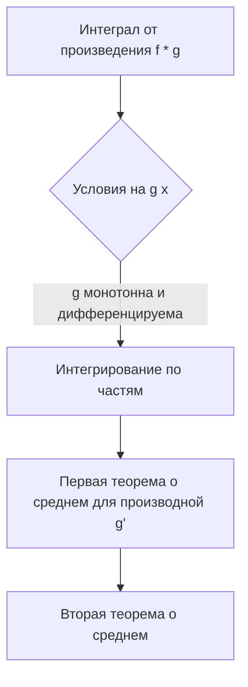
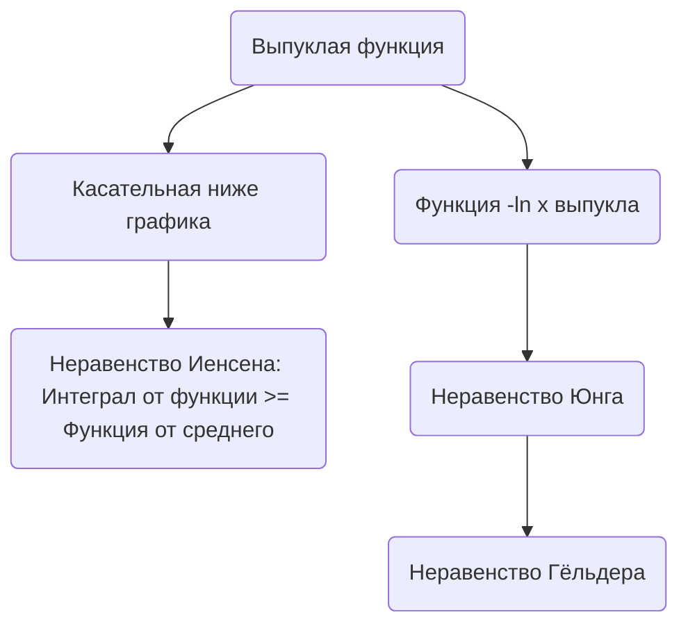

---
tags:
  - матанализ
  - 1_курс
  - подготовка_к_экзамену
тип: конспект
статус: готов
---

Добро пожаловать на экзамен. Математический анализ не терпит легкомыслия и пробелов в логике. Каждое утверждение должно быть строго обосновано, каждый переход — опираться на фундаментальные теоремы. Ниже представлен академически выверенный конспект, который я ожидаю увидеть в ваших ответах. Читайте вдумчиво.

# Вопрос №25. Формула Валлиса.

> [!abstract] Геометрический / Физический смысл
> Формула Валлиса связывает [[Предел последовательности|предел]] отношения площадей под графиками функций $y = \sin^n x$ на отрезке $[0, \pi/2]$ с числом $\pi$. Интуитивно, с ростом $n$ «купол» синусоиды сужается, и площади убывают, но отношение соседних площадей позволяет асимптотически точно выразить константу $\pi$ через исключительно рациональные операции (произведения целых чисел).

> [!definition] Интеграл Валлиса
> Для любого целого неотрицательного числа $n \in \mathbb{Z}_{\ge 0}$ определим числовую последовательность интегралов:
> $$ I_n = \int_0^{\pi/2} \sin^n x \, dx $$
> Данный интеграл существует как [[Интеграл Римана]] от непрерывной функции на отрезке.

> [!lemma] Рекуррентное соотношение для интеграла Валлиса
> Для любого $n \ge 2$ справедливо равенство:
> $$ I_n = \frac{n-1}{n} I_{n-2} $$

> [!proof]+ Доказательство леммы
> Воспользуемся формулой интегрирования по частям для определенного интеграла: $\int_a^b u \, dv = uv|_a^b - \int_a^b v \, du$.
> Положим:
> $$ u = \sin^{n-1} x, \quad dv = \sin x \, dx $$
> Дифференцируя $u$ и интегрируя $dv$, получаем:
> $$ du = (n-1)\sin^{n-2}x \cos x \, dx, \quad v = -\cos x $$
> Подставляем в формулу:
> $$ I_n = \left( -\sin^{n-1}x \cos x \right) \Bigg|_0^{\pi/2} - \int_0^{\pi/2} (-\cos x)(n-1)\sin^{n-2}x \cos x \, dx $$
> Первое слагаемое равно нулю, так как $\cos(\pi/2) = 0$ и $\sin(0) = 0$. Следовательно:
> $$ I_n = (n-1) \int_0^{\pi/2} \sin^{n-2}x \cos^2 x \, dx $$
> Применим основное тригонометрическое тождество $\cos^2 x = 1 - \sin^2 x$ (искусственный прием $+\pm$ здесь реализуется через замену):
> $$ I_n = (n-1) \int_0^{\pi/2} \sin^{n-2}x (1 - \sin^2 x) \, dx $$
> В силу линейности интеграла Римана разбиваем на два интеграла:
> $$ I_n = (n-1) \int_0^{\pi/2} \sin^{n-2}x \, dx - (n-1) \int_0^{\pi/2} \sin^n x \, dx $$
> $$ I_n = (n-1) I_{n-2} - (n-1) I_n $$
> Перенесем слагаемое с $I_n$ в левую часть:
> $$ I_n + (n-1)I_n = (n-1)I_{n-2} \quad \Rightarrow \quad n I_n = (n-1)I_{n-2} $$
> Разделив на $n$ (так как $n \ge 2 > 0$), получаем требуемое: $I_n = \frac{n-1}{n} I_{n-2}$. Ч.т.д.

Вычислим первые элементы: $I_0 = \int_0^{\pi/2} 1 \, dx = \frac{\pi}{2}$, $I_1 = \int_0^{\pi/2} \sin x \, dx = -\cos x |_0^{\pi/2} = 1$.
По индукции немедленно выводятся явные формулы:
$$ I_{2k} = \frac{(2k-1)!!}{(2k)!!} \frac{\pi}{2} \qquad \text{и} \qquad I_{2k+1} = \frac{(2k)!!}{(2k+1)!!} $$
где двойной факториал $m!!$ — произведение всех чисел той же четности от $1$ до $m$.

> [!theorem] Формула Валлиса
> Справедливо следующее предельное соотношение:
> $$ \frac{\pi}{2} = \lim_{k \to \infty} \left( \frac{(2k)!!}{(2k-1)!!} \right)^2 \frac{1}{2k+1} = \lim_{k \to \infty} \left( \frac{2 \cdot 4 \cdot \dots \cdot 2k}{1 \cdot 3 \cdot \dots \cdot (2k-1)} \right)^2 \frac{1}{2k+1} $$

> [!proof]+ Доказательство теоремы Валлиса
> 1. **Анализ монотонности:** На интервале $(0, \pi/2)$ выполняется неравенство $0 < \sin x < 1$. Следовательно, умножение на $\sin x$ уменьшает значение функции:
> $$ \sin^{2k+1} x \le \sin^{2k} x \le \sin^{2k-1} x $$
> В силу свойства монотонности интеграла Римана (интегрирование сохраняет нестрогие неравенства):
> $$ I_{2k+1} \le I_{2k} \le I_{2k-1} $$
> 
> 2. **Построение оценки:** Разделим все части двойного неравенства на $I_{2k+1}$ (строго положительную величину, так как подынтегральная функция непрерывна и неотрицательна, и не равна тождественно нулю):
> $$ 1 \le \frac{I_{2k}}{I_{2k+1}} \le \frac{I_{2k-1}}{I_{2k+1}} $$
> Согласно доказанной лемме, $I_{2k+1} = \frac{2k}{2k+1} I_{2k-1}$. Следовательно, правая часть неравенства равна:
> $$ \frac{I_{2k-1}}{I_{2k+1}} = \frac{2k+1}{2k} = 1 + \frac{1}{2k} $$
> Получаем:
> $$ 1 \le \frac{I_{2k}}{I_{2k+1}} \le 1 + \frac{1}{2k} $$
> 
> 3. **Предельный переход:** По теореме о пределе промежуточной функции (о двух милиционерах), так как $\lim_{k \to \infty} 1 = 1$ и $\lim_{k \to \infty} \left(1 + \frac{1}{2k}\right) = 1$, следует, что:
> $$ \lim_{k \to \infty} \frac{I_{2k}}{I_{2k+1}} = 1 $$
> 
> 4. **Алгебраическая подстановка:** Подставим найденные ранее явные выражения для $I_{2k}$ и $I_{2k+1}$ в это отношение:
> $$ \frac{I_{2k}}{I_{2k+1}} = \frac{\frac{(2k-1)!!}{(2k)!!} \frac{\pi}{2}}{\frac{(2k)!!}{(2k+1)!!}} = \frac{\pi}{2} \cdot \frac{(2k-1)!! (2k+1)!!}{((2k)!!)^2} $$
> Заметим, что $(2k+1)!! = (2k-1)!! \cdot (2k+1)$. Подставляем:
> $$ \frac{I_{2k}}{I_{2k+1}} = \frac{\pi}{2} \cdot \frac{((2k-1)!!)^2 \cdot (2k+1)}{((2k)!!)^2} = \frac{\pi}{2} \cdot \left( \frac{(2k-1)!!}{(2k)!!} \right)^2 (2k+1) $$
> Поскольку предел этой дроби равен $1$, запишем:
> $$ \lim_{k \to \infty} \left[ \frac{\pi}{2} \cdot \left( \frac{(2k-1)!!}{(2k)!!} \right)^2 (2k+1) \right] = 1 $$
> Разрешая это уравнение относительно $\pi/2$ (вынося константу за знак предела), получаем формулу Валлиса:
> $$ \frac{\pi}{2} = \lim_{k \to \infty} \left( \frac{(2k)!!}{(2k-1)!!} \right)^2 \frac{1}{2k+1} $$
> Ч.т.д.

> [!warning] Важное замечание
> Формула Валлиса критически важна для вывода формулы Стирлинга (асимптотики факториала), так как она позволяет найти константу $\sqrt{2\pi}$, возникающую при предельном переходе. Без нее курс анализа теряет связность.

---

# Вопрос №26. Вторая теорема о среднем интегрального исчисления.

> [!abstract] Физический смысл
> Вторая теорема о среднем (теорема Бонне/Вейерштрасса) позволяет вынести за знак интеграла значение монотонной функции («веса»), взятое на одном из концов отрезка, разбив интеграл на две части. Это аналог преобразования Абеля (суммирования по частям) для непрерывного случая. Применяется для оценки осциллирующих интегралов, где функция меняет знак, а амплитуда монотонно падает (например, $\int \frac{\sin x}{x} dx$).

> [!lemma] Первая теорема о среднем (напоминание)
> Если $u(x)$ непрерывна на $[a,b]$, а $v(x)$ интегрируема и не меняет знак на $[a,b]$, то $\exists c \in [a,b]$ такое, что $\int_a^b u(x)v(x)dx = u(c)\int_a^b v(x)dx$. Справедливость опирается на [[Теорема Вейерштрасса]] о достижении непрерывной функцией точных граней.

> [!theorem] Вторая теорема о среднем (Форма Бонне)
> Пусть функция $f(x)$ интегрируема по Риману на $[a,b]$.
> 1. Если $g(x)$ невозрастающая и $g(x) \ge 0$ на $[a,b]$, то существует точка $\xi \in [a,b]$ такая, что:
> $$ \int_a^b f(x)g(x)\,dx = g(a) \int_a^\xi f(x)\,dx $$
> 2. Если $g(x)$ неубывающая и $g(x) \ge 0$ на $[a,b]$, то существует точка $\xi \in [a,b]$ такая, что:
> $$ \int_a^b f(x)g(x)\,dx = g(b) \int_\xi^b f(x)\,dx $$

> [!theorem] Вторая теорема о среднем (Общая форма)
> Пусть функция $f(x)$ интегрируема по Риману на $[a,b]$, а функция $g(x)$ монотонна на $[a,b]$. Тогда существует точка $\xi \in [a,b]$ такая, что:
> $$ \int_a^b f(x)g(x)\,dx = g(a) \int_a^\xi f(x)\,dx + g(b) \int_\xi^b f(x)\,dx $$

> [!proof]+ Строгое доказательство (для $g \in C^1[a,b]$)
> В рамках первого курса мы докажем общую формулу, предполагая дополнительно, что $g(x)$ непрерывно дифференцируема на $[a,b]$. (Случай просто монотонной функции доказывается переходом к суммам Дарбу и преобразованием Абеля, но требует громоздких технических выкладок).
> 
> Введем функцию с переменным верхним пределом:
> $$ F(x) = \int_a^x f(t)\,dt $$
> Так как $f(t)$ интегрируема, функция $F(x)$ является непрерывной на $[a,b]$ (по свойству интеграла Римана). По [[Теорема Вейерштрасса]], непрерывная функция на отрезке достигает своих глобальных минимума $m$ и максимума $M$.
> 
> По формуле интегрирования по частям (которая применима, так как $F \in C[a,b]$ и $g \in C^1[a,b]$):
> $$ \int_a^b f(x)g(x)\,dx = \int_a^b g(x) \, dF(x) = F(x)g(x)\Big|_a^b - \int_a^b F(x)g'(x)\,dx $$
> Заметим, что $F(a) = \int_a^a f(t)dt = 0$. Тогда:
> $$ \int_a^b f(x)g(x)\,dx = F(b)g(b) - \int_a^b F(x)g'(x)\,dx $$
> 
> Так как $g(x)$ монотонна на $[a,b]$, ее производная $g'(x)$ не меняет знак (например, если $g$ невозрастает, то $g'(x) \le 0$). Функция $F(x)$ непрерывна. Мы находимся в условиях Первой теоремы о среднем интегрального исчисления!
> Применим ее к интегралу $\int_a^b F(x)g'(x)dx$: существует точка $\xi \in [a,b]$ такая, что:
> $$ \int_a^b F(x)g'(x)\,dx = F(\xi) \int_a^b g'(x)\,dx $$
> По [[Формула Ньютона-Лейбница]], интеграл от производной равен приращению функции: $\int_a^b g'(x)dx = g(b) - g(a)$.
> Подставляем это обратно:
> $$ \int_a^b f(x)g(x)\,dx = F(b)g(b) - F(\xi) [g(b) - g(a)] $$
> Раскроем скобки и перегруппируем:
> $$ \int_a^b f(x)g(x)\,dx = F(b)g(b) - F(\xi)g(b) + F(\xi)g(a) $$
> $$ \int_a^b f(x)g(x)\,dx = g(a)F(\xi) + g(b)[F(b) - F(\xi)] $$
> Вспомним определение $F(x)$:
> $$ F(\xi) = \int_a^\xi f(x)\,dx $$
> $$ F(b) - F(\xi) = \int_a^b f(x)\,dx - \int_a^\xi f(x)\,dx = \int_\xi^b f(x)\,dx \quad \text{(по свойству аддитивности)} $$
> Окончательно получаем:
> $$ \int_a^b f(x)g(x)\,dx = g(a) \int_a^\xi f(x)\,dx + g(b) \int_\xi^b f(x)\,dx $$
> Ч.т.д.

### Применение для оценки интегралов

Вторая теорема о среднем — мощнейший инструмент для оценки интегралов от осциллирующих функций.

**Пример задачи:** Доказать, что $\left| \int_a^b \sin(x^2) \, dx \right| \le \frac{1}{a}$ для любых $b > a > 0$.
**Решение:**
Сделаем замену $t = x^2 \Rightarrow x = \sqrt{t}, dx = \frac{dt}{2\sqrt{t}}$.
$$ I = \int_{a^2}^{b^2} \frac{\sin t}{2\sqrt{t}} \, dt $$
Пусть $f(t) = \sin t$, $g(t) = \frac{1}{2\sqrt{t}}$.
Функция $g(t)$ монотонно убывает на $[a^2, b^2]$ и $g(t) \ge 0$. По форме Бонне (так как $g(b^2) > 0$, но мы можем применить общую формулу, или просто форму Бонне к функции $g(t) - \lim_{t\to\infty} g(t)$):
По первой форме Бонне:
$$ I = g(a^2) \int_{a^2}^{\xi} \sin t \, dt = \frac{1}{2a} \left( -\cos t \Big|_{a^2}^\xi \right) = \frac{\cos(a^2) - \cos(\xi)}{2a} $$
Оценим модуль:
$$ |I| = \left| \frac{\cos(a^2) - \cos(\xi)}{2a} \right| \le \frac{|\cos(a^2)| + |\cos(\xi)|}{2a} \le \frac{1 + 1}{2a} = \frac{1}{a} $$
Оценка получена строго и без вычисления неберущегося интеграла Френеля.

---

# Вопрос №27. Неравенства Иенсена и Гёльдера для интегралов.

> [!definition] Выпуклая функция
> Функция $\varphi(x)$, заданная на интервале $X$, называется **выпуклой вниз** (просто выпуклой), если для любых $x_1, x_2 \in X$ и любых $\lambda_1, \lambda_2 \ge 0$ таких, что $\lambda_1 + \lambda_2 = 1$, выполняется неравенство:
> $$ \varphi(\lambda_1 x_1 + \lambda_2 x_2) \le \lambda_1 \varphi(x_1) + \lambda_2 \varphi(x_2) $$
> Геометрически: хорда всегда лежит выше графика функции. Для дифференцируемых функций выпуклость эквивалентна тому, что график функции лежит выше любой своей касательной: $\exists k \in \mathbb{R} : \varphi(y) \ge \varphi(x_0) + k(y - x_0)$.

### 1. Неравенство Иенсена

> [!theorem] Интегральное неравенство Иенсена
> Пусть $f(x)$ — непрерывная функция на $[a,b]$, принимающая значения в интервале $X$. Пусть $\varphi(y)$ — выпуклая непрерывная функция на $X$. Тогда:
> $$ \varphi\left( \frac{1}{b-a} \int_a^b f(x)\,dx \right) \le \frac{1}{b-a} \int_a^b \varphi(f(x))\,dx $$

> [!abstract] Геометрический смысл Иенсена
> Если распределить массу вдоль графика выпуклой функции, то центр масс этой кривой всегда будет находиться *над* самой кривой.

> [!proof]+ Доказательство неравенства Иенсена
> Обозначим среднее значение функции $f$ за $I$:
> $$ I = \frac{1}{b-a} \int_a^b f(x)\,dx $$
> По теореме о среднем для непрерывной функции, $I \in X$ (так как $I$ лежит между минимумом и максимумом $f(x)$).
> Из свойства выпуклости функции $\varphi$ вытекает существование "опорной прямой" в точке $y_0 = I$. То есть найдется такое число $k \in \mathbb{R}$ (угловой коэффициент), что для любого $y \in X$ выполнено:
> $$ \varphi(y) \ge \varphi(I) + k(y - I) $$
> Подставим в это неравенство в качестве аргумента $y$ значение нашей функции $f(x)$ в произвольной точке $x \in [a,b]$:
> $$ \varphi(f(x)) \ge \varphi(I) + k(f(x) - I) $$
> Заметим, что левая и правая части непрерывны (значит интегрируемы). Проинтегрируем обе части неравенства по Риману от $a$ до $b$ (интеграл сохраняет знак неравенства):
> $$ \int_a^b \varphi(f(x))\,dx \ge \int_a^b \left[ \varphi(I) + k(f(x) - I) \right] \,dx $$
> Воспользуемся линейностью интеграла:
> $$ \int_a^b \varphi(f(x))\,dx \ge \varphi(I) \int_a^b 1 \,dx + k \int_a^b f(x)\,dx - k \cdot I \int_a^b 1 \,dx $$
> Вычислим тривиальные интегралы: $\int_a^b 1 \,dx = (b-a)$.
> Заметим, что по определению $I$, $\int_a^b f(x)\,dx = I \cdot (b-a)$.
> Подставляем:
> $$ \int_a^b \varphi(f(x))\,dx \ge \varphi(I)(b-a) + k \cdot I(b-a) - k \cdot I(b-a) $$
> Слагаемые с коэффициентом $k$ взаимно уничтожаются (прием $+\pm$). Остается:
> $$ \int_a^b \varphi(f(x))\,dx \ge \varphi(I)(b-a) $$
> Разделив на строго положительную величину $(b-a)$, получаем:
> $$ \frac{1}{b-a} \int_a^b \varphi(f(x))\,dx \ge \varphi(I) = \varphi\left( \frac{1}{b-a} \int_a^b f(x)\,dx \right) $$
> Ч.т.д.

---

### 2. Неравенство Гёльдера

> [!lemma] Неравенство Юнга (вспомогательное)
> Для любых чисел $u \ge 0, v \ge 0$ и чисел $p, q > 1$, удовлетворяющих условию сопряженности $\frac{1}{p} + \frac{1}{q} = 1$, выполняется неравенство:
> $$ uv \le \frac{u^p}{p} + \frac{v^q}{q} $$
> **Доказательство леммы:** Функция $\varphi(t) = -\ln t$ является выпуклой на $(0, +\infty)$, так как $\varphi''(t) = \frac{1}{t^2} > 0$. По определению выпуклости для $\lambda_1 = 1/p$, $\lambda_2 = 1/q$ (заметим, что их сумма равна 1) и точек $t_1 = u^p$, $t_2 = v^q$:
> $$ -\ln\left( \frac{1}{p}u^p + \frac{1}{q}v^q \right) \le -\left( \frac{1}{p}\ln(u^p) + \frac{1}{q}\ln(v^q) \right) $$
> Свойства логарифма: $\frac{1}{p}\ln(u^p) + \frac{1}{q}\ln(v^q) = \ln u + \ln v = \ln(uv)$.
> Получаем $-\ln\left( \frac{u^p}{p} + \frac{v^q}{q} \right) \le -\ln(uv)$. Умножая на $-1$ (со сменой знака неравенства) и потенцируя, приходим к $uv \le \frac{u^p}{p} + \frac{v^q}{q}$.

> [!theorem] Интегральное неравенство Гёльдера
> Пусть функции $f(x)$ и $g(x)$ непрерывны на $[a,b]$. Для любых $p, q > 1$, таких что $\frac{1}{p} + \frac{1}{q} = 1$, справедливо неравенство:
> $$ \int_a^b |f(x)g(x)| \,dx \le \left( \int_a^b |f(x)|^p \,dx \right)^{\frac{1}{p}} \left( \int_a^b |g(x)|^q \,dx \right)^{\frac{1}{q}} $$

> [!warning] Важное замечание
> При $p=q=2$ неравенство Гёльдера обращается в знаменитое неравенство Коши-Буняковского-Шварца.

> [!proof]+ Доказательство неравенства Гёльдера
> Введем обозначения для интегральных норм (пока без строгой теории $L^p$ пространств, просто как числа):
> $$ A = \left( \int_a^b |f(x)|^p \,dx \right)^{\frac{1}{p}}, \quad B = \left( \int_a^b |g(x)|^q \,dx \right)^{\frac{1}{q}} $$
> Если $A = 0$, то $\int_a^b |f(x)|^p dx = 0$. Так как $|f(x)|^p \ge 0$ и функция непрерывна, отсюда по свойству определенного интеграла следует, что $f(x) \equiv 0$ на $[a,b]$. Тогда левая часть исходного неравенства равна $0$, и неравенство $0 \le 0$ тривиально выполняется. Аналогично для $B = 0$.
> 
> Предположим теперь, что $A > 0$ и $B > 0$. Проведем нормировку функций. Зафиксируем произвольное $x \in [a,b]$ и применим лемму (неравенство Юнга), положив:
> $$ u = \frac{|f(x)|}{A}, \quad v = \frac{|g(x)|}{B} $$
> Подставляем в $uv \le \frac{u^p}{p} + \frac{v^q}{q}$:
> $$ \frac{|f(x)|}{A} \cdot \frac{|g(x)|}{B} \le \frac{1}{p} \frac{|f(x)|^p}{A^p} + \frac{1}{q} \frac{|g(x)|^q}{B^q} $$
> Поскольку обе части неравенства являются непрерывными функциями на $[a,b]$, мы можем проинтегрировать это неравенство по отрезку от $a$ до $b$. Константы $A$ и $B$ выносим за знак интеграла:
> $$ \frac{1}{AB} \int_a^b |f(x)g(x)| \,dx \le \frac{1}{p A^p} \int_a^b |f(x)|^p \,dx + \frac{1}{q B^q} \int_a^b |g(x)|^q \,dx $$
> Вспомним, как мы определили $A$ и $B$. Заметим, что:
> $$ \int_a^b |f(x)|^p \,dx = A^p, \qquad \int_a^b |g(x)|^q \,dx = B^q $$
> Подставим эти равенства в правую часть:
> $$ \frac{1}{AB} \int_a^b |f(x)g(x)| \,dx \le \frac{1}{p A^p} \cdot A^p + \frac{1}{q B^q} \cdot B^q $$
> Дроби сокращаются, и правая часть становится равной:
> $$ \frac{1}{p} + \frac{1}{q} $$
> Но по условию теоремы $p$ и $q$ сопряжены, то есть $\frac{1}{p} + \frac{1}{q} = 1$. Следовательно:
> $$ \frac{1}{AB} \int_a^b |f(x)g(x)| \,dx \le 1 $$
> Умножим обе части неравенства на положительное число $AB$:
> $$ \int_a^b |f(x)g(x)| \,dx \le A \cdot B $$
> Подставляя исходные значения $A$ и $B$, мы в точности получаем формулировку теоремы. Ч.т.д.

