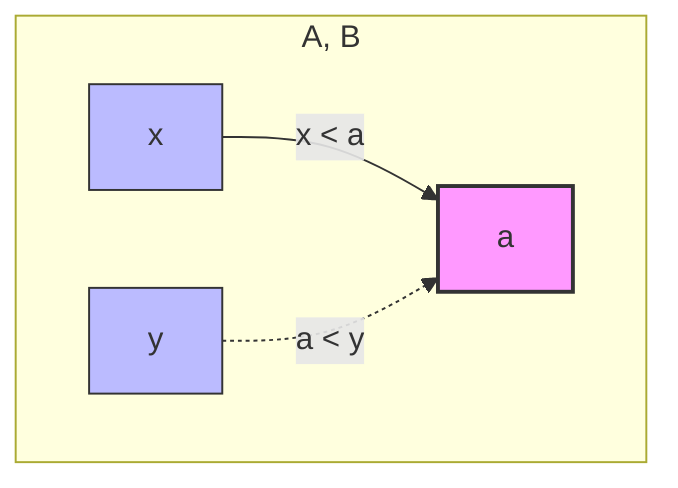

---
tags:
  - лекция
  - матанализ
  - матан
  - высшая_математика
  - выпуклые_функции
  - опорная_прямая
  - теорема_Лагранжа
  - критерий_выпуклости
---
# Математический анализ. Глава 3. Дифференциальное исчисление | §8. Выпуклые функции

### Лекции 33-34

**12 февраля 2026**

---
© Д.Е. Апушкинская (РУДН) | Мат. анализ лекции 33-34 | 12 февраля 2026 | 1 / 16

## Цитата дня:

> Абсолютная истина состоит в том, что большинство людей ничего не умеет делать хорошо.
> 
> — *Г.Г. Харди, из книги “Апология математика”*

---
© Д.Е. Апушкинская (РУДН) | Мат. анализ лекции 33-34 | 12 февраля 2026 | 2 / 16

# Цель лекции

- Продолжим обсуждение выпуклых функций, включая связь выпуклости и монотонности и различные критерии выпуклости.

---
© Д.Е. Апушкинская (РУДН) | Мат. анализ лекции 33-34 | 12 февраля 2026 | 3 / 16

# Выпуклые функции
#### Глава 3. Дифференциальное исчисление | §8. Выпуклые функции

Рассмотрим функцию $f : \langle A, B \rangle \to \mathbb{R}$.

> [!question]+ Рукописная заметка на полях:
> Напомним определение выпуклости
> * ии-шная визуализация определения:
> ![[Pasted image 20260617234226.png]]

> [!note]+ Геометрический смысл выпуклости
> Функция выпукла, если отрезок, соединяющий любые две точки её графика, лежит **не ниже** самого графика.
> 
> * $\lambda a + (1 - \lambda)b$ — аргумент, бегущий между $a$ и $b$.
> * $f(\lambda a + (1 - \lambda)b)$ — точка на **графике**.
> * $\lambda f(a) + (1 - \lambda)f(b)$ — точка на **хорде**.
> 
> Поскольку график лежит *под* хордой, то $\text{График} \leqslant \text{Хорда}$.

 [Какие-то нейрослоп объяснения](<Линкинг additional 33-34>)

### Определение 3.8.1

1. Пусть для любых $a, b \in \langle A, B \rangle$ и $\lambda \in (0, 1)$ справедливо неравенство
   $$f(\lambda a + (1 - \lambda)b) \leqslant \lambda f(a) + (1 - \lambda)f(b).$$
   Тогда $f$ называется ==выпуклой== на $\langle A, B \rangle$.

2. Пусть для любых $a, b \in \langle A, B \rangle$ ($a \neq b$) и $\lambda \in (0, 1)$ справедливо неравенство
   $$f(\lambda a + (1 - \lambda)b) < \lambda f(a) + (1 - \lambda)f(b).$$
   Тогда $f$ называется ==строго выпуклой== на $\langle A, B \rangle$.

---
© Д.Е. Апушкинская (РУДН) | Мат. анализ лекции 33-34 | 12 февраля 2026 | 4 / 16

#### Глава 3. Дифференциальное исчисление | §8. Выпуклые функции

# Связь выпуклости и монотонности

### Следствие 3.8.1

Пусть $f : \langle A, B \rangle \to \mathbb{R}$, $a \in \langle A, B \rangle$. Обозначим
$$F(x) = \frac{f(x) - f(a)}{x - a}.$$

Тогда справедливы следующие утверждения:

1. Если $f$ выпукла на $\langle A, B \rangle$, то $F$ возрастает на $\langle A, B \rangle \setminus \{a\}$.
2. Если $f$ строго выпукла на $\langle A, B \rangle$, то $F$ строго возрастает на $\langle A, B \rangle \setminus \{a\}$.

> [!question]+ Объяснение, почему это так (геометрический смысл):
> Величина $F(x) = \frac{f(x) - f(a)}{x - a}$ — это не что иное, как **угловой коэффициент (тангенс угла наклона) секущей прямой**, проходящей через две точки графика: фиксированную точку $(a, f(a))$ и подвижную точку $(x, f(x))$.
> 
> Если функция $f(x)$ является выпуклой (направленной выпуклостью вниз), то её график визуально напоминает «чашу». Представьте, что вы закрепили один конец нити или линейки в точке $a$ и начинаете двигать точку $x$ слева направо вдоль графика:
> - Когда $x$ находится далеко слева от $a$ ($x < a$), секущая наклонена вниз (отрицательный наклон).
> - По мере приближения $x$ к точке $a$ слева, наклон секущей становится всё менее крутым, то есть значение $F(x)$ увеличивается (растет в сторону нуля).
> - Когда $x$ переходит через точку $a$ и движется дальше вправо ($x > a$), секущая начинает уходить вверх, и её наклон становится всё более и более крутым (положительный наклон увеличивается).
> 
> Таким образом, при движении аргумента $x$ слева направо (увеличении $x$) наклон секущей линии $F(x)$ монотонно увеличивается. Это геометрическое свойство «возрастания хорд» эквивалентно аналитическому определению выпуклости функции.

---
© Д.Е. Апушкинская (РУДН) | Мат. анализ лекции 33-34 | 12 февраля 2026 | 5 / 16

#### Глава 3. Дифференциальное исчисление | §8. Выпуклые функции

## <u>Доказательство (следствие 3.8.1)</u> Проверим 2

Пусть $x, y \in \langle A, B \rangle \setminus \{a\}$, $x < y$.
Покажем, что $F(x) < F(y)$.

$f$ — строго выпукла $\Longleftrightarrow$ Утв. 3 Леммы 3.8.1 дает:

$$\frac{f(x) - f(a)}{x - a} < \frac{f(y) - f(a)}{y - a} \quad \text{при} \quad a < x < y$$

$$\frac{f(a) - f(x)}{a - x} < \frac{f(a) - f(y)}{a - y} \quad \text{при} \quad x < y < a$$

$$\frac{f(a) - f(x)}{a - x} < \frac{f(y) - f(a)}{y - a} \quad \text{при} \quad x < a < y$$

Каждое из неравенств $\Longleftrightarrow F(x) < F(y)$. $\blacksquare$

---

## <u>Пример</u> функция $f(x) = x^2$ строго выпукла на $\mathbb{R}$.

Действительно, пусть $a, b, c \in \mathbb{R}$, $a < c < b$.

Тогда
$$\frac{f(c) - f(a)}{c - a} - \frac{f(b) - f(c)}{b - c} =$$

$$= \frac{c^2 - a^2}{c - a} - \frac{b^2 - c^2}{b - c} = c + a - (b + c) = a - b < 0$$

$\Longrightarrow$ по лемме 3.8.1 следует строгая выпуклость.

---

> [!question]+ Объяснение математической логики (почему это так):
> 
> ### 1. Разбор доказательства следствия
> Цель доказательства — показать, что функция наклона хорды $F(x) = \frac{f(x) - f(a)}{x - a}$ строго возрастает (то есть из $x < y$ следует $F(x) < F(y)$). Так как точка $a$ делит числовую прямую на две части, для пары произвольных точек $x$ и $y$ ($x < y$) возможны ровно три геометрических расположения относительно фиксированной точки $a$:
> 
> 1. **Случай $a < x < y$ (обе точки справа от $a$):**
>    Лемма о трех хордах для выпуклой функции утверждает, что наклон хорды $[a, x]$ меньше наклона хорды $[a, y]$. В терминах функции $F$ это напрямую означает:
>    $$F(x) = \frac{f(x) - f(a)}{x - a} < \frac{f(y) - f(a)}{y - a} = F(y)$$
> 
> 2. **Случай $x < y < a$ (обе точки слева от $a$):**
>    В рукописи дроби записаны как $\frac{f(a) - f(x)}{a - x}$. Если мы умножим и числитель, и знаменатель на $-1$, то получим стандартный вид: $\frac{f(x) - f(a)}{x - a} = F(x)$. Следовательно, это неравенство точно так же эквивалентно

#### Глава 3. Дифференциальное исчисление | §8. Выпуклые функции

# Об односторонних производных

До сих пор при изучении выпуклости мы не накладывали на функцию качественных условий, таких, как непрерывность или дифференцируемость.

Оказывается, что выпуклые функции обязаны быть “достаточно хорошими”.

### Теорема 3.8.1

Пусть функция $f$ выпукла на $\langle A, B \rangle$, $a \in \langle A, B \rangle$. Тогда справедливы следующие утверждения.

1. Для $a < B$ существует $f'_+(a) \in [-\infty, +\infty)$, а для $a > A$ существует $f'_-(a) \in (-\infty, +\infty]$.
2. Если $a \in (A, B)$, то $f'_+(a)$ и $f'_-(a)$ конечны и $f'_-(a) \leqslant f'_+(a)$.

> [!question]+ Объяснение, почему это так (интуиция и логика):
> Данная теорема раскрывает удивительное свойство выпуклых функций: геометрическая форма «чаши» автоматически гарантирует хорошую структуру графика, даже если изначально мы не требовали от функции гладкости.
> 
> > 
> **1. Почему односторонние производные вообще существуют?**
> Из предыдущего следствия (Слайд 5) мы знаем, что функция наклона секущих $F(x) = \frac{f(x) - f(a)}{x - a}$ является *монотонно возрастающей* на всем промежутке (за исключением самой точки $a$). 
> * Согласно фундаментальной теореме математического анализа, у любой монотонной функции всегда существуют односторонние пределы в каждой точке. 
> * По определению, правая производная $f'_+(a)$ — это предел функции $F(x)$ при $x \to a+0$ (справа). Поскольку $F(x)$ убывает при движении справа налево к точке $a$ и ограничена снизу значениями хорд левее точки $a$, этот предел гарантированно существует и не может быть равен $+\infty$ (он либо конечен, либо равен $-\infty$). Аналогично, из-за монотонности, левая производная $f'_-(a)$ не может быть равна $-\infty$.
> 
> **2. Почему внутри интервала производные конечны и выполняется неравенство $f'_-(a) \leqslant f'_+(a)$?**
> Представьте точку $a$ внутри интервала $(A, B)$, то есть у неё есть соседи и слева, и справа.
> * Любая секущая, проведенная через точку $a$ и точку *слева* ($x_1 < a$), всегда будет иметь меньший или в крайнем случае равный наклон, чем секущая, проведенная через $a$ и точку *справа* ($x_2 > a$).
> * Переходя к пределу при $x_1 \to a-0$ и $x_2 \to a+0$, мы получаем, что наклон левой касательной (или полукасательной) не может превышать наклон правой касательной:
>   $$f'_-(a) \leqslant f'_+(a)$$
> * Так как левые хорды ограничивают правые хорды снизу, а правые хорды ограничивают левые хорды сверху, обе односторонние производные внутри интервала зажаты между конечными значениями хорд и не могут уходить в бесконечность ($\pm\infty$).
> 
> **Геометрический смысл:** > График выпуклой функции может иметь «изломы» (острые углы, как у функции $f(x) = |x|$ в точке $0$). В таком изломе левая полукасательная идет под одним углом, а правая — под другим, более крутым вверх. Неравенство $f'_-(a) \leqslant f'_+(a)$ как раз и запрещает графику иметь изломы, направленные «острием вверх», что полностью соответствует определению выпуклости вниз.

---
© Д.Е. Апушкинская (РУДН) | Мат. анализ лекции 33-34 | 12 февраля 2026 | 6 / 16

#### Глава 3. Дифференциальное исчисление | §8. Выпуклые функции

## Доказательство (теорема 3.8.1)

Рассмотрим $F : \langle A, B \rangle \setminus \{a\} \longrightarrow \mathbb{R}$
$$F(x) = \frac{f(x) - f(a)}{x - a}$$

### Часть 1
$1^{\circ}$ $a < B \implies$ по следствию 3.8.1 $F$ строго возрастает на $(a, B)$
$\implies$ по теореме о пределе монотонной функции
$$\exists \lim_{x \to a^+} F(x) \in [-\infty, +\infty)$$
(этот предел по определению равен $f'_+(a)$).

> Для $f'_-(a)$ рассуждение аналогично.

---

### Часть 2
$2^{\circ}$ Пусть $x, y \in \langle A, B \rangle$, $x < a < y \implies$ по следствию 3.8.1
$\implies F(x) < F(y)$

![[Pasted image 20260618013643.png]]

Устремляя $x \to a^-$ и $y \to a^+$ в неравенстве $F(x) < F(y)$, мы получим:

$$F(x) < F(y)$$
$$\downarrow \quad \quad \downarrow$$
$$f'_-(a) \leqslant f'_+(a)$$

Поскольку 
$$\left. \begin{aligned} f'_+(a) &< +\infty \\ f'_-(a) &> -\infty \end{aligned} \right\} \implies \text{обе производные конечны.}$$

---

> [!question]+ Объяснение шагов доказательства: почему это так?
> 
> **Пояснение к части 1 (Существование односторонних производных):**
> * Из **следствия 3.8.1** нам известно, что для выпуклой (или строго выпуклой) функции её разделенная разность (функция наклона хорд $F(x)$) является монотонно возрастающей.
> * **Теорема о пределе монотонной функции** (теорема Вейерштрасса) утверждает, что если функция монотонна на интервале, то в каждой точке этого интервала у неё существуют конечные или бесконечные односторонние пределы. 
> * Так как при $x > a$ значения $F(x)$ ограничены снизу значениями функции левее точки $a$, предел справа $\lim_{x \to a^+} F(x)$ не может уйти в $-\infty$. Следовательно, он лежит в полуинтервале $[-\infty, +\infty)$, то есть либо конечен, либо равен $-\infty$. Этот предел и есть по определению правая производная $f'_+(a)$.
> 
> **Пояснение к части 2 (Неравенство и конечность):**
> * Мы берем две точки относительно $a$: точку $x$ строго слева ($x < a$) и точку $y$ строго справа ($a < y$). Согласно тому же свойству монотонности хорд, наклон хорды слева всегда строго меньше наклона хорды справа: $F(x) < F(y)$.
> * **Предельный переход в неравенствах:** Мы одновременно или поочередно устремляем $x$ к точке $a$ слева ($x \to a^-$), а $y$ — к точке $a$ справа ($y \to a^+$). По свойствам пределов, при переходе к пределу строгое неравенство $<$ может превратиться в нестрогое $\leqslant$. Таким образом, мы получаем фундаментальное соотношение: $f'_-(a) \leqslant f'_+(a)$.
> * **Почему они конечны внутри интервала?** >   Фиксируем любое значение хорды $F(y_0)$ справа от $a$. Поскольку $F(x) < F(y_0)$ для всех $x < a$, то и предел левых хорд (левая производная) ограничен сверху этим конечным числом: $f'_-(a) \leqslant F(y_0) < +\infty$.
>   Аналогично, фиксируя хорду $F(x_0)$ слева, получаем, что правая производная ограничена снизу: $-\infty < F(x_0) \leqslant f'_+(a)$.
>   Сопоставляя эти границы вместе с неравенством $f'_-(a) \leqslant f'_+(a)$, мы делаем вывод, что ни одна из этих производных не может «убежать» в бесконечность ($\pm\infty$), а значит, внутри интервала они обязаны принимать только конечные вещественные значения.

# Непрерывность выпуклых функций
* Глава 3. Дифференциальное исчисление | §8. Выпуклые функции

### Следствие 3.8.2

Если функция $f$ выпукла на $\langle A, B \rangle$, то она непрерывна на $(A, B)$.

> [!info] Доказательство (рукописный текст):
> Д-во: Пусть $a \in (A, B)$.
> Из существования конечных производных $f'_{\pm}(a) \implies$ непрерывность $f$ слева и справа $\implies$ непрерывность $f$ в точке $a$. $\blacksquare$

> [!question]+ Объяснение, почему это так (разбор логической цепочки):
> Данное следствие опирается на доказанную ранее **Теорему 3.8.1** (со Слайда 6). Давайте разберем по шагам, почему конечные односторонние производные гарантируют непрерывность функции во всех внутренних точках интервала:
> 
> **Шаг 1. Связь производной и непрерывности (классический матанализ)**
> Из базового курса известно, что если функция дифференцируема в точке (то есть имеет конечную производную), то она автоматически является непрерывной в этой точке. Этот же принцип работает и для односторонних производных:
> * Если в точке $a$ существует конечная правая производная $f'_+(a)$, то предел $\lim_{x \to a+0} \frac{f(x) - f(a)}{x - a}$ равен конечному числу. Чтобы этот предел не уходил в бесконечность при стремлении знаменателя к нулю ($x - a \to 0$), числитель обязаны также стремиться к нулю: $\lim_{x \to a+0} (f(x) - f(a)) = 0$. А это означает, что $\lim_{x \to a+0} f(x) = f(a)$, то есть функция **непрерывна справа**.
> * Аналогично, существование конечной левой производной $f'_-(a)$ влечет за собой, что $\lim_{x \to a-0} f(x) = f(a)$, то есть функция **непрерывна слева**.
> 
> **Шаг 2. Почему на интервале $(A, B)$ они всегда конечны?**
> Согласно Теореме 3.8.1, для любой *внутренней* точки интервала $a \in (A, B)$ обе односторонние производные $f'_-(a)$ и $f'_+(a)$ **гарантированно конечны** (они не могут быть равны $\pm\infty$, так как зажаты между наклонами хорд слева и справа). 
> 
> **Шаг 3. Итоговый вывод**
> Поскольку во всякой точке $a \in (A, B)$ функция $f(x)$ одновременно непрерывна и слева, и справа, совпадение односторонних пределов со значением функции $\lim_{x \to a-0} f(x) = \lim_{x \to a+0} f(x) = f(a)$ обеспечивает её **полную непрерывность** в этой точке.
> 
> > 
> **Важное геометрическое замечание:** > Обратите внимание, что непрерывность гарантируется только на **открытом интервале $(A, B)$**. На границах области определения (в точках $A$ или $B$, если промежуток включает их) выпуклая функция вполне может иметь устранимый разрыв или разрыв первого рода (скачок вверх). Внутри же интервала любые «скачки» графика исключены свойствами выпуклости.

---
© Д.Е. Апушкинская (РУДН) | Мат. анализ лекции 33-34 | 12 февраля 2026 | 7 / 16

### <u>Пример</u>

$$f(x) = -\sqrt{1 - x^2} \quad \text{при } x \in (-1, 1]$$
$$f(-1) = 1$$

Выпуклость $f$ на $[-1, 1]$ очевидна из геометрических соображений, т.к. график $f\big|_{(-1, 1]}$ — полуокружность.

$$\left.
\begin{array}{l}
f'_+(-1) = -\infty \\
f'_-(1) = +\infty \\
f \text{ разрывна в точке } -1
\end{array}
\right\} \implies 
\begin{array}{l}
\text{в концевых точках} \\
\text{промежутка функция} \\
\text{может вести себя} \\
\text{хуже, чем во} \\
\underline{\text{внутренних точках}} \\
\underline{\text{промежутка}},!
\end{array}$$

---

> [!question]+ Объяснение, почему это так (математический разбор примера):
> 
> Этот пример наглядно иллюстрирует, почему в предыдущих утверждениях (Теорема 3.8.1 и Следствие 3.8.2) свойства **конечности односторонних производных** и **непрерывности** гарантировались *строго во внутренних точках* интервала $(A, B)$, и почему на границах отрезка всё может «сломаться».
> 
> Разберем поведение функции по шагам:
> 
> **1. Геометрическая форма и выпуклость:**
> Функция $y = -\sqrt{1 - x^2}$ на промежутке $(-1, 1]$ задает нижнюю половину единичной окружности ($x^2 + y^2 = 1$). График представляет собой гладкую «чашу», ориентированную выпуклостью вниз. Даже добавление изолированной точки $f(-1) = 1$ сверху не нарушает формальное определение выпуклости на всем отрезке $[-1, 1]$, так как любая хорда, проведенная из точки $(-1, 1)$ к любой другой точке на окружности, будет лежать строго *выше* графика этой окружности.
> 
> **2. Почему $f$ разрывна в точке $x = -1$?**
> Найдем правый предел функции при приближении к левой границе:
> $$\lim_{x \to -1+0} f(x) = \lim_{x \to -1+0} \left(-\sqrt{1 - x^2}\right) = 0$$
> Однако по условию примера задано, что в самой точке значение функции искусственно перенесено наверх: $f(-1) = 1$. 
> Поскольку предел справа ($0$) не равен значению в точке ($1$), функция терпит **разрыв первого рода (скачок)** в точке $x = -1$. Это доказывает, что выпуклая функция имеет право быть разрывной на самом краю своего промежутка задания.
> 
> **3. Почему производные в крайних точках равны бесконечности?**
> * **В точке $x = 1$ (правый край):** 
>   Обычная касательная к окружности $x^2 + y^2 = 1$ в точке $(1, 0)$ является вертикальной прямой. Угловой коэффициент вертикальной прямой равен бесконечности. Так как график идет снизу вверх, левая производная устремляется в плюс бесконечность: $f'_-(1) = +\infty$.
> * **В точке $x = -1$ (левый край):** 
>   По определению правой производной через предел при $x \to -1+0$:
>   $$f'_+(-1) = \lim_{x \to -1+0} \frac{f(x) - f(-1)}{x - (-1)} = \lim_{x \to -1+0} \frac{-\sqrt{1-x^2} - 1}{x + 1}$$
>   При $x \to -1+0$ числитель стремится к $-1$, а знаменатель стремится к $0$ через положительные значения ($+0$). Деление отрицательного числа на бесконечно малое положительное дает $-\infty$. 
> 
> **Резюме:** На концах промежутка выпуклой функции свойства гладкости и непрерывности могут нарушаться: производные могут становиться бесконечными, а сама функция — терять непрерывность.

# Опорная прямая
* Глава 3. Дифференциальное исчисление | §8. Выпуклые функции

Наряду с хордами для изучения выпуклых функций используется еще один полезный инструмент - ==опорная прямая==.

### Определение 3.8.2
Пусть $f : \langle A, B \rangle \to \mathbb{R}$, $a \in \langle A, B \rangle$, $k \in \mathbb{R}$, $g(x) = f(a) + k(x - a)$.

1. Прямая, задаваемая уравнением $y = g(x)$, называется **опорной** для функции $f$ в точке $a$, если $f(x) \geqslant g(x)$ при всех $x \in \langle A, B \rangle$.
2. Прямая, задаваемая уравнением $y = g(x)$, называется **строго опорной** для функции $f$ в точке $a$, если $f(x) > g(x)$ при всех $x \in \langle A, B \rangle \setminus \{a\}$.

Таким образом, опорной для $f$ в точке $a$ считается прямая, проходящая через точку $(a, f(a))$, которая лежит ==не выше== графика $f$. Строго опорная прямая лежит ==ниже== графика функции $f$ во всех точках, кроме $(a, f(a))$.

> [!question]+ Геометрическое и интуитивное объяснение: почему это так?
> **Суть определения:**
> Опорная прямая — это прямая, которая «подпирает» график функции снизу, касаясь его как минимум в точке $a$. 
> 
> * **Уравнение прямой:** Выражение $g(x) = f(a) + k(x - a)$ — это стандартное уравнение прямой с угловым коэффициентом (наклоном) $k$, гарантированно проходящей через фиксированную точку $(a, f(a))$, поскольку при $x = a$ получаем $g(a) = f(a)$.
> * **Условие $f(x) \geqslant g(x)$:** Означает, что в любой точке области определения ордината графика функции лежит либо выше, либо на одном уровне с ординатой опорной прямой. График «лежит на этой прямой», отсюда и название — *опорная*. Для строго выпуклых функций эта прямая может коснуться графика только в одной-единственной точке $a$, а во всех остальных точках график будет строго выше неё ($f(x) > g(x)$).

---
© Д.Е. Апушкинская (РУДН) | Мат. анализ лекции 33-34 | 12 февраля 2026 | 8 / 16

# Описание опорных прямых выпуклой функции
* Глава 3. Дифференциальное исчисление | §8. Выпуклые функции

### Лемма 3.8.2
Пусть $f : \langle A, B \rangle \to \mathbb{R}$, $a \in (A, B)$, $k \in \mathbb{R}$. Предположим, что прямая $\ell$ задается уравнением $y = f(a) + k(x - a)$.

Справедливы следующие утверждения.

1. Пусть $f$ выпукла на $\langle A, B \rangle$. Прямая $\ell$ является опорной для $f$ в точке $a$ тогда и только тогда, когда $k \in [f'_-(a), f'_+(a)]$.
2. Пусть $f$ строго выпукла на $\langle A, B \rangle$. Прямая $\ell$ является строго опорной для $f$ в точке $a$ тогда и только тогда, когда $k \in [f'_-(a), f'_+(a)]$.

> [!question]+ Математическое объяснение: почему это так?
> Данная лемма связывает геометрическое свойство выпуклости (существование опорной прямой) с дифференциальными характеристиками функции (левой и правой производными).
> 
> **Почему наклоны $k$ лежат именно в отрезке $[f'_-(a), f'_+(a)]$:**
> 
> 1. **Свойство выпуклых функций:** У любой выпуклой функции на интервале в каждой внутренней точке $a$ гарантированно существуют конечные левая $f'_-(a)$ и правая $f'_+(a)$ производные, причем всегда выполнено неравенство:
>    $$f'_-(a) \leqslant f'_+(a)$$
> 2. **Условие опорности:** Чтобы прямая была опорной, должно выполняться неравенство $f(x) - f(a) \geqslant k(x - a)$. Давайте разделим его на $(x - a)$, рассмотрев два случая:
>    * Если мы приближаемся к точке $a$ справа ($x > a$), то $(x - a) > 0$. Разделив неравенство, получаем отношение приращений: $\frac{f(x) - f(a)}{x - a} \geqslant k$. Переходя к пределу при $x \to a^+$, получаем, что наклон прямой не может превышать правую производную: **$k \leqslant f'_+(a)$**.
>    * Если мы приближаемся слева ($x < a$), то $(x - a) < 0$. При делении знак неравенства меняется: $\frac{f(x) - f(a)}{x - a} \leqslant k$. Переходя к пределу при $x \to a^-$, получаем, что наклон прямой должен быть не меньше левой производной: **$k \geqslant f'_-(a)$**.
> 
> Объединяя эти два условия, получаем критерий: прямая будет подпирать график выпуклой функции тогда и только тогда, когда её угловой коэффициент удовлетворяет условию $f'_-(a) \leqslant k \leqslant f'_+(a)$. Если функция дифференцируема в точке $a$, то $f'_-(a) = f'_+(a) = f'(a)$, и существует ровно одна опорная прямая — обычная касательная ($k = f'(a)$). Если на графике излом (угловая точка), то опорных прямых целое семейство (целый «веер» прямых, проходящих между левым и правым наклоном).

---
© Д.Е. Апушкинская (РУДН) | Мат. анализ лекции 33-34 | 12 февраля 2026 | 9 / 16

# Описание опорных прямых выпуклой функции-2
* Глава 3. Дифференциальное исчисление | §8. Выпуклые функции

Геометрический смысл леммы 3.8.2 иллюстрирует рисунок.
![[Pasted image 20260618015859.png]]
*(Визуальный график функции с изломом в точке $a$, где заштрихованная область снизу ограничена предельными положениями опорных прямых с наклонами $f'_-(a)$ и $f'_+(a)$).*

> [!question]+ Геометрическое объяснение рисунка: почему это так?
> На рисунке изображен график выпуклой функции, имеющей **излом (угловую точку)** при $x = a$. 
> 
> * **Левая и правая производные:** В точке излома касательная не уникальна. Наклон графика слева (левая производная $f'_-(a)$) отрицательный (кривая идет вниз), а наклон справа (правая производная $f'_+(a)$) положительный (кривая идет вверх). 
> * **Семейство («веер») опорных прямых:** Лемма утверждает, что любая прямая, проходящая через точку $(a, f(a))$ с угловым коэффициентом $k \in [f'_-(a), f'_+(a)]$, будет лежать не выше графика функции. 
> * **Заштрихованная область:** Две сплошные прямые на рисунке представляют собой «крайние» положения опорных прямых: одна имеет наклон, равный левой производной, другая — правой. Любая прямая, проходящая внутри неокрашенного «нижнего угла» (заштрихованная зона под ними), гарантированно подпирает график снизу и нигде его не пересекает.

---
© Д.Е. Апушкинская (РУДН) |  Мат. анализ лекции 33-34 | 12 февраля 2026 | 10 / 16

# Замечания
* Глава 3. Дифференциальное исчисление | §8. Выпуклые функции

1. Из теоремы 3.8.1 вытекает существование для $a \in (A, B)$ конечных производных $f'_\pm(a)$ и неравенство $f'_-(a) \leqslant f'_+(a)$. Поэтому в любой точке $a \in (A, B)$ у выпуклой функции ==существует== опорная прямая, а у строго выпуклой - строго опорная прямая. Это верно и для концевой точки промежутка, если ==потребовать== существование в ней конечной односторонней производной.

2. Если функция $f$ ==дифференцируема== в точке $a \in (A, B)$, то ее опорная прямая в точке $a$ ==единственна и совпадает с касательной в точке $a$==.

> [!question]+ Разбор рукописных заметок: почему это так?
> **Текст рукописной заметки:**
> > Действительно $\Rightarrow f'_-(a) = f'_+(a) = f'(a) \Rightarrow k = f'(a) \Rightarrow$ Опорная прямая $\ell$ — единственна и совпадает с касательной.
> 
> **Математическое объяснение:**
> Этот комментарий строго доказывает второе замечание:
> 
> 1. По определению, функция $f(x)$ называется **дифференцируемой** в точке $a$, если в этой точке существуют и равны между собой обе односторонние производные. То есть:
>    $$f'_-(a) = f'_+(a) = f'(a)$$
> 2. Из предыдущей леммы 3.8.2 мы знаем, что угловой коэффициент $k$ любой опорной прямой должен лежать в замкнутом отрезке между левой и правой производными: $k \in [f'_-(a), f'_+(a)]$.
> 3. Поскольку левая и правая границы этого отрезка схлопываются в одну точку ($f'(a)$), у нас не остается выбора для $k$:
>    $$k = f'(a)$$
> 4. Уравнение опорной прямой принимает вид $y = f(a) + f'(a)(x-a)$, что в точности совпадает с классическим уравнением геометрической касательной к графику функции в точке $a$. Таким образом, «веер» возможных прямых (как на слайде 10) превращается в одну-единственную уникальную линию.

---
© Д.Е. Апушкинская (РУДН) |  Мат. анализ лекции 33-34 | 12 февраля 2026 | 11 / 16

## Доказательство (лемма 3.8.2)

**Ограничимся доказательством утв. 2** (для строго опорной прямой и строго выпуклой функции).

### Часть 1: Необходимость ($\Rightarrow$)

Пусть $\ell$ — строго опорная прямая $f$ в т. $a$.

По определению правой производной:
$$f(x) - f(a) = f'_+(a)(x - a) + o(x - a) \quad \text{при } x \to a^+$$

$$\Downarrow$$

$$0 < f(x) - f(a) - k(x - a) = (x - a) \cdot \left( f'_+(a) - k + o(1) \right) \quad \text{при } x \to a^+$$

Устремим $x \to a^+ \implies f'_+(a) \geqslant k$.

Аналогично, для $x \in (A, a)$ получим $f'_-(a) \leqslant k$.

> [!question]+ Объяснение шага: почему это так?
> **1. Разложение по определению производной:** > Выражение $f(x) - f(a) = f'_+(a)(x-a) + o(x-a)$ — это просто перенос слагаемых из классического определения правой производной через бесконечно малую функцию: $\frac{f(x)-f(a)}{x-a} = f'_+(a) + o(1)$.
> 
> **2. Откуда берется строгое неравенство $0 < \dots$:** > Так как по условию утверждения (2) прямая $\ell$ является **строго опорной**, то для всех $x \neq a$ выполнено неравенство $f(x) > g(x)$, где $g(x) = f(a) + k(x-a)$. Перенося всё в одну сторону, получаем:
> $$f(x) - f(a) - k(x - a) > 0$$
> 
> **3. Вынесение $(x-a)$ и предельный переход:** > Подставим разложение правой производной в это неравенство:
> $$f'_+(a)(x - a) + o(x - a) - k(x - a) > 0$$
> Выносим общий множитель $(x - a)$. Так как мы стремимся к $a$ справа ($x \to a^+$), разность $(x - a)$ строго положительна. Мы можем разделить на неё обе части неравенства, не меняя знак:
> $$f'_+(a) - k + o(1) > 0$$
> Переходя к пределу при $x \to a^+$, член $o(1)$ превращается в $0$. По свойствам предельных переходов в неравенствах, строгое неравенство $>$ может в пределе превратиться в нестрогое $\geqslant$. Отсюда получаем:
> $$f'_+(a) - k \geqslant 0 \implies f'_+(a) \geqslant k$$
> 
> **4. Левая сторона:** > При $x \to a^-$ (слева от точки $a$) разность $(x - a)$ отрицательна. При делении неравенства на отрицательное число знак меняется на противоположный, что после предельного перехода дает $f'_-(a) \leqslant k$. Объединяя два результата, получаем необходимый отрезок: $k \in [f'_-(a), f'_+(a)]$.

---

### Часть 2: Достаточность ($\Leftarrow$)

Пусть $k \in [f'_-(a), f'_+(a)]$. 
Рассмотрим разделенную разность (хорду) как функцию $F(x) = \frac{f(x) - f(a)}{x - a}$. Из свойств выпуклости известно, что $F(x) \nearrow\nearrow$ (строго возрастает) на $(a, B\rangle$.

$$\implies f'_+(a) = \inf_{(a, B)} F < F(x) \quad \forall x \in (a, B\rangle$$

Тогда $\forall x \in (a, B\rangle$ получим:

$$f(x) - f(a) = F(x)(x - a) > f'_+(a)(x - a) \geqslant k(x - a)$$

$$\implies f(x) > f(a) + k(x - a)$$

Случай $x \in \langle A, a)$ рассматривается аналогично.

**Поэтому** на $\langle A, B \rangle \setminus \{a\}$ график $f$ лежит выше $\ell$. $\blacksquare$

> [!question]+ Объяснение шага: почему это так?
> **1. Поведение функции $F(x)$:** > Геометрический смысл строго выпуклой функции заключается в том, что угловой коэффициент хорды, проведенной из фиксированной точки $a$ в любую точку $x$, строго растет по мере движения $x$ вправо. Поэтому функция наклонов $F(x) = \frac{f(x)-f(a)}{x-a}$ является строго возрастающей ($\nearrow\nearrow$).
> 
> **2. Почему $f'_+(a) = \inf F < F(x)$:** > Так как $F(x)$ строго возрастает на интервале $(a, B)$, её точная нижняя грань ($\inf$) достигается на левом конце интервала, то есть при предельном переходе $x \to a^+$. А предел разделенной разности справа — это и есть правая производная $f'_+(a)$. Поскольку возрастание строгое, значение функции в любой точке $x > a$ будет строго больше её инфимума: $f'_+(a) < F(x)$.
> 
> **3. Сборка цепочки неравенств:** > Умножим неравенство $F(x) > f'_+(a)$ на положительное число $(x - a)$:
> $$F(x)(x - a) > f'_+(a)(x - a)$$
> По определению функции $F(x)$, левая часть $F(x)(x - a)$ в точности равна приращению функции $f(x) - f(a)$.  
> Из условия достаточности мы знаем, что $k \leqslant f'_+(a)$. Умножая это на то же положительное число $(x - a)$, получаем $f'_+(a)(x - a) \geqslant k(x - a)$.
> 
> Соединяем всё в одну строчку:
> $$f(x) - f(a) > f'_+(a)(x - a) \geqslant k(x - a)$$
> Выкидывая промежуточное звено:
> $$f(x) - f(a) > k(x - a) \implies f(x) > f(a) + k(x - a)$$
> Это в точности совпадает с определением строго опорной прямой для правой половины графика. Левая половина ($x < a$) из-за двойного изменения знаков (при делении и умножении на отрицательное $(x-a)$) приводит к точно такому же итоговому неравенству. Доказательство завершено.

# Характеристика выпуклости с помощью опорных прямых
* Глава 3. Дифференциальное исчисление | §8. Выпуклые функции

### Лемма 3.8.3
Пусть $f : \langle A, B \rangle \to \mathbb{R}$. Тогда справедливы следующие утверждения.

1. Если в каждой точке $a \in \langle A, B \rangle$ функция $f$ имеет опорную прямую, то она выпукла на промежутке $\langle A, B \rangle$.
2. Если в каждой точке $a \in \langle A, B \rangle$ функция $f$ имеет строго опорную прямую, то она строго выпукла на промежутке $\langle A, B \rangle$.

> [!question]+ Математическое объяснение: почему это так?
> Данная лемма утверждает, что локальное геометрическое свойство (возможность провести опорную прямую в каждой точке) гарантирует глобальное свойство функции — её выпуклость на всем промежутке.
> 
> **Геометрическая интуиция:**
> Представьте, что график функции лежит на плоскости. Если в *абсолютно любой* точке графика мы можем подставить снизу жесткую прямую линейку так, чтобы весь остальной график оказался выше неё или на ней (не пересекая её насквозь), то график физически вынужден изгибаться только вверх. Он не может иметь «провисаний» или вогнутых участков, иначе в точке перехода к вогнутости прямая проткнула бы график, нарушив условие опорности.
> 
> **Схематическое доказательство (от противного):**
> Если бы функция не была выпуклой, то нашлись бы такие две точки $x_1$ и $x_2$, что хорда, соединяющая $(x_1, f(x_1))$ и $(x_2, f(x_2))$, лежала бы *ниже* графика на некотором интервале между ними (то есть функция бы локально «выпучивалась» вверх). Если мы возьмем точку максимума этого верхнего отклонения, то в ней график будет выгнут «горбом». Попытавшись провести опорную прямую через эту вершину горба, мы обнаружим, что точки $x_1$ и $x_2$ обязательно окажутся *ниже* этой прямой. Это противоречит условию, что опорная прямая обязана лежать *не выше* графика функции во всех точках. Следовательно, функция обязана быть выпуклой.

---
© Д.Е. Апушкинская (РУДН) | Мат. анализ лекции 33-34 | 12 февраля 2026 | 12 / 16

# Критерий выпуклости в терминах касательных
* Глава 3. Дифференциальное исчисление | §8. Выпуклые функции

> [!info] Рукописная заметка сверху:
> $T_{a,1} f(x) = f(a) + f'(a)(x-a)$

### Теорема 3.8.2
Пусть $f : \langle A, B \rangle \to \mathbb{R}$, $f$ дифференцируема на $\langle A, B \rangle$.

Справедливы следующие утверждения.

1. Функция $f$ выпукла на $\langle A, B \rangle$ тогда и только тогда, когда для любых $a, x \in \langle A, B \rangle$ выполняется неравенство $f(x) \geqslant T_{a,1}f(x)$.
2. Функция $f$ строго выпукла на $\langle A, B \rangle$ тогда и только тогда, когда для любых различных $a, x \in \langle A, B \rangle$ выполняется неравенство $f(x) > T_{a,1}f(x)$.

> [!question]+ Математическое объяснение: почему это так?
> Эта теорема является одним из главных аналитических критериев выпуклости для гладких (дифференцируемых) функций.
> 
> **Что такое $T_{a,1} f(x)$:**
> Обозначение $T_{a,1} f(x)$ — это многочлен Тейлора 1-го порядка для функции $f$ в точке $a$. Геометрически уравнение $y = T_{a,1} f(x) = f(a) + f'(a)(x-a)$ представляет собой не что иное, как **уравнение касательной** к графику функции в точке $a$.
> 
> **Суть критерия:**
> Дифференцируемая функция является выпуклой тогда и только тогда, когда её график в любой точке лежит **не ниже касательной**, проведенной в этой точке. Соответственно, для строгой выпуклости график касается прямой только в точке касания $x=a$, а во всех остальных точках уходит строго выше неё.
> 
> **Связь с предыдущей леммой:**
> Поскольку функция дифференцируема, у неё в каждой точке существует единственная опорная прямая, и угловой коэффициент этой прямой $k$ (согласно Лемме 3.8.2) зажат в границах $[f'_-(a), f'_+(a)]$. Но так как функция гладкая, левая производная равна правой: $f'_-(a) = f'_+(a) = f'(a)$. Значит, единственным кандидатом на роль опорной прямой становится касательная. Заменяя в определении опорной прямой абстрактную функцию $g(x)$ на конкретную касательную $T_{a,1} f(x)$, мы и получаем данную теорему.

---
© Д.Е. Апушкинская (РУДН) | Мат. анализ лекции 33-34 | 12 февраля 2026 | 13 / 16

# Геометрический смысл критерия выпуклости в терминах касательных
* Глава 3. Дифференциальное исчисление | §8. Выпуклые функции

Таким образом, график выпуклой функции можно представлять себе как ==верхнюю огибающую семейства ее касательных==. График строго выпуклой функции пересекается с каждой касательной только в точке касания.

![[Pasted image 20260618020817.png]]
**Рис.:** Выпуклая функция (слева) и строго выпуклая функция (справа).

> [!question]+ Геометрическое объяснение: почему это так?
> Этот слайд визуализирует Теорему 3.8.2 и вводит очень важное для оптимизации и функционального анализа понятие — **верхнюю огибающую**.
> 
> **1. Что такое «верхняя огибающая семейства касательных»:**
> Представьте, что мы провели касательные линии абсолютно во всех точках графика выпуклой функции. Каждая такая касательная — это прямая линия, которая подпирает график снизу. Если мы теперь рассмотрим *множество всех этих прямых* и для каждого фиксированного $x$ выберем самую верхнюю точку среди всех возможных касательных, то мы в точности восстановим исходный график функции $f(x)$. Математически это записывается через операцию точной верхней грани (супремума):
> $$f(x) = \sup_{a} T_{a,1}f(x)$$
> Именно поэтому график «огибает» это бесконечное семейство прямых сверху.
> 
> **2. В чем разница между левым и правым рисунками (выпуклая vs строго выпуклая):**
> * **На левом рисунке (просто выпуклая функция):** Допускаются линейные участки (прямые отрезки). Если у функции есть плоский, прямолинейный кусок графика, то касательная, проверенная в любой точке этого отрезка, совпадет с самим отрезком. В этом случае график функции и касательная будут иметь бесконечно много общих точек (они сольются на данном интервале). Неравенство $f(x) \geqslant T_{a,1}f(x)$ выполняется, но в некоторых местах превращается в строгое равенство вне точки касания.
> * **На правом рисунке (строго выпуклая функция):** График «круглится» в каждой своей точке и не содержит ни одного прямого участка. Из-за постоянного изгиба вверх, как только мы отступаем от точки касания $a$ в любую сторону (влево или вправо), график мгновенно «отрывается» от прямой и уходит выше неё. Поэтому точка касания остается единственной точкой пересечения: $f(x) > T_{a,1}f(x)$ при всех $x \neq a$.

---
© Д.Е. Апушкинская (РУДН) | Мат. анализ лекции 33-34 | 12 февраля 2026 | 14 / 16

# Док-во (теорема 3.8.2) (Критерий выпуклости в терминах касательных)

### $\underline{\text{H}}$ (Необходимость)
У нас было замечание, что если $f$ — дифференцируема в т. $a \in (A,B)$, то опорная прямая к $f$ совпадает с касательной.
А для опорных прямых этот факт уже доказан.

### $\underline{\text{Д}}$ (Достаточность)
Известно, что 
$$f(x) > T_{a,1}f(x) \quad \forall x, a \in \langle A,B \rangle, \quad x \neq a$$

$\Rightarrow$ касательная $y = T_{a,1}f(x)$ является ==строго опорной прямой== для $f$ в $\forall$ т. $a \in \langle A,B \rangle$

$$\Downarrow \text{ (по св-ву строго опорных прямых)}$$

$f$ строго выпукла.

![[Pasted image 20260618021457.png]]

---

> [!question]+ Подробное объяснение: почему это так?
> Давайте разберем логику этого доказательства, структуру обозначений $\underline{\text{H}}$ / $\underline{\text{Д}}$, а также смысл графиков, нарисованных от руки.
> 
> ### 1. Что значат буквы $\underline{\text{H}}$ и $\underline{\text{Д}}$?
> Это стандартные академические сокращения для математических доказательств критериев (утверждений типа «тогда и только тогда»):
> * **$\underline{\text{H}}$ (Необходимость):** Доказывается утверждение «вместо стрелки вправо» ($\Rightarrow$). Мы предполагаем, что функция *выпукла*, и доказываем, что её график лежит выше касательной.
> * **$\underline{\text{Д}}$ (Достаточность):** Доказывается утверждение «вместо стрелки влево» ($\Leftarrow$). Мы предполагаем, что выполняется неравенство $f(x) > T_{a,1}f(x)$ (график выше касательной), и на основе этого доказываем, что функция *строго выпукла*.
> 
> ### 2. Разбор логики достаточного условия ($\underline{\text{Д}}$):
> Шаг очень изящный и простой, поскольку опирается на ранее доказанные в лекции леммы:
> 1. Нам дано, что везде, кроме самой точки касания ($x \neq a$), выполняется неравенство $f(x) > T_{a,1}f(x)$.
> 2. Вспоминаем определение строго опорной прямой (из *Слайда 8*): это прямая $g(x)$, для которой $f(x) > g(x)$ при всех $x \neq a$. Так как многочлен Тейлора первого порядка $T_{a,1}f(x)$ — это и есть уравнение касательной (прямой линии), то эта касательная автоматически удовлетворяет определению **строго опорной прямой**.
> 3. Вспоминаем характеристику выпуклости (из *Слайда 12*, Лемма 3.8.3, пункт 2): если в *каждой* точке промежутка у функции существует строго опорная прямая, то функция гарантированно является **строго выпуклой**. Переход доказан.
> 
> ### 3. Что значат графики внизу?
> Нарисованные от руки графики иллюстрируют поведение функций, имеющих вертикальные асимптоты (похожие на гиперболы вида $y = \frac{1}{x}$ или $y = -\frac{1}{x}$), и то, как касательные линии работают в качестве опорных:
> 
> * **Левый график (Выпуклая ветвь):** Красная кривая находится в первой и третьей четвертях (относительно своих асимптот). Правая ветвь имеет изгиб, направленный «чашей вверх» (локальная выпуклость). Проведенная к ней белая касательная прямая проходит снизу под графиком, успешно выполняя роль опорной прямой ($f(x) \geqslant g(x)$).
> * **Правый график (Вогнутая/Невыпуклая ветвь):** Красная кривая изгибается «горбом вверх». Белая касательная линия, проведенная к такой функции, ложится *выше* самого графика. В таком случае выполняется неравенство $f(x) \leqslant g(x)$, то есть прямая является не опорной снизу, а «прижимающей» сверху. Это визуализирует нарушение условия выпуклости функции.

# Выпуклость и асимптота
* Глава 3. Дифференциальное исчисление | §8. Выпуклые функции

## Теорема 3.8.3
Пусть функция $f : (A, +\infty) \to \mathbb{R}$ имеет при $x \to +\infty$ асимптоту $y = kx + b$. Справедливы следующие утверждения.

1. Если $f$ выпукла на $(A, +\infty)$, то $f(x) \geqslant kx + b$ при всех $x > A$.
2. Если $f$ строго выпукла на $(A, +\infty)$, то $f(x) > kx + b$ при всех $x > A$.

- Утверждения теоремы 3.8.3 верны и для асимптот на $-\infty$.
- Поскольку $f(x) - (kx + b) \to 0$ при $x \to +\infty$, мы можем трактовать асимптоту выпуклой функции как ее ==опорную прямую в $+\infty$==.

> [!question]+ Математическое объяснение: почему это так?
> Эта теорема описывает красивое глобальное свойство: если у выпуклой функции есть наклонная асимптота, то график функции приближается к ней **исключительно сверху**, никогда её не пересекая.
> 
> > [!warning] Опечатка на слайде
> > В предпоследней строчке оригинала слайда допущена опечатка: написано $f(x) = kx - b \to 0$. Разумеется, должно быть условие существования наклонной асимптоты:
> > $$f(x) - (kx + b) \to 0 \quad \text{при} \quad x \to +\infty$$
> > В коде выше эта ошибка исправлена для корректности ваших конспектов.
> 
> **Почему график не может пересечь асимптоту?**
> 
> > 
> 1. **Принцип «изгиба вверх»:** В силу выпуклости, график функции всегда лежит не ниже любой своей касательной (или опорной прямой). Наклон касательных $f'(x)$ при движении вправо ($x \to +\infty$) монотонно возрастает (или не убывает) и стремится к угловому коэффициенту асимптоты $k$.
> 2. **Доказательство от противного:** Предположим, что в какой-то точке $x_0 > A$ график функции оказался *ниже* асимптоты, то есть $f(x_0) < kx_0 + b$. 
>    * Так как при $x \to +\infty$ расстояние между графиком и асимптотой стремится к нулю, функции придется в какой-то момент «повернуться» обратно к прямой, то есть начать изгибаться горбом (вниз). 
>    * Если же функция попытается остаться выпуклой (изгибаться только вверх) из точки, находящейся ниже асимптоты, её скорость роста ($f'(x)$) в силу выпуклости обязана быть строго больше наклона асимптоты $k$ на каком-то участке, чтобы успеть догнать прямую. Но если наклон функции станет больше $k$, то из-за монотонного возрастания производной $f'(x)$ график начнет уходить вверх еще быстрее и в итоге *пересечет* асимптоту, уйдя в бесконечность выше неё, что противоречит самому определению асимптоты (расстояние должно стремиться к $0$, а не расти).
> 
> Таким образом, единственный способ для выпуклой функции иметь асимптоту — это плавно «ложиться» на неё сверху. Именно поэтому асимптоту можно считать предельной (граничной) опорной прямой на бесконечности.

---
© Д.Е. Апушкинская (РУДН) | Мат. анализ лекции 33-34 | 12 февраля 2026 | 15 / 16

## Док-во (теорема 3.8.3)

*Докажем только второе утв. теоремы.*

Рассмотрим ф-цию $g(x) = f(x) - kx$

Если $g(x)$ строго убывает на $(A, +\infty)$ и $f$ имеет асимптоту, то:
$$\implies \exists \lim_{t \to +\infty} g(t) = b$$

> [!info] Пояснение на полях:
> (можно применить теорему о пределе монотонной ф-ции)

$$\implies g(x) > \lim_{t \to +\infty} g(t) = b \implies f(x) > kx + b$$
> [!info] Пояснение снизу:
> а это и есть [утв. теоремы].

---

### Докажем строгое убывание $g$

Пусть $A < x < y$. Положим $F(t) = \frac{f(t) - f(x)}{t - x}$

Заметим, что $\lim_{t \to +\infty} F(t) = k$. Действительно,

- если $k=0$, то $\lim_{t \to +\infty} f(t) = b \implies \lim_{t \to +\infty} F(t) = 0$
- если $k \neq 0$, то $\lim_{t \to +\infty} f(t) = +\infty$, откуда ...

> [!question]+ Подробное объяснение Части 1: почему это так?
> **1. Зачем вводится функция $g(x) = f(x) - kx$?**
> По определению наклонной асимптоты, расстояние по вертикали между графиком $f(x)$ и прямой $kx+b$ стремится к нулю: $\lim_{x\to+\infty} [f(x) - (kx + b)] = 0$. 
> Если мы перенесем $b$, то получим $\lim_{x\to+\infty} [f(x) - kx] = b$. Функция $g(x)$ — это и есть «сдвинутая» на величину асимптоты функция. Нам нужно доказать, что $f(x) > kx + b$, что эквивалентно неравенству $g(x) > b$.
> 
> **2. Логика с пределом монотонной функции:**
> Если мы сможем доказать, что $g(x)$ **строго убывает**, то при движении вправо ($t \to +\infty$) её значения будут становиться всё меньше и меньше, приближаясь к своему нижнему пределу $b$. Но поскольку убывание *строгое*, функция в любой конечной точке $x$ обязана быть строго *больше* своего предела на бесконечности. Отсюда моментально следует $g(x) > b \implies f(x) - kx > b \implies f(x) > kx + b$.
> 
> **3. Зачем вводится вспомогательная функция хорды $F(t)$?**
> Чтобы доказать убывание $g(x)$, нам нужно сравнить её значения в точках $x$ и $y$ (где $x < y$). Функция $F(t) = \frac{f(t) - f(x)}{t - x}$ задает угловой коэффициент хорды, соединяющей фиксированную точку $(x, f(x))$ с бегущей точкой $(t, f(t))$. Из выпуклости функции $f(x)$ следует, что наклон этих хорд $F(t)$ монотонно растет с ростом $t$.

$$\lim_{t \to +\infty} F(t) = \lim_{t \to +\infty} \frac{f(t)}{t} = k$$

$F \nearrow\nearrow$ на $(x, +\infty) \implies$ (по теореме о пределе мон. функции) $F(t) < k \quad \forall t > x$

$$\Downarrow \text{ в частности,}$$
$$F(y) < k$$

$$f(y) - f(x) < k(y - x) \iff f(y) - ky < f(x) - kx$$

$$\iff g(y) < g(x) \implies g \searrow\searrow.$$

> [!question]+ Подробное объяснение Части 2: почему это так?
> **1. Почему $\lim_{t \to +\infty} F(t) = k$?**
> Предел функции хорды при $t \to +\infty$ равен:
> $$\lim_{t \to +\infty} \frac{f(t) - f(x)}{t - x}$$
> Поскольку $t \to +\infty$, фиксированные значения $f(x)$ и $x$ в масштабах бесконечности перестают влиять на предел (старшие члены доминируют). Разделив числитель и знаменатель на $t$, получаем стандартное следствие из определения наклонной асимптоты:
> $$\lim_{t \to +\infty} \frac{f(t)}{t} = k$$
> 
> **2. Почему $F(t) < k$ и откуда берется строгое возрастание $F \nearrow\nearrow$?**
> По условию теоремы функция $f(x)$ **строго выпукла**. Геометрическое свойство строгой выпуклости означает, что угловой коэффициент хорды $F(t)$, выходящей из точки $x$, является **строго возрастающей** функцией от $t$. 
> Если функция строго возрастает и стремится к своему пределу $k$ на бесконечности, то в любой конечной точке $t > x$ её значение обязано быть строго *меньше* этого предела: $F(t) < k$.
> 
> **3. Финальный переход к убыванию $g(x)$:**
> Так как неравенство $F(t) < k$ верно для любого $t > x$, мы имеем право вместо $t$ подставить конкретную точку $y$ (ведь по условию $y > x$). Получаем:
> $$F(y) < k \implies \frac{f(y) - f(x)}{y - x} < k$$
> Умножаем обе части на положительную величину $(y - x) > 0$:
> $$f(y) - f(x) < k(y - x)$$
> Раскрываем скобки:
> $$f(y) - f(x) < ky - kx$$
> Группируем слагаемые с $y$ слева, а с $x$ справа:
> $$f(y) - ky < f(x) - kx$$
> Вспоминаем, что по определению $g(t) = f(t) - kt$. Значит, мы получили:
> $$g(y) < g(x)$$
> Мы брали произвольные точки $x < y$ и доказали, что $g(y) < g(x)$. Это и есть определение **строгого убывания** функции $g$ ($g \searrow\searrow$), что полностью завершает доказательство, начатое в Части 1.

# Критерий выпуклости в терминах первой производной
* Глава 3. Дифференциальное исчисление | §8. Выпуклые функции

## Теорема 3.8.4
Пусть $f : \langle A, B \rangle \to \mathbb{R}$, $f$ непрерывна на $\langle A, B \rangle$ и дифференцируема на $(A, B)$.

Справедливы следующие утверждения.

1. $f$ выпукла на $\langle A, B \rangle$ тогда и только тогда, когда $f'$ возрастает на $(A, B)$.
2. $f$ строго выпукла на $\langle A, B \rangle$ тогда и только тогда, когда $f'$ строго возрастает на $(A, B)$.

> [!question]+ Математическое объяснение: почему это так?
> Эта теорема дает мощный аналитический инструмент для проверки функции на выпуклость с помощью знака или монотонности её производной. 
> 
> > 
> ### Геометрическая интуиция
> Производная $f'(x)$ — это угловой коэффициент (наклон) касательной к графику в точке $x$. 
> Если мы двигаемся по графику выпуклой функции слева направо, мы замечаем, что касательная постоянно «вращается» против часовой стрелки. Её наклон сначала может быть сильно отрицательным (функция круто убывает), затем становится более пологим, проходит через ноль (в точке минимума) и начинает расти в положительную сторону (функция возрастает). Тот факт, что наклон касательной непрерывно увеличивается, и означает, что **производная $f'(x)$ возрастает**.
> 
> ---
> 
> ### Идея доказательства (в обе стороны)
> 
> #### 1. Необходимость ($\Rightarrow$)
> *Пусть функция выпукла. Почему $f'$ возрастает?*
> 
> Возьмем три произвольные точки $x_1 < x_2 < x_3$. По геометрическому свойству выпуклости (свойству трех хорд), наклон хорды на левом интервале меньше наклона хорды на правом интервале:
> $$\frac{f(x_2) - f(x_1)}{x_2 - x_1} \leqslant \frac{f(x_3) - f(x_2)}{x_3 - x_2}$$
> 
> По теореме Лагранжа о среднем значении:
> * Для левого интервала найдется точка $c_1 \in (x_1, x_2)$, где $f'(c_1) = \frac{f(x_2) - f(x_1)}{x_2 - x_1}$.
> * Для правого интервала найдется точка $c_2 \in (x_2, x_3)$, где $f'(c_2) = \frac{f(x_3) - f(x_2)}{x_3 - x_2}$.
> 
> Следовательно, $f'(c_1) \leqslant f'(c_2)$ при $c_1 < c_2$. Устремляя точки друг к другу, мы строго доказываем, что для любых двух точек $x_1 < x_2$ выполняется $f'(x_1) \leqslant f'(x_2)$, то есть производная монотонно возрастает.
> 
> #### 2. Достаточность ($\Leftarrow$)
> *Пусть $f'$ возрастает. Почему функция выпукла?*
> 
> Воспользуемся доказанным ранее критерием касательных (Теорема 3.8.2). Нам нужно показать, что график функции лежит не ниже касательной, то есть:
> $$f(x) - T_{a,1}f(x) = f(x) - f(a) - f'(a)(x - a) \geqslant 0$$
> 
> Снова применим теорему Лагранжа к разности $f(x) - f(a)$. Найдется точка $c$, лежащая строго между $a$ и $x$, такая что $f(x) - f(a) = f'(c)(x - a)$. Подставим это в наше выражение:
> $$f'(c)(x - a) - f'(a)(x - a) = (f'(c) - f'(a))(x - a)$$
> 
> Теперь рассмотрим два возможных случая расположения точек:
> 1. Если $x > a$, то точка $c$ лежит между ними ($a < c < x$). Поскольку $f'$ возрастает, то $f'(c) \geqslant f'(a)$, значит разность $(f'(c) - f'(a)) \geqslant 0$. Множитель $(x - a)$ также положителен. Произведение двух неотрицательных чисел $\geqslant 0$.
> 2. Если $x < a$, то точка $c$ лежит в порядке $x < c < a$. Так как $f'$ возрастает, то $f'(c) \leqslant f'(a)$, а значит разность $(f'(c) - f'(a)) \leqslant 0$. При этом множитель $(x - a)$ тоже отрицателен. Произведение двух неположительных чисел снова дает величину $\geqslant 0$.
> 
> В обоих случаях неравенство $f(x) \geqslant T_{a,1}f(x)$ выполняется, что и доказывает выпуклость функции. Для строгой выпуклости все нестрогие знаки неравенств в рассуждениях заменяются на строгие.

---
© Д.Е. Апушкинская (РУДН) | Мат. анализ лекции 33-34 | 12 февраля 2026 | 16 / 16

## Доказательство (теорема 3.8.4)

Ограничимся проверкой утв. 2 (случай строгой выпуклости).

### 1. Необходимость ($\text{H}$)
Пусть $x, y \in (A, B)$, $x < y$. Покажем, что
$$f'(x) < \frac{f(y) - f(x)}{y - x} < f'(y)$$

Рассмотрим функцию $F(t) = \frac{f(t) - f(x)}{t - x} \quad (t \neq x)$.

$F \nearrow\nearrow$ на $(x, y]$ (по следствию к лемме о 3 хордах)
$$\Downarrow$$
$$f'(x) = \lim_{t \to x + 0} F(t) = \inf_{(x, y]} F < F(y) = \frac{f(y) - f(x)}{y - x}$$

Правое неравенство — аналогично.

> [!question]+ Объяснение шага $(\text{H})$: почему это так?
> Здесь доказывается первая часть: **если функция строго выпукла, то её производная строго возрастает**.
> 
> 1. **Что такое $F(t)$**: Это угловой коэффициент хорды, проведенной через фиксированную точку $(x, f(x))$ и бегущую точку $(t, f(t))$.
> 2. **Почему $F(t)$ строго возрастает ($\nearrow\nearrow$)**: Лемма о трех хордах для строго выпуклой функции утверждает, что если мы двигаем точку $t$ вправо, наклон хорды становится всё круче.
> 3. **Переход к пределу**: Так как $F(t)$ строго возрастает на интервале $(x, y]$, её точная нижняя грань ($\inf$) достигается в самом левом конце — то есть при $t \to x+0$. По определению производной, этот предел равен правосторонней производной $f'_+(x)$, которая из-за дифференцируемости совпадает с $f'(x)$.
> 4. **Откуда строгое неравенство**: Поскольку функция $F(t)$ строго возрастает, значение предела в левом конце всегда будет *строго меньше* значения функции в любой точке правее, включая саму точку $y$. Поэтому $f'(x) < F(y)$. 
> 5. **Правое неравенство**: Доказывается симметрично, если зафиксировать правый конец $y$ и приближаться к нему слева точкой $t$. Объединяя их, получаем $f'(x) < \frac{f(y)-f(x)}{y-x} < f'(y)$, откуда автоматически следует, что при $x < y$ выполнено $f'(x) < f'(y)$ (строгое возрастание производной).

---

### 2. Достаточность ($\text{Д}$)
Пусть $a, b, c \in \langle A, B \rangle$, $a < c < b$.

По теореме Лагранжа $\Rightarrow \exists \alpha \in (a, c):$
$$f'(\alpha) = \frac{f(c) - f(a)}{c - a}$$

$\exists \beta \in (c, b):$
$$f'(\beta) = \frac{f(b) - f(c)}{b - c}$$

Так как $\alpha < \beta \Rightarrow f'(\alpha) < f'(\beta)$, т.к. $f'$ строго возрастает $\Rightarrow$
$$f'(\alpha) = \frac{f(c) - f(a)}{c - a} < \frac{f(b) - f(c)}{b - c} = f'(\beta)$$

$$\Rightarrow \text{По лемме о 3 хордах} \Rightarrow f \text{ — строго выпукла}$$

> [!question]+ Объяснение шага $(\text{Д})$: почему это так?
> Здесь доказывается обратная часть: **если производная строго возрастает, то функция строго выпукла**.
> 
> 1. **Зачем берутся три точки $a < c < b$**: Чтобы доказать выпуклость, нам нужно проверить поведение функции на любом разбиении интервала. Мы хотим показать, что промежуточная точка графика $(c, f(c))$ лежит ниже хорды, соединяющей концы $a$ и $b$. По лемме о трех хордах, это эквивалентно тому, что наклон левой хорды меньше наклона правой хорды.
> 2. **Применение теоремы Лагранжа**: 
>    * На левом отрезке $[a, c]$ график имеет какую-то среднюю скорость роста (наклон хорды). Теорема Лагранжа гарантирует, что внутри этого отрезка есть точка $\alpha$, где мгновенная скорость (производная $f'(\alpha)$) в точности равна наклону этой левой хорды.
>    * На правом отрезке $[c, b]$ аналогично находится точка $\beta$, где производная $f'(\beta)$ равна наклону правой хорды.
> 3. **Почему $\alpha < \beta$**: Из геометрии расположения интервалов очевидно (как нарисовано на схеме в конспекте): точка $\alpha$ зажата внутри $(a, c)$, а точка $\beta$ — внутри $(c, b)$. Значит, $\alpha$ гарантированно левее $\beta$.
> 4. **Финальный аккорд**: Так как по условию достаточного признака производная $f'$ строго возрастает, из условия $\alpha < \beta$ железно следует, что $f'(\alpha) < f'(\beta)$. Подставляя вместо производных значения наклонов хорд из теоремы Лагранжа, получаем:
>    $$\frac{f(c) - f(a)}{c - a} < \frac{f(b) - f(c)}{b - c}$$
>    Это неравенство означает, что левая хорда идет положе, чем правая, что по определению (или лемме о 3 хордах) делает функцию строго выпуклой.
